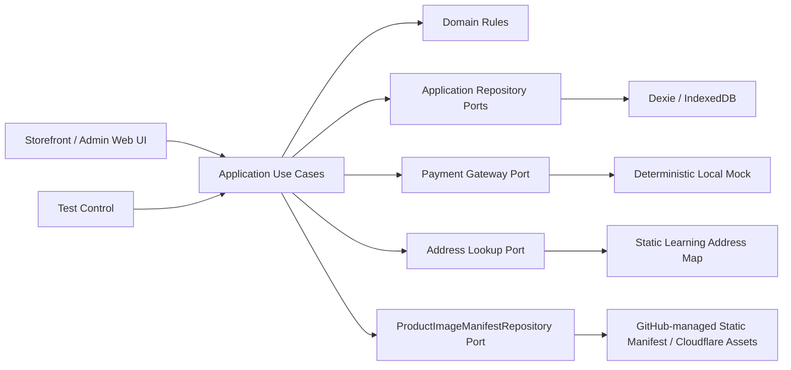
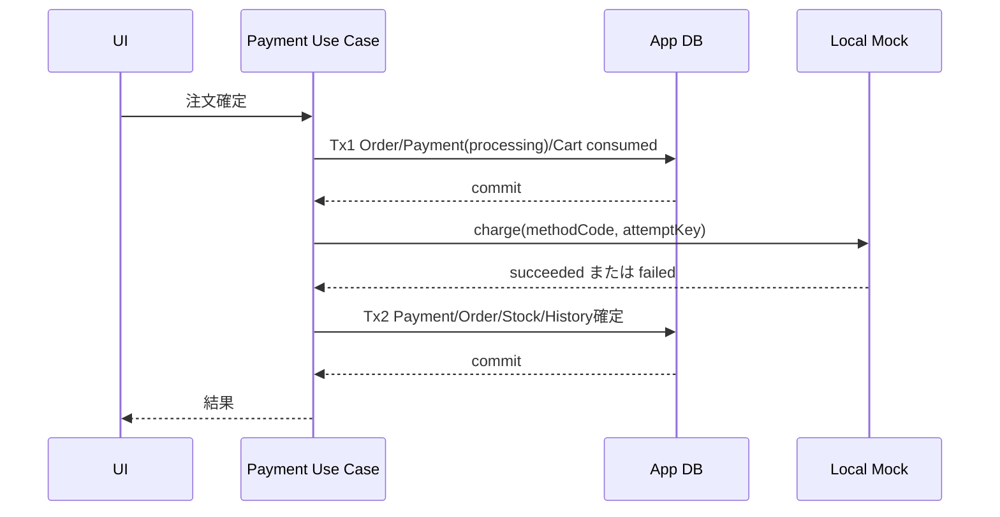

# システムアーキテクチャ

## 1. Phase 1の全体構成

Phase 1では、サーバー、API、クラウドデータベース、外部決済サービスを持ちません。

リポジトリのPort規約（Contract）はアプリケーション層の管轄として`src/application/repositories/**`に配置し、`src/application/ports.ts`ではプラットフォームや外部サービス向けのPortを管理します。

## 2. レイヤー責務

### Presentation

- ストアフロントおよび管理画面のシェル、ルーティング、画面状態、フォーム、フォーカス制御、表示メッセージ
- ユースケースの呼び出しと結果の表示
- データベースアクセス、価格計算、権限判定のロジックを直接持たない

### Application

- 認証、商品、カート、チェックアウト、決済、注文、レビューの一連の処理順序の制御
- `ApplicationTransactionRunner`を用いたトランザクション境界の制御
- ロール、所有権（Ownership）、バージョンの検証呼び出し

### Domain

- 金額（Money）、価格・送料・会員割引の計算ロジック
- 商品の閲覧条件、検索・絞り込み・ファセットのルール
- 在庫数および注文数量の制約
- 注文、決済、商品、レビューの状態遷移

### Infrastructure

- Dexieによるリポジトリ実装、管理画面概要（Admin Overview）のリードモデル
- ローカルセッション、GitHub管理の静的画像アセットカタログ
- 決定論的（Deterministic）なローカルモック決済ゲートウェイ
- 静的な住所検索（Address Lookup）、システムクロックおよびID生成器

## 3. 主要Ports

- UserRepository、SessionRepository、AddressRepository、AddressLookupService
- StorefrontCatalogQueryRepository、ProductQueryRepository、AdminProductQueryRepository、ProductRepository、CategoryRepository、BrandRepository、ReviewSummaryRepository
- CartRepository、CheckoutSessionRepository
- InventoryRepository
- OrderRepository、SequenceRepository、ShipmentRepository
- PaymentRepository、PaymentGateway
- ReviewRepository、AdminOverviewQueryRepository
- Clock、IdGenerator、PasswordHasher
- ProductImageManifestRepository（`StaticManifestRepository`が実装）
- ApplicationTransactionRunner

## 4. 状態管理

- 永続化する業務データ: リポジトリ（Repository）
- 現在のセッションID: ローカルストレージ（Local Storage）
- 画面内のフォームやダイアログ: コンポーネントの状態（Component State）
- 共有UI状態: 必要最小限のContext
- サーバー状態管理ライブラリ（Server State Library）は使用しない

## 5. 商品Aggregateと画像アセットの境界

- 商品の保存は、`ProductAggregate`（Product、Variant、ProductImageの関連付け）単位で行う。
- 既存Variantの`stockQuantity`は集約（Aggregate）の更新対象外とし、在庫調整ユースケースのみが変更する。
- ProductImageはGitHubリポジトリ内の静的アセットを`assetId`で参照し、画像バイナリはIndexedDBへ保存しない。
- 管理UIで行う操作は、アセットカタログからの選択、関連付けの解除、プライマリ画像の変更、表示順序の変更、Altテキストの変更のみとする。
- ブラウザからGitHub APIへの書き込みは行わず、画像バイナリの追加はコミットやプルリクエスト（PR）、マニフェスト生成、Cloudflareへの再デプロイを通じて反映する。
- リリース済みのアセットは、ブラウザ側での参照有無をGitHub Actions（CI）から判定できないため追記のみ（append-only）とし、廃止する場合は`isActive=false`で表現する。
- 新規の関連付けは有効なアセット（active）のみに限定する。既存の関連付けがある無効なアセット（inactive）は維持・表示可能だが、一度解除した後の再関連付けは行えない。

## 6. Phase 1における決済（Payment）境界

Payment（決済）は外部決済サービスの厳密な再現ではなく、E2Eテストを通じて成功・失敗・再試行の挙動を学ぶための決定論的モック（Deterministic Mock）です。

- ゲートウェイの呼び出し中はデータベースのトランザクションを保持しません。
- モックの実行結果は決済手段コード（Method Code）のみに基づいて決まり、同一の試行キー（Attempt Key）に対しては常に同じ結果を返します。モック側は時刻情報を返却せず、結果を受け取った後にアプリケーション層が`Clock.now()`を1度だけ取得して、Paymentの`processedAt`やOrder/Payment履歴の`createdAt`に同一の値を設定します。
- ステータスが`processing`のままアプリが再起動された場合や、確定トランザクションが失敗した場合は、同一のAttemptを再実行します。ローカルモックであるため二重課金の概念はありません。すでに`succeeded`または`failed`となっている場合は既存の結果をそのまま返し、確定処理が競合した際には最新の状態を再取得したうえで完了済みの結果を返します。
- タイムアウト、状態不明（unknown）、独立した決済台帳、および照合（Reconciliation）の仕組みはPhase 3で扱います。

## 7. トランザクション実装契約

- アプリケーション層は`ApplicationTransactionRunner.run(scope, work)`を呼び出し、Runnerが必要なDexieのストアを単一のトランザクションとして開始する。
- `work`関数に渡されるリポジトリ群は同一のトランザクションコンテキストにバインドされ、コンテキスト外のリポジトリを混在させてはならない。
- 決済ゲートウェイや住所検索などの外部I/O処理は、トランザクションの外側で実行する。画像カタログはビルド時に生成されたモジュールを静的にインポートし、必要なパスをトランザクション開始前に解決しておく。
- 複数ストアにまたがる書き込みは必ず`ApplicationTransactionRunner`から開始し、処理に参加する各リポジトリ内部で個別にトップレベルのトランザクションを開始してはならない。
- 単一ストアで完結する単純な作成・更新処理に限り、リポジトリメソッド内での単一トランザクション実行を認める。
- カテゴリーの作成時は、単一のCategoryストアのトランザクション内で現在の最大`sortOrder`を読み出し、0件であれば10、既存データがある場合は最大値+10として保存する。
- ログイン/会員登録、カート統合、チェックアウト、商品集約（Aggregate）/ステータス更新、在庫、ユーザー権限（User Access）、注文、決済、出荷、レビューの各スコープは、型付けされたマップによって定義を固定する。

## 8. 主なトランザクション一覧

| 操作 | 同一トランザクション内で更新するデータ |
|---|---|
| ログイン / 会員登録 | Session、User作成（新規登録時）、ゲスト/ユーザーのCart統合 |
| デフォルト配送先の保存・削除（単一ストア） | User Address、旧デフォルト配送先の解除または後継のデフォルト配送先設定 |
| 初回カート追加 | 対象オーナーの有効なCart（active Cart）の取得または作成、Cart Itemの加算/作成、親Cartのversion更新 |
| カート変更 | Cart、Cart Item、親Cartのversion更新 |
| 商品Aggregate・公開状態 | Category/Brand、Product、Variant、Imageの関連付け、INITIAL_STOCK履歴 |
| 商品Aggregate時刻 | ユースケースがClockを1回取得し、Product、Variant、画像関連付け、INITIAL_STOCK履歴へ同一の時刻を適用。新規作成時のみレビュー0件のReview Summaryにも適用し、更新時はSummaryを変更しない |
| Category/Brand無効化 | 該当のCategoryまたはBrand、およびそれらを参照するProduct |
| 在庫調整 | Variantの在庫数、Inventory History |
| ユーザーアクセス権（User Access） | User、対象ユーザーの全Session。customer停止時は進行中のCheckoutもabandonedに変更 |
| 注文作成 | Order、Order Items（ビルド生成カタログから事前解決した画像パスと、トランザクション内のProductImageから取得したAltテキストのスナップショットを含む）、Payment（processing）、Cart（consumed）、Checkout（converted）、Sequence、History |
| 決済成功確定 | Payment（succeeded）、Order（paid）、SKU在庫、Inventory History、Order History |
| 決済失敗確定 | Payment（failed）、Order（payment_failed）、Order History |
| 決済再試行 | Order（pending_payment）、新規Payment（processing）、Order History |
| 発送 | Order（shipped）、Shipment（shipped）、Order History |
| 配送完了 | Order（delivered）、Shipment（delivered）、Order History |
| レビュー変更 | Review、Review History、該当商品のReview Summaryおよび評価分布 |

## 9. プラットフォーム分離

Phase 1ではDexieのみを実装します。リポジトリのインターフェースはプラットフォーム非依存に保ち、Phase 2において同一のコントラクトテスト（Contract Test）にSQLiteアダプターを追加します。Webとネイティブの双方を同時に完成させるための過度な抽象化は行いません。

## 10. エラー境界

- ドメインエラー（Domain Error）: バリデーション、権限不足、不正な状態遷移、在庫不足、価格計算エラー
- リポジトリエラー（Repository Error）: 読み込み失敗、書き込み失敗、競合（Conflict）、クォータ超過
- プレゼンテーション層: 利用者向けメッセージへの変換
- 内部の例外情報（Exception）、スタックトレース、パスワード、住所の全文などを画面上へ出力しない

## 11. Clock・ID・Test Control

Clock、ID生成器（IdGenerator）、PasswordHasherはPortとして抽象化します。自動テスト用ビルド（Automation Build）では、Clockの固定、シードデータのリセット（Seed Reset）、決済遅延（Payment Delay）、固定の読み取り専用インスペクション（Read-only Inspection）のみを提供します。任意のデータベース書き換え、任意のテーブルクエリ実行、任意のスクリプト実行機能は提供しません。

## 12. Web配信

Expo WebによるSPAを、Cloudflare Pagesの単一プロジェクトへ配信します。ボット対策のBot Challenge、Turnstile、Cloudflare Accessは、自動テストの対象環境では使用しません。

## 13. 禁止事項

- UIからDexieを直接呼び出すこと
- 複数リポジトリの更新処理を別々のトランザクションに分割し、順番にコミットすること
- ブラウザにGitHub Tokenを埋め込み、管理UIから画像バイナリをGitHubへ直接アップロードすること
- 決済モックの呼び出し中にデータベースのトランザクションを保持し続けること
- 未使用の決済ゲートウェイ台帳（Gateway Ledger）、返金（Refund）、マイグレーション復旧用テーブルなどをPhase 1で作成すること
- ストアフロントと管理画面（Admin）を同一のページシェルに混在させること
- ドメイン層の内部状態名をUIへそのまま直接表示すること
- ロール（権限）判定をメニュー項目の非表示処理だけで済ませること
- 固定の待機時間（sleep）をE2Eテストの同期手段として利用すること

## 実装境界と採用ライブラリ

- プレゼンテーション層は`*Request`のみを生成し、アプリケーション層がSession、Clock、IdGenerator、GuestIdentity、ビルド時に生成されたManifestをもとに`*Command`を組み立てる。
- フォーム管理にはReact Hook Formを採用し、バリデーションにはZodを使用する。
- 共通UIにはReact NativeのStyleSheetを使用し、Web専用の管理画面やレイアウトには`.web.tsx`とCSS Modulesを組み合わせる。
- ダイアログやコンボボックスなどのアクセシビリティ対応コンポーネントは、React Aria Componentsに限定する。
- 実装開始後は、`src/domain/contracts`、`src/application/contracts`、`src/application/errors.ts`、およびDexieのスキーマ定義コードを型の正本とし、Markdownドキュメントは業務ルールの意味や設計理由の正本とする。
