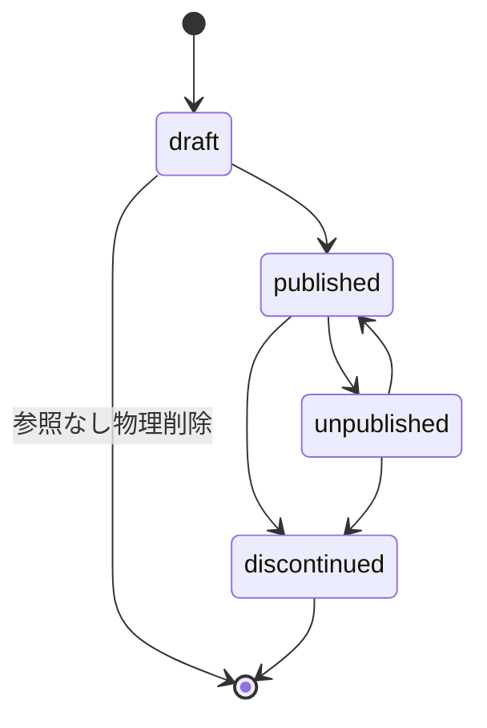
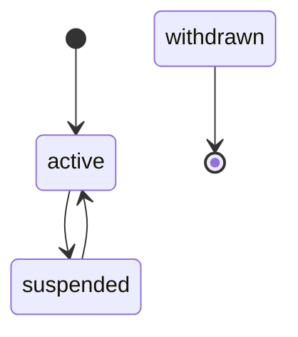
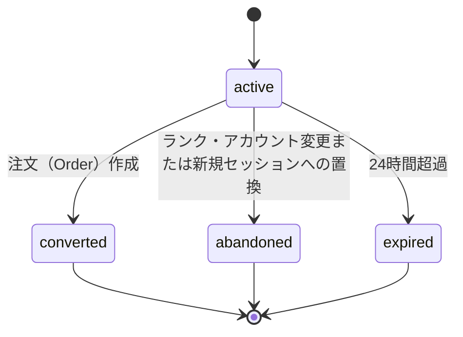
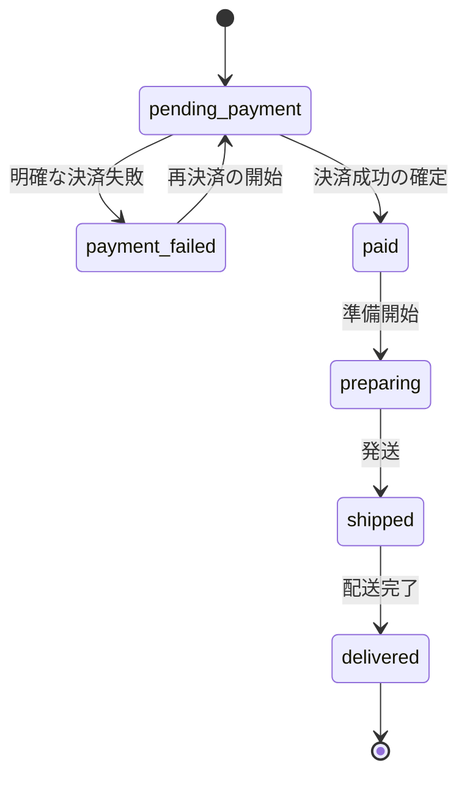
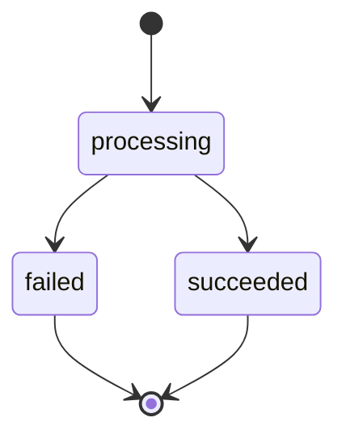
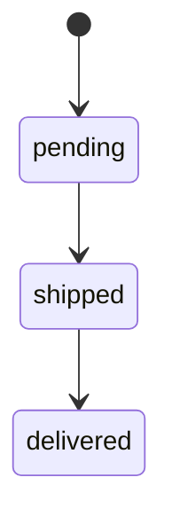
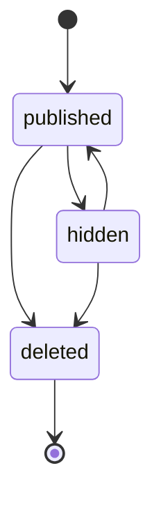
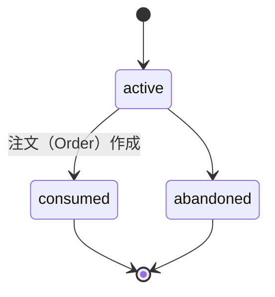

# 状態遷移設計

## 1. Phase 1

### 商品

### Account

Phase 1では、`active ↔ suspended` のみを取り扱い可能な管理操作とします。`withdrawn` は固定シードデータによる読み取り専用状態であり、退会処理に伴う状態遷移はPhase 2で対応します。

### Checkout Session

カートの変更時には、同一トランザクション内でチェックアウトセッションを更新しません。カートアイテムの変更時は親カートのバージョンのみを更新し、チェックアウトルートガード、注文確認画面の取得時、および注文確定時にセッションの `cartVersion` との不一致を検出してカート画面へ戻します。その後、チェックアウトを再開した際に、従来の `active` セッションを `abandoned` へ変更し、新しいカートバージョンのセッションを作成します。

### Order

### Payment

### Shipment

### Review

### Cart

## 2. 操作制約

- Payment が `processing` の間は、再決済やキャンセルを行えない。
- `paid` 状態の Order を直接 `shipped` へ変更することはできず、必ず `preparing` を経由する。
- Order と Shipment の状態を個別の操作で更新しない。
- Review の `deleted` は終端状態とする。
- 強制的に状態を変更するユースケースは、Phase 1 には設けない。

## 3. 将来拡張

- Phase 2: `cancelled`、`cancel_requested`、`return_requested`、`returned`、`refund_pending`、`refund_failed`、`refunded`
- Phase 3: `payment_unknown`、`reconciliation_required`

将来拡張で予定されている状態を、Phase 1 のデータベース CHECK 制約や UI に先行して追加することはありません。
