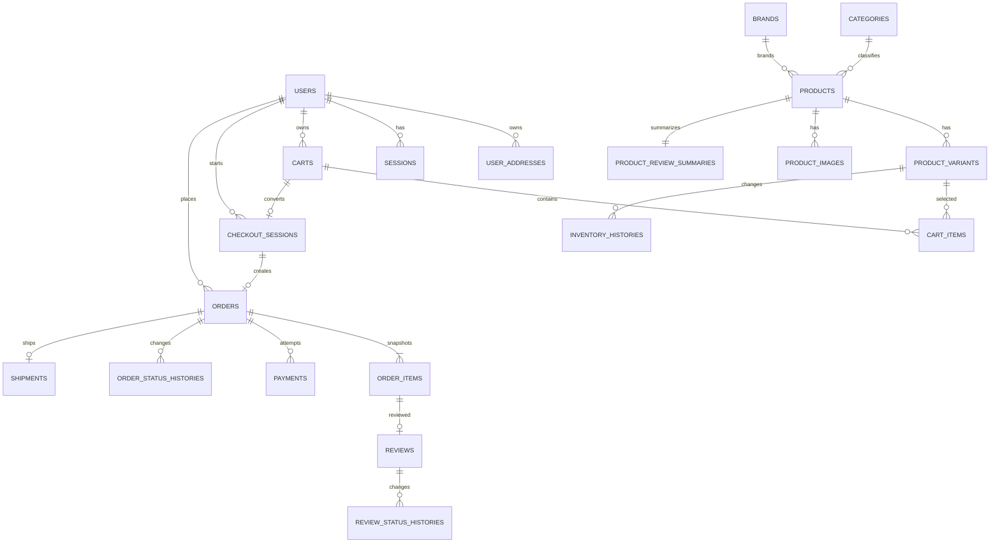

# データモデル

## 1. Phase 1 ER図

## 2. 共通規約

- IDはUUID形式の文字列とします。初期データ（Seed）のみ可読性のある固定IDを使用します。
- 日時はUTC基準のISO 8601形式文字列で保存し、画面表示時にAsia/Tokyo（日本標準時）へ変換します。
- 金額、数量、在庫数は整数で扱います。
- 更新対象のテーブルには`version`カラムを設け、更新時に値の一致を確認して楽観的ロックを制御します。
- フェーズ1で未使用の将来的なエンティティはテーブル化しません。

## 3. User・Session

### users

| Field | Rule |
|---|---|
| id | 主キー（PK） |
| email | 一意（unique）、小文字（lowercase） |
| passwordHash | `application_contracts.md`に規定するPBKDF2形式。平文保存は不可 |
| displayName | 1〜100文字 |
| phone | null許容（nullable）、ダミー値のみ |
| role | customer / operator / admin |
| membershipRank | customerは regular / gold / platinum、管理者ロールはnull |
| accountStatus | active / suspended / withdrawn |
| createdAt/updatedAt | UTC日時 |
| version | 楽観的ロック |

### user_addresses

保持項目は `id`、`userId`、`label`、`recipientName`、`postalCode`、`prefecture`、`city`、`addressLine1`、`addressLine2`、`phone`、`isDefault`、`createdAt`、`updatedAt`、`version` です。ユーザー1人あたり最大5件まで保持でき、デフォルト住所（default）は最大1件とします。最初に登録された住所は自動的にデフォルト住所となり、更新処理で単にデフォルト指定を外す操作はできません。デフォルト住所を削除した際は、`createdAt`の昇順、同一日時の場合は`id`の昇順で後継のデフォルト住所を選定します。Web版の永続化レコードでは、インデックス用として派生値 `isDefaultKey: 0 | 1` を保持します。

### sessions

保持項目は `id`、`userId`、`createdAt` です。現在のセッションID（Current Session ID）のみをローカルストレージへ保存します。

## 4. 商品マスタ

### categories

保持項目は `id`、`name`、`nameNormalized`（一意）、`sortOrder`、`isActive`、`createdAt`、`updatedAt`、`version` です。フェーズ1では1階層のカテゴリーのみを扱い、商品は1つのカテゴリーを直接参照します。新規作成時は、既存カテゴリーが0件であれば `sortOrder=10` とし、既存データがある場合は `max(sortOrder) + 10` として末尾に追加します。公開中の商品から参照されているカテゴリーは無効化できません。Web版レコードでは `isActiveKey: 0 | 1` を派生値として保持します。

### brands

保持項目は `id`、`name`、`nameNormalized`（一意）、`isActive`、`createdAt`、`updatedAt`、`version` です。ブランドの表示順は `nameNormalized` の昇順、同一値の場合は `id` の昇順で固定し、手動での並べ替えは行いません。Web版レコードでは `isActiveKey: 0 | 1` を派生値として保持します。

### products

保持項目は `id`、`productCode`（一意）、`name`、`shortDescription`、`description`、`categoryId`、`brandId`、`status`、`requiredRank`（null許容）、`variationName`（null許容）、`publishedAt`（null許容）、`createdAt`、`updatedAt`、`version` です。`publishedAt` は初回公開時に設定し、非公開化や再公開を行っても値を保持します。新着順の並びは `publishedAt` の降順とし、同一日時の場合は `productCode` の昇順とします。

### product_variants

保持項目は `id`、`productId`、`sku`（一意）、`optionValue`（null許容）、`optionValueNormalized`（null許容）、`regularPrice`、`salePrice`（null許容）、`saleStartAt`（null許容）、`saleEndAt`（null許容）、`stockQuantity`、`purchaseLimit`、`isActive`、`createdAt`、`updatedAt`、`version` です。下書き（draft）を含む商品は有効なバリアント（active Variant）を1件以上保持する必要があり、バリエーションなしの場合は有効なバリアントがちょうど1件、バリエーションありの場合は1件以上とします。既存バリアントの `stockQuantity` は商品集約（Aggregate）更新の対象外です。Web版レコードでは、`isActiveKey: 0 | 1` とともに、有効かつバリエーションなしの場合は `__SINGLE_ACTIVE__`、無効な場合は `__INACTIVE__:<variantId>` を設定する `optionScopeKey` を派生値として保持します。

### product_images

保持項目は `id`、`productId`、`assetId`、`altText`、`sortOrder`、`isPrimary`、`createdAt` です。`assetId` はGitHubで管理される静的マニフェストを参照し、商品1件あたり最大3件まで登録できます。同一商品内において `assetId` と `sortOrder` はそれぞれ一意である必要があります。画像0件の状態は下書き（draft）のみ許可され、画像が1件以上ある場合は代表画像（Primary）をちょうど1件設定します。画像バイナリはデータベースには保存しません。

### image_asset_catalog（ビルド生成TypeScriptモジュール、DBテーブルではない）

保持項目は `assetId`（一意）、`path`、`mimeType`、`width`、`height`、`bytes`、`sha256`、`defaultAltText`、`tags`、`isActive` です。GitHubリポジトリ内の画像からビルド時にTypeScriptモジュールを生成してバンドルに含めます。画像のバイナリデータはCloudflareから同一オリジンで配信され、既存商品から参照されているアセットは `isActive=false` であっても表示可能です。

### ProductListItem（Read DTO）

保持項目は `productId`、`productCode`、`name`、`brandName`、`primaryImage`、`minimumViewerUnitPrice`、`maximumViewerUnitPrice`、`hasPurchasableStock`、`hasActiveSale`、`ratingAverage`、`publishedReviewCount` です。データベースのテーブルではなく、検索クエリ（Search Query）によって生成します。

管理者向け商品一覧のRead DTOは、有効なSKUの在庫合計である `activeTotalStock` を返却し、商品単位の在庫フィルターを `0=out_of_stock`（在庫切れ）、`1～5=low_stock`（残りわずか）、`1以上=in_stock`（在庫あり）として判定します。

### product_review_summaries

保持項目は `productId`（主キー）、`publishedCount`、`ratingTotal`、`ratingAverage`、`rating1Count`、`rating2Count`、`rating3Count`、`rating4Count`、`rating5Count`、`updatedAt`、`version` です。各レーティングのカウント値は0以上とし、その合計は `publishedCount` と一致させます。`publishedCount=0` のときは `ratingAverage=0` とし、それ以外の場合は `ratingTotal / publishedCount` の計算結果を丸めずに保存し、画面表示時のみ小数第1位に丸めます。ソートやフィルターの処理でも未丸めの値を使用します。

## 5. 在庫

### inventory_histories

保持項目は `id`、`variantId`、`changeQuantity`、`beforeQuantity`、`afterQuantity`、`reasonCode`、`reasonText`、`actorUserId`（null許容）、`orderId`（null許容）、`createdAt` です。

## 6. Cart・Checkout

### carts

保持項目は `id`、`ownerType`（guest / user）、`guestId`（null許容）、`userId`（null許容）、`status`（active / consumed / abandoned）、`createdAt`、`updatedAt`、`version` です。

- 有効なユーザーカート（active User Cart）は、ユーザーごとに1件のみ保持します。
- 有効なゲストカート（active Guest Cart）は、`guestId`ごとに1件のみ保持し、`guestId`はローカルストレージに保存します。
- カートアイテム（Cart Item）が変更されるすべての操作において、親カートの `updatedAt` と `version` も同一トランザクション内で更新します。

### cart_items

保持項目は `id`、`cartId`、`variantId`、`quantity`、`unitEffectivePriceAtAdd`、`createdAt`、`updatedAt`、`version` です。同一のカートおよびバリアントの組み合わせは1件のみ保持します。保存する単価（`unitEffectivePriceAtAdd`）はセール適用後かつ会員割引適用前の価格であり、会員割引はカート表示時および注文確定時にユーザーの現在ランクから再計算します。

### CartLineDto（Read DTO）

商品名、SKU、バリエーション、画像、数量、購入可能上限、カート追加時単価、現在の割引前有効単価、現在の会員価格、行金額、問題コード（エラーコード）を保持します。データベースのテーブルではなく、カートクエリ（Cart Query）によって生成します。

### checkout_sessions

| Field | Rule |
|---|---|
| id | 主キー（PK） |
| userId / cartId | 一般顧客（customer）および有効なカート（active Cart） |
| cartVersion | チェックアウト開始時点のカートバージョン |
| addressSnapshot | 配送先住所決定後に型付きオブジェクト（Typed Object）として保存 |
| paymentMethodCode | テスト用コード。未選択時はnull |
| unlockedStep | address / payment / confirm。到達済みの最後続ステップを表し、前のステップに戻る操作を行っても減算しない |
| status | active / converted / abandoned / expired |
| expiresAt | 作成日時から24時間後 |
| orderId | converted（注文完了）後にのみ設定 |
| createdAt / updatedAt / version | 共通規約に準拠 |

ユーザーごとに保持できる有効なチェックアウトセッション（active Checkout Session）は最大1件とします。

決済ゲートウェイのキー（Gateway Key）はチェックアウトセッションには保存しません。

## 7. Order・Payment・Shipment

### orders

保持項目は `id`、`orderNumber`（一意）、`userId`、`checkoutSessionId`（一意）、`status`、`subtotalAmount`、`discountAmount`、`shippingAmount`、`totalAmount`、`membershipRankSnapshot`、`shippingAddressSnapshot`、`createdAt`、`updatedAt`、`version` です。

フェーズ1におけるステータス（status）：`pending_payment`、`payment_failed`、`paid`、`preparing`、`shipped`、`delivered`。

### order_items

保持項目は `id`、`orderId`、`lineNumber`、`productId`、`variantId`、`productCodeSnapshot`、`productNameSnapshot`、`skuSnapshot`、`variationNameSnapshot`（null許容）、`optionValueSnapshot`（null許容）、`unitEffectivePrice`（セール適用後・会員割引前）、`unitDiscountAmount`、`quantity`、`lineSubtotalAmount`、`lineDiscountAmount`、`lineTotalAmount`、`primaryImageAssetIdSnapshot`、`primaryImagePathSnapshot`、`primaryImageAltTextSnapshot`、`createdAt` です。同一注文（Order）内の `lineNumber` は1から始まる一意の値とし、カートアイテムの `createdAt` の昇順、同一日時の場合は `itemId` の昇順で採番します。計算式は `unitDiscountAmount = floor(unitEffectivePrice × ランク割引率)`、`lineDiscountAmount = unitDiscountAmount × quantity`、`lineTotalAmount = lineSubtotalAmount - lineDiscountAmount` とします。注文全体の `orders.discountAmount` は、全明細の `lineDiscountAmount` の合計値と一致させます。注文の代表画像には `lineNumber=1` の画像を使用します。注文後に商品の画像情報が変更された場合でも、注文履歴にはスナップショットとして保持されている画像パス（Snapshot Path）を表示します。

### daily_sequences

`sequenceType` と `localDate` を複合主キー（PK）とし、`currentValue` と `version` を保持します。

### order_status_histories

保持項目は `id`、`orderId`、`fromStatus`（null許容）、`toStatus`、`actorUserId`（null許容）、`reasonCode`、`createdAt` です。

### payments

| Field | Rule |
|---|---|
| id | 主キー（PK） |
| orderId | 外部キー（FK） |
| attemptNumber | 同一注文（Order）内で1から始まる試行連番 |
| methodCode | 決済方法コード（例: TEST-SUCCESS 等） |
| status | processing / succeeded / failed |
| amount | 注文合計金額（totalAmount）と一致 |
| gatewayIdempotencyKey | 一意（unique）。決済試行（Attempt）作成時に生成 |
| errorCode | 決済失敗（failed）時に設定 |
| createdAt / processedAt | UTC日時。`processedAt`はゲートウェイからの結果受領時点におけるアプリケーションクロック（Application Clock）を正本とする |
| version | 楽観的ロック |

`orderId + attemptNumber` の組み合わせを一意とします。

### shipments

保持項目は `id`、`orderId`（一意）、`status`（pending / shipped / delivered）、`carrierName`（null許容）、`trackingNumber`（null許容）、`shippedAt`（null許容）、`deliveredAt`（null許容）、`createdAt`、`updatedAt`、`version` です。

## 8. Review

### reviews

保持項目は `id`、`orderItemId`（一意）、`productId`、`userId`、`rating`、`title`（null許容）、`body`、`status`（published / hidden / deleted）、`createdAt`、`updatedAt`、`version` です。

### review_status_histories

保持項目は `id`、`reviewId`、`fromStatus`（null許容）、`toStatus`、`actorUserId`、`reasonText`（null許容）、`createdAt` です。初回のレビュー作成時に限り、`fromStatus` はnullとなります。

## 9. Settings

### app_settings

保持項目は `key`（主キー）、`valueJson`、`updatedAt` です。テスト用クロック（Test Clock）、決済遅延（Payment Delay）、シードバージョン（Seed Version）などを保存します。

### schema_metadata

保持項目は `key`（主キー）、`value`、`updatedAt` です。フェーズ1ではスキーマバージョン（Schema Version）およびシードバージョン（Seed Version）の確認に使用します。

## 10. 正本関係

| 情報 | 正本 |
|---|---|
| 商品の現在価格・在庫 | product_variants |
| 注文時点の商品・価格・住所 | order_items / orders スナップショット |
| 注文の業務状態 | orders.status |
| 決済試行（Payment Attempt）状態 | payments.status |
| 配送状態 | shipments.status |
| 商品レビュー集計 | product_review_summaries |
| チェックアウト進捗 | checkout_sessions |
| 商品画像バイナリとパス | GitHubリポジトリ / 静的画像マニフェスト（static image manifest） |
| 商品と画像の関連・表示順・代替テキスト（Alt） | product_images |

## 11. 将来Entity

- フェーズ2（Phase 2）：`order_requests`、`refunds`、`audit_logs`
- フェーズ3（Phase 3）：`gateway_transactions`、`legal_acceptances`、インポート・エクスポート用メタデータ（Import/Export Metadata）

各フェーズの開始前に、必要な項目と制約を改めて再レビューします。