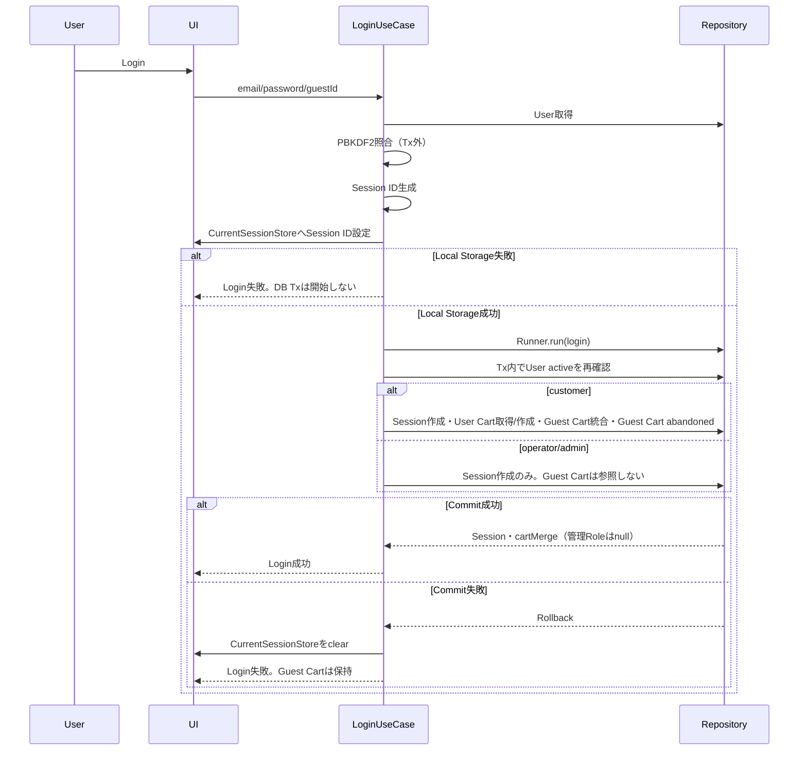
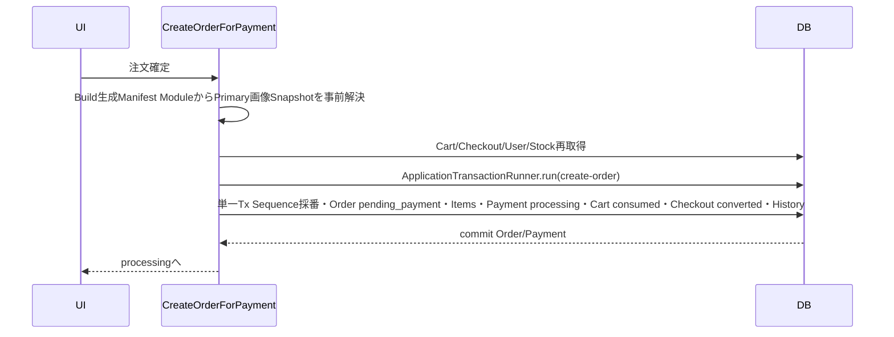
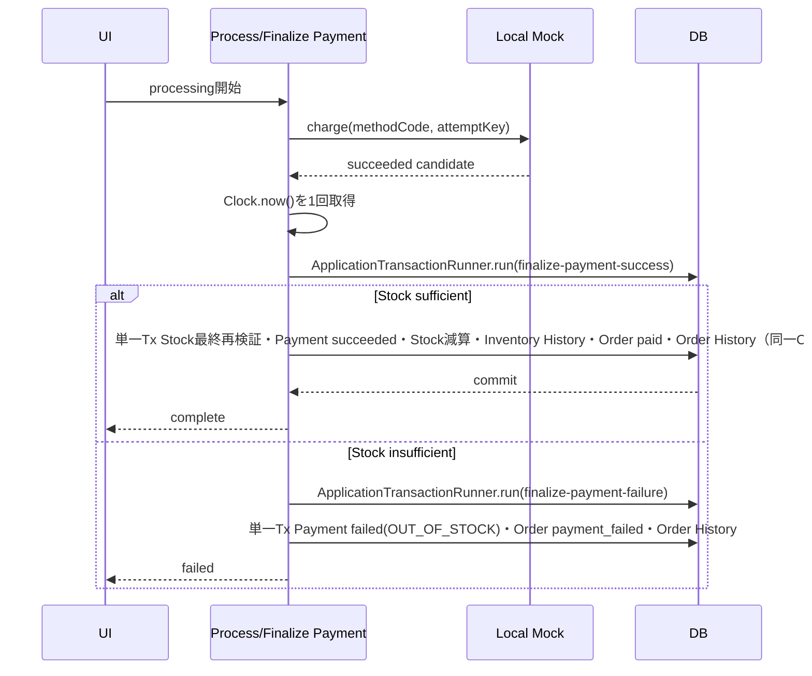
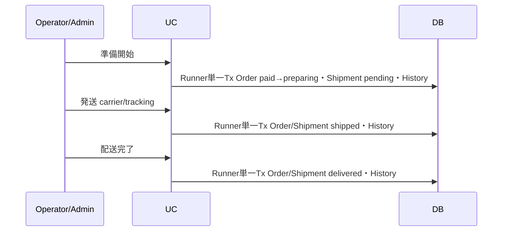
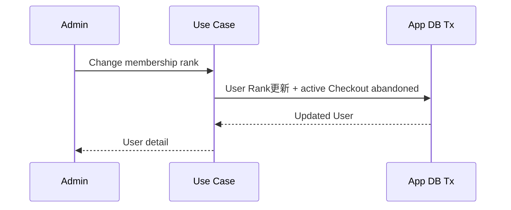

# シーケンスフロー

## 1. LoginとGuest Cart統合

## 1.1 Cart変更

1. guestまたはcustomerの種別、activeなCart、およびCartのexpectedVersionを確認する。
2. 追加（Add）の場合は追加数量、更新（Update）の場合は変更後の絶対数量として、SKU、在庫、購入上限を検証する。Updateの数量が0の場合は削除（Remove）の処理へ委譲する。
3. Addでは既存SKUへ加算するか新規IDで作成し、Updateでは指定された絶対数量へ置換する。アイテムの変更・削除・価格変更承認と、親CartのupdatedAtおよびversionの更新は、同一トランザクション（Tx）内で確定する。
4. 既存のCheckout Sessionは、このトランザクション内では更新しない。親CartのVersion変更は、Checkout Route Guard、確認画面取得時、および注文確定時における不一致の検出に使用する。
5. 競合（コンフリクト）発生時は、ItemもCartも変更せずにConflictを返す。

## 2. Checkout開始

1. Clockを参照し、期限切れとなったactiveなCheckout Sessionをexpiredへ変更する。
2. activeなcustomerおよびactiveなCartを確認する。
3. 商品の公開状態、会員ランク（Rank）、価格、在庫を再検証する。
4. 価格変更が未承認の場合はCart画面へ差し戻す。
5. 対象UserのactiveなCheckout Sessionを確認する。
6. 同じCart IDおよびVersionであればセッションを再開し、異なる場合は既存のセッションをabandonedへ変更する。
7. 必要に応じて、ステータスをactive、ステップをaddressとしてCheckout Sessionを作成する。
8. Address、Payment、Confirmの順に処理を進める。

## 2.1 商品Aggregate保存

1. operatorまたはadmin権限とProductのexpectedVersionを確認し、ユースケース内でClockから現在時刻を1回取得する。
2. Product、Variant、および画像関連の整合性を検証する。
3. 既存VariantのstockQuantityが入力値によって変更されていないことを確認する。
4. 新規VariantのinitialStockQuantityをもとに、INITIAL_STOCK履歴を作成する。
5. 削除対象として指定されたVariantの参照状況を確認し、物理削除するか無効化するかを決定する。
6. Image Asset Manifestを参照してassetIdを検証する。
7. Product、Variant、ProductImage関連付け、および必要なInventory Historyを同一トランザクションで保存し、手順1で取得した同一時刻を各エンティティのcreatedAt/updatedAtに使用する。新規商品の登録時は、0件のReview Summaryも同一トランザクション・同一時刻で作成する。商品の更新時は、既存のReview Summaryに対する読み書きは行わない。既存のinactiveなAsset関連付けは維持できるが、新規の関連付けや再関連付けはactiveなAssetのみを対象とする。

GitHub上の画像バイナリは、このシーケンスでは変更しません。

## 3. Order作成

Payment Gatewayの呼び出しは、このトランザクション内では行いません。画像パスは、ビルド時に生成されたManifestモジュールからトランザクション開始前に事前解決します。トランザクション内ではPrimaryのassetIdと事前解決済みのパスを照合し、商品固有のAltテキストは現在のProductImage関連付けから取得してOrder Itemへ保存します。

Order作成トランザクション内では、Cart Itemの追加時単価と、現在時刻に基づいて再計算した現在単価を比較します。差異がある場合は`PRICE_CHANGED`として全体をロールバックし、CartまたはCheckoutでの再確認を要求します。

## 4. Payment成功

## 5. Payment明確失敗と再試行

- モックがfailedを返した場合は、PaymentのfailedおよびOrderのpayment_failedを同一トランザクションで確定する。
- 在庫の変更は行わない。
- Order詳細画面から再試行を実行すると、`retry-payment`の単一トランザクション内でOrderをpending_paymentへ戻し、Historyの記録とともにattemptNumberを増やしたprocessing状態のPaymentを作成する。
- 新しい試行（Attempt）に対応するgatewayIdempotencyKeyを生成する。
- processing状態の処理中は、再試行やキャンセル（Cancel）のボタン・操作を表示しない。

## 6. processing再開

`/checkout/processing?orderId=...`の画面表示時、アプリやブラウザの再起動後、または決済結果確定時のDB書き込みが失敗して最新Paymentがprocessingのまま残存している場合、Orderの所有権、Orderのpending_payment状態、および最新Paymentがprocessing状態であることを確認した上で`ResumeProcessingPaymentUseCase`を実行します。同一のAttempt KeyおよびMethod Codeを用いてLocal Mockを再実行し、結果を成功または失敗として確定します。

## 7. Order処理

## 8. Review

1. 操作者が購入者（customer）本人であること、対象Orderがdelivered状態であること、および対象OrderItemが未レビューであることを確認する。
2. Reviewをpublishedステータスで作成する。
3. Product Review Summaryの件数、合計、平均、および評価1～5別の件数を同一トランザクション内で更新する。
4. 非公開化、再公開、編集、削除を行う場合も、同様にSummaryと評価分布を同時に更新する。

## 9. 在庫調整

1. 操作者がoperatorまたはadmin権限を持つこと、対象VariantのexpectedVersion、および調整理由を確認する。
2. `ApplicationTransactionRunner.run("adjust-inventory")`を開始する。
3. Variantの在庫を更新し、変更前数量（before）、変更後数量（after）、変動量（change）を持つInventory Historyを同一トランザクション内で作成する。
4. 在庫不足、競合、または履歴保存の失敗が発生した場合は、全体をロールバックする。

## 10. User Access変更

1. 操作者であるadmin本人と、変更対象となるUserの情報を取得する。
2. Rank変更はcustomer内、Role変更はoperatorとadminの間、Status変更はactiveとsuspendedの間でのみ許可する。
3. RoleまたはStatusを変更する際は、同一トランザクション内で「最後のactiveなadminが不在にならないか」および「自己変更でないか」を再検証する。
4. Userの更新と、対象Userに紐づく全Sessionの削除を同一トランザクション内でコミットする。
5. CartおよびOrderの内容は変更しない。ただし、会員ランク（Rank）を変更する場合、またはcustomerをsuspendedへ変更する場合は、対象UserのactiveなCheckout Sessionを同一トランザクション内でabandonedへ変更する。

## 11. Checkout期限切れ

アプリ起動時、Checkout Route Guard通過時、およびStartCheckout開始時に、Clockと`expiresAt`を比較し、期限を超過したactiveなSessionをexpiredへ変更します。定期タイマー（定期Timer）は使用しません。

## 12. Test Reset

Test ControlまたはTest APIからのリクエスト → 同一ブラウザコンテキスト（Browser Context）内に開いているページが1件のみであることを確認 → Dexieの接続をクローズ（Connection Close） → IndexedDBを削除 → CurrentSessionStoreを削除 → GuestIdentityStoreを削除 → DB v1スキーマを作成 → 指定されたSeedデータを投入 → Seed用のGuest IDを設定 → メタデータを返却 → ページをリロード（Page Reload）。
別のページが開いている場合や、IndexedDBの削除がブロック（delete blocked）された場合は、`RESET_BLOCKED_BY_OPEN_PAGE`エラーとして処理を中断し、成功扱いにはしません。

## 会員ランク変更

Cartの内容はそのまま保持され、customerは次回のCheckout開始時に新しい会員ランクに応じた金額を再確認します。

## Payment再開の冪等性

最新の試行（Attempt）が完了済みであれば、既存の処理結果を返します。processing状態のままであれば、同一のAttempt KeyでLocal Mockを再実行します。確定トランザクションの競合（Conflict）が発生した後は、最新のOrderおよびPaymentを再取得し、並行する他の処理によって完了済みとなっていれば同じ結果画面へ遷移します。
