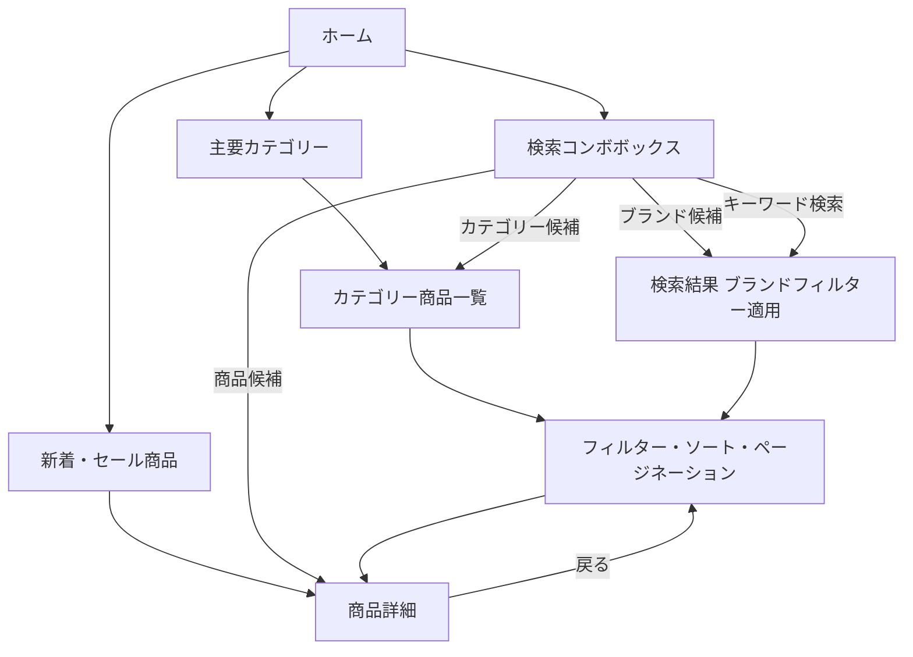
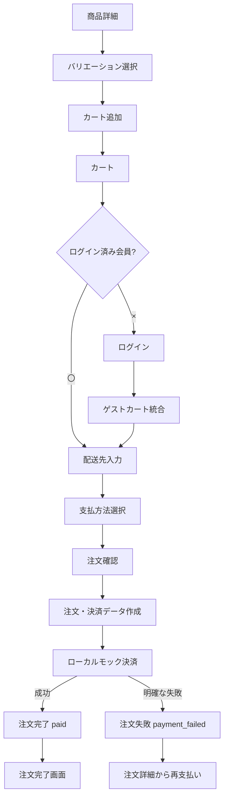
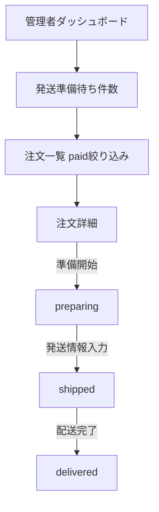
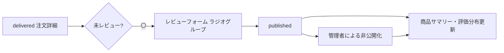

# ユーザーフロー

## 1. 商品探索フロー

検索候補からの画面遷移は、商品候補の場合は `/products/[productId]`、カテゴリー候補の場合は `/categories/[categoryId]`、ブランド候補の場合は `/search?brand=[brandId]` とし、候補を選択せずEnterキーで確定した検索は `/search?q=[正規化済み入力]` とします。

商品一覧などの検索結果画面へ戻った際は、検索クエリ、ページ番号、スクロール位置を復元します。

## 2. 購入フロー

### 2.1 商品詳細からの初回カート追加

1. ゲスト（guest）または会員（customer）がバリエーションと追加数量を選択する。
2. UIは `variantId` と `addQuantity` のみを送信する。
3. ユースケースがセッションまたはゲスト識別子（Guest Identity）からオーナー（owner）を特定する。
4. リポジトリが同一トランザクション内でアクティブなカートを取得し、存在しなければ新規作成する。
5. 同一SKUの明細が既に存在する場合は数量を加算し、存在しなければ新規明細を作成する。
6. 在庫数、購入上限数、およびシステム上限（99）を検証し、親カートの `updatedAt` と `version` を更新する。
7. 処理成功後、カートのDTOを返却する。

## 2.2 カート変更・統合フロー

- 商品の追加や数量変更によって上限を超過した場合は、数値を自動補正せず、変更前の数量を維持する。
- 数量を0にするか、削除ボタンを押下することで該当明細を削除する。
- ログイン時は会員カートを基準としてゲストカートを統合し、追加数量、上限超過数量、除外明細をSKU単位で表示する。
- ゲストカートは統合トランザクション内でステータスを `abandoned` に更新する。
- カート明細（Cart Item）を変更した際は、同一トランザクション内で親カートの `version` のみを更新し、進行中のチェックアウトセッション（Checkout Session）はその場では変更しない。ルートガード（Route Guard）、注文確認、注文確定の各フェーズでバージョンの不一致を検知してカート画面へ差し戻し、次回チェックアウト開始時に過去の旧セッションを `abandoned` に更新する。

## 3. 管理概要・注文フロー

## 4. レビューフロー

## 5. 商品管理フロー

管理者ダッシュボード（Admin Overview）または商品一覧 → 新規登録／編集 → 商品基本情報入力 → SKU追加／変更／無効化 → GitHub画像アセット選択／紐付け解除／並べ替え → 編集画面内ダイアログで未保存プレビュー確認 → コンテキスト保存バー（Contextual Save Bar）で集約（Aggregate）を保存 → 公開条件確認 → 公開（Publish）。

- 新規SKUの登録時は初期在庫数を入力し、保存時に `INITIAL_STOCK` の履歴レコードを作成する。
- 既存SKUの在庫数は商品編集フォームでは直接変更せず、在庫調整画面へ遷移して変更する。
- ステータスが `draft` かつ外部参照がない場合に限り、危険地帯（Danger Zone）エリアから商品集約を物理削除できる。
- 新規の画像バイナリはアプリケーション外部でGitHubへコミットし、再デプロイ完了後にアセットカタログ（Asset Catalog）から選択する。

## 5.1 管理者登録商品を消費者が購入するフロー

1. 管理者（admin）が商品一覧画面から下書き（`draft`）商品を新規登録する。
2. 商品コード（Product Code）、商品情報、SKU、初期在庫数、GitHub画像アセットを設定して保存する。
3. 編集画面内のプレビューダイアログで未保存内容を確認し、公開条件を満たしたうえでステータスを `published` に変更する。
4. 管理者（admin）がログアウトし、同一ブラウザコンテキスト（Browser Context）上で顧客（customer）としてログインする。
5. 顧客（customer）が検索またはカテゴリー一覧から該当商品を見つけ、希望のSKUをカートに追加する。
6. 顧客（customer）がカート内で数量変更・削除・再追加の操作を行い、チェックアウト（Checkout）で購入を完了する。
7. 再び管理者（admin）としてログインし、注文（Order）のステータスを `preparing`（準備中）、`shipped`（発送済み）、`delivered`（配達完了）へと順に進める。
8. 再度顧客（customer）としてログインし、注文詳細画面からレビューを投稿する。

このフローは、バックエンドサーバーを介さずに同一のIndexedDBを共有して動作する教材用シナリオです。異なるブラウザコンテキストや別端末間ではデータは共有されません。

## 6. カテゴリー並べ替えフロー

カテゴリー一覧 → 並べ替えモード → ドラッグまたは上下移動ボタンによる順序変更 → 未保存状態の表示 → 保存バー（Save Bar）で保存。キーボード操作を行うユーザーも上下ボタンのみで並べ替えを完了できます。なお、ブランドは名称順の昇順固定となっており、並べ替え機能は提供しません。

## 7. 在庫管理フロー

ダッシュボード（Overview）または在庫一覧 → 対象SKUの選択 → 在庫調整数および調整理由の入力 → 変更前後の数値確認 → 保存 → 在庫履歴（Inventory History）への記録。

## 8. テストフロー

テストシナリオ選択 → 状態リセット（Reset） → 仮想時刻（Clock）／遅延（Delay）設定 → 対象画面への遷移 → テスト実行 → トレース／スクリーンショット／メタデータの保存。

## 9. 将来フロー

- フェーズ2（Phase 2）: ネイティブアプリ対応、注文キャンセル、返品、返金、ゲストチェックアウトの仕様再検討。
- フェーズ3（Phase 3）: 決済状態不明／照合（Payment Unknown / Reconciliation）、リカバリー処理、データのインポート／エクスポート。
