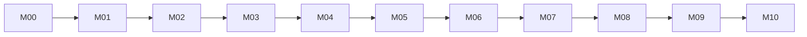

# AI協働テスト自動化カリキュラム：知識グラフ

このディレクトリは、[PR #199の設計Plan](../../plans/2026-10-16_qa-curriculum-ai-agent-redesign.md)を今後改訂するときに使う**知識と参照関係の正本**を管理します。

- [`knowledge-graph.json`](./knowledge-graph.json)：機械処理可能な基準グラフ。初版は**3フェーズ、11モジュール、51学習項目、58理解事項**を含みます。
- `scripts/training/knowledge-graph.mjs`：ID・前提関係の検証と、仕様・Skillの変更時に再確認すべき学習項目の抽出。
- [学習順序・習熟基準Plan](../../plans/2026-10-16_qa-curriculum-ai-agent-redesign_progression.md)：受講者が何を学んでLevel 2へ到達するかの説明・演習基準。

**現在の状態**：`knowledge-graph.json`はPlanの51項目から生成した初期版です。理解事項の粒度・前提関係は**確認が必要な設計案**で、教材・問題・実技や合否を検証済みとするものではありません。今後の変更履歴はGitで追跡します。

## 正本の境界

- **学習目標・知識分解・学習上の前提・参照関係**：本グラフと対応するカリキュラムPlanで保守する。矛盾した場合は一方を自動的に上書きせず、差異を確認して整合させる。
- **Scenario Shopの期待動作**：`docs/spec/`の正式仕様が正本。BR/AC・状態遷移などは製品仕様側で変更し、グラフは追従する。具体的なSeed ID等の正本は[仕様README](../../spec/README.md)に従う。
- **Agent Skillsの実装・説明**：別リポジトリ [`qa-workflow-skills`](https://github.com/ryu-yoshikawa-pro-vision/qa-workflow-skills) が正本。グラフから参照するSkillは起動確認済みとは限らない。
- **確認クイズ・演習・評価**：今後実装する個別ファイルが正本。**問題数やIDが対応しているだけで評価済み・習熟済みとはしない**。現時点では未作成なので、実在しない問題・実技をグラフへ登録しない。
- JSTQBのシラバスや問題バンクは複製・公開しない。`jstqb-learning-library`の知識分解・評価網羅の考え方のみ参考にする。

## ノードと関係

| ノードtype | 意味 | 初期状態 |
| --- | --- | --- |
| `phase` / `module` | 受講段階と学習順序 | Planで定義済み |
| `learning_objective` | M00-01等の学習目標。Level 2基準付き | 51項目はPlanで定義済み |
| `knowledge` | 学習目標を達成するための理解事項。細分化は必要な範囲だけ | 58件はレビュー前の案 |
| `test_target` | 演習に関係するScenario Shopの機能と正式仕様ファイル | ファイルは確認済み、割当は例示 |
| `skill` | 学習で使用する可能性があるAgent Skill | ファイルは確認済み、実行可否未検証 |

| 関係 | 向きと意味 |
| --- | --- |
| `part_of` | 学習目標→モジュール、モジュール→フェーズ |
| `requires` | 後から学ぶモジュール/知識→先に必要なモジュール/知識 |
| `requires_knowledge` | 学習目標→その達成に必要な知識 |
| `applies_to` | 学習目標→演習対象の候補機能。**正式な課題割当ではない** |
| `may_use_skill` | モジュール→使用候補のSkill。**実行済みとは限らない** |

学習目標と知識は通常多対多。1つの知識が複数目標へ関わる場合は重複ノードを作らない。目的や確認方法の異なる知識は分けるが、構文や単語ごとに無条件で細分化しない。

## 現時点の学習順序（概要）



これはモジュールの順序だけを示す図です。具体的な知識や依存関係・機能参照はJSONを正本とします。

## 検証と変更影響の確認

リポジトリのルートから**Node.js標準機能のみ**で実行します。これらのコマンドは読み取り専用です。

```bash
node scripts/training/knowledge-graph.mjs validate
node scripts/training/knowledge-graph.mjs impact M05-01
node scripts/training/knowledge-graph.mjs impact K-M05-06
node scripts/training/knowledge-graph.mjs impact docs/spec/features/cart.md
node scripts/training/knowledge-graph.mjs impact ryu-yoshikawa-pro-vision/qa-workflow-skills:skills/test-case-design/SKILL.md
```

- `validate`は、ノードと関係の参照、重複、モジュール・知識の前提循環、学習目標IDの学習項目表との一致、知識への接続、存在するローカル仕様ファイルを確認する。
- `impact`はグラフ上で直接参照する学習項目・モジュールを**再確認候補として表示する**。Skillを参照するモジュールについてはモジュール単位、仕様の変更については学習目標単位の候補を返す。
- コマンドは意味の正しさ、設問の評価能力、GitHub上の外部Skillの現在の実行可能性、テストのPASSを証明しない。

## 改訂手順

1. **変更元と影響を確かめる**。製品のBR/AC、Skillの入出力、学習目標・教材、評価課題のどれが変わるのかを確認する。製品仕様なら`docs/spec/change-process.md`に従い、Skillなら当該リポジトリの契約・テストを優先する。
2. `impact`で関連する学習目標・知識・モジュールを列挙し、候補以外にも呼び出し経路や未変更コードへの影響があるか実際に確認する。**グラフのつながりだけで変更を確定しない**。
3. 必要な場合にだけ、`knowledge-graph.json`の知識・関係・参照先を更新する。**既存IDは可能な限り維持**する。分割・統合・削除が必要な場合はPRに旧ID、新ID、理由、影響範囲、評価記録との対応を説明する。
4. 変更した知識に必要な**理解・適用・判断**の要求水準を確認し、教材の説明、例、クイズ、実技、Level 2基準を改訂する。**教材がある／問題を配置した／問題内容を評価できる／本人が習熟した**は別々の判定。
5. 誤答は現実に混同しやすい概念を使い、各選択肢の意味と当該条件での正誤理由を照合する。設問数や全選択肢の形式検証だけで認知レベル達成を認定しない。
6. `validate`と関係する既存検証を実行する。仕様・Skill・演習の実装を変更した場合はそれぞれのテストや再実行証拠を確認する。未検証なら状態を未確認のまま残す。
7. **明示的に変更が依頼されていない製品コード・Skill・既存回帰テストを自動で変更しない**。変更提案と反映は対象の承認範囲に従う。

## 学習用Templateへの同期と評価情報

受講者が実行する`course:load Mxx`は、教材管理側のグラフ改訂とは別処理です。**グラフの全件を受講者へ配布する必要はない**ため、現在の[同期・ロードPlan](../../plans/2026-10-16_qa-curriculum-ai-agent-redesign_distribution.md)ではグラフを同期対象へ自動追加しません。必要になった場合、モジュール名・教材との参照だけを配布許可リストで明示します。

公開グラフへ**修了課題の模範解答、非公開採点用テスト、受講者個人の評価記録、APIキー**を登録しない。問題・実技が実装された後に、それらへの参照を追加する場合も、公開情報の範囲とスキーマ変更を先に検討します。
