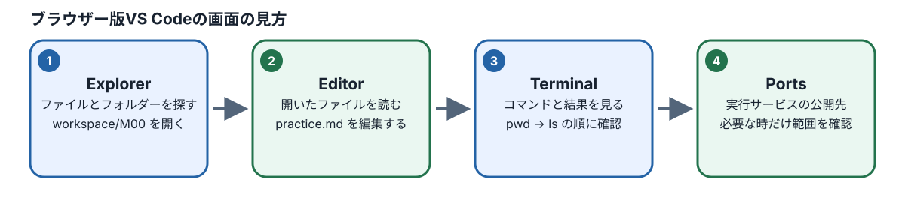
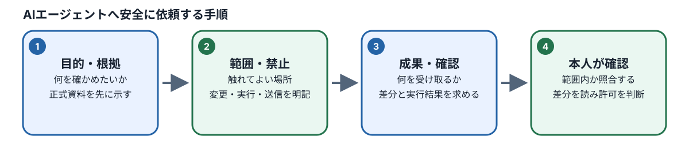

# M00：学習環境とAIの安全な利用

## この章でできるようになること

プログラミングやソフトウェアテストの経験がまったくない方でも、自分専用の安全なクラウド学習環境を立ち上げ、ファイルの作成・保存・確認といったコンピュータ操作の基礎を確実に身につけることができます。

さらに、近年急速に普及しているAIツール（AIチャットやAIエージェント）を扱うにあたり、「AIに何を依頼し、どの操作を許可してよいか」をエンジニアの視点で安全に判断できるようになります。AIの返答や自己申告を鵜呑みにせず、実際のファイルや実行結果を自分の手と目で照合して確かめるという、ソフトウェアテスト・品質保証（QA：Quality Assurance）の最も大切な基本姿勢を習得します。

この章では、複雑なプログラムコードを書く必要はありません。まずは作業画面の見方、ファイルの扱い方、コマンドの入力方法、そしてAIと安全に協働するための約束事に慣れていきましょう。

| 学習目標ID | 目標の概要 | 本章を終えたときに確認する具体的な行動 |
| :--- | :--- | :--- |
| M00-01 | クラウド学習環境の基本操作 | 自分専用のCodespaceを用意し、ファイルを新規作成・編集・保存・開き直し、ターミナルで現在位置を確認できる |
| M00-02 | AIツールの種別と権限の理解 | 通常のAIチャット、自律動作するAIエージェント、および手順書であるSkillの違いを理解し、AIに与える実行権限の範囲を説明できる |
| M00-03 | 安全なAI依頼と結果照合の実践 | 読取り専用の指示を自分で組み立ててAIに依頼し、AIの回答内容と実際のファイル記述を照合して正誤を判断できる |
| M00-04 | セキュリティと資産保全の判断 | APIキーなどの機密情報（Secret）の保護、通信ポートの公開範囲、利用枠・費用の管理、および作業成果物の保全を正しく判断できる |

## 1. 学習場所を知る

### 1.1 GitHubって何ですか？

初めてソフトウェア開発の世界に触れる方にとって、「GitHub（ギットハブ）」という言葉は聞き慣れないものかもしれません。まずは、なぜ世界中のエンジニアがこのサービスを使っているのか、身近なたとえを交えて基本から学んでいきましょう。

#### 1.1.1 GitHubは何のために使うサービスですか？

**GitHub（ギットハブ）**は、プログラムのソースコードや仕様書、マニュアルなどのテキストファイルを、インターネット上で安全に保管・共有・管理するためのクラウドサービスです。世界中の数千万人に及ぶエンジニアや企業が、日々の開発業務で利用しています。

たとえば、学習や仕事を進める中で「説明書が5つ、練習用のプログラムが3つ、設定ファイルが2つ」あるとします。これらをメールやチャットツールの添付ファイルでやり取りしていると、次のようなトラブルが頻繁に起こります。

- 「どれが最新版のファイルか分からなくなってしまった」
- 「相手が編集した部分と、自分が編集した部分が重複して上書きで消えてしまった」
- 「必要なファイルが1つだけ添付から抜け落ちていた」

GitHubを使うと、プロジェクトに関係するすべてのファイルをインターネット上の一箇所にまとめて保管できます。さらに、「誰が・いつ・どのファイルの・どの行を変更したのか」という記録（変更履歴）を追跡することが可能です。

> **身近な例えで考える**
> 学校やオフィスの「共有キャビネット」をイメージしてください。先生やチームリーダーが用意した公式テキスト、課題用紙、提出用テンプレートがキャビネットの中に整理して保管されており、鍵を持つ人ならいつでも必要なときに取り出せる場所です。
> さらにGitHubは単なる棚ではなく、「過去のすべての版（バージョン）の書類が、変更理由メモ付きで奥に保管されている賢いキャビネット」のようなものです。

ただし、初心者が最も勘違いしやすい重要な注意点があります。**「手元の作業部屋で書類を書き換えて机の引き出しにしまっただけでは、共有キャビネットの中身は一切更新されない」**という点です。手元のファイルを編集・保存しただけでは、GitHub上の履歴に自動的に記録されるわけではありません。手元の変更を正式な履歴として記録し、共有キャビネット（GitHub）へ送り届けるための操作（Git操作）は、後の章（M08）で詳しく学びます。

#### 1.1.2 「閲覧」と「編集」の違い

ここで、エンジニアとして活動する上で極めて大切な原則を整理しておきましょう。
それは、**「WebブラウザでGitHub上のファイルを読んだこと」と、「自分の作業環境でファイルを編集・保存したこと」は完全に別である**という点です。

インターネット上のニュースサイトやブログ記事を読んだからといって、自分のパソコンの中にその記事ファイルが保存されたり、記事の内容が書き換わったりしないのと同じです。GitHub上の画面で文字を目で読んだだけでは、自分の手元にファイルを作成したことにも、課題を提出したことにもなりません。

#### やってみよう（リポジトリの閲覧）

まずは、見るだけの「閲覧」操作を行ってみましょう。

1. 案内された教材用GitHubページのWebアドレス（URL）を、普段使っているWebブラウザ（ChromeやEdgeなど）で開きます。
2. 画面左上に表示されているリポジトリ名（例：`qa-training-store` など）を確認します。
3. 画面中央に並んでいるファイル一覧の中から `README.md` というファイルを探し、クリックして開きます。
4. ファイルの最初の見出しや文章を声に出して読んでみましょう。

※この閲覧操作だけでは、ファイルの編集や削除、新規作成は一切行われません。また、利用料金（課金）が発生することもありません。もし指定されたページが見当たらない場合は、無関係なページを探し回るのではなく、案内されたURLが正しいか、アカウントに必要なアクセス権限が付与されているかを講師や管理者に確認してください。

#### 理解確認

**問い**：GitHub上にある教材ファイルをブラウザで読みました。これだけで、自分の課題ファイルを提出したことや、自分の変更履歴を新しく記録したことになりますか？

**解答と解説**：
**いいえ、なりません（×）。**
Webブラウザで文章を読む操作は、あくまでサーバーにあるデータを画面に表示した「閲覧」にすぎません。自分自身の学習記録としてファイルを書き換えて保存したり、課題を提出したりするには、この後で学ぶ作業環境（Codespace）を使った別の操作が必要です。

### 1.1.3 リポジトリって何ですか？

GitHubを利用していると、**Repository（リポジトリ）**という言葉が必ず登場します。

#### リポジトリの定義と役割

リポジトリとは、英語で「貯蔵庫」「保管場所」を意味する言葉です。ソフトウェア開発においては、**「1つのプロジェクトや1つの教材に関連するすべてのファイル群と、その変更履歴をひとまとめにして保管する専用の箱（入れ物）」**を指します。

パソコンで書類を整理するときに使う「フォルダ」と似ていますが、リポジトリには通常のフォルダにはない強力な特徴があります。それは、ファイルそのものだけでなく、「誰が・いつ・どのような理由で・どこを変更したか」という過去から現在までの履歴データ（Gitの履歴）がすべて丸ごと含まれている点です。

#### フォルダとリポジトリの違い

リポジトリという大きな箱の中には、ファイルを分類・整理するために複数の「フォルダ（ディレクトリ）」が作られます。たとえば、今回の学習環境では次のような構造になっています。

```text
学習用リポジトリ（プロジェクト全体の大きな箱）
├── README.md              ← 教材全体の説明書
├── docs/                  ← 仕様書やカリキュラムなどの公式文書フォルダ
└── workspace/             ← 受講者のみなさんが実際に手を動かして演習を行う作業フォルダ
    └── M00/               ← M00モジュール専用の練習スペース
```

ここで注意したいのは、`docs/` や `workspace/` は**リポジトリの中にある特定のフォルダ（小部屋）**であり、リポジトリそのものではないということです。リポジトリは、これらすべてを内包している一番外側の枠組みです。

※上記の図はフォルダの階層関係を直感的に理解するための模式図です。実際にどのようなファイルが存在するかは、後ほどエディタ画面のファイル一覧（Explorer）で自分の目で確かめます。

#### やってみよう（リポジトリ内のフォルダを確認する）

1. ブラウザ上のリポジトリ画面で、ファイル一覧にある `docs` フォルダをクリックして開きます。
2. フォルダの中に入っているファイルの一覧が表示されることを確認します。
3. 画面上部に表示されている「リポジトリ名 > docs」といったリンク（パンくずリスト）や、ブラウザの「戻る」ボタンを使って、リポジトリの最上層（ルート）に戻ります。
4. 今見ているリポジトリの正確な名前を手元のメモ帳などに控えておきましょう。

### 1.1.4 Codespacesって何ですか？

GitHub上で教材のファイルを見られるようになりました。しかし、実際にテスト自動化のプログラムを実行したり、Webサイトを動かしたり、演習課題のファイルを新しく作成して編集したりするには、それらを処理するための「コンピュータ環境」が必要です。

#### 自分のパソコンにソフトをインストールしなくてよい仕組み

通常、プログラミングやテスト自動化をゼロから学ぶには、自分のパソコンに何種類もの専門ソフトウェアをインストールし、環境変数や通信設定などの複雑な初期設定を行わなければなりません。しかし、受講者それぞれのパソコン環境（Windows、Mac、OSのバージョン、すでにインストールされているソフトなど）の違いによって、思わぬエラーが発生し、学習を始める前に何日もつまずいてしまうことが多々あります。

そこで利用するのが **GitHub Codespaces（コードスペース）** です。
Codespacesは、ブラウザからログインするだけで、あらかじめテスト自動化や演習に必要なツールがすべてセットアップされた「仮想の開発用コンピュータ（クラウド作業環境）」を、クラウド上に自動で用意してくれる仕組みです。高性能なパソコンを自分で持っていなくても、一般的なブラウザさえ動けば、誰でもまったく同じ安定した環境で学習をスタートできます。

主要なツールの関係性を整理すると、次のようになります。

- **GitHub**：プロジェクトのファイルと履歴をクラウド上で保管・管理・共有するWebサービス。
- **リポジトリ**：GitHubの中で、1つのプロジェクトに属するファイル群をまとめた保管場所（大きな箱）。
- **Codespace**：そのリポジトリのファイルを開き、編集し、プログラムを実行するためのクラウド作業環境（仮想コンピュータ）。
- **VS Code（Visual Studio Code）**：Codespaceの中でファイルを編集したり、コンピュータに命令を出したりする際に画面上で操作する高機能な作業台（エディタ）。

#### 重要な注意点：Codespaceの保存と停止

Codespaceを使い始めるにあたり、初学者が最も誤解しやすい重要なポイントが2つあります。

1. **Codespace内でファイルを保存しても、GitHub上の履歴（コミット）に自動で記録・共有されるわけではありません。**
   エディタ上で保存（Ctrl+S / Cmd+S）する操作は、あくまで「そのCodespaceというクラウド上の作業部屋のハードディスクに書き込んだ」状態にすぎません。全世界に公開されたり、GitHub本体の履歴に反映されたりしたわけではありません。
2. **Codespaceを停止（Stop）する操作も、GitHubへ変更を送信・記録する操作ではありません。**
   停止は、部屋の電気を消してパソコンを休止（スリープ）させるような操作です。作業部屋を休止させても、書類が共有キャビネット（GitHub）へ自動配送されるわけではありません。

作業成果物をどのように安全に保全・提出するかは、受講開始ガイドの手順に必ず従ってください。また、Codespaceはクラウド上のコンピュータを動かす仕組みであるため、利用時間に応じた枠（無料枠や組織の割り当て枠）が存在します。無駄な消費を防ぐための確認手順を次節で学びます。

#### 理解確認

**問い**：次の3つの操作を、「閲覧」「作業」「停止」のどれに該当するか分類してください。

1. ブラウザでGitHubのリポジトリページを開き、画面上で `README.md` を読んだ。
2. Codespace上のVS Codeで、練習用ファイルに文章を入力してキーボードで保存操作（Ctrl+S / Cmd+S）を行った。
3. その日の学習を終えるため、管理画面で対象Codespaceの「Stop Codespace」を押した。

**解答と解説**：
1 は「閲覧」、2 は「作業」、3 は「停止」です。
どれか1つを行ったからといって、GitHubのリモートリポジトリに新しい変更履歴（コミットやプッシュ）が自動的に永久保存されるわけではない点に注意しましょう。

### 1.2 自分の環境を作る前の確認

Codespaceを起動する前に、意図しない利用枠の浪費や設定ミスを防ぐため、必ず以下のチェック項目を確認します。

#### テンプレートから作成する場合の注意

管理者から「受講者専用の個人リポジトリ（あなたのアカウント名がついたリポジトリ）」があらかじめ案内されている場合は、そのリポジトリを使用します。
もし「テンプレートリポジトリから各自で作成してください」という指示がある場合は、必ずテンプレート画面の右上の緑色のボタン **Use this template → Create a new repository** を選び、公開設定として **Private（非公開）** を選択して自分専用のリポジトリを作成してください。Public（公開）にしてしまうと、演習の回答や作業内容がインターネット上の誰からでも見えてしまうためです。

#### 作成時の5大チェックリスト

自分のリポジトリ画面で緑色の **Code** ボタンを押し、**Codespaces** タブを開きます。「New with options」や新規作成の画面で、次の5点を必ず1つずつ指差し確認します。

```text
【Codespace 作成前 5大チェック】
 1. 対象リポジトリ   : 自分の学習用個人リポジトリになっているか？
 2. 支払い責任者     : 想定した本人、または受講を許可された組織（Organization）か？
 3. マシン種別       : 「2-core」（2コアCPU）が選択されているか？
 4. 利用可能枠       : 無料利用枠または組織から許可された枠の範囲内か？
 5. コンテナー設定   : 案内された所定の開発コンテナー（devcontainer）が選ばれているか？
```

1. **対象リポジトリ**：作成対象が自分自身の学習リポジトリになっていること（教材の元の配布元リポジトリで直接作ろうとしていないこと）。
2. **支払い責任者（Owner）**：画面に表示される支払者情報が、想定した本人、または受講を許可された組織（Organization）になっていること。
3. **マシン種別**：マシンの性能として **2-core**（2コアCPU / 4GBメモリ等）が表示され、それが選択されていること。
4. **利用可能枠**：無料利用枠の範囲内であるか、または許可された利用枠が確認できること。
5. **コンテナー設定**：案内された所定の開発コンテナー設定（devcontainer）が適用されていること。

> **警告：確認が取れないときは作成を中止する**
> 「2-coreが選択肢に出てこない」「支払者の表示が意図したものと違う」「利用枠の条件が分からない」という場合は、独断で4-coreや8-coreなどの上位スペックを選んで作成してはいけません。思わぬ課金トラブルを防ぐため、作業を一度中断し、必ず管理者に確認してください。

### 1.3 VS Codeの四つの場所



Codespaceが起動すると、ブラウザの画面いっぱいに **VS Code（Visual Studio Code）** というエディタ画面が表示されます。未経験の方はボタンやパネルの多さに圧倒されるかもしれませんが、このカリキュラムで日常的に使う場所は主に**4つ**だけです。

```text
+------------------+----------------------------------+
| 1. Explorer      | 2. Editor                        |
|   (エクスプローラー) |   (エディター：ファイルを編集)       |
|                  |                                  |
|   ファイルや       |   文章やコードを読んだり         |
|   フォルダを探す   |   書き換えたりするメイン画面     |
|                  +----------------------------------+
|                  | 3. Terminal (ターミナル: コマンド) |
|                  |   コンピュータに文字で命令を出す |
|                  +----------------------------------+
|                  | 4. Ports (ポート: 接続確認)       |
|                  |   動いている画面の公開範囲を確認 |
+------------------+----------------------------------+
```

| 画面の場所 | 日本語名称 | ここは何をする場所ですか？ | 本章（M00）で行う操作 |
| :--- | :--- | :--- | :--- |
| **Explorer** | エクスプローラー | プロジェクト内のファイルやフォルダを一覧で探し、開く場所 | `workspace` や `M00` フォルダを展開し、練習ファイルを選択する |
| **Editor** | エディター | 開いたファイルの内容を読んだり、文章を書き込んだりする場所 | `practice.md` などのテキストを入力・編集・保存する |
| **Terminal** | ターミナル | コンピュータに対してキーボードで命令（コマンド）を直接入力し、結果を見る場所 | `pwd` や `ls`、`pnpm course:load M00` を入力して実行する |
| **Ports** | ポート | Codespace内で起動しているWebサービスやツールの公開範囲を確認する場所 | テスト用ポート（6080など）の公開範囲がPrivateであることを確認する |

#### 迷子にならないためのアドバイス

ウィンドウの幅やブラウザの拡大率によって、これらのパネルが下部に移動したり、アイコンの中に折りたたまれたりすることがあります。「画面の左上にあるはず」「右下にあるはず」といった**画面上の位置だけで覚えず、アイコンの形状や名称（上部メニューの View からいつでも開けること）で探す**習慣をつけてください。

## 2. ファイルとコマンドを扱う

### 2.1 ファイル名とパス

#### 画面とファイルの基本

コンピュータの中で、特定のファイルがどの場所（フォルダ）にしまわれているかを示す「住所」のことを、**パス（Path）** と呼びます。

たとえば、`workspace/M00/practice.md` という表記を見てみましょう。

- `workspace`：一番外側にある作業用フォルダの名前
- `/`（スラッシュ）：フォルダとフォルダ、またはフォルダとファイルを区切る記号
- `M00`：`workspace` フォルダの中にある、M00専用のサブフォルダの名前
- `practice.md`：ファイルそのものの名前
- `.md`（拡張子）：ファイル名の末尾につき、ファイルの種類を表す目印（`.md` は Markdown形式の文書であることを表します）

#### ターミナルで現在地を確認する

**Terminal（ターミナル）**は、マウスでアイコンをクリックする代わりに、キーボードで文字列（コマンド）を打ち込んでコンピュータに直接指示を出す画面です。

ターミナルでコマンドを実行するとき、コンピュータは常に「いま自分が作業部屋のどのフォルダの中に立っているか（カレントディレクトリ / 現在の作業ディレクトリ）」を基準にしてファイルを探します。

VS Codeの下部にある **Terminal** パネルをクリックして文字が打てる状態にし、以下のコマンドを入力してキーボードの `Enter` キーを押してください。

```bash
pwd
ls
```

1行目の `pwd` を入力して `Enter` を押し、表示された結果を確認したら、2行目の `ls` を入力して `Enter` を押します。

- **`pwd`（Print Working Directory：作業ディレクトリの表示）**：「いま自分がどのフォルダにいるか」の正確な絶対住所を表示するコマンドです。
- **`ls`（List：一覧表示）**：「いま自分が立っているフォルダの中に、どんなファイルやフォルダがあるか」を一覧表示するコマンドです。

たとえば、リポジトリの最上層（ルートディレクトリ）にいる状態であれば、`ls workspace/M00` と指定することで、離れた場所にあるフォルダの中身を確認できます。しかし、ターミナルですでに `workspace/M00` の中へ移動していた場合、同じように `ls workspace/M00` と入力すると、「そんなフォルダはありません（No such file or directory）」とエラーになってしまいます。

コマンドを実行してエラーが出たときは、慌てて同じコマンドを何度も入力するのではなく、**まず `pwd` を実行して「いま自分はどこにいるのか」を確かめる**ことがエンジニアの鉄則です。

### 2.2 最初の教材を読み込む

ターミナルがリポジトリのルート（最上層）を指していることを `pwd` で確認したら、M00の演習ファイルを配置するための専用コマンドを実行します。

```bash
pnpm course:load M00
```

- **`pnpm`（ピーエヌピーエム）**：プロジェクトに必要なツールやスクリプトを管理・実行するためのパッケージ管理ツールです。
- **`course:load M00`**：このカリキュラム用に作られた命令で、M00に必要な演習用ファイルや提出用テンプレートを自動で準備してくれます。

コマンドを実行すると、教材システムが `workspace/M00/` フォルダの中に必要なファイルを自動で配置します。まだ自分でプログラムを書く必要はありません。

コマンドの処理が終わったら、ターミナルに表示されたメッセージを最後まで読み、さらに画面左側の **Explorer（エクスプローラー）** パネルを開いて、`workspace/M00/submission.md` というファイルが実際に作られているかを目視で確認してください。

> **大切な習慣：画面の文字だけで安心しない**
> ターミナルに「成功（Success）」と表示されても、それだけで作業完了と思い込んではいけません。エクスプローラーを開き、目的の場所に本物のファイルが存在するかを自分の目で必ず確かめましょう。
> もしエラーが表示された場合は、エラー文を落ち着いて読み、「現在位置（pwd）がルートからずれていないか」「スペルミスがないか」を確認します。原因が分からないまま関連ファイルを勝手に削除したり、無理に別名で作り直したりしてはいけません。

### 2.2.1 フォルダの階層と相対パスを実際に確認する

`workspace/M00/practice.md` という住所は、フォルダが階層構造（入れ子構造）になっていることを表しています。次の図で関係性を確認しましょう。

```text
qa-training-store/                 ← リポジトリのルート（一番外側のフォルダ）
├── package.json                   ← プロジェクト全体の設定ファイル
├── docs/                          ← ドキュメントフォルダ
└── workspace/                     ← 親フォルダ（M00から見て一つ上）
    └── M00/                       ← 子フォルダ（作業スペース）
        ├── submission.md           ← ロード後に自動配置される提出用ファイル
        └── practice.md             ← これから自分で作成する練習ファイル
```

フォルダの階層を家やオフィスに例えると、`workspace` は `M00` の**親フォルダ（上の階）**であり、`M00` は `workspace` の**子フォルダ（部屋）**です。

- **相対パス**：自分が「いま立っている場所」を基準にして目的地を指定する書き方です。
  例：ルートに立っているときの `workspace/M00`。
- **絶対パス**：コンピュータの根元の階層（先頭の `/`）からすべてのフォルダ名を省略せずに指定する書き方です。Codespaceでの実際の絶対パスは `pwd` コマンドで確認できます。
- **`.`（ドット1つ）**：「いま立っている現在のフォルダ」を表す特別な記号です。
- **`..`（ドット2つ）**：「いま立っているフォルダの親フォルダ（1つ上の階層）」を表す特別な記号です。
- **`cd`（Change Directory：ディレクトリの移動）**：ターミナルの作業場所を別のフォルダへ移動するコマンドです。

> **注意：エディタとターミナルは別物**
> `cd` コマンドでターミナルの現在位置を移動しても、VS CodeのEditor（上半分）で開いているファイルは自動的に切り替わりません。エディタの表示とターミナルの現在位置は、それぞれ独立して動いています。

#### 手順付き練習：あえて場所を間違えて原因を調べる

パスの仕組みを深く理解するために、あえてエラーを起こして原因を突き止める練習を行ってみましょう。
この練習では**ファイルの削除や変更は一切行いません**。安心して手順通りに進めてください。最初に `pnpm course:load M00` が完了しており、ルートにいることを確認してから開始します。

1. ルートのTerminalで `pwd` を実行し、現在位置がリポジトリ直下であることを確認します。続けて `ls workspace/M00` を実行し、フォルダが存在することを確認します。
2. ターミナルで `cd workspace/M00` と入力して `Enter` を押し、作業フォルダの中へ移動します。
3. `pwd` を実行します。表示された住所の末尾が `/workspace/M00` に変わっていることを確認します。
4. その状態で、あえて **`ls workspace/M00`** と入力して `Enter` を押します。
   通常は `ls: cannot access 'workspace/M00': No such file or directory`（そんなファイルやディレクトリはありません）とエラーが表示されます。**ここではエラーになることが練習の目的です。** 失敗してもファイルが消えたわけではありません。
5. 続けて、その場所で単に `ls` とだけ入力して実行します。今いる `M00` フォルダの中身（`submission.md` など）が正しく表示されます。さらに `ls .` と入力しても、同じく現在地の内容が表示されることを確認します。
6. `cd ..` と入力して実行します。1つ上の親フォルダである `workspace` へ移動します。`pwd` で現在地を確かめたら、もう一度 `cd ..` を実行して、リポジトリの最上層（ルート）へ戻ります。
7. 最後に `pwd` と `ls package.json` を実行し、正しくルートへ戻ってきたことを確認します。もし `package.json` が見つからない場合は**そこで操作を止め**、`pwd` の出力文字列とExplorerのフォルダツリーを見比べて、自分が今どこにいるのかを確認してください。位置が分からないまま `pnpm` などのコマンドを実行してはいけません。

**解答と詳しい解説**：

- 手順4でエラーになった理由：すでに `M00` フォルダの中に立っているのに、さらにその中に `workspace/M00` というフォルダを探そうとしたためです。「東京都千代田区の中にいるのに、さらにその住所の中に東京都千代田区を探そうとした」ような状態です。
- 手順5で表示できた理由：基準となる現在地（`.`）そのものを指定したため、正しく中身が表示されました。
- `cd ..` を2回行った理由：`M00` から `workspace` へ戻るのに1回、`workspace` からルートへ戻るのに1回、合計2階層をさかのぼる必要があったためです。

**別条件の問題**：もしターミナルの現在地が `workspace` フォルダにあるとき、子フォルダである `M00` の中身を一覧表示するための相対パスはどう書きますか？
**解答**：`ls M00` です。ルートにいたときの `ls workspace/M00` をそのまま入力しても、基準となる現在地が1階層深くなっているためエラーになります。

この練習で使うのは `cd`、`pwd`、`ls` などの安全な情報確認コマンドだけです。万が一操作に迷っても、`git clean`、`rm`、`git reset --hard` などの破壊的なコマンドで無理やり片付けようとしてはいけません。

### 2.3 ファイルを一つ作る

ファイルの新規作成と保存の確実な手順を体験するため、実際に練習用ファイルを1つ作成してみましょう。

#### 手順

1. **作成場所を選ぶ**：画面左側のExplorer（エクスプローラー）で `workspace` フォルダの左にある小さな矢印（またはフォルダ名）をクリックして中身を展開し、その中にある `M00` フォルダをクリックして選択状態（ハイライト表示）にします。
2. **ファイルを新規作成する**：`M00` フォルダを右クリックして「New File（新規ファイル）」を選ぶか、フォルダ名にマウスを合わせたときに表示される新規ファイルアイコンを押し、入力欄に `practice.md` と半角英数字で入力して `Enter` キーを押します。
3. **内容を入力する**：画面右側のEditor（エディター）画面に新しいタブが開き、文字が入力できる状態になります。エディターの中に「今日はファイルを保存しました。」と日本語で入力してみましょう。
4. **保存する**：キーボードの `Ctrl + S`（Macをご利用の方は `Cmd + S`）を押して保存します。画面上部にあるファイル名タブの右端についていた「未保存を示す白い丸印（●）」が消えて、通常のファイル名表示（または ×印）に戻ったことを確認します。
5. **一度閉じて開き直して確認する**：Explorerで別のファイル（例：`submission.md`）をクリックして表示を切り替えます。その後、もう一度 `practice.md` をクリックして開き直します。先ほど入力した「今日はファイルを保存しました。」という文章が消えずにそのまま残っていることを確かめます。
6. **結果を記録する**：`workspace/M00/submission.md` を開き、確認した事実（作成したファイル名、保存先パス、開き直しても文字が保持されていた事実）を所定の欄に記録します。

#### なぜ一度閉じて開き直すのか？

エディタの画面上に文字がきれいに見えていても、コンピュータの世界では「パソコンの一時的な記憶領域（メモリ）の上だけに文字が存在し、ストレージ（ディスク）にはまだ書き込まれていない」という状態が起こり得ます。
一度エディタの表示を別のファイルへ切り替えてから再度開き直しても文字が残っていれば、少なくともそのCodespaceの仮想ディスクに確実に書き込まれたことが客観的に証明できるからです。

### 操作練習：保存できたことを自分で証明する

**目的**：ファイルが確実に保存されたことを確認する一連の手順を自力で再現し、ターミナルの現在位置とエクスプローラーの表示を照合できるようになる。

**準備**：`pnpm course:load M00` が完了しており、Explorer上で `workspace/M00/` が見えている状態にします。

#### 実践ステップ

1. Explorerで `workspace/M00/` フォルダの中に、新しく `notes.md` というファイルを作成します。
2. ファイルの1行目に「操作した場所：workspace/M00」、2行目に「確認した方法：保存後に開き直して内容を確認した」と入力し、キーボードで保存操作（Ctrl+S / Cmd+S）を行います。
3. ファイルタブの未保存マーク（白い丸印）が消えたことを確認したら、別のファイルを開き、再度 `notes.md` を開き直して2行の文章が消えずに残っていることを目視で確認します。
4. ターミナルをクリックし、まず `pwd` を実行して現在の作業位置を確認します。もしリポジトリの最上層（ルート）にいる場合は、`ls workspace/M00` を実行して、一覧の中に自分が作った `notes.md` が表示されることを確認します。
5. `workspace/M00/submission.md` の所定欄に、作成したファイル名、保存確認の結果、およびターミナルで確認した現在位置の文字列を正確に記入します。

#### 理解確認問題

**問い**：Editor画面で文章がきれいに見えていますが、ファイルタブの右端には白い丸印が付いています。この状態を「保存完了」と判断して作業を終えてよいでしょうか？

**解答と解説**：
**いいえ、判断してはいけません（×）。**
丸印がついている状態は、まだ編集内容がパソコンの一時記憶（メモリ）の上にあるだけで、ディスクには書き込まれていません。このままブラウザを閉じたりCodespaceを停止したりすると、せっかく書いた内容が消失してしまう危険があります。必ず保存操作（Ctrl+S / Cmd+S）を行い、丸印が消えたことを確認してから次の作業に進んでください。

## 3. AIに作業を依頼する前に

### 3.1 チャット、エージェント、Skill

#### エージェントskill権限

近年、ソフトウェア開発の現場ではAIを活用することが当たり前になってきました。しかし、ひとくちに「AIツール」と言ってもいくつかの種類があり、それぞれできることとリスクの大きさが全く異なります。安全に使いこなすために、まずはその違いを正しく理解しましょう。

```text
【1. AIチャット】
 受講者 ──(質問・相談)──> AI ──(文章で回答)──> 受講者
 ※原則として画面上の会話のみ。ファイル操作やコマンド実行は行わない（安全・相談向け）

【2. AIエージェント】
 受講者 ──(作業依頼)──> AIエージェント ──(ツール呼び出し)──> [ファイル読取 / ファイル編集 / コマンド実行]
 ※指示に応じて実際のファイルを書き換える力を持つ（事前の許可と事後の結果照合が必須）

【3. Skill（スキル）】
 AIエージェントが特定の専門業務（QAテスト設計など）を正確に行うために参照する「手順書や補助プログラムのパッケージ」
```

- **AIチャット**：主に会話形式で質問に答えてくれる利用形態です。基本的には文章でアドバイスをくれるだけなので、勝手に手元のファイルが書き換わるリスクは低いです。ただし、画面がチャット形式に見えても、裏でファイル操作ツールが接続されているシステムもあるため、「チャット画面だから安全」と決めつけず、AIにどのような権限が与えられているかを確認する習慣が大切です。
- **AIエージェント**：人間から作業の依頼を受けると、接続された「ツール（ファイルの読み込み、ファイルの新規作成・編集、ターミナルでのコマンド実行など）」をAI自らが判断して呼び出し、実際の作業を代行してくれるシステムです。非常に強力ですが、指示が曖昧だと意図しないファイルを書き換えたり、危険なコマンドを実行したりするリスクがあります。
- **Skill（スキル）**：AIエージェントが自己流の推測で迷走しないよう、プロジェクト固有の業務手順、守るべき制約、参照すべき仕様書、補助プログラム（スクリプト）などをひとまとめにした設定パッケージです。通常、`.agents/skills/` 配下の `SKILL.md` というファイルにその厳密な手順が定義されています。

#### Skillの存在確認

ターミナルで次のコマンドを実行し、この学習環境にどのようなSkillが用意されているかを実際に見てみましょう。

```bash
ls .agents/skills
cat .agents/skills/qa-workflow/SKILL.md
```

- **`cat`（Concatenate：ファイルの連結・表示）**：指定したファイルの中身を、ターミナル画面上にそのまま出力して閲覧するコマンドです。

コマンドを実行すると、画面に `qa-workflow` というSkillの手順書（マークダウン文書）が表示されます。
ここで理解しておきたいのは、**「Skillの手順書が存在すること（読めること）」と、「Skillが実際に正しく実行されたこと」は別である**ということです。M00では、補助プログラムの内部コードをすべて理解する必要はありません。「どんな手順書があり、どんなルールで動くのか」を把握することが目的です。

### 3.2 AIに渡す依頼の五つの情報

#### 依頼の作り方

AIエージェントに「この課題をやっておいて」「適当に直して」といった曖昧な指示を出すと、AIは推測で関係のないファイルを書き換えたり、意図しないコマンドを実行して環境を壊してしまったりします。
AIと安全に協働するためには、作業を依頼するプロンプト（指示文）の中に、次の**5つの情報**を必ず明確に含めます。

| 必要な情報 | なぜ必要か？ | 本章（M00）での具体例 |
| :--- | :--- | :--- |
| **1. 目的** | 何のために行う作業かを明確にするため | M00の提出メモに記載された確認項目を整理する |
| **2. 参照資料** | AIが読むべきファイルを限定するため | `workspace/M00/submission.md` だけを読む |
| **3. 許可範囲** | 意図しないファイル変更や破壊を防ぐため | ファイルの変更、削除、コマンド実行、許可されていない外部サイトへの追加アクセスは禁止（モデルサービスとの承認済みの通常通信は別） |
| **4. 成果物** | どのような形で回答を出力するか指定するため | 不足している確認項目を箇条書きで3点以内で提示する |
| **5. 確認方法** | 結果が正しいかを人間がどう確かめるか決めるため | 受講者自身が元のファイルを開いて回答内容と突き合わせる |

#### 安全な依頼のテンプレート

AIエージェントに調査や読取りを依頼するときは、まず次の「読取り専用（変更禁止）」のテンプレートをそのまま使ってください。

> **読取り専用の依頼文テンプレート**
> `workspace/M00/submission.md` だけを読み、記載されている項目を3点以内で要約してください。
> ファイルの変更、新規作成、削除、コマンド実行、および外部への通信はすべて禁止します。
> ファイルが読めない場合は、無理に推測せずその理由を報告して作業を停止してください。

AIから返答があったら、元の `submission.md` を自分の目でエディタで開き直し、AIの要約が事実に合っているか照合します。「AIが完了しましたと言ったから正しい」と思い込んではいけません。

### 3.3 Secret、外部送信、公開範囲

学習環境であっても、セキュリティに対する意識を持つことはエンジニアとして不可欠です。次の3つの安全ルールを必ず守ってください。

#### 1. 機密情報（Secret）の保護

APIキーや認証トークン、パスワード、クレジットカード番号、個人の氏名や電話番号などの機密情報（Secret）は、絶対にAIエージェントのチャット欄に貼り付けたり、提出用ファイルに書き込んだりしてはいけません。AIとの対話履歴がクラウド上のログとして残ったり、外部のAIサービス提供元に送信されたりして情報漏洩につながる危険があるためです。

#### 2. ポートの公開範囲（Private維持）

VS Codeの **Ports** パネルを開くと、学習環境で使われる `6080` などのポート番号が表示されていることがあります（これは画面描画やテストツール用の内部通信などに使われます）。このポートの公開範囲（Visibility）は、必ず **Private（自分のみアクセス可能）** のままにしておきます。むやみに **Public（誰でもアクセス可能）** に変更してはいけません。Publicにしてしまうと、URLを知っているインターネット上の第三者があなたの作業環境にアクセスできてしまうためです。

#### 3. モデルの利用条件

無料枠で提供されているモデルを使用している場合でも、1日あたりの利用回数制限や認証条件が存在します。許可されていない有料モデルへ勝手に切り替えたり、未承認の外部APIを呼び出したりしないよう注意してください。

## 3A. 実践：AIエージェントを起動して使う

### 3A.1 まず、AIエージェントを起動する

**目的**：ターミナルからAIエージェントツール（OpenCode）を対話画面として起動し、指定されたモデルが選ばれていることを確認する。

**準備**：個人用Codespaceが正しく起動していることを確認します。

#### 手順

1. VS Codeのターミナルで `pwd` を実行し、リポジトリのルート（最上層）にいることを確認します。
2. 次のコマンドを実行して、環境にOpenCodeが正しく導入されているか確認します。

   ```bash
   command -v opencode
   ```

   コマンドを実行したあと、`/usr/local/bin/opencode` のようなパス文字列が表示されれば準備完了です。もし何も表示されない場合は、勝手にインストール作業を行わず、環境設定の案内を確認するか管理者に連絡してください。
3. OpenCodeを対話形式で起動します。

   ```bash
   opencode
   ```

   コマンドを実行すると、ターミナルの通常入力画面から、OpenCodeの対話画面（専用のプロンプト画面）へと切り替わります。
4. 対話画面で `/models` と入力して `Enter` を押し、案内されている**利用可能な無料モデル**が選択されているか確認します。
5. OpenCodeの画面に表示されるツールの承認プロンプトをよく確認します。**すべての操作を無条件で自動承認するモード（auto-approve等）は絶対に使用しないでください。** ツール実行や権限確認の画面が出たら、毎回「AIが何をしようとしているのか」を読んでから承認します。

#### 理解確認

**問い**：OpenCodeの起動コマンドを実行し、モデル一覧画面が表示されました。この時点で「AIによるファイル読取り課題が完了した」と言えるでしょうか？

**解答と解説**：
**いいえ、言えません（×）。**
モデルを選択しただけでは、まだAIに対して何の依頼も行っていませんし、ファイルが読まれた証拠もありません。実際の依頼文を送信し、回答を得て、人間が実ファイルと照合して初めて作業が進みます。

### 3A.2 読取り専用の依頼を実行する



**目的**：AIエージェントに対して「指定したファイルだけを読み取り、一切変更しない」という制限付きの依頼を送り、回答が実ファイルと一致しているかを自分で照合する。

**操作前の状態**：VS CodeのEditorで、先ほど自分で作成した `workspace/M00/practice.md` を開き、中に何が書いてあるかを手元にメモしておきます。

#### 手順

1. OpenCodeの入力欄に、以下の指示を入力して送信します。
   > `workspace/M00/practice.md` だけを読み、ファイルに書かれている内容を一文で説明してください。
   > ファイルの編集、新規作成、削除、コマンド実行、許可されていない外部サイトへの追加通信、および他ファイルの参照は禁止します。モデルサービスとの承認済みの通信はこの禁止対象と区別します。
   > ファイルが読み取れなかった場合は、読めなかったとだけ報告してください。
2. もしAIエージェントがファイルの書き換えや範囲外のコマンド実行の許可を求めてきた場合は、**必ず拒否（Reject）** してください。
3. AIから返答があったら、VS Codeの画面に戻り、`practice.md` の本文とAIの回答を見比べます。自分が書いた覚えのない情報が回答に含まれていた場合、それを事実として受け入れてはいけません。
4. Explorerで `practice.md` の更新日時や内容を確認し、ファイルが一切変更されていないこと（更新日時が変わっていないこと）を確かめます。
5. `workspace/M00/submission.md` の所定欄に、送信した依頼文の骨子、AIの応答、および実ファイルとの照合結果を記録します。

### 3A.3 変更を伴う依頼を、安全な別練習として試す

**目的**：「読むだけの作業」と「ファイルを書き換える作業」では、人間に求められる警戒度と確認手順が全く異なることを体験する。

> **注意：大切なファイルを書き換え対象にしない**
> 前節で使用した `practice.md` や提出用の `submission.md` を書き換え対象にしてはいけません。必ず実験専用の別ファイルを作成して行います。

#### 手順

1. VS CodeのEditorで `workspace/M00/ai-practice.md` という新規ファイルを作成し、本文に `準備中` とだけ入力して保存します。
2. OpenCodeに対して、次のように1ファイル限定の変更依頼を送信します。
   > `workspace/M00/ai-practice.md` のファイル内にある `準備中` という文字列を `変更確認済み` に置き換えてください。
   > 他のファイルの参照や変更、削除、許可されていない外部サイトへの追加通信、追加のシェルコマンド実行は禁止します。モデルサービスとの承認済みの通信は別です。
   > 変更前後の内容を回答で示してください。
3. AIエージェントがファイル書き込みツールの実行許可を求めてきたら、**対象パスが `workspace/M00/ai-practice.md` であること**、および操作内容が指定通りであることを確認し、承認します。もし異なるパスへの書き込みを求めてきた場合は即座に拒否します。
4. 実行後、VS Codeで `workspace/M00/ai-practice.md` を開き、実際に文字が `変更確認済み` に変わっているか自分の目で確認します。また、`practice.md` や `submission.md` が誤って書き換わっていないかも確認します。
5. もし意図通りに変わっていなければ、AIが「変更しました」と主張していても信用せず、ツールの承認状況やファイルの中身を調査します。

#### 理解確認問題

**問い**：AIに作業を依頼するとき、「A: workspace/M00/のファイルをきれいに整理して」と頼むのと、「B: workspace/M00/ai-practice.mdの1行目の単語だけを置き換えて」と頼むのでは、どちらが安全でしょうか？

**解答と解説**：
**Bが圧倒的に安全です。**
対象ファイル、変更箇所、操作内容が明確に限定されているため、AIが意図しないファイルを削除したり上書きしたりする事故を防ぐことができます。一方、Aのような曖昧な依頼は、AIの独自判断による破壊的変更を招くリスクが高くなります。

### 3A.4 Skillを読んで、利用できるか判断する

**目的**：提供されたSkill手順書を実際に確認し、AIが説明する手順が本物と合致しているか検証する。

#### 手順

1. ターミナルで `ls .agents/skills` を実行し、環境に `qa-workflow` が存在することを確認します。
2. `cat .agents/skills/qa-workflow/SKILL.md` を実行し、Skillの開始条件、参照資料、前提条件に目を通します。
3. OpenCodeに対して、次のように質問します。
   > 配布されている `qa-workflow` の公開された手順書（SKILL.md）だけを参照して、この学習環境で最初に行うべき安全な作業と、実行前に確認すべき条件を説明してください。
   > 現時点では、コマンド実行や他Skillの呼び出し、ファイルの変更は行わないでください。
4. AIが答えた「Skill名」「前提条件」「停止条件」を、先ほどターミナルで読んだ `SKILL.md` の原文と突き合わせます。原文に書かれていない架空の手順を提案してきた場合は採用しません。
5. 実行できた手順と、未実行のまま残った手順を明確に区別し、推測で完了扱いにしないようにします。

### 3A.5 最後に確認すること


OpenCode対話画面を終了（`/exit` と入力するか、キーボードの `Ctrl + C` を押す）し、ターミナルの通常入力に戻ります。
`workspace/M00/submission.md` を開き、以下の内容が正しく記録されているか最終点検します。

- OpenCodeが起動できたことの確認
- 選択したモデル名
- 読取り専用依頼の実行結果と、実ファイルとの突き合わせ事実
- 限定的なファイル変更演習の変更前後の目視確認結果
- Skill手順書の確認結果

> **最重要ルール：客観的事実だけを記録する**
> 実際に自分の手と目で確認できたことだけを記録してください。動かしていない手順やエラーになった項目を「完了」と書いてはいけません。また、APIキーや個人のパスワードなどは絶対に提出ファイルに記載しないでください。

## 4. 再ロードと作業成果の保全

### 4.1 教材の再ロードを試す

これまでの演習で、`workspace/M00/` の中に `practice.md` や `notes.md` を作成し、内容を書き込んで保存しました。この状態で、もう一度次のコマンドを実行してみましょう。

```bash
pnpm course:load M00
```

このカリキュラムのロードスクリプトには、「受講者がすでに変更・保存したファイルを勝手に上書きして消してはならない」という安全設計（契約）が組み込まれています。

しかし、**「仕様としてそう作られているはずだ」と思い込むのと、「実際に自分のファイルが無事であることを確かめる」のは別です。**

#### 確認手順

1. コマンドの実行完了後、VS Codeで `practice.md` と `notes.md` を開き直します。
2. 自分が入力したテキストがそのまま残っていることを確認します。
3. もし万が一、ファイルの競合（Conflict）や上書き警告が表示された場合は、無理に上書きを確定させず、内容のバックアップを取った上で状況を確認してください。

### 4.2 作業成果の保全とCodespaceの終了

本カリキュラムの初期フェーズ（Phase 1・2）では、受講者に対してGitコマンド（commitやpush）の操作を必須とはしていません。

そのため、作業を終了する際は次の点に留意してください。

- **Codespaceのブラウザタブを閉じるだけでは、Codespace自体が停止したことにはなりません。**
- 作業を終えるときは、受講開始ガイドの案内に従い、GitHubのCodespaces管理画面から対象のCodespaceを「Stop（停止）」させてください。
- 次回再開するときは、同じCodespaceを「Start（再開）」することで、`workspace/` 内に保存したファイルをそのまま引き継いで作業を再開できます。

## さらに理解を深める：画面を見失わないための操作演習

### 演習A：自分が「今どこにいるか」を調べる

初心者の方が最も陥りやすいトラブルは、「エディタ画面（上部）で開いているファイル」と「ターミナル（下部）で作業している場所」を混同してしまうことです。この2つは完全に独立しています。

1. **エディタの対象を確認する**：Explorerで `workspace/M00/submission.md` をクリックして開きます。画面上部のタブにファイル名が表示されます。これが「現在編集している対象」です。
2. **ターミナルの位置を確認する**：下部のTerminalをクリックし、`pwd` を実行します。表示されたパス文字列を確認します。これが「コマンドを実行する現在地」です。
3. **現在地の一覧を見る**：`ls` を実行します。表示される一覧は、手順2の `pwd` で示された場所にあるファイルです。
4. **相対パスで指定してみる**：現在地がリポジトリのルートである場合のみ、`ls workspace/M00` を実行すると `submission.md` が見えます。
5. **エディタを切り替えてみる**：Explorerで別のファイルを開き、ターミナルで再び `pwd` を実行します。エディタで別のファイルを開いても、ターミナルの作業ディレクトリは一切動かないことを観察してください。

#### よくある失敗例

ターミナルですでに `workspace/M00` に移動しているのに、マニュアルの文字通りに `ls workspace/M00` と打ってしまい、`No such file or directory` と怒られるケースです。
「ファイルが消えた！」と焦る前に、必ず `pwd` を打ちましょう。

### 演習B：保存と表示を区別する

画面に文字が見えていることと、ファイルに保存されたことは別です。次の3段階で確認しましょう。

1. **手本**：`practice.md` に「一回目の記録」と書き、`Ctrl+S` で保存します。タブの丸印が消えたのを確認し、別のファイルを開いてから戻り、文字が残っていることを確かめます。
2. **追記**：同じファイルの2行目に「二回目の記録」と追記します。保存キーを押す前のタブの状態（丸印がある）と、押した後の状態（丸印が消える）をじっくり観察します。
3. **自力確認**：`notes.md` を開き、自分の言葉で保存確認の手順をメモし、保存・開き直しを行ってください。

### 演習C：安全なAI依頼を三つに分解する

次の3つの依頼文を見比べて、安全性の違いを考えてみましょう。

- **依頼1**：「私の課題を全部直して」
  - *問題点*：どのファイルが対象か不明。何を修正してよいかも不明。AIが勝手に関係のないファイルを上書きする恐れがあります。
- **依頼2**：「`workspace/M00/submission.md` を読んで、足りない見出しを教えて。変更はしないで」
  - *改善点*：対象ファイルが限定され、変更禁止も明示されています。ただし、何と比較して「足りない」と判断するかの基準が曖昧です。
- **依頼3**：「`workspace/M00/submission.md` だけを読み、教材の要求項目と現在の記載内容の対応関係を整理してください。ファイル変更、削除、コマンド実行、許可されていない外部サイトへの追加通信は禁止します。モデルサービスとの承認済みの通信は別です。ファイルから読み取れない情報は推測せず『未確認』と明記してください」
  - *優れている点*：対象ファイル、禁止事項、出力形式、そして推測を排除する指示まで明確に定義されています。

**練習**：`workspace/M00/notes.md` の行数を確認する指示を、依頼3の形式を参考にして自分で作成してみましょう。

### 演習D：報告から事実を選ぶ

AIエージェントと協働する際、「AIの報告」と「客観的な事実」を切り分ける訓練を行います。

たとえば、AIが次のように答えたとします。
> 「ご指示のファイルをすべて確認しました。すべての項目について完璧に記入が完了しています！」

しかし、自分で `notes.md` を開いてみると、まだ1行しか書かれていませんでした。

- **AIの主張**：「完璧に記入が完了している」
- **客観的な事実**：`notes.md` には1行しか文章が存在しない。
- **エンジニアとしての判断**：AIの報告は誤りであり、課題の条件は満たされていない。
- **次の行動**：不足している行を自分で追記して保存するか、適切な制限をつけて再度AIに依頼する。

「AIが太鼓判を押してくれたから大丈夫」という態度は、QA（品質保証）やテストの現場では最も危険です。常に**実際のデータ（一次情報）を確認する**姿勢を貫いてください。

### 演習E：学習環境の終了を判断する

学習を終える際の4つの状態の違いを整理します。

1. **ブラウザのタブを閉じる**：画面の表示を閉じただけで、クラウド上のCodespaceは裏で動き続けています（一定時間操作がないと自動停止しますが、枠を消費します）。
2. **Codespaceを停止（Stop）する**：仮想マシンの稼働を安全に休止させ、無駄な稼働時間の消費を止めます。作成したファイルは内部に保持されます。
3. **リモートリポジトリへ反映する（Git操作）**：コミットとプッシュを行ってGitHub本体に変更を記録します（※Phase 1・2では必須としません）。
4. **成果物を提出する**：指定された提出用ファイル（`submission.md` など）の内容を所定の方法で提出・保全します。

「GitHubにpushしないと作業が全部消えてしまう」と慌てる必要はありませんが、Codespaceを動かしっぱなしにしないよう、使い終わったら明示的に停止する習慣を身につけましょう。

### 理解を深める問い

学習内容の定着を確認するため、以下の問いに自分の言葉で答えてみましょう。

1. **問い**：Explorerで別のファイルをクリックして開いたとき、ターミナルの作業場所（カレントディレクトリ）も自動的にそのファイルがある場所へ移動するでしょうか？ 理由とともに答えてください。
2. **問い**：`pnpm course:load M00` コマンドが成功メッセージを表示して終了しました。これだけで「M00の課題に合格した」と言えるでしょうか？ なぜそう言えないのか説明してください。
3. **問い**：AIエージェントに「読取り専用（変更禁止）」の指示を出しました。指示通りに動いたかどうかを確かめるには、AIの返答を読む以外に何を確認すべきですか？
4. **問い**：`notes.md` を作成し、中身の文章も完璧に書けました。しかし、保存場所が `workspace/M00/` ではなくリポジトリ直下のルートフォルダになっていました。この課題は完了と言えるでしょうか？
5. **問い**：作業を終えてCodespaceを「Stop」しました。これにより、自分の編集内容がGitHub上の公開リポジトリの最新版として自動反映されたと言えるでしょうか？

#### 問いの詳しい解説

1. **移動しません（×）。** エディタでのファイル選択は表示を切り替えるGUIの操作であり、ターミナル（シェル）に対してディレクトリ移動命令（`cd` コマンドなど）を送っているわけではないためです。
2. **言えません（×）。** このコマンドは演習用の初期ファイルを配置した（準備ができた）だけであり、受講者本人が演習を行い、理解を証明した証拠にはならないためです。
3. **実ファイルの更新日時や内容、差分（diff）、およびエージェントのツール実行ログを確認します。** AIが「変更していません」と答えても、誤ってファイルを触っていないかを人間の目で検証する必要があります。
4. **完了とは言えません（×）。** ソフトウェア開発やテストの現場では、「決められた所定のパスにファイルが存在すること」自体が厳密な仕様・契約だからです。場所が違うと、自動採点プログラムや他のツールからも検出されません。
5. **言えません（×）。** Codespaceの停止は仮想コンピュータの電源を一時的に切る操作にすぎず、GitHubのリポジトリ履歴へコミット・プッシュして共有する操作とは別物だからです。

## 通常演習の解答例と確認ポイント

### 保存・再読込の練習の解答例

`workspace/M00/notes.md` の記述例：

```markdown
操作した場所：VS CodeのExplorerでworkspace/M00フォルダを選択して作成しました。
確認した方法：文字を入力して保存後、一度submission.mdを開き、再びnotes.mdを開き直して2行の文章が完全に残っていることを確認しました。
```

#### 確認ポイント

- 指定されたパス（`workspace/M00/notes.md`）に配置されているか。
- 単に例文の文字を貼り付けただけでなく、実際にファイルを一度閉じて開き直す手順を踏んでいるか。
- 未保存マーク（白丸）が消えた状態になっているか。

### 安全なAI依頼の解答例

OpenCode等のAIエージェントに入力するプロンプト例：

> `workspace/M00/notes.md` だけを読み取ってください。
> ファイル内に文章が何行書かれているかを報告し、それぞれの行の内容を短く要約してください。
> ファイルの編集、新規作成、削除、コマンドの実行、外部への通信、および指定ファイル以外の閲覧はすべて禁止します。
> 何らかの理由でファイルが読めない場合は、無理に推測せず「読み取り不可」とその理由を回答して処理を終了してください。

#### 確認ポイント

- 対象ファイルが1つに特定されているか。
- 禁止事項（編集、コマンド実行、許可されていない外部サイトへの追加通信）が明確に列挙されているか。
- 失敗時の停止条件が指示されているか。
- AIの回答が出たあと、実際の `notes.md` の行数・内容と一致しているかを自分で確認したか。

### 操作失敗を判断する解答例

もしターミナルで `ls workspace/M00` と実行して `ls: cannot access 'workspace/M00': No such file or directory` と怒られた場合：

- **誤った初動**：「教材ファイルが全部消えてしまった！ Codespaceを作り直そう！」とパニックになり、環境を勝手に削除・初期化する。
- **正しい初動**：
  1. まず `pwd` を実行して、いま自分がどこにいるかを確認する。
  2. もし結果が `/workspaces/qa-training-store/workspace/M00` だった場合、すでに目的のフォルダの中にいるため、二重に `workspace/M00` を指定したことが原因だと気づく。
  3. その場所で単に `ls` と入力すれば、中にあるファイルが正しく表示されることを確認する。

## 5. 確認問題と章末演習

### 確認問題

**確認1**：ターミナルでコマンドを実行したところ、「No such file or directory（ファイルやフォルダが見つかりません）」というエラーが出ました。入力をやり直す前に、まずどのコマンドを実行して何を確認すべきですか？

**確認2**：AIエージェントにファイルの調査を頼んだところ、「ファイルの修正と確認が完了しました！」と報告してきました。受講者はこの報告を受けたあと、具体的に何をしなければなりませんか？

**確認3**：AIエージェントとの対話中、エージェントから「作業を進めるためにAPIキーやアクセストークンを入力してください」と要求されました。どのように対応すべきですか？

#### 確認問題の解説

1. **まず `pwd` を実行して、ターミナルの「現在の作業ディレクトリ」を確認します。** 自分が思っている場所と実際のコマンド実行位置がずれていないかを確かめるためです。
2. **エディタで対象の実ファイルを開き、本当に指定した通りの内容になっているか、意図しない変更が加わっていないかを自分の目で照合します。** AIの自己申告を鵜呑みにせず、客観的事実を確認するのが原則です。
3. **キーやトークンは絶対にチャット欄に入力せず、作業を直ちに中断・停止します。** 機密情報がログに残ったり外部流出したりするのを防ぐためです。必要な認証がある場合は、受講ガイドに記載された正規の環境変数設定手順等を確認し、管理者に相談します。

### 章末演習（提出課題の作成）

`workspace/M00/submission.md` を開き、これまでの演習で確認した以下の項目を、事実に基づいて丁寧に記録してください。

1. **環境確認**：使用しているCodespaceの環境情報（マシン種別が2-coreであること、支払者情報が適切であること）。
2. **ファイル操作の証明**：`practice.md` および `notes.md` を作成・保存し、一度エディタで開き直して内容が保持されていたことの記録。
3. **ターミナルの現在位置**：ルートディレクトリで `pwd` を実行した際に出力された正確な文字列。
4. **AIエージェントの安全な利用記録**：
   - OpenCodeで選択したモデル名。
   - 読取り専用の依頼文の要点と、AIの回答を実ファイルと照合した結果。
   - 限定的なファイル変更演習（`ai-practice.md`）の承認内容と、変更前後の目視確認結果。
   - `qa-workflow` のSkill手順書（`SKILL.md`）の確認結果。
5. **保全とセキュリティの判断**：ポート6080の公開範囲がPrivateであることの確認、および機密情報を一切含めていないことの確認。

※実際に自分が操作して確かめた「客観的事実」だけを記入してください。未実施の項目がある場合は、推測で埋めず「未実施」または「BLOCKED」と記載してください。

## 学習資料

本章の内容を復習したり、次のステップへ進む際は、以下の関連資料を参照してください。

- [受講開始ガイド](../../start-here.md)
- [M00の演習手順](../../../../../training/ai-assisted-qa-course/exercises/M00/exercise.md)
- [M00の提出テンプレート](../../../../../training/ai-assisted-qa-course/exercises/M00/submission-template.md)
- [M00の確認クイズ](../../quizzes/M00.json)
- [M00の学習目標](../../../../plans/2026-10-16_qa-curriculum-ai-agent-redesign_learning-map.md)
- 開始・終了状態は、個人用学習環境で `pnpm course:check M00 --state start` および `pnpm course:check M00 --state end` を実行して確認します。公開Web教材から配布対象外の状態定義JSONを直接開くことはできません。

> **AIチューターについて**
> AIチューターが利用可能な環境では、ターミナルで `pnpm course:tutor M00 --model provider/model-id` を実行して学習の補助を受けることができます（`provider/model-id` には案内された所定のモデル識別子を指定してください）。対話文の中にパスワードや認証情報を含めてはいけません。チューターは概念理解や疑問解消をサポートするための相談相手であり、受講者の代わりに演習ファイルを書き換えたり、正式な修了評価を代行したりするものではありません。

## 理解ノード別の追加確認

次の理解事項は、本文の解説・練習を踏まえて条件を変えた場合にも本人が判断できるかを確認します。問題の正答だけでは正式な達成を認定しません。

### K-M00-07

**確認する内容**：Codespaceの停止・ブラウザ閉鎖・保存・Remote反映を別の操作として説明できる

**練習**：関連する本文の手順・例題を読み、条件や入力を変更した場合の期待と根拠を自分の言葉で記録してください。

### K-M00-08

**確認する内容**：公開ポートとモデル利用条件・費用を確認し、不明な場合には操作を停止できる

**練習**：関連する本文の手順・例題を読み、条件や入力を変更した場合の期待と根拠を自分の言葉で記録してください。
