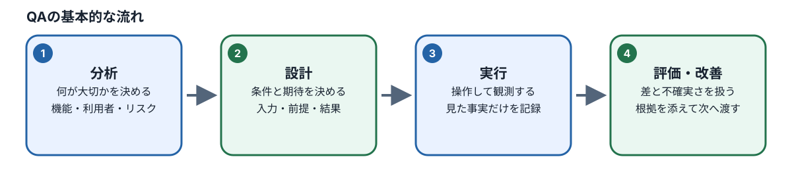
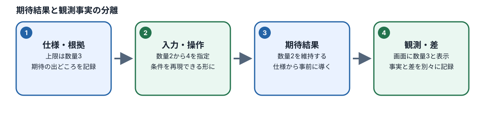

# M01：QAと自動化の基礎

## このモジュールで学ぶこと

- **目的と必要な理由：** ソフトウェアを確かめるテストの基本と、仕様上の期待と画面で観察した事実の違いを学びます。二つを混同すると、問題の見落としや根拠のない成功報告につながるためです。
- **到達点：** 何を確かめるかを短く説明し、期待と観察を分け、AIと人の役割を述べ、目的に合うテストの範囲を選べます。
- **前提と前章とのつながり：** M00で扱った教材ファイルと安全な依頼が出発点です。必要なら[M00を先に復習](../M00/README.md)してください。プログラミング経験は要りません。
- **準備するもの：** この章のカート仕様と画面例を使います。実際のアプリやターミナルを操作する前に、本文の期待結果と観察例を読み分けます。

> **任意の補助：** 本文と演習だけで学べます。AIチューターを使わなくても進められます。利用する場合はCodespacesでM01をロードした後に `pnpm course:tutor M01 --model provider/model-id` を実行できます。利用条件を確認して起動し、質問にはToken・API key・個人情報を含めないでください。チューターはM01の公開資料と本人の成果物を読み取り専用で使い、正式評価やファイル変更は行いません。

## 図で全体の流れをつかむ

図の番号を左から追い、各段階で「何を根拠に決めるか」「何を見て確認するか」を本文の説明と結び付けてください。図は要約です。具体的な条件・例外・手順は続く節と演習で確認します。

*図：各箱を左から読み、期待は仕様から、観測は実行して見えた事実から記録します。*

*図：AIの提案と実際の観測を混ぜず、差異があれば調査事項として残します。*

*概念図：期待と観測の不一致は、原因を決めつけず調査へつなぎます。*

テストは画面を操作したことを示すだけではありません。どの品質や業務ルールを確かめるかを決め、入力と前提を用意し、期待結果と実際の観測を比べます。QAはテスト実行だけでなく、リスクを減らすための分析・設計・実行・評価・改善を含みます。

## 期待結果と観測事実

カート数量の変更を調べるなら、「数量を2から上限超過へ変更する」が入力と操作、「変更を拒否し数量2を維持する」が仕様に基づく期待結果、「画面に数量2とエラー表示が見えた」が観測です。観測が期待と違えば差異を報告します。画面で成功に見えたことやAIの説明を、期待結果の根拠に置き換えません。

手動探索は未知の使い方や問題を見つけやすい一方、同じ手順の繰返しには再現記録が必要です。自動化は決まった条件を繰り返し確認できますが、初期状態・データ・期待値が不正確なら速く誤った結果を返します。回帰テストは変更後も既存動作が保たれたかを確認する用途です。

### 判断の完成例と練習

数量上限が3、変更前数量が2の条件で、数量4を指定したとします。`BR-CART-001`と`AC-CART-001`から、期待は「操作を拒否し、数量2を維持」です。実際に画面が数量3を表示したなら、観測は「数量3を表示した」であり、期待との差を調査対象にします。この時点では製品・テスト・環境のどれが原因か確定していません。実行していなければ、観測欄は未実行です。

次に、同じ上限3で数量3を指定する場合を考えます。仕様のどの条件から期待を導くかを書き、実際に操作していない間は観測欄を空欄または未実行としてください。期待を書いたことと結果を見たことを分けられたら、別商品でも上限の根拠を調べ直します。

## テスト工程と役割

分析で対象とリスクを整理し、設計で条件とケースを決め、実行で観測し、評価で差異・証拠・残る不確実さを判断し、必要な改善へつなぎます。AIは資料の整理や案の作成を補助できます。期待結果、未確認事項、修了判断をAIの自己申告だけで確定しません。

Unitは小さな関数、Integrationは複数部品の連携、ComponentはUI部品、Web E2Eは利用者の経路を通して確認する例です。E2Eは実環境に近い反面、起動・データ準備・実行時間・保守負荷が大きくなります。対象リスクと必要な観測範囲に合う層を選びます。

## 演習と提出

1. 仕様断片、画面の観測、AIの提案を「期待結果」「観測」「仮説」に分類します。
2. 価格表示の確認と商品購入の拒否を比較し、目的に合う手動/自動の選択と理由を書きます。
3. 繰返し確認に向く自動化候補と、探索を優先すべき候補を一件ずつ挙げます。
4. 各候補でUnit/Integration/Component/E2Eのどの層を選ぶか、費用と見逃しのリスクを説明します。

提出は `workspace/M01/submission.md` の分類表と判断理由です。仕様にない期待結果は「未確定」とします。クイズだけでなく短い分類演習を行います。

## 確認と復習

[M01の確認クイズ](../../quizzes/M01.json)を回答し、誤答した考え方を例へ戻って確認します。別の機能を使って期待と観測を分類し直します。

## 参考

- [Scenario ShopのCart仕様](../../../../spec/features/cart.md)
- [M01の学習項目](../../../../plans/2026-10-16_qa-curriculum-ai-agent-redesign_learning-map.md)
