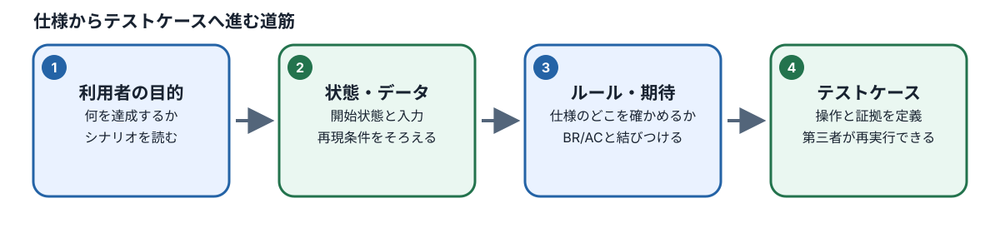
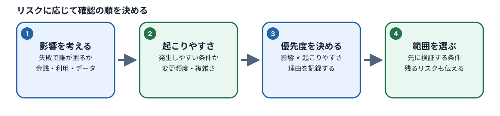

# M02：仕様とリスク分析

## このモジュールで学ぶこと

- **目的と必要な理由：** 曖昧な依頼を、根拠のある確認条件とリスクへ整理します。仕様を読まずにAIや画面の説明を正しいとみなすことを防ぎます。
- **到達点：** 仕様から利用者、開始状態、データ、操作後の期待を取り出し、Seed/Resetが保証する範囲を確認し、未決事項は質問として分けられます。
- **前提と前章とのつながり：** M01で学ぶ期待結果と観察事実の区別を使います。必要なら[M01の復習](../M01/README.md)に戻れます。テスト設計やコードはまだ不要です。
- **準備するもの：** 本文に示すカート仕様とデータ例を使います。分からない語は「用語と根拠」の節で確認し、実行していないことを実行済みと書かないでください。

> **任意の補助：** 本文と演習だけで学べます。AIチューターを使わなくても進められます。利用する場合はCodespacesでM02をロードした後に `pnpm course:tutor M02 --model provider/model-id` を実行できます。利用条件を確認して起動し、質問にはToken・API key・個人情報を含めないでください。チューターはM02の公開資料と本人の成果物を読み取り専用で使い、正式評価やファイル変更は行いません。

## 図で全体の流れをつかむ

図の番号を左から追い、各段階で「何を根拠に決めるか」「何を見て確認するか」を本文の説明と結び付けてください。図は要約です。具体的な条件・例外・手順は続く節と演習で確認します。

*図：利用者の目的から、再現条件と期待結果をたどってください。*

*図：影響と起こりやすさの根拠を分け、優先順位の理由を言葉で残します。*

- 正式仕様、実装、観測事実、AIの推測を区別する。
- Role、State、Data、Journeyを整理し、必要な前提を明示する。
- Seed/Resetが保証する開始状態と、保証しない条件を区別する。
- Impact、Likelihood、Priorityを根拠付きで比較し、発生率を事実のように置かない。
- AIの分析案を仕様に照らし、誤読・欠落・未決事項を分ける。

## 到達条件

初見の条件について、正本の仕様ID、開始状態、対象ロール、入力データ、操作後に維持すべき状態を示し、優先度とその理由を説明できます。仕様だけでは決められない事項は、推測で補わず未決として記録できます。

## 用語と根拠

- **BR（Business Rule）**は守るべき業務ルールです。**AC（Acceptance Criteria）**はそのルールの受入基準です。どちらも画面で実際に観測した事実とは区別します。
- **Role**は操作する利用者、**State**は開始時点の状態、**Data**は対象データ、**Journey**は利用者が行う一連の操作です。
- **Seed**は指定された初期データを作り、**Reset**はその条件を再現する操作です。Seed名が存在するだけでは、課題に必要なすべての状態が保証されたことになりません。
- **Risk**は起きたときの影響と、発生しやすさについての仮説です。実際の発生率データがなければ、Likelihoodは比較のための評価として示し、測定値と呼びません。

## 例：カート数量の上限

[カート正式仕様](../../../../spec/features/cart.md)の`BR-CART-001`は、同じSKUの合計数量が「在庫数・購入上限数・99」の最小値を超えないことを定めています。`AC-CART-001`は、上限を超える指定を拒否し、自動補正せず現在の数量を維持することを確認します。

この仕様から、次のように事実と未確認事項を分けます。

| 観点 | 記録する内容 |
| --- | --- |
| 仕様根拠 | `BR-CART-001`、`AC-CART-001` |
| 分析範囲 | この分析で扱う条件を識別する`SCOPE-...`参照とその意味。参照元と読んだ仕様revisionも記録する。Scope参照はSkillのMachine Entityではない |
| 対象 | ゲストまたは会員のカート。対象SKUと現在数量は演習条件で指定する |
| 操作 | 同一SKUの合計数量を許容上限より大きくしようとする |
| 期待結果 | 操作が拒否され、数量が変更前の値を保つ。上限に自動補正されない |
| 未確認 | 演習条件に購入上限・在庫・現在数量がなければ、その具体値は未決のままにする |

### SeedとResetで実行時の状態を確認する

`low-stock`シナリオは`variant-basic-shirt-02`の在庫を3に上書きします。このシナリオはdefault datasetを複製してから変更を加え、同variantの`purchaseLimit`はdefault datasetから5を引き継ぎます。したがって`BR-CART-001`に基づくこのvariantの数量上限は`min(3, 5, 99) = 3`です。`low-stock`の開始sessionはguestですが、このシナリオ名や在庫値だけから実行時のカート数量を決めてはいけません。数量を使う演習ではReset後のsessionとカートを確認します。

### Riskを仮説として評価する

Impactは問題が起きた場合の影響、Likelihoodはその条件で起きやすいかの評価です。発生率データがない場合、Likelihoodは観測済みの頻度ではなく、比較用の仮説として根拠を添えます。Impactが大きいことだけからLikelihoodも高いとは決めず、分からない条件は未確認として残します。

### 答えがない仕様から質問を作る

例えば「利用できない入力は受け付けない」という説明だけでは、どの入力が利用できないか、拒否後に以前の値が残るかは分かりません。「無効なら値を消す」というAI案は、上記の説明だけからは導けません。まず正式仕様の関連箇所を探し、それでも答えがなければ「利用できない条件は何か」「拒否後の以前の値と表示はどうなるか」を確認します。回答まで、その挙動を期待結果として固定せず、対象Caseの保留理由と、後続設計への影響を引き継ぎます。

開始サンプルの架空の配送先断片で、同じ手順を自分で試します。これは正式なShop仕様ではありません。質問に対する答えを想像する代わりに、質問を受ける人が判断するために必要な前提も添えます。

## 演習：検証責務を書く

1. `docs/spec/features/cart.md`のBR/ACを読み、上限超過時に守る不変条件を一文で書きます。
2. 対象Role、初期State、SKU/Data、操作、観測したい結果を分けて記録します。
3. 「不正な数量は上限へ補正される」というAI案を仕様と照合し、誤りを示す根拠を記録します。
4. ImpactとLikelihoodをそれぞれ根拠付きで評価します。実測の発生率がない場合は、そのことを明記します。
5. `low-stock`の対象variantでは在庫3と購入上限5から上限3を導きます。分析範囲には意味・出典・読んだ仕様revisionを持つ`SCOPE-...`参照を付けます。これはScope Machine Entityではありません。実行時のカート数量はReset後に確認し、資料にない値は未決事項として残します。

### 提出する作業メモ

`workspace/M02/analysis.md`に、仕様のrevision、BR/AC、Role/State/Data/Journey、リスク、検証したい責務、未決事項、AI提案の採否と根拠を記録します。本文の検証責務は人が読んで判断できる文章にします。M03の機械入力JSONとは別ファイルで管理してください。

## 評価基準

次の項目をすべて本人が根拠付きで説明できた場合に、M02のLevel 2到達を評価できます。AIが正しい表を出したことや、記入欄が埋まっていることだけでは到達としません。

| 観点 | 到達を示す証拠 | 到達しない例 |
| --- | --- | --- |
| 正本と事実の区別 | 仕様ID・revisionと、画面やテストで観測した事実を分け、AI案と矛盾するとき正本を示す | 表示やAI説明を仕様そのものとして扱う |
| Role/State/Data/Journey | 対象ロール、開始状態、対象データ、操作順と操作後の状態を課題条件から記録する | 未指定の在庫・購入上限・現在数量を補う |
| Riskと優先度 | ImpactとLikelihoodを根拠から別々に説明し、測定値がなければ仮説・比較として扱う | 根拠のない発生率を事実として書く |
| 検証責務 | ID、本文、BR/AC、成立条件、不変条件、観測方法を対応させ、未決事項を残す | M03のMachine EntityやTCNをM02の必須成果物と誤認する |
| AI案の採否 | 誤り・欠落・重複を正本と照合し、採用・修正・保留の理由を説明する | 採否理由がなく、未確認を完了扱いする |

評価対象は学習例の転記ではなく、条件を変えた仕様資料です。本人の判断と根拠を確認し、文章の流暢さは採点対象にしません。

## 次へ進む条件

M03へ進む前に、本人が仕様ID、開始状態、リスク、検証責務ID、BR/AC根拠、対象範囲、期待する成立条件、未決事項を整理します。ここではテスト技法を選び切ったり、外部SkillのJSON schemaを暗記したりする必要はありません。

## 確認クイズ

[M02の確認クイズ](../../quizzes/M02.json)を開いてください。クイズは全問回答後に正誤、選択肢の解説、復習先を表示します。

## 参考

- [カート正式仕様](../../../../spec/features/cart.md)
- [Seedと状態シナリオの正本](../../../../spec/state-and-scenarios.md)
- [M02の学習項目と到達基準](../../../../plans/2026-10-16_qa-curriculum-ai-agent-redesign_learning-map.md)
