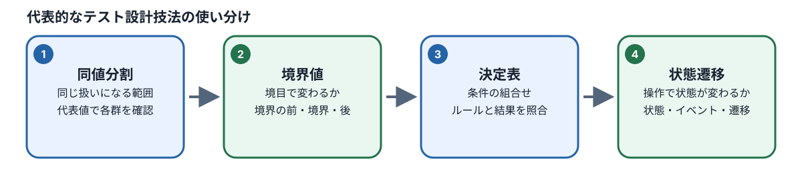
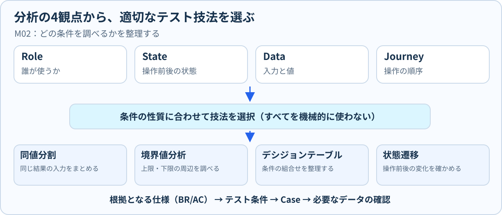
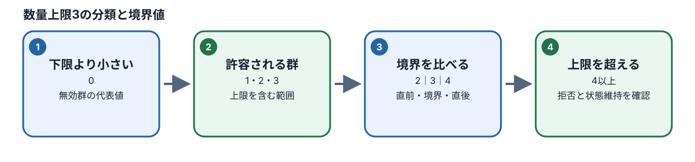
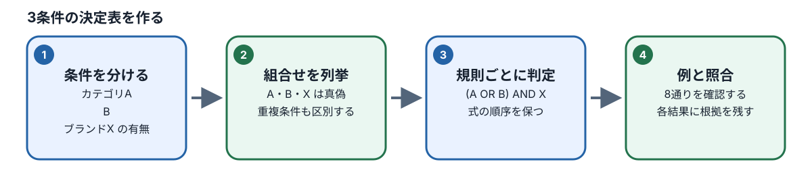

# M03：テスト設計の四つの技法

## この章でできるようになること

前章のM02では、仕様書を丁寧に読み解き、システムに潜むリスク（重大な問題が発生する可能性）や、利用者が操作を行う前にシステムが満たしていなければならない前提条件を整理する方法を学びました。

本章（M03）では、それらの分析結果をもとに、**「何を、どのような入力値や画面の状態で確かめるか」**を具体的に組み立てるための**テスト設計技法**を身につけます。

ソフトウェアテストの目的は、思いつく限りの操作手順を手当たり次第に大量に試すことではありません。開発現場ではテストに使える時間や人員が限られています。その限られた制約の中で、システムに潜む致命的な不具合を効率よく見つけ出すためには、**「なぜその値でテストするのか」という論理的な根拠を持ち、必要な確認を漏れなく、かつ無駄な重複を省いて選ぶこと**が最も重要です。

本章を学習すると、以下のことができるようになります。

| 学習目標ID | できるようになること |
| :--- | :--- |
| M03-01 | **同値分割法**を使って同じ結果になる入力値のグループを整理し、代表的な値を選んでその理由を説明できる |
| M03-02 | **境界値分析**を使って不具合が起きやすい仕様の境目を割り出し、システムに期待される動作を正確に判断できる |
| M03-03 | 複数の条件が絡み合う複雑な仕様から**デシジョンテーブル**を作成し、漏れのないテストケースへ変換できる |
| M03-04 | 操作前と操作後の変化を**状態遷移**として捉え、許可される変更・拒否される変更（状態維持）を正しく整理できる |
| M03-05 | **Risk（リスク）→ Condition（テスト条件）→ Case（テストケース）→ BR/AC（仕様根拠）**のつながり（トレーサビリティ）を説明できる |

## 1. テスト条件とテストケースを分ける

テストの具体的な設計を始める前に、QAエンジニアが必ず厳密に区別している基本的な概念があります。それが**「テスト条件」**と**「テストケース」**の違いです。この2つを混同したまま作業を始めると、テストの目的を見失ったり、確認の漏れが発生したりします。

### 1.1 テスト条件とは何か？

**テスト条件（Test Condition）**とは、一言でいえば**「確かめる必要がある事柄（テストの観点やテーマ）」**です。
この段階では、まだ「どの数値を入力するか」や「どのボタンをどの順序で押すか」といった詳細な操作手順は決まっていません。「この機能の、この性質を検証しなければならない」という確認のテーマを指します。

- **例1**：「カート画面において、数量の上限を超える変更要求が正しく拒否されること」
- **例2**：「商品一覧画面において、異なるカテゴリとブランドを同時に選んだとき、両方の条件に一致する商品だけが絞り込まれること」
- **例3**：「未ログインのゲスト利用者が商品をカートに入れた状態でログインした場合、ゲスト時のカート内容が会員カートへ正しく統合されること」

テスト条件を定義する目的は、「何のためにテストをするのか」という検証のゴールを明確にし、設計の全体像を俯瞰できるようにすることです。

### 1.2 テストケースとは何か？

**テストケース（Test Case）**とは、定義した「テスト条件」を実際に現場や自動テストで検証できるように、**「どのような前提状態で、誰が何を操作・入力し、結果として画面やデータがどうなれば合格とするのか」**を具体的にそろえた手順書です。

テストケースには、第三者や自動テストプログラムが迷わず実行できるように、以下の要素が必ず含まれます。

| 項目 | 役割 | 具体例 |
| :--- | :--- | :--- |
| **テスト条件** | 何を確かめるためのテストか（目的・観点） | カートの数量上限を超える変更要求が確実に拒否されること |
| **前提条件** | 操作を行う直前のシステムやデータの状態 | ログイン済み会員、カートに対象商品Aが数量2で入っている、対象商品Aの在庫数は3、1回の購入上限数は5 |
| **入力・操作** | 誰が、どの画面で、何を入力・実行するのか | カート画面の数量入力欄に「4」と入力し、「更新」ボタンをクリックする |
| **期待結果** | どうなれば合格（PASS）と判定するのか | 変更要求が拒否され、カート内の対象商品Aの数量は「2」のまま維持される（エラーメッセージの有無は仕様書の規定に従う） |
| **仕様根拠** | その期待結果が正しいと言える仕様書の根拠ID | ビジネスルール：`BR-CART-001`、受入基準：`AC-CART-001` |

### 1.3 なぜ両方を分ける必要があるのか？



初学者がテスト設計を行う際、最も陥りやすい失敗が**「いきなりテストケース（具体的な操作手順）を書き始めてしまうこと」**です。

1つの「テスト条件（例：上限超過の数量変更が拒否されること）」であっても、以下のように状況が変われば確かめるべき「テストケース」は複数に分かれます。

- **利用者の権限**：ログイン前のゲスト利用者か、通常会員か
- **操作前の数量**：カートに1個入っている状態か、上限ちょうど（3個）入っている状態か
- **商品の制約**：在庫数が購入上限より少ない商品か、購入上限のほうが在庫数より少ない商品か
- **操作する画面**：カート画面の一覧で直接更新するのか、商品詳細画面で追加するのか

最初から具体的なテストケースを書き進めてしまうと、「そもそも何を確かめるためのテストだったのか」という目的を見失い、似たような手順のテストばかりが増えて、本当に防ぐべきリスクが抜け落ちてしまいます。

そのため、プロのQAエンジニアリングでは**「まず仕様書から確認すべきテスト条件（観点）をすべて洗い出し、その条件を漏れなく確認するために最適なテストケースを設計する」**という2段階の手順を必ず踏みます。



図は、前章のRole・State・Data・Journeyを、今から学ぶ4つのテスト技法へ結び付けたものです。これは技法と観点の一対一対応表ではありません。同じ条件に複数の技法を使う場合もあり、仕様とリスクに応じて選びます。図の下段にあるとおり、CaseにはBR/ACなどの仕様根拠を残してください。

## 2. 同値分割法：同じ振る舞いになる入力をまとめる

### 2.1 どうして同値分割が必要なのか？

たとえば、Webサイトの入力欄に「1から99までの整数を入力できる」という仕様があったとします。
この入力欄が正しく動くかを確かめるために、`1, 2, 3, 4, …, 99` と99回すべての数値を手作業で入力してテストするのは現実的でしょうか。さらに、0や100、負の数（-1など）、小数、文字（「abc」など）まで試すとなると、入力可能な組み合わせは無限に広がってしまいます。

そこで使われるテスト技法が**同値分割法（Equivalence Partitioning）**です。

同値分割法とは、**「同じ前提条件のもとで、システムが仕様上まったく同じ振る舞い（同じ処理経路・同じ結果）をすると考えられる値のグループ」**に入力範囲を分類する技法です。この分類されたグループのことを**同値クラス（Equivalence Class）**と呼びます。

同値クラスには、大きく分けて次の2種類があります。

1. **有効同値クラス（Valid Equivalence Class）**：システムが正常な入力として受け入れ、処理を完了することを期待する値のグループ。
2. **無効同値クラス（Invalid Equivalence Class）**：システムが異常な入力として拒否し、エラー処理や入力制限を行うことを期待する値のグループ。

同値クラス内の値であれば、システムにとってはどれも同じ扱いになります。そのため、**「そのグループの中から代表的な値を1つ選んでテストすれば、そのグループに属する他のすべての値をテストしたのと同じ効果が得られる」**と考えます。これにより、テストの回数を劇的に減らしながら、十分な確認の網羅性を維持できます。

### 2.2 ショッピングカートの数量変更で考える

#### 同値分割同じ結果になる値をまとめる

具体的なシステム仕様を題材にして、同値クラスを導き出すプロセスを体験してみましょう。

【題材となる仕様】

- 対象商品：低在庫商品（`low-stock`）
- 現在の在庫数：3個
- 1回の注文での購入上限数：5個
- システム全体の数量上限：99個
- 操作種別：カート画面において、数量入力欄に**指定した数値を直接入力して更新する操作**（今ある数量に加算する追加操作ではありません）

#### 有効上限の計算

まず、この商品をカート内で何個まで指定できるか、真の**有効上限**を計算します。
在庫が3個、購入上限が5個、システム上限が99個の場合、実際に購入できる最大数は、これら3つの制約の中で最も小さい値（最も厳しい条件）によって決まります。

`min(3, 5, 99) = 3`（在庫3個が最小のため、有効上限は3個）

在庫が3個しかないため、購入上限が5個であっても、3個を超えて購入することは物理的に不可能です。したがって、この商品がカートに入っているとき、指定可能な数量の上限は「3個」となります。

#### 同値クラスの導出

この仕様のもとで、入力される整数値をシステムの振る舞いに応じて分類すると、次の3つの同値クラスに整理できます。

| 同値クラスの範囲 | システムに期待する振る舞い | 有効・無効の分類 | 代表値の候補 | 仕様上の期待結果 |
| :--- | :--- | :--- | :---: | :--- |
| **0** | カートから対象商品の明細行を削除する | 有効（特殊な正常動作） | 0 | 明細が削除され、カートから商品が消える |
| **1 〜 3** | 指定された数値への数量変更を受け入れる | 有効（正常動作） | 2 | 数量が指定した数値（2）に更新される |
| **4 以上** | 要求を拒否し、元の数量を維持する | 無効（エラー動作） | 4 | 変更要求が拒否され、変更前の数量が維持される |

#### 注意：更新操作と追加操作を混同しないこと

テスト設計において非常によくある間違いが、**「数値を指定して更新する操作（上書き）」**と**「今ある数量に加算する操作（追加）」**を取り違えることです。

たとえば、カートにすでに「2個」入っている状態で、「2個追加する」ボタンを押した場合は合計「4個」となり、有効上限の3個を超過するため要求は拒否されます。
一方、「数量を2に更新する」場合は、指定後の数量が「2個」のままなので、上限3個の範囲内となり許可されます。
同じ「2」という数字を扱う操作であっても、操作の種類が異なれば計算式もシステムの判定結果も完全に変わります。テストケースを設計する際は、**操作種別（更新なのか、追加なのか）を必ず明確に固定して**考えてください。

また、負の数（-1など）や小数（1.5など）、文字列（「abc」など）が画面上でどのように扱われるかは、入力検証（バリデーション）の仕様書を別途確認する必要があります。上記の整数3分類だけで、あらゆる入力パターンの確認がすべて完了したと過信してはいけません。

### 2.3 手順付き練習：同値クラスを自分で導く

理解を深めるために、条件を変えて同値クラスを導く手順を実際に練習してみましょう。

#### 【練習問題】

- 対象商品：通常在庫商品
- 在庫数：5個
- 1回の注文での購入上限数：2個
- システム上限：99個
- 操作種別：カート内の数量を絶対値で更新する操作（変更前のカート内数量は「1」とする）

#### 【考える手順】

1. **有効上限を計算する**：`min(在庫数, 購入上限数, システム上限数)` を計算します。
2. **振る舞いの異なる領域を分ける**：「明細削除」「更新許可」「更新拒否」の3つに分類します。
3. **各領域から代表値を選ぶ**：それぞれのグループから、テストに使う数値を1つずつ選びます。
4. **拒否時の期待結果を明確にする**：要求が拒否されたとき、システムの数量が最終的にどうなるべきかを言葉で説明します。

#### 【解答と解説】

1. **有効上限の計算**：
   `min(5, 2, 99) = 2`（購入上限2個が最小のため、有効上限は2個）
   在庫が5個あっても、購入上限が2個に制限されているため、この商品を購入できる最大数は「2個」となります。制約の中で最も小さい値が上限を決定します。
2. **同値クラスの分類**：
   - `0`：明細行削除グループ（有効）
   - `1 〜 2`：数量更新許可グループ（有効）
   - `3 以上`（3, 4, 5...）：数量更新拒否グループ（無効）
3. **代表値の選定**：
   - 明細削除グループ：`0`
   - 更新許可グループ：`1`（または `2`）
   - 更新拒否グループ：`3`（または `4` など）
4. **拒否時の期待結果**：
   無効な値である「3」を入力して更新を要求した場合、単に「エラーになる」と書くだけでは不十分です。「変更要求がシステムによって拒否され、操作前の数量である1個がそのまま維持されること」と定義します。操作前の数量が維持されたことを確かめて初めて、システムが不当な書き換えを行わなかったことを検証できます。

## 3. 境界値分析：境目を詳しく調べる

### 3.1 どうして境目が重要なのか？



同値分割法を使えば、膨大な入力値をいくつかのグループに整理し、テストの回数を効率的に減らすことができます。しかし、ソフトウェア開発の現場において、**最もバグ（不具合・欠陥）が集中して発生しやすい場所は、グループとグループの「境目（境界）」**です。

プログラマが仕様書を読んでプログラムを書くとき、条件式の不等号を以下のように書き間違えるミスが頻繁に起こります。

- **本来の実装すべき仕様**：`if (quantity <= 3)` （数量が3以下なら許可）
- **誤った実装コード**：`if (quantity < 3)` （数量が3未満なら許可）

もし誤った実装になっていた場合、数量が「1」や「2」のときは正常に動きますが、「3」を入力した瞬間に、本来許可されるべきなのに誤って拒否されてしまいます。
このような「1つだけズレる」欠陥は、同値クラスの真ん中にある代表値（「2」など）をいくらテストしていても絶対に発見できません。「3」という境目そのものをピンポイントでテストして初めて見つけ出すことができます。

このように、**同値クラスの境目にある値（境界値）とそのすぐ隣の値を重点的に狙ってテストする技法**を**境界値分析（Boundary Value Analysis）**と呼びます。

### 3.2 境界値の選び方

#### 例数量上限の境界値

境界値分析では、境界となる値の「すぐ内側（有効側）」と「すぐ外側（無効側）」をセットでテストします。
有効上限が「3」の場合、境界値として選ぶべき数値は次の3つです。

| 選ぶ値 | 境界における位置付け | 仕様上の期待動作 | なぜこの値を選ぶのか |
| :---: | :--- | :--- | :--- |
| **2** | 上限の1つ手前（有効範囲内） | 許可（数量2へ更新） | 境界のすぐ内側で、正常に処理が受け入れられることを確認するため |
| **3** | 上限ちょうど（境界そのもの） | 許可（数量3へ更新） | 上限値そのものが正しく受け入れられるかを確認するため（`<` と `<=` の実装誤りを発見する） |
| **4** | 上限の1つ外側（無効範囲） | 拒否（操作前の数量を維持） | 上限を1つでも超えたら、確実にシステムがブロックすることを確認するため（`>` と `>=` の誤りを発見する） |

```text
       有効な範囲（許可される領域）       無効な範囲（拒否される領域）
  ───────────────────────────────┬───────────────────────────────
   ...   0        1        2   [3] │  [4]        5        6   ...
                           ↑    ↑  │   ↑
                      上限の1つ前 上限 境界 上限の1つ後（超過）
```

境界値を決めるとき、「システム上限が99だから98, 99, 100をテストしよう」と機械的に考えてはいけません。実際のECサイトでは、在庫数や購入上限数によって、商品ごとに真の境界値が動的に変化します。**「いまテスト対象としている商品のデータにおいて、真の境界値はいくつか」**を必ず手計算で割り出してから、テストする数値を決定してください。

また、上限側だけでなく、**下限側（最小値側）の境界**にも目を向ける必要があります。
数量「1」は通常の更新として許可されますが、数量「0」は単なる拒否ではなく「明細行の削除」という全く別の特別な動作になります。したがって、「0」と「1」の境目も、システムの振る舞いが劇的に切り替わる極めて重要な境界です。

### 3.3 練習：どの制約が上限を決めるのか（解答付き）

有効上限は必ず `min(在庫数, 購入上限数, システム上限数)` で計算します。計算の計算式自体は常に同じですが、**どの条件が最も小さい値となって上限を縛るのか**は商品データによって異なります。以下の練習問題を通じて、上限の判定と期待結果の導出プロセスを完全にマスターしましょう。

※以下の問題は、仕様の理解を深めるための架空データを用いた練習問題であり、現在のテスト環境の初期データ（Seedデータ）の実測値ではありません。

1. 各問題の3つの数値を比較し、最小値となる「有効上限」を求めます。
2. 上限より1少ない数量、上限ちょうどの数量、上限より1多い数量を考えます（有効上限が1の場合、数量0は「明細削除」という別動作になる点に注意してください）。
3. 上限を超過したときの期待結果には、「指定を拒否し、**操作前の数量**をそのまま維持すること」を明確に含めます。

| 問題 | 在庫 | 購入上限 | システム上限 | 操作前数量 | 更新要求 | 上限 | 期待結果 |
| :---: | ---: | ---: | ---: | ---: | ---: | :---: | :--- |
| A | 3 | 5 | 99 | 2 | 4 | ？ | ？ |
| B | 8 | 3 | 99 | 1 | 3 | ？ | ？ |
| C | 10 | 10 | 99 | 2 | 11 | ？ | ？ |
| D | 120 | 150 | 99 | 10 | 100 | ？ | ？ |
| E | 70 | 120 | 99 | 3 | 70 | ？ | ？ |
| F | 120 | 20 | 99 | 5 | 21 | ？ | ？ |
| G | 6 | 99 | 99 | 4 | 5 | ？ | ？ |
| H | 99 | 99 | 99 | 10 | 100 | ？ | ？ |

#### 答えと考え方

| 問題 | 最小値・有効上限 | 更新の判定 | 操作後の数量と理由 |
| :---: | :--- | :---: | :--- |
| A | 3（在庫数が制限） | 拒否 | 2のまま維持。要求値4は有効上限3を超えるため |
| B | 3（購入上限数が制限） | 許可 | 3に更新。要求値3が有効上限3ちょうどと一致するため |
| C | 10（在庫数と購入上限が同値） | 拒否 | 2のまま維持。要求値11は有効上限10を超えるため |
| D | 99（システム上限が制限） | 拒否 | 10のまま維持。要求値100はシステム上限99を超えるため |
| E | 70（在庫数が制限） | 許可 | 70に更新。要求値70が有効上限70ちょうどのため |
| F | 20（購入上限数が制限） | 拒否 | 5のまま維持。要求値21は購入上限20を超えるため |
| G | 6（在庫数が制限） | 許可 | 5に更新。要求値5は有効上限6以下のため |
| H | 99（3つの値がすべて同値） | 拒否 | 10のまま維持。要求値100は上限99を超えるため |

**初学者が間違えやすい注意点**：

- 更新が許可された場合の操作後数量は**「要求した数量」**になります。
- 更新が拒否された場合の操作後数量は**「操作前の数量」**がそのまま維持されます。
- 「上限を超えて拒否されたので、システムが親切に上限値まで自動補正してくれる」と推測で期待結果を書くのは、Scenario Shopの正式仕様（`BR-CART-001`・`AC-CART-001`）に明確に反します。仕様書に書かれていない自動補正動作を勝手に創作してはいけません。
- なお、在庫が0個でそもそも購入可能数量が存在しないような境界条件については、本表の数量更新とは別に、商品詳細画面やカート追加時の画面状態仕様を個別に確認する必要があります。

**応用問題（解答付き）**：

- **設問**：在庫数8個、購入上限数3個、操作前数量2個のとき、「数量を4に更新する操作」と「カートに2個を追加する操作」は同じテスト操作でしょうか？
- **解答**：操作の種類が明確に異なります。
  - 前者の「数量4への更新」は、指定された絶対値「4」と有効上限「3」を直接比較します。
  - 後者の「2個の追加」は、操作前の現在数量「2」に追加要求「2」を足した合計値「`2 + 2 = 4`」と有効上限「3」を比較します。
  結果としてどちらも上限3を超えて拒否される点では一致しますが、システムの内部処理や呼び出されるAPI・画面イベントが異なるため、テストケース（Case）には操作種別を厳密に区別して記録しなければなりません。

## 4. 状態遷移：操作前後の状態変化を捉える

### 4.1 状態遷移テストとは何か？

#### 状態遷移操作前後の状態をつなぐ

同値分割法や境界値分析は、基本的に「ある特定の画面で、ある値を入力した瞬間に何が起きるか」という1回限りの入出力を検証するのに適した技法です。
しかし、実際のWebアプリケーションは、**「システムが今どのような状態にあるか」によって、まったく同じ操作をしても結果が異なる**ことが数多くあります。

たとえば、ショッピングカートを考えてみましょう。

- カートの中に商品が1点も入っていない「空（Empty）」の状態で「購入手続きへ進む」ボタンを押しても、注文手続き画面へは進めず、ボタン自体が無効化されているかエラーが表示されます。
- 一方、カートの中に商品が1点以上入っている「有効（Active）」な状態であれば、同じボタンを押すことで正常に注文手続き画面へ進むことができます。

このように、**「システムがいまどのような状態（State）にあり、どのような操作や出来事（Event）が発生すると、次にどの状態へと変化（Transition：遷移）するのか」**を整理し、期待通りに状態が変わるか（あるいは不正な状態へ変わらないか）を確かめる手法を**状態遷移テスト（State Transition Testing）**と呼びます。

### 4.2 状態遷移の整理表

カート明細の数量変更操作を、状態の変化という観点から表に整理してみましょう。

| 操作前の状態 | 行う操作（イベント） | 期待される操作後の状態 | 仕様根拠 |
| :--- | :--- | :--- | :--- |
| カート内に商品Aが数量2、有効上限3 | 数量を「3」へ更新 | カート内の商品Aが**数量3**になる（正常な状態遷移） | `BR-CART-001` |
| カート内に商品Aが数量2 | 数量を「0」へ更新 | 商品Aの明細行が**削除**され、商品一覧から消える（削除遷移） | `BR-CART-001` |
| カート内に商品Aが数量2、有効上限3 | 数量を「4」へ更新 | 要求が拒否され、**数量2のまま維持**される（自己遷移） | `BR-CART-001`、`AC-CART-001` |

ここで最も重要なポイントは、3行目の「数量4へ更新」の扱いです。
数量4への変更が拒否されたとき、システムの次の状態は「数量4」になるわけではありません。システムは不正な変更要求をブロックし、**「操作前の状態（数量2）にとどまり続ける」**という振る舞いをします。これを状態遷移モデルでは**自己遷移（元の状態への維持）**と呼びます。

もしテスト設計者が「数量4を要求したから、次の状態は数量4（ただしエラー）」のように図や表を描いてしまうと、仕様上絶対に許可してはならない不正な状態をシステムが受け入れたかのような誤った設計書になってしまいます。不合格となった操作は、「状態が変化せず維持されたこと」を明記してください。

### 4.3 許可された遷移・禁止された遷移・未決の区別

状態遷移を設計する際は、以下の3つの区分を明確に意識して分類します。

1. **許可された遷移（正常系）**：仕様書に「この状態からこのイベントが起きると、この状態へ遷移する」と明確に規定されているもの。
2. **禁止された遷移（異常系）**：仕様上、明確に禁止されている遷移。または業務ルールや常識的な整合性から絶対に起きてはならないもの。
3. **未決の事項（要確認事項）**：仕様書に遷移の可否が記載されておらず、開発チームやプロダクトオーナーへの確認が必要なもの。

#### 終端状態（Terminal State）のルール

正式仕様書（`docs/spec/state-and-scenarios.md`）において、ショッピングカートの状態モデルには `active`（有効）から `abandoned`（放棄済み）への遷移が定義されており、`abandoned` は**終端状態（Terminal State）**と規定されています。

**終端状態**とは、システムのライフサイクル（寿命）がそこで終了することを意味し、「その状態に一度到達したら、それ以降は二度と他の状態へ遷移することはない」という絶対的な終着点です。

したがって、たとえば「`abandoned` 状態になったカートを操作して、再び `active` 状態に戻る遷移」について、「仕様書に戻れるとも戻れないとも書いていないから未決（確認中）である」と判断するのは誤りです。
**「終端状態として定義されているというアーキテクチャ規則に基づき、元の状態へ戻る遷移は明確に禁止されている」**と判断するのが正しいQAエンジニアの論理的な設計判断です。

## 5. デシジョンテーブル：条件の組み合わせを漏らさない

### 5.1 デシジョンテーブル（意思決定表）とは何か？

システムの振る舞いは、1つの入力値だけでなく、**複数の条件が複雑に組み合わさることによって初めて決定される**ケースが非常に多く存在します。
たとえば、ECサイトの商品検索で「カテゴリ」「ブランド」「在庫の有無」などを複数指定して絞り込む場合や、会員ランクと購入金額によって割引率が変わる場合などです。

このように複数の条件が絡み合う仕様を整理し、**考えられるすべての条件の組み合わせパターンと、それぞれのパターンに対してシステムが取るべき期待動作を一覧表にしたもの**を**デシジョンテーブル（Decision Table：決定表）**と呼びます。デシジョンテーブルを使うことで、人間が頭の中だけで考えていると必ず見落としてしまう「条件の抜け漏れ」を完全に防ぐことができます。

### 5.2 検索仕様から論理式を導く

#### 例検索条件のデシジョンテーブル



Scenario Shopの検索仕様書（`BR-STOREFRONT-002`）には、複数の絞り込み条件に関する重要なビジネスルールが定められています。

> **複数条件の組み合わせルール（`BR-STOREFRONT-002`）**：
>
> - 同じファセット（絞り込み項目グループ）内の複数選択は **OR（いずれか一致）** 条件として扱う。
> - 異なるファセット間の条件は **AND（すべて一致）** 条件として扱う。

例として、利用者が画面上で以下の条件にチェックを入れて検索を実行する場合を考えます。

- ファセット1（カテゴリ）：「カテゴリA」または「カテゴリB」を選択
- ファセット2（ブランド）：「ブランドX」を選択

このとき、ある商品が検索結果の一覧に表示されるかどうかを判定するための論理式（判定ルール）は、数学的には次のように表されます。

検索条件は「**（カテゴリA または カテゴリB）かつ ブランドX**」です。「または」はどちらか一方以上が真なら成立し、「かつ」は両方が真の場合だけ成立します。

※ `または` は「または（OR）」、`かつ` は「かつ（AND）」を意味する数学・論理学の記号です。

### 5.3 8通りのデシジョンテーブル

この検索条件には、3つの命題（条件1：カテゴリAに属するか、条件2：カテゴリBに属するか、条件3：ブランドXに属するか）が存在します。
それぞれの条件に対して、商品が「当てはまる（真：〇）」か「当てはまらない（偽：×）」かの2通りがあるため、論理的に考えられる組み合わせの総数は、以下の計算により**全部で8通り（規則1〜規則8）**となります。

`2 × 2 × 2 = 8通り`（三つの条件について、それぞれ「該当する／しない」を組み合わせる場合）

これをデシジョンテーブルとして表にまとめます。人間向けの可否・真偽判定は、文章規約に従い `〇`（U+3007）と `×`（U+00D7）で統一して表現します。

| 条件・結果 | 規則1 | 規則2 | 規則3 | 規則4 | 規則5 | 規則6 | 規則7 | 規則8 |
| :--- | :---: | :---: | :---: | :---: | :---: | :---: | :---: | :---: |
| **条件1：カテゴリAに属する** | 〇 | 〇 | 〇 | 〇 | × | × | × | × |
| **条件2：カテゴリBに属する** | 〇 | 〇 | × | × | 〇 | 〇 | × | × |
| **条件3：ブランドXである** | 〇 | × | 〇 | × | 〇 | × | 〇 | × |
| **括弧内の中間計算（A OR B）** | 〇 | 〇 | 〇 | 〇 | 〇 | 〇 | × | × |
| **期待結果：検索結果に表示される** | **〇** | **×** | **〇** | **×** | **〇** | **×** | **×** | **×** |

#### 表の読み解き方と計算プロセス

- **規則5の列を見る**：
  - 条件1（カテゴリA）は「×」、条件2（カテゴリB）は「〇」、条件3（ブランドX）は「〇」です。
  - まず括弧内のOR条件（AまたはB）を評価します。どちらか一方でも〇であれば成立するため、中間判定は「〇」になります。
  - 次に外側のAND条件（ブランドX）と組み合わせます。中間判定が「〇」で、ブランドXも「〇」なので、両方が揃って成立し、最終的な期待結果は**「〇（検索結果に表示される）」**となります。
- **規則7の列を見る**：
  - 条件1（カテゴリA）も条件2（カテゴリB）も「×」で、条件3（ブランドX）だけが「〇」です。
  - 括弧内のOR条件がどちらも×なので、中間判定は「×」になります。
  - そのため、ブランドXがどれほど一致していても、AND条件の片方が×である以上、最終的な期待結果は**「×（検索結果に表示されない）」**となります。

#### 論理上のルールとテストデータの存在を混同しないこと

この表に並んでいる8つの規則（規則1〜規則8）は、**仕様書の論理式から数学的に導き出された「仕様上の論理ルール」**です。
しかし、実際のテスト環境のデータベース（Seedデータ）を調べてみると、「カテゴリAとカテゴリBの両方に同時に所属している商品（規則1に該当する商品）」が、たまたま1件も登録されていないことがあります。

その際、「テストできる商品データが存在しないから」といって、デシジョンテーブルから規則1の列を勝手に消してはいけません。
QAエンジニアは、次の2つの異なる事態を明確に区別して記録しなければなりません。

1. **テストデータ不足（BLOCKED / 未実行）**：仕様上は論理的にあり得る組み合わせだが、現在のテスト環境に該当するデータがまだ準備されていない状態。
2. **到達不能条件（仕様上不可能な組み合わせ）**：システムの仕様上、たとえば「商品は必ず単一のカテゴリにしか所属できない」という絶対ルールが存在するため、論理的にも物理的にも絶対に発生し得ない組み合わせ。

### 5.4 正式演習へ進む前の別例：2ブランドと在庫条件

これまでに学んだ「カテゴリA/BとブランドX」は、AND条件とOR条件の基本的な組み合わせ方を理解するための入門用の解説例です。
**M03の正式演習では題材となる条件が変わります。**
正式演習では、`BR-STOREFRONT-002` に基づき、ブランドファセットで「ブランドXまたはブランドY」を選択し、さらに別のファセットである在庫条件で「在庫あり」を指定する場合を扱います。

- **ブランド条件**：同じファセット内の複数選択であるため、ブランドXまたはブランドYのどちらかに一致すればよい（OR条件）。
- **在庫条件**：ブランドとは異なるファセットであるため、ブランド条件と同時に満たす必要がある（AND条件）。
- **演習固有の前提条件**：この練習問題では、「各商品は必ず1つのブランドにのみ所属し、複数のブランドに同時に所属することはない」と仮定します。なお、この仮定は本演習を解くための**演習上の制約条件**であり、`BR-STOREFRONT-002` の一般仕様から普遍的に導かれるルールではありません。

この検索条件を論理式で表すと、以下のようになります。

検索条件は「**（ブランドX または ブランドY）かつ 在庫あり**」です。ブランドの条件を満たしても在庫がなければ、検索条件全体は成立しません。

3つの真偽条件（Xに属するか、Yに属するか、在庫があるか）には、論理上 `2 × 2 × 2 = 8` 通りの組み合わせが存在します。そのうちの代表的なパターンを抜粋して整理した例が以下の表です。

| 練習用の入力条件 | ブランドX | ブランドY | 在庫あり | 論理式に一致するか | テストを実行できるか |
| :--- | :---: | :---: | :---: | :---: | :--- |
| **例A** | 〇 | × | 〇 | 〇（一致する） | 実際のSeedデータに対象商品が存在することを確認するまで未確認 |
| **例B** | × | 〇 | × | ×（一致しない） | 実際のSeedデータに対象商品が存在することを確認するまで未確認 |
| **例C** | 〇 | 〇 | 〇 | 論理上は「〇」 | 1商品1ブランドの演習前提があるため、この条件には到達不能 |

※この表はデシジョンテーブルの読み方を理解するための**3行のみの抜粋例**です。正式演習で必要となる全8ルールの完成表ではありません。残りの組み合わせパターンについては、受講者自身で全通りを列挙し、各条件の真偽、実行可能性、対応するテストケース（Case）を根拠とともに整理してください。

ここでは、次の2つの判断を明確に切り分けて考えます。

1. **論理式の評価結果**：論理式を計算したとき、その商品は検索条件に一致して表示されるべきか（〇か×か）。
2. **実行可能性の判断**：その条件を満たすテストデータを、現在のテスト環境（Seedデータ）で**実際に準備・確認できるか**。
「在庫ありの商品が現在のSeedデータにたまたま存在しない」だけであれば、それはデータ不足であって仕様上禁止された組み合わせではありません。一方、「ブランドXとブランドYに同時に所属する（例C）」は、本演習の「1商品1ブランド」という前提条件のもとでは絶対に作り出せないため、到達不能（実行不可能）と判断します。

**手順付き練習（解答付き）**：

- **設問**：ブランドXにのみ属し、在庫がある商品を仮定した場合、検索条件に一致するかどうかを論理式から求めてください。
- **解答**：条件は「X＝〇、Y＝×、在庫あり＝〇」となります（上表の例Aに該当）。論理式に代入すると、`(〇 または ×) かつ 〇 = 〇 かつ 〇 = 〇` となり、検索結果に表示されるのが正しい期待動作です。ただし、これは**仮定した商品データに対する論理上の判定**であり、実在する商品名や検索件数を実環境で確認した証拠にはまだなっていない点に留意してください。

**条件を変える練習（解答付き）**：

- **設問**：ブランドYに属しているが、在庫が切れている（在庫なし）商品を仮定した場合、検索結果に表示されるでしょうか？
- **解答**：条件は「X＝×、Y＝〇、在庫あり＝×」となります（上表の例Bに該当）。論理式に代入すると、`(× または 〇) かつ × = 〇 かつ × = ×` となり、検索結果には表示されません。ブランドの条件を満たしていても、AND条件である在庫条件を満たしていないためです。

**正式演習への接続**：
受講者は、演習課題ファイル（`training/ai-assisted-qa-course/exercises/M03/exercise.md`）の指示に従い、指定された8ルールの全パターンを自力で作成し、到達不能条件の判定、テストケースへの変換、実際のSeedデータとの照合作業を自身の手で進めてください。

### 5.5 カート統合にも同値分割と状態遷移を使う

数量変更や商品検索は分かりやすい入門例ですが、M03で習得すべきテスト技法はそれだけにとどまりません。
Scenario Shopの正式仕様書（`BR-CART-002` および `AC-CART-002`）には、利用者がログインした際に**「未ログイン時のゲストカートの内容を、ログイン後の会員カートへ統合する」**という重要なビジネスルールが定められています。

まず、「カート統合」という業務処理の意味を正確に理解しましょう。
利用者が会員ログインする前にゲストとして商品をカートに入れ、その後にログイン画面からログインを完了した場合、システムは元からデータベースに保存されていた「会員カート」を基準として、ゲストカート内の明細を合算・統合します。

しかし、すべての明細が無条件にそのまま統合されるわけではありません。
仕様書には、以下の条件に該当する明細は統合対象から除外され、**画面上に除外理由を個別に明示しなければならない**と規定されています。

- 統合によって許容上限（在庫数や購入制限数）を超えてしまう数量分
- 管理者によって非公開に設定された商品
- 会員の会員ランク（会員権限）が不足している商品
- 販売停止や無効化されたSKU（商品バリエーション）
- 在庫数が0（完売）になった商品

ここでテスト設計上極めて重要なのは、**「統合されなかった」という結果が同じであっても、除外された理由が異なるものは、同じ同値クラスにまとめてはいけない**ということです。理由ごとに異なるエラーハンドリングやメッセージ表示が求められるため、それぞれ独立した同値クラスとして切り分けてテストケースを設計する必要があります。

#### 同値クラスを考える順序

1. 仕様書（`BR-CART-002`, `AC-CART-002`）から、統合が「許可される条件」と「除外される条件」を漏れなく抽出します。
2. 単に「除外されるか」という二者択一だけでなく、「除外理由がどのように区別されて利用者に通知されるか」を確認します。
3. 同じ前提条件のもとで、まったく同じ除外理由・同じ期待結果になる入力パターンだけを1つの同値クラスにまとめます。
4. それぞれの代表的なテストデータを、テスト環境の初期データ（Seedデータ）から準備できるか点検します。
5. 仕様書に記載されていない除外理由の優先順位（たとえば「非公開かつ在庫0」の場合にどちらのエラーを優先するか）について、テスト設計者が勝手な思い込みで仕様を推測してはいけません。記載がない場合は未決事項として記録します。

#### 状態遷移を考える順序

カート統合の前後では、会員カートとゲストカートの双方がそれぞれ異なる状態変化を起こします。片方の変化だけを見てテストを完了としてはいけません。

| 観測対象 | 統合を行う前に確認すること（操作前） | 統合完了後に仕様から確認すること（期待される操作後） |
| :--- | :--- | :--- |
| **会員カート** | ログイン前に保存されていた既存の明細行と数量 | 会員カートを基準として統合された明細、除外された明細行、カートのバージョン番号が更新されたこと |
| **ゲストカート** | ゲスト状態で追加されていた統合元の明細行と状態（`active`） | 統合元となったゲストカートが**放棄済み（`abandoned`）**の状態へと遷移したこと |
| **各商品のSKU** | SKUの有効性、公開状態、在庫数、会員ランク権限 | それぞれの条件に応じた統合可否と、正しい除外理由が画面に表示されたこと |

**確認問題と解説**：

- **設問**：「ログイン後に統合先である会員カートの内容が正しく更新されていれば、統合元となったゲストカートの状態確認は省略してもよいでしょうか？」
- **解答**：**絶対に省略してはいけません。**
  `BR-CART-002` および `AC-CART-002` の受入基準には、統合先の計算結果だけでなく、「統合元のゲストカートが安全に `abandoned`（終端状態）へ遷移し、二重注文や不正利用が防止されていること」までが明確な仕様として求められているためです。

## 6. テスト技法の選び方と使い分け

ここまで学んだ4つのテスト技法は、どれか1つだけを単独で使えばよいというものではありません。検証したい仕様の性質やデータ構造に応じて適切に使い分け、組み合わせて活用します。

| 技法名 | 最も適した確認対象 | 典型的な適用例 | 設計時の注意点 |
| :--- | :--- | :--- | :--- |
| **同値分割法** | 同じ処理結果になる広い入力値の範囲 | 数量入力、金額計算、文字数の範囲 | 前提条件（在庫や上限）と操作の種類（上書き更新か追加か）をそろえて比較する |
| **境界値分析** | 条件の変わり目・上限値・下限値 | 在庫上限、購入制限数、最小数量0と1 | 有効上限を計算（`min`値）して真の境目を求める。境界直前・境界・直後（超過）をセットで選ぶ |
| **デシジョンテーブル** | 複数の条件の論理的な組み合わせ | 複合検索、割引クーポンの適用条件 | 論理式の計算順序（カッコの優先順位）を守る。テストデータの有無と論理ルールを混同しない |
| **状態遷移テスト** | 操作の前後でシステムの状態が変わる処理 | カートの明細変更・削除・注文完了 | 拒否された操作は「状態維持（自己遷移）」と表現し、終端状態からの不正な復帰を許さない |

実際のテスト設計現場では、1つのテストケースを作成する際に複数の技法が同時に組み合わされることが一般的です。
たとえば、ショッピングカートの数量変更テストケースを設計する場合、

1. まず**同値分割法**で入力値全体を「削除（0）」「許可（1〜3）」「拒否（4以上）」の3グループに整理し、
2. 次に**境界値分析**を用いて、許可と拒否の境目にある数値「3」と「4」をピンポイントで抽出し、
3. 最後に**状態遷移テスト**の観点から、「数量4を入力して拒否された場合、カートの状態は数量2のまま自己遷移して維持される」という期待結果を導き出す、
というように、各技法が連携して高品質なテストケースを作り上げます。

## 7. リスク・テスト条件・テストケース・仕様根拠のトレーサビリティ

テスト設計において、初学者が最も陥りやすい失敗は「思いつきや直感でテストケースをバラバラに作ってしまうこと」です。
プロのQAエンジニアは、作成したすべてのテストケースに対して**「なぜそのテストが必要なのか」という理由の連鎖（トレーサビリティ：追跡可能性）**を第三者に完全に説明できるように設計します。

```text
[製品リスク（Product Risk）]
  「在庫数を超えた注文が誤って成立してしまい、出荷不能や欠品トラブルが発生する」
       │
       ▼ そのリスクを防ぐために、何を確かめるべきか？
[テスト条件（Test Condition）]
  「カート画面において、有効上限を超える数量変更要求を行った場合、システムが確実に要求を拒否すること」
       │
       ▼ 具体的にどのデータと操作手順で確かめるか？
[テストケース（Test Case）]
  「在庫3・購入上限5の商品Aが入ったカート（現在数量2）に対し、数量4への更新を要求し、
   要求が拒否されて数量2が維持されることを確認する」
       │
       ▼ その結果が正しいと言える正本仕様の根拠は何か？
[仕様根拠（BR / AC）]
  「ビジネスルール：BR-CART-001、受入基準：AC-CART-001」
```

このように、**Risk → Condition → Case → BR/AC** が1本の途切れない線で結ばれている状態を「トレーサビリティが確保されている」と呼びます。

もしテストケースのIDだけが大量に並んでいても、そのテストがどの製品リスクを防ぐためのものか、どの仕様書に基づいているかが説明できなければ、たとえテストがすべて合格（PASS）したとしても、「システムが本当に安全であること」を誰も客観的に保証できません。

## 8. AIエージェントおよび固定Skillとの協働

現代のソフトウェアエンジニアリングおよびQA現場では、人間がすべてのテストケースを手作業で清書するだけでなく、AIエージェントや**Agent Skills（以下、Skill）**を活用して、テスト設計の効率化と品質向上を図ります。

### 8.1 Skill（スキル）とは何か？

未経験の方にとって「Skill」という言葉は聞き慣れないかもしれません。
普段、ChatGPTなどのAIチャットツールを使うときは、人間が画面に入力した自由な文章に対して、AIも自由に文章を返してくれます。しかし、ソフトウェアテストや開発の現場では、AIに「自由で曖昧な回答」をされると困る場面が多々あります。決まったJSONフォーマットで出力してほしい、あらかじめ決められたID規則を1文字の狂いもなく厳密に守ってほしい、といった場合です。

そこで本教材のリポジトリでは、AIエージェントに対して**特定の作業手順や厳密なデータ契約（入力形式と出力形式のスキーマ）を定義した拡張機能**を用意しています。これを**Skill**と呼びます。
本コースのM03では、テスト設計支援用の固定Skill（`qa-workflow`）を使用します。

### 8.2 AI協働における人間の役割とSkillの役割

Skillを導入する目的は、定型的なデータ構造の生成やIDの重複チェックなど、**機械的・決定論的な処理を正確にミスなく行わせること**です。

ここで絶対に忘れてはならない、AI協働の鉄則があります。
**「Skillの機械的な形式チェック（バリデーション）に合格したこと」と、「テスト設計の内容が仕様上正しいこと」は全くの別物です。**

- **Skill（機械）ができること**：出力されたJSONファイルが指定の構文ルールに従っているか、必須項目であるIDが存在するか、同一のIDが重複して発行されていないかを判定すること。
- **人間（QAエンジニア）にしかできないこと**：仕様書の文脈や業務意図を正しく読み取っているか、境界値の計算式に間違いがないか、拒否されたときの期待結果が「数量維持」になっているか、仕様書に書かれていない未決事項を勝手な推測で埋めていないかを、意味レベルでレビューして判断すること。

AIやSkillが「バリデーションPASS」「問題ありません」と報告してきたとしても、それだけで設計内容が正しいと盲信してはいけません。最終的な品質保証の責任は、常に人間のレビューにあります。

### 8.3 AIエージェントへの具体的な指示手順（プロンプト例）

AIエージェントにテスト設計の支援を依頼する際は、曖昧に「テストケースを作って」と頼むのではなく、作業の前提条件、参照すべき仕様ID、制約事項を明確に指示します。

#### 【AIへのプロンプト指示例】

```text
M03のテスト条件（Condition）とテストケース（Case）の設計を支援してください。

【前提条件】
- 参照仕様：docs/spec/features/cart.md（BR-CART-001, AC-CART-001）
- 操作種別：カート明細の数量を「指定した数値に更新する操作」（追加操作ではありません）
- 対象データ：在庫数3、購入上限数5、現在数量2のSKU

【指示事項】
1. 実行する前に、参照するSkill/helperの入出力仕様、変更予定ファイル、停止条件を提示してください。私の許可なくファイルの書き換えやコマンド実行を行わないでください。
2. 同値分割法と境界値分析に基づき、境界となる入力値（2, 3, 4）に対する期待結果を整理してください。
3. 超過要求（4）に対する期待結果は、仕様に基づき「要求を拒否し、操作前の数量2を維持する」としてください。仕様に根拠のないエラーダイアログの文言などを勝手に創作しないでください。
```

### 8.4 機械的な検証と証拠（Evidence）の確認

正式な演習では、Skillおよび付属の検証プログラム（`runtime_contract.py` や `verify_runtime_evidence` など）を実行して、設計成果物の整合性を検証します。

1. AIエージェントが「すべて成功しました」「検証はPASSしました」と報告してきた場合でも、**必ず自分自身の目で実際の実行ログと出力ファイルの内容を確認**してください。
2. 出力されたJSONファイルの中に `valid: true` という文字列が書かれていたとしても、それは単にファイルにその文字が出力されただけであり、検証ツールを実際に実行した証拠にはなりません。
3. 入力不足やバージョンの不一致、未実行の項目がある場合は、無理に「成功」と偽らず、`未実行` または `BLOCKED`（中断）として正確に記録します。事実と異なる成功報告を行うことは、QAエンジニアとして最も避けるべき行為です。

### 8.5 固定Skillを実行するための手順と証拠の読み方

ここからは、M03の正式演習を開始するための**具体的な操作手順**です。先ほどまでの手計算の練習問題とは異なり、リポジトリ内の実環境でツールを動作させます。実際のSkillの入出力仕様は、配布されたファイルと[`M03演習手順`](../../../../../training/ai-assisted-qa-course/exercises/M03/exercise.md)を正本として確認してください。

1. **開始入力を調べる**：
   ターミナルを開き、リポジトリのルートディレクトリで `pwd` を実行して現在位置を確認します。続いて、案内されたコマンド `pnpm course:load M03` を実行します。受講者本人のM02提出物がある場合はその参照を確認し、利用できない場合はM03用に配布された公開開始入力を選択して、入力元のファイルパスとコミット識別子（revision）を記録します。本人のM02成果物を断りなく自動上書きしてはいけません。
2. **Skillの契約を確認する**：
   `.agents/skills/` 配下に配布されているSkill定義を確認し、固定revisionである `7cc6cba7772de549841a39d71694cbafbc783324`、参照ファイル、ヘルパープログラム、入力形式、変更範囲を照合します。必要なファイルやrevisionが不足している場合は、推測で別バージョンを実行せず、`BLOCKED`（中断）として記録します。
3. **まず入力の意味を決める**：
   正式なBR/AC仕様書と、M02の分析結果から、「自分は何を検証しようとしているのか」を自身の言葉で文章化します。現在のAuthority / Product Risk Entityの参照・fingerprintを生成・確認し、Scopeについては勝手に別のMachine Entityを新設せず、意味・出典・revisionの明確な `SCOPE-...` 参照を使用します。`TARGET-CART-001` などをScope項目へ安易に流用してはいけません。
4. **条件の構造を確かめる**：
   固定Skillの入力契約に従って `condition_structure(direct)` を実行します。未知のキー、間違った実行モード（mode）、未解決の参照先が存在する場合は処理を停止し、何が不足しているのかを確認します。実行方法は配布されたSkillの手順に厳密に従い、本文に規定されていない関数呼び出しやJSONキーを推測で創作しないでください。
5. **技法を選んで実行する**：
   構造化した条件から1つの技法を選択し、その実行処理（runtime）を実行します。公開サンプルでは「在庫20、購入上限5」の条件から境界値となる上限「5」と超過「6」を導出します。これは本章の前半で学んだ「low-stock（在庫3、上限3）」とは**異なるテスト条件**です。4技法すべてをツール上で実行する必要はありませんが、4技法それぞれを別の条件に対して手作業で設計する練習は必須です。
6. **CoverageとCaseを結ぶ**：
   `materialize_coverage(artifact)` によるカバレッジ情報の生成と、テストケース（Case）の作成・参照の照合を行います。TR（テスト要求）→ TCN（テスト条件ノード）→ CI（カバレッジ項目）→ Case（テストケース）→ BR/AC（仕様根拠）の連鎖が成立しているかを、単にID文字列が存在するかだけでなく、意味的な妥当性も含めて点検します。
7. **現在の成果物を保存する**：
   所定の作業ディレクトリに `workspace/M03/condition-design.md` および `workspace/M03/cases.md` を作成・確認し、実際に使用した入力と実行結果を `condition-runtime-evidence.json` および `case-runtime-evidence.json` に保存します。`artifact_markdown` の項目には、対応する現在のMarkdownファイル全文を正確に一致させて格納します。`skill`、`normalized_skill_input`、`partial_rerun`、過去の成果物情報などの値には、**実際の実行に用いた真実の値**を記録します。見本のJSONをそのままコピー＆ペーストしたり、`valid=true` と手入力して偽りの証拠を作成したりしてはいけません。
8. **決定論的検証を実行する**：
   リポジトリのルートディレクトリにおいて、実際の入力JSONファイルが存在することを確認した上で、次の2つの検証コマンドを実行します。

   ```bash
   python3 .agents/skills/test-condition-design/scripts/runtime_contract.py < workspace/M03/condition-runtime-evidence.json
   python3 .agents/skills/test-case-design/scripts/runtime_contract.py < workspace/M03/case-runtime-evidence.json
   ```

9. **結果を評価する**：
   検証結果の出力において、`valid` が `true` であることだけでなく、`issues`（問題点）、`missing`（欠落項目）、`extra`（余剰項目）、`incomplete pairs`（不完全なペア）などの警告やエラーが一切出ていないことを確認します。ヘルパースクリプトの成功は、あくまで形式的・構造的な証拠の整合性を確認したにすぎず、テストケースの期待結果が仕様上本当に正しいかどうかを保証するものではありません。AIの説明、実際の成果物、正式仕様書のBR/ACを自身の目で必ず照合してください。

**失敗した場合のトラブルシューティング**：

- ファイルが見つからない場合は、現在のカレントディレクトリ（`pwd`）と入力パスを確認してください。
- revisionが異なる場合は、配布元リポジトリのコミット情報を確認してください。
- 検証結果が不一致となる場合は、JSONファイル内に格納されたartifactと、ディスク上に保存されている現在のMarkdownファイルの内容に差分がないか確認してください。
- Entity情報が不足している場合は、生成元となった前工程の分析結果を見直してください。
- いかなる場合も、未実行・失敗・入力不足の状態を「成功」と偽って報告してはいけません。後続の `course:assess M04` では、固定Skillヘルパーの再実行を伴う厳密な検証が行われます。

**提出物**：

- `workspace/M03/condition-design.md`
- `workspace/M03/cases.md`
- 2つの実行証拠ファイル（`condition-runtime-evidence.json`, `case-runtime-evidence.json`）
- それぞれの実行結果および受講者自身による意味レベルのレビュー記録
※正式な採点評価課題の完成テストケースは、本教材本文中には掲載していません。

## 9. さらに理解を深める：解説付き例題と練習問題

本節では、初学者が実務や演習で特につまずきやすいポイントを、詳しい例題と解説を通じて学びます。

### 9.1 例題：同値分割の五段階導出プロセス

同値分割法をミスなく確実に行うための「5つのステップ」を実践してみましょう。

- **ステップ1：前提条件と操作種別を明確に固定する**
  操作は「カート内商品の数量変更（上書き更新）」、現在のカート内数量は「2個」、商品の在庫数は「3個」、購入上限数は「5個」とします。
- **ステップ2：入力可能なデータの性質と型を特定する**
  今回の入力値は「整数」とします（負の数や小数の扱いは、別途入力バリデーション仕様書で確認します）。
- **ステップ3：振る舞いの異なる領域（同値クラス）を定義する**
  有効上限は `min(3, 5, 99) = 3` です。
  - 数量 `0`：明細行の削除（特殊な正常動作）
  - 数量 `1 〜 3`：数量更新の許可（有効同値クラス）
  - 数量 `4 以上`：数量更新の拒否（無効同値クラス）
- **ステップ4：各領域から代表値を選び、仕様IDと紐付ける**
  - 削除グループ代表値：`0`（根拠：`BR-CART-001`）
  - 許可グループ代表値：`2`（根拠：`BR-CART-001`）
  - 拒否グループ代表値：`4`（根拠：`BR-CART-001`, `AC-CART-001`）
- **ステップ5：前提を崩す例外的な条件がないか点検する**
  「もし利用者が操作している途中で、別の人が購入して在庫が1個に減ったらどうなるか？」「未ログインのゲスト利用者とログイン済み会員で上限の扱いに違いはあるか？」といった前提の変化を点検し、必要に応じて新たなテスト条件として切り出します。

### 9.2 例題：状態遷移における「拒否」の描き方

**【問い】**
カート内の商品数量が現在2個、有効上限が3個の状態で、利用者が数量「4」への変更を要求しました。システムはこの要求を拒否します。このとき、状態遷移図における矢印の行き先はどう描くべきでしょうか？

**【解説】**
矢印の行き先を「数量4」にしてはいけません。
仕様上、数量4という状態への遷移はシステムによって許可されていません。正しくは、**「数量2の状態から矢印が出て、要求が拒否された結果、再び数量2の状態に戻る（自己遷移）」**と描くか、あるいは「エラー発生（システムの状態は数量2のまま不変）」と明記します。

また、このとき「画面にどのようなエラーメッセージが表示されるか」について仕様書に明確な規定がない場合は、テスト設計者が推測で「『上限を超えています』という赤いダイアログが表示される」といった期待結果を創作してはいけません。確定している仕様である「要求拒否・数量2の維持」と、未確認のUI表示仕様を明確に分けて記録するのがプロの設計です。

### 9.3 詳しい解説付き練習問題（全10問）

以下の問題を解いて、本章の理解度を確認してみましょう。解き終えたらすぐに解説を読み、考え方のプロセスがあっているか確認してください。

#### 問題1（同値分割・上限計算）

- **条件**：商品の在庫数6個、購入上限数4個、システム上限99個。現在のカート数量は3個。
- **状況**：利用者がカート画面で「さらに2個追加する」ボタンを押した。
- **設問**：有効上限数、操作後の要求数量、システムの期待結果を答えてください。

##### 【解答】

- 有効上限数：`min(6, 4, 99) = 4` 個
- 操作後の要求数量：`3 + 2 = 5` 個
- 期待結果：要求は拒否され、カート内の数量は「3個」のまま維持される。

**【考え方】**
在庫が6個あっても、1回の購入上限が4個に制限されているため、有効上限は4個となります。また、今回は「数値を直接上書きする更新操作」ではなく「2個追加する操作」であるため、要求数量は現在の3個に2個を足した `3 + 2 = 5` 個になります。有効上限の4個を超過するため、システムは要求を確実に拒否し、操作前の数量3個をそのまま維持しなければなりません。

#### 問題2（同値分割・操作種別の区別）

- **条件**：商品の在庫数2個、購入上限数9個、現在のカート数量は1個。
- **状況**：カート画面の入力欄に「2」と入力して更新ボタンを押した。
- **設問**：この入力値「2」は、どの同値クラスに属しますか？

**【解答】**
有効同値クラス（更新許可グループ）に属します。

**【考え方】**
有効上限は `min(2, 9, 99) = 2` 個です。今回の操作は加算ではなく絶対値での「2への更新」であるため、要求数量は2個となります。これは有効上限である2個ちょうどと一致するため、正常に受け入れられます（現在数量1に2を足して3個になるわけではありません）。なお、この「2」は境界値分析においても極めて重要な「上限ちょうど」の値となります。

#### 問題3（デシジョンテーブル・論理計算1）

- **条件**：商品検索の判定式が `(カテゴリA または カテゴリB) かつ ブランドX` であるとします。
- **状況**：ある商品が、カテゴリA＝×（偽）、カテゴリB＝×（偽）、ブランドX＝×（偽）である場合。
- **設問**：この商品は検索結果に一致しますか（〇か×か）？ 計算の理由とともに答えてください。

**【解答】**
×（一致しない）

**【考え方】**
まず括弧内のOR条件を計算します。`× または × = ×` となり、カテゴリ条件は不成立です。次にブランド条件とANDを取ります。`× かつ × = ×` となります。どの条件も満たしていないため、当然ながら検索結果の一覧には表示されません。

#### 問題4（デシジョンテーブル・論理計算2）

- **条件**：判定式は同様に `(カテゴリA または カテゴリB) かつ ブランドX` です。
- **状況**：ある商品が、カテゴリA＝〇（真）、カテゴリB＝×（偽）、ブランドX＝〇（真）である場合。
- **設問**：この商品は検索結果に一致しますか（〇か×か）？

**【解答】**
〇（一致する）

**【考え方】**
括弧内のOR条件は「カテゴリAまたはカテゴリBのいずれか一方でも一致すればよい」ため、`〇 または × = 〇` となります。そしてブランドXも「〇」なので、両方のファセット条件を満たし、`〇 かつ 〇 = 〇` となります。したがって、検索結果に正常に表示されます。同一ファセット内は片方の一致で有効となります。

#### 問題5（状態遷移・終端状態）

- **条件**：カートの状態遷移仕様において、`active` から `abandoned`（放棄済み）への遷移が定義されており、`abandoned` は終端状態とされています。
- **状況**：テストケースとして、「`abandoned` 状態になったカートを操作して、再び `active` 状態に戻ることを確かめる」正常系ケースを作成しようとしました。
- **設問**：このテストケースの期待結果を「正常に戻ること」として作成してよいでしょうか？

**【解答】**
作成してはいけません（正常に戻ることを期待するのは誤りです）。

**【考え方】**
終端状態（Terminal State）とは、ライフサイクルの終了を意味し、そこから他の通常状態へ遷移することはアーキテクチャ一般規則として禁止されています。仕様書の一覧表に「戻る遷移」が書かれていないからといって、「未決事項だから戻れるかもしれない」と勝手に復帰を期待するケースを作ってはいけません。戻る遷移は「禁止された不正な遷移」として扱うのが正しい設計です。

#### 問題6（境界値分析・値の網羅）

- **条件**：有効上限数が「3」の数量入力欄があります。
- **状況**：テスト担当者が境界値分析として、入力値「1」「2」「3」の3つを選んでテストを完了としました。
- **設問**：このテスト設計には何が不足していますか？

**【解答】**
無効側（上限超過側）の境界値である「4」が不足しています（また、下限側の境目である「0」も必要です）。

**【考え方】**
選ばれた「1, 2, 3」はすべて許可される有効同値クラスの値です。境界値分析で最も重要な目的の1つは、「上限を超えた最初の値が、不当に受け入れられず確実にブロックされること」を検証することです。上限3の直後である「4」をテストしなければ、`<` と `<=` の実装誤りを見逃してしまいます。また、数量0（明細削除）と1（数量維持）の境目である「0」の確認も欠かせません。

#### 問題7（仕様根拠のない期待結果の排除）

- **状況**：あるテストケースの期待結果に「画面中央に『これ以上注文できません』という赤いエラーダイアログがポップアップすること」と記述されていました。しかし、機能仕様書には「上限超過時は変更要求を拒否し、元の数量を維持する」としか書かれていません。
- **設問**：このテストケースの記述をどう見直すべきですか？

**【解答】**
具体的なダイアログの有無やエラーメッセージの文言を勝手に期待結果とせず、仕様書に明記されている「要求が拒否され、操作前の数量が維持されること」を主たる期待結果に修正します。

**【考え方】**
UIの詳細仕様（ダイアログの見た目や正確な文言）が共通UI仕様書などで別途定義されている場合を除き、仕様の裏付けがない文言をテスト設計者が推測で創作してはいけません。もし文言まで厳密に検証する必要があるなら、仕様未決事項として開発元やプロダクトオーナーに確認を依頼し、仕様が確定してからテストケースに反映します。

#### 問題8（Skillの自動検証結果の扱い）

- **状況**：固定Skillを実行したところ、エラーは出ず、生成されたテストケース一覧にも重複するIDはありませんでした。
- **設問**：これだけで「テスト設計の網羅性と内容の正しさが完全に確認できた」と言えるでしょうか？

**【解答】**
言えません。

**【考え方】**
Skillや検証スクリプトが保証するのは、「データの形式がJSONスキーマに合っているか」「IDが一意（ユニーク）であるか」といった構文的・機械的な整合性だけです。仕様の意図を正しく反映しているか、境界値の計算が合っているか、必要なリスクが漏れていないかという「意味的な正しさ」は、人間が仕様書と照らし合わせてレビューしなければ確認できません。

#### 問題9（デシジョンテーブルとテストデータ）

- **状況**：商品検索のデシジョンテーブルを作成したところ、全8列の組み合わせが導き出されました。しかし、現在の開発環境のデータベースには、そのうち4列の条件に合致する商品データしか登録されていませんでした。
- **設問**：テストを実行できない残りの4列は、デシジョンテーブルから削除して完了としてよいでしょうか？

**【解答】**
削除してはいけません。

**【考え方】**
デシジョンテーブルの列は「仕様上の論理ルール」を表しています。テストデータが存在しないことと、仕様として不要であることは全く別の問題です。表には全8列を残した上で、実行できない列については「現在のSeedデータに該当商品が存在しないため未実行（BLOCKED）」と記録し、必要に応じてテストデータの追加を開発チームに依頼するのが正しい対応です。

#### 問題10（状態遷移表の記録項目）

- **状況**：カートの数量が「2」の状態で、数量「4」への変更を要求する操作を状態遷移表に記録しました。操作後の状態欄には「数量2」とだけ書かれています。
- **設問**：この記録には何が不足していますか？

**【解答】**
「要求が拒否されたこと」「有効上限が3であること」「根拠となる仕様ID（`BR-CART-001`, `AC-CART-001`）」が不足しています。

**【考え方】**
単に「数量2」とだけ書かれていると、変更操作が正しく行われて数量2になったのか、要求が拒否されて元の数量2が維持されたのか、それともシステムが操作を無視したのかが第三者に伝わりません。「上限3を超えるため要求が拒否され、変更前の数量2が維持された」という理由と仕様根拠を必ず併記する必要があります。

## 10. 章末実践演習

本章で学んだ知識を使って、実際の演習に取り組みましょう。

### 10.1 演習の手順

1. **入力情報の確認**：
   前工程（M02）で作成した分析資料、または `inputs/M03/start.md` を開き、対象となる仕様IDとリスク、前提条件を確認します。
2. **同値分割と境界値分析の実施**：
   対象SKUの有効上限（在庫数・購入上限数・システム上限99の最小値）を算出し、同値クラスと境界値（上限直前、上限、上限超過）を特定してテストケースの候補を作成します。
3. **デシジョンテーブルの作成**：
   指定された検索条件について、OR条件とAND条件の論理式を組み立て、全パターンの組み合わせ表を作成します。実環境でのデータ有無も併記します。
4. **状態遷移の整理**：
   操作前の状態、発生させるイベント、操作後の期待状態を整理し、許可される遷移と拒否される遷移（自己遷移）を明確に区別します。
5. **トレーサビリティの確認**：
   作成したテストケースが、どのリスク（Risk）を防ぐためのもので、どのテスト条件（Condition）を満たし、どの仕様（BR/AC）に基づいているかを対応付けます。
6. **固定Skillの実行と検証**：
   指定された手順に沿ってSkillを実行し、生成された成果物に対して検証ヘルパー（`verify_runtime_evidence` など）を実行します。機械的なPASSだけでなく、内容が仕様に合致しているかを自身の目で確かめます。

### 10.2 注意事項

- 正式な課題の成果物は、所定の作業ディレクトリ（`workspace/M03/`）に記録してください。
- 仕様に書かれていない不明点や未定義の動作を見つけた場合は、AIの推測で勝手に仕様を確定させず、未決事項として記録してください。

**【本章の修了確認】**
初めて見る新しい仕様書を渡されたときに、4つのテスト技法（同値分割法、境界値分析、デシジョンテーブル、状態遷移テスト）の中からどれを使うべきかを自分で判断し、テスト条件・テストケース・期待結果・仕様根拠を筋道立てて説明できるようになれば、本章の目標は達成です。

次章のM04では、本章で設計したテストケースをもとに、AIの提案をレビューしながら、どのテストを自動化すべきか（自動化対象の選定基準）を学んでいきます。

## 学習資料・参照リンク

- [カート正式仕様](../../../../spec/features/cart.md)
- [商品検索・一覧正式仕様](../../../../spec/features/storefront.md)
- [状態シナリオの正本](../../../../spec/state-and-scenarios.md)
- [固定Skillの実行契約](../../../../../training/ai-assisted-qa-course/integrations/M02-M03-contract.md)
- [M03演習手順書](../../../../../training/ai-assisted-qa-course/exercises/M03/exercise.md)
- [M03提出用テンプレート](../../../../../training/ai-assisted-qa-course/exercises/M03/submission-template.md)
- [M03確認クイズ](../../quizzes/M03.json)
- [カリキュラム学習マップ](../../../../plans/2026-10-16_qa-curriculum-ai-agent-redesign_learning-map.md)

> **学習支援AIへの質問方法**：
> 学習中に疑問が生じた場合は、以下のコマンドでAIチューターに質問することができます。
> `pnpm course:tutor M03 --model <プロバイダ/モデルID>`
> ※AIの回答をそのまま鵜呑みにせず、必ず正式仕様書の根拠と照らし合わせて確認する習慣をつけましょう。

## 理解ノード別の追加確認

次の理解事項は、本文と演習で学んだ条件を変えて本人が判断できるかを確認します。クイズの正答を正式な実技の達成とはみなしません。

### K-M03-06

**確認する内容**：テスト条件とリスクから技法を選び、不採用の理由も説明できる

**練習**：この章の対応するコード例・テスト設計例を読み、別の入力条件での結果を予測して根拠を説明してください。

### K-M03-07

**確認する内容**：論理的な到達不能、データの未準備、未決仕様を区別できる

**練習**：この章の対応するコード例・テスト設計例を読み、別の入力条件での結果を予測して根拠を説明してください。

### K-M03-08

**確認する内容**：runtimeの成功と期待結果の根拠・設計の意味的な正しさを区別できる

**練習**：この章の対応するコード例・テスト設計例を読み、別の入力条件での結果を予測して根拠を説明してください。
