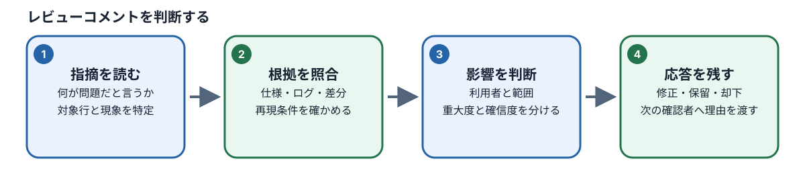
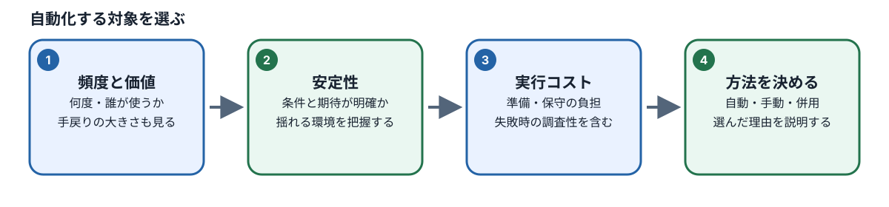

# M04：テスト設計のレビューと自動化対象の選定

## この章でできるようになること

前章（M03）では、仕様書をもとにテストケース（検証の前提条件・操作手順・期待結果をまとめた設計書）を作成する基礎を学びました。また、生成AIに指示を出してテストケースのたたき台を出力してもらう体験もしました。

しかし、AIが作成したテストケースや、人間が書いたテストケースが、最初からすべて正しいとは限りません。AIは文章を整えるのが得意な反面、仕様書の細かい条件を読み飛ばしたり、存在しない架空のルールを世の中の常識から勝手に作り出したり（専門用語で「ハルシネーション」と呼びます）することがあるからです。また、人間が設計した場合でも、思い込みや見落としによって仕様と食い違ってしまうことがあります。

このM04では、作成されたテストケースを客観的な視点で見直す「レビュー」の技術と、限られた開発期間の中で最大の効果を出すための「自動化対象の選定」を身につけます。

具体的には、次の4つの行動ができるようになることを目指します。

| 学習目標ID | 学習目標 | 具体的に確認する行動 |
| --- | --- | --- |
| M04-01 | AI提案の検証と採否判断 | AIが提案したテストケースから、仕様の欠落・重複・根拠のない期待結果を見つけ、正しく修正できる。 |
| M04-02 | テスト層の適切な選定 | Unit、Integration、Component、Web E2Eの特徴と費用を理解し、検証目的に合った層を選べる。 |
| M04-03 | 自動化可否の理由付き判断 | 各テストケースについて「Automate（自動化）」「Later（保留）」「Do not automate（自動化しない）」を根拠とともに判断できる。 |
| M04-04 | 未確定仕様の整理と引継ぎ | 仕様書に書かれていない未知の動作について、推測で決めつけず、質問事項と保留範囲を整理して第三者へ引き継げる。 |

この章を修了すると、Phase 1（テスト設計・自動化戦略フェーズ）の知識がすべて揃い、総合演習および正式評価課題へ進む準備が整います。

## 1. レビューとは何か？ なぜ必要なのか？

### 1.1 「レビュー」って何ですか？

「レビュー（Review）」とは、作成した成果物（テストケース、プログラムのソースコード、設計書など）を自分以外の視点、あるいは別の客観的な視点から見直し、誤り・抜け漏れ・矛盾がないかを確かめる作業のことです。

テストケースにおけるレビューは、単に「誤字脱字がないか」や「日本語として読みやすいか」をチェックする作業ではありません。**「このテストケースは、製品が正しく作られているかを検証するために本当に適しているか？」** を確かめることが本質です。

テストケースは、開発者やテスターにとって「製品が正しく動いているかを判断する唯一の基準」になります。いわば裁判における「法律」のような存在です。その基準自体が間違っていたら、どれだけ厳密にテストを実行しても品質を保証することはできません。

### 1.2 なぜテストを書く前にレビューが必要なのですか？

ソフトウェアテストの世界には、「バグは後工程で見つかるほど、修正にかかるコストが跳ね上がる」という有名な法則があります。もし誤ったテストケースを採用したまま、次のステップで自動テストプログラムを書いてしまうと、次のような重大な問題が発生します。

1. **正しい製品の動作を「不具合（FAIL）」と誤判定してしまう（偽陽性 / False Positive）**
   - 製品は仕様書どおりに正しく動いているのに、テスト側の期待値が間違っているためにテストが失敗します。「テストが落ちた！」と開発チームが大騒ぎになり、原因を調べた結果「テストケース側の勘違いでした」となれば、開発者やQAの貴重な時間が無駄に奪われてしまいます。
2. **製品の深刻なバグを「合格（PASS）」と見逃してしまう（偽陰性 / False Negative）**
   - テストの確認観点が甘かったり、期待結果が的外れだったりすると、画面にエラーが出ているのにテストが素通りしてしまいます。「自動テストが全部合格したから安心だ」とリリースした結果、本番環境でユーザーに不具合が届き、ビジネスに大きな損失を与えてしまいます。
3. **無駄な自動化コードを大量に作ってしまい、維持できなくなる**
   - 同じ内容を確認するテストが何本も重複していたり、そもそも自動化に向かないテストを無理にプログラム化したりすると、将来画面や仕様が少し変わるたびにテストコードの修正に追われ、保守コストが雪だるま式に膨らみます。

テスト自動化で最も費用がかかるのは、「自動テストコードを最初に書く時間」ではなく、「間違ったテストを直したり、壊れやすいテストを世話し続けたりする時間（メンテナンスコスト）」です。だからこそ、コードを1行も書かない「テスト設計」の段階で、厳密にレビューを行って無駄や誤りを排除しておく必要があります（これをテストの「シフトレフト」と呼びます）。

### 1.3 レビューで確認する5つの順番

#### caseレビューの順番


テストケースをレビューするときは、思いつきで眺めるのではなく、次の順序で1項目ずつ確認していきます。この順番を守ることで、「文章はきれいだが中身が間違っているテストケース」に惑わされなくなります。

```text
【ステップ1】仕様の根拠があるか？（正式なBR/ACのIDと対応しているか）
      ↓
【ステップ2】前提条件が揃っているか？（Role、State、Data、Journey）
      ↓
【ステップ3】操作と期待結果がつながっているか？（入力と結果の因果関係）
      ↓
【ステップ4】既存のテストケースと重複していないか？（同じ責務の無駄な重複）
      ↓
【ステップ5】現実的に実行可能か？（環境・データ・画面操作が揃うか）
```

- **ステップ1（仕様の根拠）**：テストの期待結果は、設計者の個人的な好みやAIの推測ではなく、正式な仕様書（ビジネスルールや受入基準）に明確な根拠があるかを確認します。根拠のない期待結果は、どれだけもっともらしく見えても却下対象です。
- **ステップ2（前提条件）**：誰が（Role：ゲスト、一般会員、管理者など）、どのような状態の画面で（State）、どんな初期データ（在庫数やカート内の数量など）を持って始めるのかが具体的に書かれているかを確認します。
- **ステップ3（因果関係）**：「Aというボタンを押したから、Bという結果になる」という論理的なつながりが正しいかを確認します。途中のステップが省略されていたり、操作と関係のない結果が期待値になっていないかを点検します。
- **ステップ4（重複の排除）**：すでに作成済みの他のテストケースと、検証したいリスクや内容がまったく同じになっていないかを確認します。
- **ステップ5（実行可能性）**：そのテストを実行するためのテスト環境、テストデータ、画面の導線が現実に用意できるかを確認します。

## 2. AIの提案を正式仕様で検証する

### 2.1 AIの「もっともらしい嘘」を見抜く

AIにテストケースを作成させると、非常に自然で読みやすい日本語を出力してくれます。しかし、AIは「世の中の一般的なECサイトの常識」をもとに文章を補う癖があります。私たちが開発している製品固有の仕様（Scenario Shopの仕様書）を勝手に書き換えてしまうことがあるのです。

具体例を見てみましょう。カートに商品を追加する機能について、AIが次のようなテストケースを提案してきたとします。

> **AIの提案案**：
> 「カート内の商品数量がすでに2個あり、商品の購入有効上限が3個の状態で、さらに商品を2個追加する。追加後のカート内数量は上限の3個に自動補正される。」

一見すると、「上限を超えたら上限値に合わせてくれる親切な機能」のように思えます。しかし、ここで絶対に「親切そうだからこれでいいか」「一般的なショッピングサイトもそうなっている気がする」と感覚で判断してはいけません。必ず**正本となる正式仕様書**を開いて突き合わせます。

### 2.2 正式仕様書との突き合わせ手順

実際に仕様書と突き合わせる手順を追ってみましょう。

1. **数字を計算する（要求値の把握）**
   - 操作前のカート内数量は `2` です。
   - そこへ `2個追加` しようとしています。
   - ユーザーが要求した合計数量は `2 + 2 = 4` 個です。
2. **ビジネスルール（BR）を確認する**
   - 仕様書の `docs/spec/features/cart.md` にある `BR-CART-001` を確認します。
   - そこには「カート内の同一SKU（商品バリエーション）の数量は、商品の有効上限（在庫数、購入制限数、システム上限99個のうち最小の値）を超えてはならない」と定められています。
   - 今回の有効上限は `3` です。要求数量 `4` は上限を超えています。
3. **受入基準（AC）を確認する**
   - 仕様書の `AC-CART-001` を確認します。
   - そこには「有効上限を超える追加要求があった場合、**要求を拒否（拒絶）し、変更前の数量を維持する**」と明確に定義されています。
4. **AIの案を評価・訂正する**
   - AIが言った「3個に自動補正される」は、この製品の仕様ではありません。
   - 正しい期待結果は、**「要求はエラーとなり拒否され、カート内の数量は変更前の2個のまま維持される」** です。

| 確認項目 | AI提案の記述 | 仕様書との照合 | レビュー結果と修正方針 |
| --- | --- | --- | --- |
| 操作前の数量 | 2個 | テスト開始時に用意可能か確認 | 〇（問題なし） |
| 操作内容 | 2個追加 | 更新（上書き）ではなく追加操作 | 〇（要求合計は `2 + 2 = 4` 個） |
| 期待結果 | 3個に自動補正される | `AC-CART-001` を確認 | **×（却下）**。仕様は「要求拒否・数量2個維持」。期待結果を訂正する |
| 実行可能性 | 未記入 | SKU・在庫・画面状態の確認 | △（不足あり）。対象商品とログイン状態を補足する |

このように、AIの提案をレビューするときは、**「AIが言っている結果」をまず疑い、「仕様書に書かれている期待結果」と1文字単位で比較する**姿勢が必要です。

### 2.3 テストケースの「採用」「修正して採用」「重複の統合・却下」の判断基準

レビューは、単に間違いを見つけて捨てるだけの作業ではありません。良い部分を活かして育てる作業でもあります。レビュー結果は、大きく次の3つに分類して判断します。

- **採用（Accept）**：
  - 正式な仕様番号（BR-*/ AC-*）が明記されており、前提条件・操作手順・期待結果が正確で、漏れている条件もない場合は、そのまま採用します。すでに完成しているケースに、無理に手を加える必要はありません。採用した根拠（どのBR/ACを満たしているか）を記録に残します。
- **修正して採用（Modify & Accept）**：
  - 上記の例のように、操作手順や前提は良いのに「期待結果の細部だけが間違っている」場合や、「前提条件のデータ（在庫数や現在数量）が抜けている」場合は、人間が仕様書通りに文章を直して採用します。AIの提案をベースにすることで、ゼロから書くよりも時間を短縮できます。
- **重複の統合・却下（Consolidate / Reject）**：
  - 修正した結果、すでに存在する別のテストケースと「前提・操作・期待結果」が全く同じになってしまった場合は、重複として削除または統合します。
  - **重要な注意点**：見た目の操作が似ていても、「一般会員（Member）と管理者（Admin）で権限が違う」「スマートフォンの画面とPCの画面で導線が違う」など、**検証しているリスク（責務）が異なる場合**は重複ではありません。安易に削ってはいけません。

## 3. 実践演習：AIにケースをレビューさせ、人間が採否を決める（M04-01）

ここでは、AIにテストケースのレビューを依頼し、返ってきた指摘を自分の目で確認して採否を判断する実習を行います。

### 演習の目的

AIの指摘を鵜呑みにせず、仕様書の根拠をもとに「採用」「修正して採用」「却下」を自分の言葉で論理的に判断できるようになる。

### 準備

1. 前章（M03）で自分が作成したカート機能のテストケースを1件手元に用意します。（手元にない場合は、下記の練習用ケースを使用してください）
   - *練習用ケース*：「カート数量が2個、商品の購入上限が3個の状態で、カート画面から数量『4個』を選択して更新ボタンを押す。画面に『上限は3個です』と表示され、数量が3個に変更される。」
2. リポジトリ内の正式仕様書 `docs/spec/features/cart.md` にある `BR-CART-001` と `AC-CART-001` を開いて手元で確認します。

### 操作手順

1. **テストケースの要素を分解して書き出す**
   - 自分のメモ帳またはエディタに、次の5項目を抜き出します。
     - 操作前の状態（現在の数量、在庫、購入上限）
     - 操作するユーザーの権限（ゲストか、ログイン会員か）
     - 実行する操作（追加か、更新か、何個にするか）
     - 期待される結果（画面表示、最終的な数量）
     - 根拠となる仕様（BR-*/ AC-*）
2. **AIエージェント（OpenCodeなど）にレビューを依頼する**
   - ターミナルまたはチャット画面で、AIに次のように指示します。**AIにファイルを書き換えさせたり、コマンドを実行させたりしてはいけません。**

   ```text
   以下のテストケースについて、(1)前提条件の過不足、(2)操作に対する期待結果の正しさ、(3)正式仕様（BR-CART-001 / AC-CART-001）との整合性、(4)既存の標準的な上限超過確認との重複の疑い、の4点をレビューしてください。
   改善案を文章で提示するだけにしてください。ファイルの変更やコマンド実行は禁止します。

   【対象テストケース】
   カート数量が2個、商品の購入上限が3個の状態で、カート画面から数量『4個』を選択して更新ボタンを押す。画面に『上限は3個です』と表示され、数量が3個に変更される。
   ```

3. **AIの回答を分析し、判断表を作成する**
   - AIから返ってきた指摘の1つひとつに対し、人間であるあなたが採否を決めます。

| AIの指摘内容 | あなたの判断（採用 / 修正して採用 / 却下） | 判断の理由と根拠（BR/ACの記述） |
| --- | --- | --- |
| （例）数量が4個から3個に自動変更される動作はAC-CART-001に違反しているため、更新を拒否して変更前数量2個を維持する期待結果に直すべき。 | **採用** | `AC-CART-001` に「上限を超える要求は拒否され、変更前の数量が維持される」と明記されているため、AIの指摘が完全に正しい。 |
| （例）エラーメッセージが表示されないため、親切なトースト通知を表示する仕様に書き換えるべき。 | **却下** | 仕様書にない独自のUI仕様を勝手に追加することは禁止されているため。未確定の要望として扱う。 |

1. **人間自身の手でテストケースを修正する**
   - 正しい指摘のみを反映し、完成したテストケースをご自身で書き直してください。

### 理解確認演習

**問い**：AIが「上限を超えた場合は、ユーザーの利便性を考えて一番近い上限値である3個に自動的に切り替えてあげるのが現代のWeb標準です。期待結果を『3個に補正される』に修正しましょう」と強く主張してきました。あなたはこの提案を採用しますか？

**解説と解答**：
**採用しません（却下します）。**
どれだけAIが「現代のWeb標準」「親切な設計」と主張しても、**正本である仕様書（AC-CART-001）が「拒否して変更前数量を維持する」と定めている以上、勝手に期待結果を変えてはいけません。**
もし本当に仕様を変更したいのであれば、それはテスト設計者の独断で行うのではなく、製品責任者（プロダクトオーナー）や仕様設計者に相談して正式な「仕様変更プロセス」を踏む必要があります。テストの役割は「現在の仕様通りに動いているかを検証すること」です。

## 4. テスト層を選ぶ（Unit / Integration / Component / Web E2E）

テストケースが正しく整理できたら、次は「そのテストケースをどの深さ（どの仕組み）で検証するか」を決めます。これを**テスト層（テストレベル）の選定**と呼びます。

### 4.1 4つのテスト層の特徴

#### テスト層と自動化判断

ソフトウェアには、小さな計算処理から全体の画面操作まで、複数の階層があります。検証したい目的に合わせて適切な層を選びます。

```text
       ▲         【Web E2E】ブラウザを実際に動かし、画面全体・複数画面の利用者の体験を通しで確認する
      / \        【Component】画面のボタンや入力欄など、部品単体の表示やクリック時の反応を確認する
     /   \       【Integration】APIサーバーとデータベース、複数の機能が正しくつながるかを確認する
    /     \      【Unit】計算ロジックや条件分岐など、独立した最小単位の関数を直接動かして確認する
   ─────────
```

| テスト層 | 主に確認したいこと | 身近な例え（自動車の製造） | 特徴と留意点 |
| --- | --- | --- | --- |
| **Unit（単体）** | 個々の関数や計算処理が、渡された入力に対して正しい値を返すか。 | ブレーキペダルを踏んだとき、油圧ピストンが正しく押し出されるか単体で測る。 | 実行速度がミリ秒単位で非常に速く、何百通りもの境界値を一瞬で試せる。ただし、画面の見た目や通信の成否まではわからない。 |
| **Integration（結合）** | 複数の機能、APIとデータベース、サーバー同士が正しく連携できるか。 | ペダル、油圧パイプ、ブレーキパッドを接続して、全体に圧力が伝わるか試す。 | データの保存やAPIのやり取りを確実に検証できる。ブラウザを起動しないため比較的速い。 |
| **Component（コンポーネント）** | 画面の特定の部品（ボタン、入力欄、カードなど）が状態に応じて正しく描画されるか。 | 運転席のインパネ（メーターパネル）単体に電気を流し、警告ランプが点灯するか見る。 | ブラウザ全体を動かさずに画面部品の表示崩れやクリック時のイベントを素早く確認できる。 |
| **Web E2E（エンドツーエンド）** | 実際のブラウザ（Chromiumなど）を起動し、利用者が画面を開いて操作を完了できるか。 | 完成した自動車に人間が乗り込み、テストコースを実際に走らせて止まれるか試す。 | 利用者の体験を最も確実に保証できる。ただし、テストの実行に数秒〜数十秒かかり、画面の微小な変更でテストが失敗しやすい（壊れやすい）。環境準備の負荷も高い。 |

### 4.2 初心者が陥りやすい「全部E2Eにすればいい」という罠

初学者の多くは「画面から操作して確認するのが一番確実だから、すべてのテストケースをWeb E2E（Playwrightなど）で自動化しよう」と考えがちです。

しかし、カートの数量上限の計算式 `min(stock, purchaseLimit, 99)` を確認するために、毎回ブラウザを起動し、ログインし、商品を検索し、カート画面を開いて数値を変更していたらどうなるでしょうか。

- 10通りの数値を試すだけで数分間かかります。
- 途中でネットワークの読み込みが0.1秒遅れただけで、テスト全体が失敗してしまいます。

**正しい選び方の原則**：

- **計算や複雑な条件の組み合わせ**（境界値テストなど）は、最も高速で安定している **Unitテスト** で徹底的に確認する。
- **サーバーとの通信やデータ更新の成功・拒否** は **Integrationテスト** で確認する。
- **「利用者が画面上でボタンを押し、正しいエラー文言を見て、数量が維持されること」という全体の導線** を、代表的な数件に絞って **Web E2Eテスト** で確認する。

このように役割分担をすることで、速くて壊れにくいテスト環境を作ることができます。

## 5. 自動化対象の選定（Automate / Later / Do not automate）

すべてのテストケースをプログラムで自動化する必要はありません。「どれを自動化し、どれを手動で残すか」を明確に判断します。

### 5.1 3つの選択肢の定義



| 判断結果 | どのような場合に選ぶか | 記録・引き継ぐべき内容 |
| --- | --- | --- |
| **Automate（今すぐ自動化する）** | 期待結果が仕様で完全に決まっており、繰り返し実行する価値が高く、テストスクリプトを書く費用に見合うもの。 | 担当するテスト層（Unit/E2Eなど）、対象のリスク、使用するテストデータ。 |
| **Later（保留・あとで検討する）** | テストする価値は高いが、仕様がまだ確定していない、またはテスト用の環境やデータが未準備で、現時点では着手できないもの。 | **何が解決すれば再開できるか**（例：仕様書の回答待ち、テスト用APIの完成待ち）。 |
| **Do not automate（自動化しない・手動でやる）** | 人間の目によるデザインの心地よさの確認、探索的な使いやすさの検証、または実行頻度が極めて低く自動化コードを書く方がコストが高いもの。 | 自動化しない理由、代わりに**どのような手動テストで品質を確認するか**。 |

### 5.2 「高リスクだから必ず自動化」ではない

「この機能は重大な不具合が起きたら困る（高リスク）だから、絶対に全部自動化しなければならない」と考えがちですが、これも誤りです。

例えば、決済画面のデザインやレイアウトの印象は売上に直結する高リスクな要素ですが、これを自動テストのプログラムで「デザインが美しいか」判定することはできません。人間が目で見て触って確認する（手動テスト・探索的テスト）方がはるかに適切です。

自動化するかどうかは、以下の4つのバランスで総合的に判断します。

1. **反復の頻度**：毎回のリリースのたびに繰り返し実行するか？
2. **結果の安定性**：同じ条件で動かせば、必ず同じ結果（PASS/FAIL）が再現するか？
3. **仕様の確定度**：来週デザインや文言がガラリと変わる予定はないか？
4. **実装と保守の費用**：自動化コードを書いて維持する手間より、手動で確認する手間の方が大きいか？

## 6. 仕様が未確定なときの対処と引継ぎ（M04-04）

### 6.1 勝手に仕様を決めてはいけない

#### 仕様未決と観測結果を分ける

テストケースを作っていると、仕様書をどれだけ読んでも書いていない状況に出くわすことがあります。

> **例**：「検索結果が0件だったとき、画面にはどのような文言やイラストが表示されるべきか？」について、仕様書に何も書かれていない。

このとき、AIに相談すると「一般的なECサイトでは『該当する商品は見つかりませんでした』と表示されます」と教えてくれるかもしれません。
しかし、**AIの推測や自分の思い込みを、正式なテストの期待結果にしてはいけません。**

### 6.2 引継ぎメモに残すべき5項目

仕様がわからないときは、作業を無理に進めず、次の項目を整理した「引継ぎメモ」を作成します。

1. **何がわからないか（未確定の論点）**
   - 例：検索結果0件時のエラーメッセージ文言および再検索ボタンの有無。
2. **どの資料まで確認したか（確認済みの範囲）**
   - 例：`docs/spec/features/storefront.md` の全章、画面カタログ `SCREEN-STORE-SEARCH` を確認したが記載なし。
3. **誰に・どこへ確認すべきか（問い合わせ先）**
   - 例：製品責任者（Product Owner）またはUIデザイナー。
4. **回答が得られるまで、どのテストケースを保留にするか**
   - 例：`TC-SEARCH-005`（0件検索時の画面表示確認）の期待結果を「保留（Later）」に設定。
5. **影響を受けない範囲はどこか**
   - 例：検索結果が1件以上ある場合の表示・絞り込みテストは仕様が確定しているため、先行して自動化を進める。

「仕様がわからないから全部の作業を止める」のではなく、**「わからない部分を特定して保留にし、わかる部分だけを安全に進める」** のがプロフェッショナルの進め方です。

## 7. 実践演習：自動化の判断と未確定仕様の引継ぎ（M04-02〜M04-04）

### 演習1：異なる3つの題材で自動化を判断する（M04-02, M04-03）

次の3つの題材について、あなたならどう判断するかを考えてみましょう。

- **題材A**：商品の注文上限数を計算する処理。入力値（在庫数、会員上限、1回あたりの上限）に対して正しい最小値を返す計算ロジック。仕様は確定しており、試したい数値の組み合わせが50通りある。
- **題材B**：新しくリニューアル予定の購入確認画面。まだデザイン案が固まっておらず、利用者が迷わずに購入完了まで進めるか、使い勝手を確かめたい。
- **題材C**：毎日深夜に実行されるリグレッションテスト（回帰テスト）。トップページからログインし、商品を1件カートに入れて購入完了する、売上に直結する最も主要な注文導線。画面構成は安定している。

#### 手順

1. メモ帳を開き、題材A・B・Cそれぞれについて、以下を記入します。
   - 確認したいリスク
   - 適したテスト層（Unit / Integration / Component / Web E2E / 手動確認）
   - 判断（Automate / Later / Do not automate）
   - その判断を下した理由（費用、安定性、頻度）
2. 記入後、下記の解説と照らし合わせます。

#### 解答と詳しい解説

- **題材Aの解説**：
  - **適した層**：**Unitテスト**
  - **判断**：**Automate（自動化する）**
  - **理由**：計算ロジックが独立しており、50通りもの組み合わせを手動で確認するのは非効率です。Unitテストであれば1秒未満で50通りすべてを検証でき、コストパフォーマンスが非常に高いためです。
- **題材Bの解説**：
  - **適した層**：**手動確認（探索的テスト / ユーザビリティテスト）**
  - **判断**：**Do not automate（現時点では自動化しない）**（または仕様確定まで **Later**）
  - **理由**：画面が頻繁に変わり、仕様も未確定な状態で自動テストコードを書くと、画面が変わるたびにテストが壊れてメンテナンス不能になります。また「使いやすさや迷いやすさ」はプログラムでは測れないため、人間が実際に触って観察するべきです。
- **題材Cの解説**：
  - **適した層**：**Web E2Eテスト**
  - **判断**：**Automate（自動化する）**
  - **理由**：売上に直結する最重要の基幹導線であり、仕様が安定していて、毎日繰り返し実行する価値があるためです。E2Eテストは作成や保守のコストが高いですが、このケースはそのコストを払う価値が十分にあります。

### 演習2：未確定仕様の引継ぎメモを作成する（M04-04）

#### 題材

次の架空の仕様書の一文を読んでください。

> 「不正な連続注文を防止するため、一定回数を超えた注文要求については、利用者に確認を求めるものとする。」

この文章には、テストケースを書くために必要な具体的な条件がいくつも抜けています。

#### 手順

1. この仕様を読んだときに、仕様担当者（開発者やプロダクトオーナー）に質問しなければならない項目を3つ挙げてください。
2. 質問の答えが得られるまでの間、テスト設計をどのように管理すべきか（保留にする範囲）をメモにまとめてください。

#### 解答例と詳しい解説

- **仕様担当者への3つの質問**：
  1. 「『一定回数』とは具体的に何回ですか？ また、それは『過去何分以内』『過去何時間以内』のような期間の指定がありますか？」
  2. 「『利用者に確認を求める』とは、具体的にどのようなUI動作ですか？（画面に確認ダイアログが出るのか、登録メールアドレスに認証コードが届くのか、画面が切り替わるのか）」
  3. 「利用者が確認を拒否した場合、または確認画面を閉じてしまった場合、その注文データの状態（ステータス）はどうなりますか？」
- **引継ぎメモの構成例**：
  - **確定済み事項**：1回ごとの通常注文処理、および明らかな残高不足等の通常エラー動作はテストケース作成を継続する。
  - **保留事項（Later）**：連続注文時の上限判定、確認画面の表示、および確認後の注文確定・破棄に関するテストケースは、上記3点の回答が得られるまで「未確定」として保留にする。
  - **注意**：AIに「一般的な連続注文の制限は何回ですか？」と聞いて「3回です」と答えたとしても、その数値を正式な期待結果として採用してはならない。

## 8. レビューの考え方を深める7つの問い

テストケースを見直すとき、手元に置いておくべき「7つの問い」です。レビューに迷ったときは、このリストに立ち返ってください。

1. **このテストケースは何を検証したいのか、目的を1文で説明できるか？**
   - 「とりあえず動かしてみる」ではなく、「有効上限値の境界で注文が拒否されること」のように目的が明確か。
2. **仕様書のどの記述（BR-* / AC-*）が、この期待結果を支えているか？**
   - 自分の思い込みやAIの勝手な補足ではなく、正式なドキュメントに出典があるか。
3. **前提条件（権限・画面状態・初期データ）は具体的に書かれているか？**
   - 「ログインしている」だけでなく、「一般会員で、すでにカートにSKU-Aが2個入っている状態」のように誰でも同じ状態を作れるか。
4. **操作の手順に入力値が具体的に書かれているか？**
   - 「商品を追加する」だけでなく、「数量選択プルダウンで『2』を選び、追加ボタンを押す」と書かれているか。
5. **何をもって合格（PASS）・不合格（FAIL）とするのか、観測方法が具体的か？**
   - 「エラーになる」だけでなく、「画面上部に『購入上限を超えています』というエラーメッセージが表示され、カート件数が2件のままであること」と書かれているか。
6. **すでに作成された別のテストケースと、検証したいリスクが完全に一致していないか？**
   - まったく同じ条件・同じ操作・同じ期待結果のケースが二重に存在していないか。
7. **現時点で実行できない理由や未確定な仕様がある場合、それが記録されているか？**
   - 実行できないことを隠して「たぶん動く」と済ませず、保留理由と次のアクションが残されているか。

## 9. 章末の理解確認問題

学習した内容を定着させるための問題です。全問に詳しい解説が付いています。解き終わったら必ず解説を読み、考え方のプロセスを確認してください。

### 問題1

AIにテストケースのレビューを依頼したところ、「このテストは実際に動かしてみましたが、問題なく数量4個の注文が許可されました。PASSと判定して良いでしょう」と回答してきました。ただし、実行ログや画面のキャプチャなどの証拠は添付されていません。あなたはこのAIの報告を受け入れますか？

- **解説と解答**：
  - **受け入れません（不採用）。**
  - 理由は2つあります。第1に、AIがチャットの文章で「動かしました」と言ったとしても、それは本物のテスト実行証拠ではありません（AIエージェントが実際のブラウザやコマンドを動かした証拠ログがなければ、単なる文章の生成にすぎません）。
  - 第2に、もし上限3個の商品に対して「数量4個の注文が許可された」としたら、それは仕様違反（バグ）の疑いがあります。不具合の可能性がある動作を「PASS」と判定してはいけません。必ず仕様書と突き合わせ、実際の実行環境で確認する必要があります。

### 問題2

同じカート数量の変更操作を確認するテストケースが2本あります。

- ケース1：カート画面でプルダウンから数量を変更し、画面の合計金額の表示が変わることを確認する。
- ケース2：カート更新APIに対して直接リクエストを送信し、データベース上の数量データが書き換わることを確認する。
この2つのケースは、操作対象が同じであるため「無駄な重複」としてどちらかを削除すべきでしょうか？

- **解説と解答**：
  - **削除すべきではありません（両方残すべきです）。**
  - ケース1は「利用者の画面表示とUIの連動（Web E2EまたはComponent層）」を確認しており、ケース2は「通信とデータ更新の確実性（Integration層）」を確認しています。
  - 見た目の目的が似ていても、検証している場所（テスト層）と保証したいリスクが異なるため、これは正当な役割分担であり、無駄な重複ではありません。

### 問題3

仕様書に「パスワードを忘れた場合の再設定メール送信機能」が記載されていますが、開発環境ではまだメールサーバーが構築されておらず、テストメールを受信することができません。このテストケースの自動化判断はどうすべきですか？

- **解説と解答**：
  - **Later（保留）** とします。
  - メール再設定は重要な機能であり、将来的に検証する価値は極めて高いですが、現時点ではテストを実行するための前提環境（メール受信環境やモックサーバー）が揃っていません。
  - 「テスト環境でメール受信確認の仕組みが整ったら自動化を実装する」という条件と理由を明記して、保留として管理するのが適切です。

### 問題4

テスト自動化の経験が浅い開発者が、「テストコードを共通化してメンテナンス性を高めるために、最初の2本のE2Eテストを書く段階から、巨大な共通抽象化ライブラリと共通データファクトリをすべて設計して作り込みましょう」と提案してきました。あなたはこの提案をどう評価しますか？

- **解説と解答**：
  - **現時点では見送る（却下または縮小する）のが合理的です。**
  - まだテストが2本しかなく、どのような重複が発生するかも見えていない段階で、過度な共通化や複雑な仕組みを作り込むと、ライブラリ自体の開発とメンテナンスに追われ、肝心のテストケース作成が進まなくなります（これを「早すぎる最適化」と呼びます）。
  - 最初はシンプルなテストを確実に動かし、実際に同じ操作やデータ作成の重複が3箇所以上発生した段階で、必要最小限の共通化を行うのが健全なテスト自動化の進め方です。

### 問題5

未確定の仕様について、仕様設計者に質問を投げましたが、締め切りまでに回答が返ってきそうにありません。テスト設計のスケジュールを守るため、過去の別のプロジェクトの仕様を参考にして、自分で期待結果を決めてテストケースを完成させてもよいでしょうか？

- **解説と解答**：
  - **いけません（禁止です）。**
  - 勝手に決めた期待結果をもとにテストを作成すると、実際の製品と食い違いが発生し、後からすべて手戻りになります。
  - 正しい対応は、未確定な部分を「保留（Later）」として切り離し、確定している他の部分のテスト設計を進めることです。そして「どの仕様の回答待ちで、どのケースが保留になっているか」を関係者に共有します。

## 10. Phase 1総合演習と正式修了評価について

この章の演習を完了すると、Phase 1（テスト設計・自動化戦略）のすべての学習カリキュラムが完了します。

### 総合演習の流れ

受講環境の `workspace/M04/review.md` に配布されている演習資料を開き、以下の手順で総合課題に取り組みます。

1. 配布されたAI提案のテストケース一覧を読み込みます。
2. 仕様書（`docs/spec/`）を参照しながら、各ケースの「採用」「修正して採用」「統合・削除」「保留」を理由付きで判定します。
3. 採用したケースについて、適切なテスト層（Unit / Integration / Component / Web E2E）を選定します。
4. 自動化の可否（Automate / Later / Do not automate）を理由とともに決定します。
5. 仕様が読み取れない項目について、引継ぎメモ（質問事項、影響範囲、保留理由）をまとめます。
6. 公開されている評価基準（ルーブリック）と照らし合わせ、自分の回答に不足がないかを自己点検します。

> **正式修了評価（Assessment）の注意**：
>
> - Phase 1の正式な修了評価は、受講者本人がターミナルから `pnpm course:assess M04 --model provider/model-id` コマンドを実行して起動します。
> - 正式修了評価課題は、本テキストに掲載されている練習問題とは異なり、独立した問題が出題されます。採点基準（ルーブリック）に基づき、AIエージェントによる厳密な成果物検証が行われます。
> - AIチューター（`pnpm course:tutor M04`）との学習相談は自由に行えますが、評価結果を偽装したり、模範解答をそのまま提出したりすることは禁止されています。
> - 未達（FAIL）やBLOCKEDが出た場合は、フィードバックに従って該当セクションを復習し、再評価を受けてください。

次章（M05）からは、Phase 2として、選定したテストを実際にプログラムで自動化するための「プログラミング基礎とPlaywrightの実装」に進みます。（Phase 1のみを受講するコース設計の場合、M05以降は必須修了条件ではありません）

## 学習資料と参照リンク

学習を進める上で参照する公式資料および演習ファイルへのリンクです。

- [M04 実践演習課題ファイル](../../../../../training/ai-assisted-qa-course/exercises/M04/exercise.md)
- [M04 提出用テンプレート](../../../../../training/ai-assisted-qa-course/exercises/M04/submission-template.md)
- [Phase 1 公開評価基準（ルーブリック）](../../../../../training/ai-assisted-qa-course/assessment/phase-1-rubric.md)
- [M04 理解度確認クイズデータ](../../quizzes/M04.json)
- [カリキュラム学習マップと目標一覧](../../../../plans/2026-10-16_qa-curriculum-ai-agent-redesign_learning-map.md)

> **AIチューターの活用**：
> 疑問点がある場合は、`pnpm course:tutor M04 --model provider/model-id` を実行してAIチューターに質問することができます。仕様の確認やレビューの壁打ち相手として活用してください。
