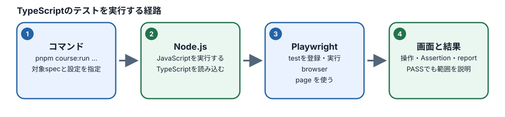
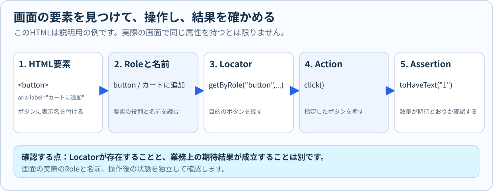
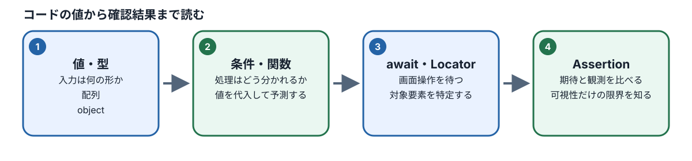

# M05：Node.js・TypeScript・Playwrightの基礎

## この章でできるようになること

この章から、いよいよ自動テストのプログラムコードを具体的に扱っていきます。

前の章（M04）では、「どの画面の、どの条件を自動テストの対象として選ぶべきか」というテスト設計の判断基準を学びました。しかし、設計したテストを実際にコンピュータ上で動かすには、コンピュータに対する指示書である「プログラム（ソースコード）」を読み、その動作の流れを頭の中で追い、実行結果やエラーを正しく確認するスキルが欠かせません。

プログラミングと聞くと、「難しそう」「数学が得意でないとできないのでは」「専門用語ばかりでついていけないのではないか」と不安を感じるかもしれません。しかし、心配する必要はまったくありません。最初から何百行もの複雑なプログラムを一から組み立てる必要はないからです。

この章（M05）の最終ゴールは、**短いプログラム（TypeScriptコード）を落ち着いて読み、頭の中で実行結果を予測できるようになること**、そして**すでにあるPlaywrightのテストコードを読み解き、画面の変更に合わせて安全に1行だけ修正して正しくテストを成功させられること**です。

新しいテストを一から書く実践は次のM06で行います。まずは、テストコードを構成する基本的な部品の役割を、1つずつ丁寧に理解していきましょう。

### 学習目標と確認する行動

この章を終えたとき、受講者が達成できているべき目標と具体的な行動は以下の通りです。

| 学習目標 | この章で確認する行動 |
| --- | --- |
| M05-01 | Node.js・pnpm・TypeScriptの役割と基本文法を説明し、短いコードを書いて実行・修正できる |
| M05-02 | テストコード内のLocator（要素の特定）・Action（操作）・Assertion（結果検証）の役割を区別できる |
| M05-03 | 「ボタンが見えていること」と「業務上の期待結果（数量変更や購入完了）が成立したこと」の違いを判断できる |
| M05-04 | 構文エラー・型エラー・実行時エラー・待機やAssertion失敗の違いをエラーメッセージから区別できる |
| M05-05 | 学習用ポート（8082番）と専用設定（Config）の役割を理解し、テストの実行結果と証拠を確認できる |

## 1. プログラムと実行環境の基礎知識

### 1.1 プログラムとは何か？

プログラムとは、一言で言えば**「コンピュータに対する手順書」**です。

身近な例として、料理のレシピ（手順書）を思い浮かべてみてください。

1. 鍋に水を入れて火にかけ、お湯を沸かす
2. 沸騰したら麺を入れる
3. タイマーをセットして3分待つ
4. 火を止めてスープの素を入れ、よく混ぜる

人間であれば、「お湯を適当に沸かして、いい感じに茹でる」といった曖昧な指示でも、これまでの経験から判断して料理を作ることができます。

しかし、コンピュータにはそのような「気の利いた融通」は一切利きません。コンピュータは、書かれた指示を、書かれた順序の通りに、寸分の狂いもなく機械的に実行することしかできません。もし「お湯を沸かす前に麺を入れる」と指示書に書かれていれば、水の中にそのまま麺を投入してしまいます。

逆に言えば、**人間が一度正しい手順を書きさえすれば、コンピュータは何百回、何千回繰り返しても、疲れることも飽きることもなく、毎回完全に同じ基準で正確に作業を実行してくれる**ということです。

例えば、ECサイトで「商品の購入希望数量が1回あたりの購入上限を超えていたら、エラーメッセージを表示して注文を止める」というルールがあるとき、これをプログラムにしておけば、誰が何個注文しようと、毎回完全に同じ基準で瞬時に自動判定してくれます。

プログラミングを学ぶ第一歩は、小難しい文法を丸暗記することではありません。

- **プログラムがどんな値（データ）を扱っているのか**
- **どのような順序で上から下へ処理が進んでいるのか**
- **どのような条件で進む道筋が枝分かれしているのか**

この3つの流れを、文章を読むように丁寧に読み解く練習から始めていきましょう。

### 1.2 Node.js・TypeScript・pnpmの関係

#### 実行の流れ



テスト自動化の現場や教材の解説では、「Node.js」「TypeScript」「pnpm」という3つのツール名が頻繁に登場します。これらは、テストコードを動かすための「土台（実行環境）」となる重要なツールです。まずはそれぞれの役割と関係性を整理しましょう。

```text
[ TypeScript（言語） ]
  └── 人間が読みやすく、型（データ種類のルール）を持った安全なプログラミング言語
        ↓ （JavaScriptへ変換）
[ Node.js（実行環境・エンジン） ]
  └── パソコンのOS上でJavaScriptを直接動かすための「エンジン」
        ↑ （操作・ライブラリ管理）
[ pnpm（パッケージ管理ツール） ]
  └── 外部の便利なプログラム部品をダウンロードし、コマンドを実行・管理する道具
```

#### 1. Node.js（ノードジェイエス）とは？

通常、Webブラウザ（Google ChromeやSafariなど）の中でしか動かないプログラミング言語「JavaScript」を、パソコンのOS（Windows、macOS、Linuxなど）の上で直接動かせるようにした実行環境（エンジン）です。

Webブラウザを開かなくても、パソコンのターミナル（黒いコマンド画面）からプログラムを実行したり、ファイルを読み書きしたりできるようになります。今回扱うPlaywrightのような自動テストツールも、このNode.jsの上で動いています。

#### 2. TypeScript（タイプスクリプト）とは？

JavaScriptをベースに、値の種類（「数値」「文字」などの**型**）を指定できるように拡張されたプログラミング言語です。

JavaScriptでは、間違って数字を入れるべき場所に文字を入れてしまっても、実際に動かす瞬間までエラーに気づけないことがあります。一方、TypeScriptを使うと、コードを書いている最中に「ここは数値が必要ですが、文字が渡されています」とエディタ（VS Code）が赤い波線で警告を出してくれます。プログラムを実行する前にミスの大半を発見できるため、現代のソフトウェア開発やテスト自動化で標準的に使われています。

#### 3. pnpm（ピーエヌピーエム）とは？

世界中の開発者が公開している便利なプログラムの部品（パッケージやライブラリ）をインターネットからダウンロードして管理したり、プロジェクトに登録されたコマンドを実行したりするための道具（パッケージマネージャー）です。スマートフォンの「App Store」や「Google Play」のような役割を果たしています。

### 1.3 ターミナルでバージョンを確認する

学習環境（Codespaces）の画面下部にあるターミナル（コマンド入力画面）を開き、現在の環境にこれらのツールが正しく入っているか確認してみましょう。

ターミナルに以下のコマンドを1行ずつ入力し、キーボードのEnterキーを押します。

```bash
node --version
pnpm --version
```

**実行結果の例:**

```text
v20.x.x
9.x.x
```

表示される数字は、現在インストールされているツールの「バージョン番号」です。環境によって細かな数字は異なりますが、エラーメッセージが出ずに数字が表示されれば、ツールが正常に使える状態になっています。これは、道具を使う前の「点呼」のような作業です。

> **コマンドの使い分けに注意しましょう:**
> このコースでは、`pnpm` から始まる似たようなコマンドが登場します。
>
> - `pnpm course:load M05`：M05で使う学習用のテストファイルを作業フォルダに用意するコマンド
> - `pnpm course:run M05 <ファイル名>`：指定したテストを動かして合否を確認するコマンド
>
> どちらも `pnpm` から始まりますが、「教材を読み込む（load）」のか「テストを実行する（run）」のかで目的がまったく異なります。教材の手順をしっかり確認して入力してください。

## 2. 変数と値：データに名前を付ける

### 2.1 変数とは？

プログラムの中で計算を行ったり、大小を比較したりするには、扱っているデータを一時的に保存しておく入れ物が必要です。この入れ物のことを**変数（へんすう）**と呼びます。

実生活で言えば、書類を整理する透明な収納ボックスに、「電気代の領収書」「今月の注文数」といったラベルシールを貼るようなものです。ラベル（変数名）を貼ることで、その箱の中に何が入っているのか、誰が見てもひと目で分かるようになります。

### 2.2 変数の宣言と値の比較

次の3行のプログラムを見てみましょう。

```ts
const limit = 3;
const requested = 4;
console.log(requested > limit);
```

1行ずつ、何が行われているのかを読み解いていきます。

1. **`const limit = 3;`**
   - `limit`（上限値）という名前の箱（変数）を作り、その中に数値の `3` を入れます。
   - 先頭の `const`（コンスト）は、定数（Constant）の略で、「この箱の中身は、後から別の値に勝手に書き換えてはいけません」というルールを宣言しています。
2. **`const requested = 4;`**
   - `requested`（注文希望数）という名前の箱を作り、その中に数値の `4` を入れます。
3. **`console.log(requested > limit);`**
   - `>` は算数で習う不等号と同じで、「左側の値は、右側の値より大きいか？」を比べる記号（比較演算子）です。
   - `requested > limit` は、中身の数値を当てはめると `4 > 3` となります。4は3より大きいため、この比較は正しいです。
   - `console.log(...)` は、カッコの中身の計算結果や判定結果を画面（コンソール）に出力して表示する命令です。

`4 > 3` は正しいため、画面には「正しい」を意味するプログラミング用語の **`true`（真：トゥルー）** が出力されます。

#### 予想してみよう

もし2行目の `requested` を `2` に変えたら、画面には何と表示されるでしょうか？

```ts
const limit = 3;
const requested = 2;
console.log(requested > limit);
```

**解説:**
中身を当てはめると `2 > 3` になります。2は3より大きくないため、この不等式は成り立ちません。
したがって、結果は「誤り」を意味する **`false`（偽：フォールス）** になります。

処理の手順（比較して画面に出す）はまったく変えていなくても、変数の中身を変えるだけで、コンピュータの判定結果が `true` から `false` へと切り替わることが分かります。

### 2.3 基本的なデータ型（種類）

プログラムで扱うデータには、いくつかの「種類（型：かた）」があります。型が異なると、コンピュータができる操作も変わってきます。まずは最も基本的で重要な3つの型を覚えましょう。

| 型の名前 | 意味 | コードの書き方の例 | 説明 |
| --- | --- | --- | --- |
| 数値型（`number`） | 計算に使える数字 | `3`, `100`, `-5` | クォーテーションなしで直接書きます。足し算や大小比較ができます。 |
| 文字列型（`string`） | 人間が読むテキスト | `"3"`, `"カート"`, `"エラー"` | ダブルクォーテーション（またはシングル）で囲みます。 |
| 真偽値型（`boolean`） | 正しいか誤りかの状態 | `true`, `false` | 二者択一の判定結果を表します（クォーテーションは付けません）。 |

> **初心者が最もつまずきやすい落とし穴:**
> 人間の目には同じ「3」に見えても、数値の `3` と、文字としての `"3"` は、コンピュータにとっては全くの別物です。
>
> - 数値の `3 + 1` の計算結果は、正しく **`4`** になります。
> - 一方、文字列の `"3" + 1` を実行すると、計算ではなく文字の連結とみなされ、**`"31"`** という文字列になってしまいます。
>
> 画面に見えている値が「数値」なのか「文字列」なのかを常に区別して意識することが、バグを防ぐ重要なポイントです。

## 3. 配列・オブジェクト・条件分岐

### 3.1 配列：複数の値を順番に並べる

「商品の購入数量の選択肢（1個、2個、3個）」のように、複数のデータを順番に並べてひとまとめにして扱いたいときは**配列（はいれつ：Array）**を使います。

```ts
const quantities: number[] = [1, 2, 3];
const value = quantities[2];
console.log(value);
```

- `[1, 2, 3]`：カギカッコ `[ ]` の中に、カンマ `,` で区切って値を並べます。
- `: number[]`：これはTypeScriptの型注釈（かたちゅうしゃく）で、「この箱には数値（number）の配列だけが入ります」とルールを定めています。

#### 順番（インデックス）は「0」から数える

配列の中から特定の値を取り出すときは、`配列名[何番目]` という書き方をします。このカッコの中の番号を**インデックス（添字：そえじ）**と呼びます。

ここで初心者が最も驚くルールがあります。プログラミングの世界では、順番は1からではなく**0から数え始める**という決まりになっています。

```text
配列の中身: [   1   ,   2   ,   3   ]
インデックス:   [0]     [1]     [2]
            (1番目)  (2番目)  (3番目)
```

上のコードの `quantities[2]` は、「3番目に入っている値」を指しています。したがって、画面に出力される値は **`3`** です。

もし、存在しない4番目の値を取り出そうとして `quantities[3]` と書くと、データが存在しないことを意味する **`undefined`（未定義：アンディファインド）** という特別な状態が返ってきます。

### 3.2 オブジェクト：名前を付けてデータをまとめる

現実世界の「商品」という概念を考えてみてください。1つの商品には、「商品名」「価格」「在庫数」など、種類の異なる複数の情報がセットで紐付いています。

このように、関連するデータを項目名（プロパティ名）付きでひとまとめにした構造を**オブジェクト（Object）**と呼びます。

```ts
const setup = {
  limit: 2,
  product: "mug"
};

console.log(setup.limit);
console.log(setup.product);
```

波カッコ `{ }` の中に、`項目名: 値` のペアをカンマで区切って並べます。
値を取り出すときは、`setup.limit` のように**「オブジェクト名.項目名」**（ドット記法）でアクセスします。

- **配列**：複数の値を「番号（位置）」で管理する（例：選択肢のリスト）
- **オブジェクト**：複数の値を「名前（項目名）」で管理する（例：商品の詳細データ）

この2つの道具の違いをしっかり整理しておきましょう。

### 3.3 条件分岐：状況に応じて処理を分ける

プログラムの最も強力な機能の1つが、「もし〇〇ならAの処理を行い、そうでなければBの処理を行う」というように、状況に応じて動く道筋を切り替える仕組みです。これを**条件分岐（じょうけんぶんき）**と呼び、主に **`if`（イフ）文** を使います。

```ts
const requested = 3;
const limit = 2;

if (requested > limit) {
  console.log("上限を超える");
} else {
  console.log("上限内");
}
```

- `if (条件式) { ... }`：カッコの中の条件式が成り立つ（`true` の）場合、直後の波カッコ `{ }` の中身を実行します。
- `else { ... }`：条件式が成り立たなかった（`false` の）場合、こちらの波カッコ `{ }` の中身を実行します。

このコードでは、`requested > limit`（3 > 2）は正しいため、画面には「上限を超える」と出力されます。

#### 練習してみよう

もし `requested` を `2` に変更したら、どちらのメッセージが表示されるでしょうか？

```ts
const requested = 2;
const limit = 2;

if (requested > limit) {
  console.log("上限を超える");
} else {
  console.log("上限内");
}
```

**解答と解説:**
表示されるのは**「上限内」**です。

なぜなら、使われている比較記号 `>`（大なり）は「左側が右側より真に大きい」ことを調べるものであり、**同じ値（等しい）は含まない**からです。`2 > 2` は成り立たないため結果は `false` となり、`else` 側の処理が実行されます。

もし「同じ値も含めて上限を超えたとみなす（2以上）」と判定したいなら、記号を `>=`（以上：大なりイコール）にする必要があります。この「境界値（ピッタリ同じ値のときにどちらに転ぶか）」は、テスト設計や不具合の発見において極めて重要な視点です。

### 【手順付き実習】変数・配列・オブジェクト・条件分岐を実行する（M05-01）

コードを読むだけでなく、実際に自分の手でファイルを作成し、Node.jsを使ってプログラムを実行してみましょう。
ここでは、ブラウザを使わずに単体で動かせるシンプルなJavaScriptファイル（拡張子 `.mjs`）を作成して動かします。

#### 1. 実習の目的

自分が書いたコードを保存してNode.jsで実行し、実行前に頭の中で予測した結果と、実際のターミナルの出力が完全に一致することを検証します。

#### 2. 事前準備

1. 学習用Codespaceを開きます。
2. 画面下部のターミナルで `pwd` コマンドを実行し、リポジトリのルートフォルダにいることを確認します。
3. `node --version` を実行し、Node.jsが利用可能な状態であることを確認します。

#### 3. 実施手順

1. VS Codeの画面左側にあるExplorer（ファイル一覧）で、`workspace/M05/` フォルダを探します。
2. `workspace/M05/` フォルダの中に、新しいファイル `practice-values.mjs` を作成します。
3. 作成したファイルを開き、以下のコードをそのまま入力して保存（Windows: Ctrl+S / Mac: Cmd+S）します。**まだ実行しないでください。**

```js
const item = { name: "マグ", price: 800 };
const quantities = [1, 2, 3];
const selectedQuantity = quantities[1];
const total = item.price * selectedQuantity;

if (total >= 1500) {
  console.log(item.name + "：高額側の条件");
} else {
  console.log(item.name + "：通常側の条件");
}

console.log("合計 " + total);
```

1. ターミナルで実行する前に、画面に何が表示されるかを頭の中で計算し、メモ用紙などに予想を書き出してください。
   - `item.price` はいくらか？（800）
   - `quantities[1]` で取り出されるのは何番目の数値か？（0から数えて1番目なので「2」）
   - `total` の計算結果はいくらになるか？（800 × 2 = 1600）
   - `total >= 1500`（1600 >= 1500）の条件は成り立つか？（成り立つので `if` 側へ進む）
2. ターミナルで以下のコマンドを入力し、Enterキーを押して実行します。

```bash
node workspace/M05/practice-values.mjs
```

1. ターミナルに表示された出力と、ステップ4で立てた自分の予想を照らし合わせます。
2. 次に、コードの3行目を以下のように書き換えて保存します。

   ```js
   const selectedQuantity = quantities[0];
   ```

3. もう一度同じコマンド（`node workspace/M05/practice-values.mjs`）を実行し、表示がどう変化したかを確認してください。

#### 解答と詳しい解説

- **最初の実行結果:**

  ```text
  マグ：高額側の条件
  合計 1600
  ```

  配列のインデックスは0から始まるため、`quantities[1]` は2番目の値である `2` を取り出します。合計金額は `800 × 2 = 1600` となり、1500以上であるため `if` ブロックの処理が実行されます。
- **書き換え後の実行結果:**

  ```text
  マグ：通常側の条件
  合計 800
  ```

  `quantities[0]` は1番目の値である `1` を取り出します。合計金額は `800 × 1 = 800` となり、1500未満であるため条件を満たさず、`else` ブロックの処理が実行されます。

#### トラブルシューティング（うまくいかない場合）

`Cannot find module ...` というエラーが表示された場合は、指定した場所にファイルが見つかっていません。

- ターミナルの現在地がリポジトリの直下（ルート）になっているか
- ファイルの保存先が `workspace/M05/practice-values.mjs` になっているか
- ファイル名のスペルや拡張子（`.mjs`）に誤りがないか
を落ち着いて確認してください。

## 4. 関数と型：繰り返す処理に名前を付ける

### 4.1 関数とは？

商品の合計金額の計算や、購入上限を超えているかのチェックなど、同じような計算や判定をプログラムのあちこちで何度も書くのは大変です。また、判定ルールが変更されたときに何箇所も修正して回ると、修正漏れによる不具合の原因になります。

そこで、**「一連の処理をひとまとめにして名前を付け、必要なときに何度でも呼び出せるようにした仕組み」**を**関数（かんすう：Function）**と呼びます。

身近な例で言えば「自動販売機」です。

- お金と商品ボタンの番号を入れる（入力：**引数（ひきすう）**）
- 機械の内部で投入金額の確認や在庫のチェックを行う（**処理**）
- ジュースとお釣りが出てくる（出力：**戻り値（もどりち）**）

次のコードを見てみましょう。

```ts
const setup = { limit: 2 };

function exceedsLimit(value: number): boolean {
  return value > setup.limit;
}

console.log(exceedsLimit(3));
console.log(exceedsLimit(1));
```

#### コードの各要素の役割

1. **`function exceedsLimit(...)`**
   - `exceedsLimit`（上限を超えているか？）という名前の関数を定義（作成）しています。
2. **`(value: number)`**
   - 関数に渡される材料（**引数**）です。ここでは「`value` という名前の数値型データを受け取ります」と宣言しています。
3. **`: boolean`**
   - 処理を終えた後に関数が呼び出し元へ返す結果（**戻り値**）の型です。「真偽値（`true` または `false`）を返します」と宣言しています。
4. **`return value > setup.limit;`**
   - `return` は、計算した結果を呼び出し元へ送り返して関数を終了する命令です。ここでは `value > 2` の判定結果（`true` または `false`）を送り返します。

関数を使う（呼び出す）ときは、`exceedsLimit(3)` のようにカッコの中に調べたい数値を渡します。

- `3` を渡すと、`3 > 2` が成り立ち、`true` が返ってきます。
- `1` を渡すと、`1 > 2` は成り立たず、`false` が返ってきます。

### 4.2 型の重要性と安全性

もし素のJavaScriptで、誤って `exceedsLimit("3")` のように文字列の `"3"` を渡してしまった場合、文字と数値の比較になり、開発者が意図しない予期せぬ不具合を引き起こす危険があります。

しかし、TypeScriptを使っていれば、コードを書いた瞬間に「ここには数値（number）を渡す必要がありますが、文字列（string）が渡されています」とエディタ上で即座にエラーを教えてくれます。

> **大切な注意点:**
> TypeScriptの型検査（tsc）でエラーが出なかったからといって、「ショッピングカートの業務仕様がすべて正しい」ことまで保証されるわけではありません。型はあくまで「データの形式や種類（数値なのか文字なのか）の整合性」を保証するものであり、「上限を超えたら注文ボタンを押せなくする」といった業務ルール通りに正しく画面が動くかどうかは、テストを実行して確かめる必要があります。

## 5. ファイルをまたいだ機能の共有（import と export）

プログラムの規模が大きくなってくると、1つのファイルにすべての処理を詰め込むとコードが何千行にもなり、どこに何が書いてあるのか分からなくなってしまいます。そのため、役割ごとにファイルを分割して管理するのが一般的です。

このとき、**「定義した関数や変数を他のファイルへ公開する仕組み」**が **`export`（エクスポート）** であり、**「公開された部品を自分のファイルへ読み込む仕組み」**が **`import`（インポート）** です。

```ts
// limits.ts（判定処理を定義して外部へ公開するファイル）
export function exceeds(value: number, limit: number): boolean {
  return value > limit;
}
```

```ts
// sample.ts（別のファイルから読み込んで利用するファイル）
import { exceeds } from "./limits";

console.log(exceeds(4, 3)); // 出力結果: true
```

- `export`：関数の前に付けることで、「他のファイルからこの関数を呼び出して使っていいですよ」という公開状態になります。
- `import { 関数名 } from "ファイルの場所"`：使いたい関数を指定して自分のファイルに読み込みます。

Playwrightのテストファイルを書くときに、必ず1行目に書く以下のコードも全く同じ仕組みです。

```ts
import { expect, test } from "@playwright/test";
```

これは、「Playwrightというテストライブラリが提供してくれている便利な関数（テストケースを作る `test` や、結果を検証する `expect`）を、このテストファイルに読み込んで使います」と宣言しているのです。

## 6. 非同期処理：処理の完了を待つ（`async` と `await`）

### 6.1 なぜ「待つ」必要があるのか？

電卓で「1 + 1」を計算するとき、答えの「2」はボタンを押した瞬時に出ます。プログラムの計算処理も、基本的には一瞬で完了します。

しかし、Webブラウザを自動操作するときはどうでしょうか？

- Webページを開く（インターネットを経由してサーバーからHTMLや画像データを読み込む）
- ボタンを押して別の画面に切り替わる
- 検索ボタンを押して検索結果の一覧が届く

これらの処理には、数ミリ秒から数秒の**待ち時間（通信や描画の時間）**が必ず発生します。

もしプログラムが通信の完了を待たずに、次の行に書かれた「ボタンをクリックする」命令を猛スピードで実行してしまったらどうなるでしょうか？ まだ画面上にボタンが表示されていないため、プログラムは「そんなボタンは見つかりません」とエラーを出してテストを失敗させてしまいます。

このように、「処理を依頼してから、実際に完了するまでに待ち時間が発生する処理」のことを**非同期処理（ひどうきしょり）**と呼びます。

### 6.2 `async`（エイシンク）と `await`（アウェイト）

そこで、時間がかかる非同期処理に対して「その作業が完了するまで、次の行へ進まずに待ってください」とコンピュータに指示する仕組みが **`async`** と **`await`** です。

```ts
async function openAndClick(page: import("@playwright/test").Page) {
  await page.goto("/products");
  await page.getByRole("link", { name: "カート" }).click();
}
```

- **`async`（Asynchronousの略）**：
  - 時間のかかる非同期処理を含んでいる関数の前に付けます。「この関数の中では待ち時間が発生する処理を扱いますよ」という合図です。
- **`await`（「待つ」という意味の英語）**：
  - 完了を待つべき具体的な処理の直前に付けます。
  - `await page.goto("/products");`：商品一覧ページへの移動命令を出し、ページの読み込みが一定の完了基準に達するまで待機します（ただし、その後に画面側で動くあらゆる追加通信まで無条件に保証するわけではありません）。
  - `await page.getByRole(...).click();`：リンク要素が見つかり、クリック操作が完了するまで待機します。

> **大切な心構え:**
> `await` は魔法の杖ではありません。「`await` さえ付ければどんな問題でも自動的に解決する」と思い込まないようにしましょう。そもそも指定した名前のボタンが画面に存在しなかったり、指定したURLが間違っていれば、どれだけ長く待っても要素は見つからず、最終的にタイムアウトエラーになります。

### 【手順付き実習】関数・型・非同期処理を体験する（M05-01）

#### 実習A：関数を呼び出して結果の流れを追う

1. `workspace/M05/practice-function.mjs` を作成し、以下のコードを入力して保存します。

```js
function overLimit(current, add, limit) {
  const nextTotal = current + add;
  return nextTotal > limit;
}

console.log(overLimit(2, 1, 3));
console.log(overLimit(2, 2, 3));
```

1. 実行前の予測:
   - `overLimit(2, 1, 3)` は、現在2個入っているカートに1個追加し（合計3個）、上限3に対してどうなるか？（`3 > 3` なので超過していない → `false`）
   - `overLimit(2, 2, 3)` は、現在2個入っているカートに2個追加し（合計4個）、上限3に対してどうなるか？（`4 > 3` なので超過している → `true`）
2. ターミナルで実行します。

   ```bash
   node workspace/M05/practice-function.mjs
   ```

**解答と解説:**
ターミナルの出力は `false` と `true` になります。
`2 + 1 = 3` のとき、`3 > 3` は等しいため「超過（より大きい）」を満たさず `false` です。
`2 + 2 = 4` のとき、`4 > 3` は成り立つため `true` です。
関数に入力する値を変えることで、内部の計算と判定結果が正しく変化することを確認しましょう。

#### 実習B：非同期処理の実行順序を確認する

1. `workspace/M05/practice-async.mjs` を作成し、以下のコードを入力して保存します。

```js
console.log("1. 処理を開始します");

async function prepareData() {
  return "2. データを準備しました";
}

const message = await prepareData();
console.log(message);

console.log("3. すべての処理が終了しました");
```

1. ターミナルで実行します。

   ```bash
   node workspace/M05/practice-async.mjs
   ```

**解答と解説:**
出力結果は以下の順序になります。

```text
1. 処理を開始します
2. データを準備しました
3. すべての処理が終了しました
```

`await prepareData()` によって、データの準備処理が完了して `message` に値が入るのを待ってから、最後の「3. すべての処理が終了しました」へ順番通りに進んでいることが確認できます。

#### AIチューター（AI協働）の活用練習

VS Code上でOpenCodeやAIエージェントに、以下のように質問してみましょう。

> **プロンプト例:**
> 「`workspace/M05/practice-function.mjs` のコードを行ごとに初心者向けに解説してください。また、引数を `overLimit(1, 1, 2)` に変えた場合にどうなるか、予測とその理由を示してください。ファイルの編集やコマンドの実行は行わないでください。」

AIから返ってきた解説を読み、自分が実習で理解した内容と照らし合わせてみましょう。AIの説明が自分の理解と一致しているかを確かめる習慣をつけることが大切です。

### 6.3 実験：`await`を忘れたとき、なぜ判断が間違うのか

#### 待機と失敗の読み分け

非同期処理の関数を呼び出したとき、`await` を付けないと、完了後の値そのものではなく、**「後で結果をお渡しします」という引換券（Promiseオブジェクト）** が即座に返ってきます。

`await` は、その引換券を出して「処理が完了するまで待ち、実際の結果（値）を受け取る」ために使います。

この違いによってなぜコンピュータの判定が狂ってしまうのかを、ブラウザを起動せずに確認できる短いコードで実験してみましょう。これは**学習用の独立したコード例**であり、Scenario Shopの実行結果そのものではありません。

1. VS Codeで `workspace/M05/practice-await.mjs` を作成し、以下を入力して保存します。

```js
async function isPurchaseAllowed() {
  return false; // 今回は「購入を許可しない」という判定結果を返す関数
}

// 1. await を付け忘れた場合
const withoutAwait = isPurchaseAllowed();
console.log("awaitなしの値はPromise（引換券）か:", withoutAwait instanceof Promise);
if (withoutAwait) {
  console.log("誤った判断: 購入できる");
}

// 2. await を正しく付けた場合
const withAwait = await isPurchaseAllowed();
console.log("awaitありの判定値:", withAwait);
if (!withAwait) {
  console.log("正しい判断: 購入できない");
}
```

1. リポジトリのルートから以下のコマンドを実行します。

   ```bash
   node workspace/M05/practice-await.mjs
   ```

2. 実行前の予想と、画面の出力を比較します。

**期待される出力結果:**

```text
awaitなしの値はPromise（引換券）か: true
誤った判断: 購入できる
awaitありの判定値: false
正しい判断: 購入できない
```

**なぜこうなるのか（理由の解説）:**
`isPurchaseAllowed()` は非同期関数です。

- `await` を付けずに呼び出すと、関数から返ってくるのは `false` ではなく「Promise（引換券オブジェクト）」です。JavaScriptのルールでは、空ではないオブジェクトはすべて「存在するもの（真）」として扱われます。そのため、本来は「購入不可（`false`）」のはずなのに、`if (withoutAwait)` は真とみなされ、「購入できる」という真逆の誤った分岐に進んでしまいます。
- 一方、`await` を正しく付けると、処理の完了を待って中身の `false` を取り出すため、`if (!withAwait)` の正しい分岐に進むことができます。

**Playwrightとのつながり:**
Playwrightの `locator.click()` などの操作や、`await expect(locator).toHaveText(...)` などのWeb Assertion（自動再試行を伴う検証）もすべてPromiseを返します。
`await` を付け忘れると、クリックが完了する前に次の検証に進んでしまったり、Assertionの結果を待たずにテストが合格したと誤認して終了してしまうなど、予期せぬテストの失敗や誤判定（Flaky test）の原因になります。

**条件を変える練習（解答付き）:**
もし1行目の `return false` を `return true` に変えた場合、`withAwait` の判定はどうなりますか？

- **解答**: `withAwait` には完了後の `true` が入るため、`if (!withAwait)`（否定）の中は実行されません。一方、`withoutAwait` は依然としてPromiseオブジェクトなので、真として扱われます。このように、`await` を付け忘れたコードがたまたま正しそうに見える結果を出したとしても、決して安全だと過信してはいけません。

## 6A. Web画面の裏側を知る：HTMLとLocatorの基礎

### 6A.1 Web画面はどのようにできているのか

Webブラウザに表示されている「商品を探す」ボタンや「キーワード入力欄」の裏側には、**HTML（エイチティーエムエル）** という文章構造が存在します。

HTMLは、画面上の部品を `<button>` や `<a>` といった**タグ**と呼ばれる記号で表現します。

以下は学習用のシンプルなHTMLの例です（実際のScenario ShopのHTMLが完全にこの通りであるとは決めつけないでください）。

```html
<h1>商品を探す</h1>
<label for="keyword">キーワード</label>
<input id="keyword" type="text">
<button type="button">検索</button>
<a href="/products/mug">マグの詳細</a>
```

| HTMLの部分 | 役割 | 画面で人間が見て理解するもの |
| --- | --- | --- |
| `<h1>...</h1>` | 見出し（Heading） | 「商品を探す」という大見出しの文字 |
| `<label for="...">` | 入力欄のラベル（説明） | 入力欄の横にある「キーワード」という説明文字 |
| `<input id="..." type="text">` | 1行の文字入力欄 | 利用者が文字を打ち込む四角い枠 |
| `<button type="button">...</button>` | 押下できるボタン | クリックできる「検索」ボタン |
| `<a href="...">...</a>` | リンク（別ページへの移動） | クリックすると移動する「マグの詳細」リンク |

タグの中にある `id="keyword"` や `href="/products/mug"` のような部分を**属性（ぞくせい：Attribute）**と呼びます。

- `id`：ページ内でその部品を特定するための一意な名前です。
- `href`：リンクをクリックしたときの移動先URLを示します。
- `class`：主に画面のデザインや装飾を指定するために使われますが、デザイン変更で名前が変わりやすいため、自動テストで不用意にクラス名に依存しすぎるとテストが壊れやすくなります。

ブラウザがHTMLを読み込むと、これらの部品の親子関係を整理した**DOM（ドム：Document Object Model）**という内部構造が作られます。初学者のうちは、「見出し・入力欄・ボタン・リンクといった画面部品を、プログラムから操作しやすいようにブラウザが整理したツリー構造」と理解しておけば十分です。

### 6A.2 Roleとアクセシブル名は、画面の役割を表す

Playwrightで画面上の要素を探すとき、最も推奨される方法は、画面の部品が持っている**役割（Role：ロール）**と、人間や読み上げソフトが見出しや文字から認識する**名前（アクセシブル名：Accessible Name）**を手掛かりにすることです。

上のHTML例であれば、Playwrightでは次のように要素を指定します。

```ts
const searchButton = page.getByRole("button", { name: "検索" });
const keywordInput = page.getByRole("textbox", { name: "キーワード" });
const mugLink = page.getByRole("link", { name: "マグの詳細" });
```

- `button` は「ボタン」という役割です。`name: "検索"` を組み合わせることで、「検索という名前のボタン」を特定します。
- `textbox` は「文字入力欄」の役割です。`<label>` と `<input>` が結びついているため、「キーワードという名前の入力欄」として探せます。
- `link` は「リンク」の役割です。リンクの表示文字「マグの詳細」を手掛かりに特定します。

> **注意点:**
> アクセシブル名は、必ずしも画面に見えている文字と完全に一致するとは限りません。画面上は単にアイコン（虫眼鏡マークや「+」記号）だけが表示されていて、裏側の `aria-label` 属性によって「数量を増やす」といったアクセシブル名が設定されている場合もあります。実際の画面やHTMLを必ず確認しましょう。また、開発チームがテスト専用の識別子として `data-testid` を用意している場合は、`page.getByTestId(...)` を使うこともあります。



この図のHTMLは仕組みを理解するための説明用の例です。Scenario Shopが実際に同じHTMLやアクセシブル名を持つと仮定してはいけません。実習では表示中の画面からRoleと名前を確認し、Locatorが対象の要素を一意に指すこと、Assertionが業務仕様上の期待結果を確かめることを別々に確認します。

### 6A.3 手順付き練習：HTMLの一部からLocatorを選ぶ

次の学習用HTMLを見て、目的のボタンを特定するLocatorを考えてみましょう。

```html
<section>
  <h2>注文内容</h2>
  <button type="button" aria-label="数量を増やす">+</button>
  <button type="button">削除</button>
</section>
```

#### 考えるステップ

1. このHTMLの中に `<button>` タグはいくつありますか？（2つ）
2. 画面上に「+」と見えているボタンの**アクセシブル名**は何ですか？（`aria-label` で指定されている「数量を増やす」）
3. 「削除」ボタンを特定するLocatorはどう書けますか？
4. もし1つ目のボタンを `page.getByRole("button", { name: "+" })` と書いた場合、なぜ問題があるのでしょうか？

**解答と詳しい解説:**

- 削除ボタンのLocator: `page.getByRole("button", { name: "削除" })`
- 「+」ボタンのLocator: `page.getByRole("button", { name: "数量を増やす" })`
- 解説: 画面のボタンに「+」と表示されていても、HTML内部で `aria-label="数量を増やす"` が指定されている場合、ブラウザが認識する正式なアクセシブル名は「数量を増やす」になります。名前を単なる `"+"` と決めつけてコードを書くと、Playwrightは要素を見つけられずにタイムアウト失敗してしまいます。

### 6A.4 実際の画面で確認する手順（読取り専用）

後述の実技課題でテストコード（`product-link.spec.ts`）を修正する際は、以下の手順で実画面の情報を確認します。

1. **テストサーバーの起動確認:**
   - Scenario Shopが教材指定のポート（8082番ポート）で起動していることを確認します。勝手に別のサーバーを起動したり、公開ポートを変更したりしないでください。
2. **目視で確認:**
   - ブラウザで商品一覧ページを開き、操作したいリンクが人間の目で見てどう表示されているかをメモします。
3. **要素の検証（Inspect）を開く:**
   - リンクの上で右クリックし、メニューから「検証（Inspect）」を選んでブラウザの開発者ツールを開きます（Codespacesの利用環境によってショートカットキーが異なる場合があるため、右クリックメニューから開くのが確実です）。
4. **HTML情報の読み取り:**
   - Elementsタブで対象の `<a>` タグを見つけ、表示されているテキスト、`href` 属性の値、アクセシビリティ情報（Accessibilityツリーの名前）を**目で読み取ります**。この手順ではHTMLの編集は行いません。
5. **テストコードとの照合:**
   - テストコード内に書かれているLocatorの文字列と、先ほど読み取った実画面のアクセシブル名を比較し、どこにズレがあるかを確認します。
6. **修正の実施:**
   - ズレていた文字列のみを最小限で修正します。独断でテストの検証条件（Assertion）を削除したり、別のファイルを書き換えてはいけません。

## 7. Playwrightで画面を確かめる基本構造

### 7.1 テストコードの3大要素：Locator・Action・Assertion

#### コードを読む



ここから、Webブラウザ自動テストツール **Playwright（プレイライト）** の具体的なテストコードの構造に入っていきます。

Playwrightのテストコードは、基本的に以下の3つの要素の組み合わせで成り立っています。

```text
1. Locator（ロケーター）   : 画面上のどの部品を対象にするか「探す・特定する」
2. Action（アクション）     : 特定した部品を「クリックする」「文字を入力する」
3. Assertion（アサーション） : 操作した結果、期待通りの状態になったか「確かめる・検証する」
```

実際のテストコードの例を見てみましょう。
これは、「商品一覧ページを開き、特定の商品詳細リンクが表示されていることを確認する」短いテストです。

```ts
import { expect, test } from "@playwright/test";

test("商品一覧への導線を確認する", async ({ page }) => {
  // 画面を開く
  await page.goto("/products");

  // 1. Locator: 対象のリンクを探す
  const productLinks = page.locator('a[href^="/products/"]');

  // 3. Assertion: 最初のリンクが表示されていることを確認する
  await expect(productLinks.first()).toBeVisible();
});
```

| コードの行 | 役割 | 意味と動作の解説 |
| --- | --- | --- |
| `import { expect, test } from "@playwright/test";` | 準備 | Playwright Testの標準機能である `test` と `expect` を読み込みます。 |
| `test("テスト名", async ({ page }) => { ... });` | 枠組み | 独立した1件のテストケースを定義します。`page` はブラウザの1つのタブを表しています。 |
| `await page.goto("/products");` | 操作 | 商品一覧ページを開き、初期ロードが完了するまで待機します。 |
| `page.locator(...)` | **Locator** | 指定した条件（URLが `/products/` で始まる `<a>` リンク）に一致する画面要素を探します。 |
| `await expect(...).toBeVisible();` | **Assertion** | その要素が画面上に人間の目で視認できる状態（表示中）になっているかを自動検証します。 |

### 7.2 表示確認（弱いAssertion）と業務結果の確認の違い

テスト自動化を始めた初学者が非常によく陥る落とし穴が、**「弱いAssertion」** です。

例えば、「商品をカートに追加するテスト」を作成するとします。

1. 商品詳細ページを開く
2. 「カートに追加」ボタンをクリックする
3. `await expect(page.getByRole("button", { name: "カートに追加" })).toBeVisible();` を検証して合格（PASS）にする

このテストはグリーン（成功）になるかもしれませんが、本当に業務として成功しているでしょうか？

「カートに追加ボタンが見えていること」を確かめただけでは、単に**ボタンが画面上に存在していること**を確かめたにすぎません。

- ボタンを押した結果、カート画面にその商品が正しく入ったか？
- カート内の数量は正しく「1」になっているか？
- 合計金額は正しく計算されているか？
- データベースやストレージに注文データが作られたか？

これらを確認して初めて、「カート追加の機能が業務仕様通りに正しく動いた」と証明できたことになります。

テストが成功したときは、常に**「このテストのAssertionは何を証明できていて、何がまだ未確認なのか」**を客観的に説明できるように意識しましょう。

### 7.3 Locatorが見つからないときの原因

テストを実行したときに「Element not found（要素が見つかりません）」というタイムアウトエラーが出る場合、主な原因は以下の3つに絞られます。

1. **名前（アクセシブル名）のズレ**:
   - 画面に見えている文字と、HTMLの属性（`aria-label` など）で設定されている名前に違いがある。
2. **ページ（遷移状態）のズレ**:
   - 前の画面からの遷移が完了していない、または想定と違うURLの画面を見ている。
3. **候補の重複（一意に特定できない）**:
   - 同じ名前のボタンやリンクが画面内に複数あり、どれを操作すべきかコンピュータが判断できない（Strict mode violationエラー）。

## 8. エラーを種類別に読み解く

自動テストを実行してエラーが出たとき、初心者は焦って「とりあえず待ち時間（`waitForTimeout`）を入れてみよう」としがちです。しかし、原因を突き止めないまま固定待機時間を増やしても、テストが遅くなるだけで根本的な解決にはなりません。

まずはエラーメッセージの最初の数行を落ち着いて読み、どの種類のエラーに分類されるかを切り分けましょう。

| エラーの種類 | どんな問題か | 典型的なエラーメッセージ・原因 | 最初に見るべき場所 |
| --- | --- | --- | --- |
| **構文エラー**（Syntax Error） | プログラムの文法上の間違い | カッコ `{ }` やクォーテーション `"` の閉じ忘れ、カンマの抜け | エラーが出た行番号とその直前の行 |
| **型エラー**（Type Error） | 期待される型と渡した値の食い違い | `Type 'string' is not assignable to type 'number'` | 変数の型定義と、実際に渡している値 |
| **実行時エラー**（Runtime Error） | 実行中にプログラムがクラッシュ | `Cannot read properties of undefined`（中身が空のオブジェクトを読もうとした） | 変数の中身が `undefined` になっていないか |
| **Locator失敗** | 操作対象の要素が画面で見つからない | `waiting for getByRole('button', { name: '...' })` でタイムアウト | ブラウザ実画面の要素名、対象ページのURL |
| **Assertion失敗** | 期待した結果と実際の結果が不一致 | `Expected: 1, Received: 0` | テストが期待している値と、実際の画面の表示内容 |
| **接続・起動失敗** | サーバーやポートに接続できない | `net::ERR_CONNECTION_REFUSED` | テストサーバー（8082）が起動しているか |

## 9. 学習用の実行環境とポート契約

この教材リポジトリでは、用途に応じて複数のポート（通信の出入口となる番号）が厳密に使い分けられています。

| ポート番号 | 役割 | 注意点 |
| --- | --- | --- |
| **8081** | 通常の開発用Webサーバー | 本コース（M05〜M07）の実技テストの接続先ではありません。 |
| **8082** | **Training専用のWebテストサーバー** | **`pnpm course:run` が接続する正規のテスト対象サーバーです。** |
| **6080** | Private noVNC（デスクトップ画面確認用） | 外部に不要に公開（Public化）しないでください。 |

本コースのテスト設定ファイル `playwright.ai-assisted-qa.config.ts` には、テストの接続先として **8082番ポート** が厳密に定義されています。設定ファイルを勝手に書き換えて別のポートに接続先を変更してはいけません。

## 10. 【手順付き実技】既存のLocatorを修正してテストを成功させる（M05-02〜M05-05）

ここからは、M05の正式な実技課題に取り組みます。

あらかじめ用意されているテストファイル `product-link.spec.ts` は、わざと実画面の要素名とズレたLocatorが書かれており、そのまま実行すると失敗するようになっています。原因を調べ、最小限の修正を行ってテストを合格（PASS）させましょう。

### 10.1 手順

#### 実技と確認


#### ステップ1：課題ファイルの読み込み

ターミナルで以下のコマンドを実行し、M05の実技作業ファイルをワークスペースに準備します。

```bash
pnpm course:load M05
```

実行後、VS Codeの `workspace/M05/` フォルダ内にファイルが配置されたことを確認します。

#### ステップ2：現状のテストコードを確認する

VS Codeで `workspace/M05/product-link.spec.ts` を開きます。
コード全体を上から下まで読み、

- どのURLへ移動しているか
- どんなLocatorを使ってリンクを探しているか
- どんなAssertionで検証しているか
を確認します。

#### ステップ3：修正前の実行証拠を取得する（before Run）

テストを修正する前に、まずは現状のコードが正しく失敗することを確認し、その実行記録を残します。
`--label before` を付けて実行します。

```bash
pnpm course:run M05 product-link.spec.ts --label before
```

実行後、テストがタイムアウト等で失敗することを確認します。ターミナルに表示されたエラーメッセージを見て、何行目のどのLocatorで止まったかをメモしてください。

#### ステップ4：ブラウザ実画面で正しい要素名を確認する

テストサーバー（8082番ポート）で稼働しているScenario Shopの商品一覧画面を開きます。
対象の商品（Mugなど）のリンクに付けられている実際のアクセシブル名（リンクの表示文字）を開発者ツールで確認します。

#### ステップ5：AIに相談してヒントを得る（AI協働）

AIエージェントに以下のように質問してみましょう。

> **プロンプト例:**
> 「`workspace/M05/product-link.spec.ts` の失敗原因を分析してください。画面上のアクセシブル名とLocatorの指定を一致させるために、変更すべき最小限の行と修正方針を教えてください。まだファイルを直接編集しないでください。」

AIから返ってきた提案を読み、ステップ4で自分が実画面で確認した表示文字と一致しているかを必ず自分の目で照合します。AIの提案を検証なしで鵜呑みにしてはいけません。

#### ステップ6：Locator名を最小限で修正する

`workspace/M05/product-link.spec.ts` の該当するLocatorの文字列のみを、正しい名前に修正して保存します。
※既存のAssertionを削ったり、テストの検証条件を緩めたりしてはいけません。

#### ステップ7：修正後の実行証拠を取得する（after Run）

修正が完了したら、`--label after` を付けて再実行します。

```bash
pnpm course:run M05 product-link.spec.ts --label after
```

テストが合格（PASS）することを確認します。

#### ステップ8：提出用レポートの作成

`workspace/M05/submission.md` を開き、以下の内容を記録して提出準備を整えます。

- 修正前の失敗原因（どのLocatorがなぜ見つからなかったのか）
- 修正したコードの差分（どの行をどのように変更したか）
- before Run と after Run の結果の違い
- 今回のテストで確認できたこと／確認できていないこと（Assertionの保証範囲）

> **実行証拠（receipt）の管理について:**
> テスト実行時に自動生成されるレポート記録（receipt）には、教材の配布元バージョンを示す `source_sha` と、実行されたテストコードの内容を示す `spec_sha256` がハッシュ値として記録されます。これにより、「どのバージョンの教材に対し、どのような修正を加えて実行したか」が改ざん不可能な客観的証拠として残ります。

## 11. 理解度確認クイズと詳しい解説

学習した内容がしっかりと身についているか、1問ずつ解いてみましょう。

### 問題1

以下のコードを実行したとき、出力される数値は何ですか？

```ts
const stock = 3;
const purchaseLimit = 5;
const systemLimit = 99;
const maximum = Math.min(stock, purchaseLimit, systemLimit);
console.log(maximum);
```

**解答:** `3`
**解説:** `Math.min(...)` は、渡された複数の数値の中から最も小さい値（最小値）を選んで返すJavaScriptの組み込み関数です。3、5、99の中で最も小さい数値は3であるため、3が出力されます。

### 問題2

配列 `const quantities = [4, 8, 12];` があるとき、`quantities[1]` で取り出される値は何ですか？
**解答:** `8`
**解説:** 配列のインデックスは0から始まります。`quantities[0]` が4、`quantities[1]` が8、`quantities[2]` が12となるため、答えは8です。

### 問題3

オブジェクト `const item = { name: "マグ", price: 1200 };` から価格を取り出したい場合、コードでどう書きますか？
**解答:** `item.price`
**解説:** オブジェクト内のプロパティの値を取り出すときは、`オブジェクト名.プロパティ名`（ドット記法）を使用します。

### 問題4

以下の比較の結果（真偽値）は何になりますか？

```ts
const count = 4;
console.log(count <= 3);
```

**解答:** `false`
**解説:** `<=`（小なりイコール）は「左辺が右辺以下である」ことを調べます。4は3以下ではないため、結果は `false` になります。

### 問題5

以下の関数呼び出しの結果は何になりますか？

```ts
function isOverLimit(requested: number, maximum: number): boolean {
  return requested > maximum;
}
console.log(isOverLimit(3, 3));
```

**解答:** `false`
**解説:** `3 > 3` は両辺が等しいため、「より大きい」という条件を満たしません。等しい値を含めたい場合は `>=` を使いますが、ここでは `>` であるため `false` になります。

### 問題6

JavaScriptやTypeScriptにおいて、数値の `3` と文字列の `"3"` は同じものとして扱ってよいですか？
**解答:** いいえ、同じものとして扱ってはいけません。
**解説:** 数値型（`number`）と文字列型（`string`）は異なるデータ型です。文字列型に対して `+` 演算を行うと文字の結合になってしまうなど、計算や大小比較で予期せぬ不具合の原因になります。

### 問題7

Playwrightで `await page.goto("/products");` のように `await` を付ける理由は何ですか？
**解答:** ページの読み込みという時間のかかる非同期処理が完了するのを待ってから、次の操作に進むため。
**解説:** Webブラウザの通信や画面描画は瞬時には終わりません。完了を待たずに次の行に進むと、まだ画面に存在しない要素を操作しようとしてエラーになります。

### 問題8

テストコード内で `await expect(button).toBeVisible();` がPASSしました。これだけで「商品の購入処理がすべて正常に完了した」と判断してよいですか？
**解答:** 判断してはいけません。
**解説:** ボタンが見えていること（表示確認）と、ボタンを押した結果として注文データが正しく作られたこと（業務結果の成立）は別です。購入完了画面のメッセージや注文履歴のデータを確認する強いAssertionが必要です。

### 問題9

テスト実行時にLocatorの指定ミスでタイムアウト失敗しました。最初の対応として `page.waitForTimeout(10000)`（10秒待機）を追加するのは正しいですか？
**解答:** 正しくありません。
**解説:** Locatorの名前や指定条件そのものが間違っている場合、どれだけ待機時間を延ばしても要素は見つかりません。まず実画面の要素名やHTML属性を確認し、Locatorの指定を正しく修正するのが本質的な解決策です。

### 問題10

TypeScriptの型検査（tsc）でエラーが出なければ、カートの数量制限などの業務ルールがすべて仕様通りに正しく動くことが保証されますか？
**解答:** 保証されません。
**解説:** 型検査は「数値の場所に文字を渡していないか」といったデータ型の整合性をチェックするものです。「上限を超えたら注文を拒否する」といった業務ロジックが正しいかどうかは、テストコードを実行して初めて確認できます。

### 問題11

このリポジトリにおいて、ポート8081と8082は同じ用途として自由に使い分けてよいですか？
**解答:** いけません。
**解説:** 8081番ポートは通常Web用途、8082番ポートは教材専用のWebテストサーバーとして設定されています。`course:run` が正しく検証を行うためには、指定された8082番ポートの設定に従う必要があります。

## 12. この章のまとめと次のステップ

M05で学んだ最も重要なポイントを振り返りましょう。

1. **プログラムの基本的な構成**:
   - 変数は「名前付きのデータ入れ物」
   - 配列は「0から始まる番号付きリスト」
   - オブジェクトは「名前（キー）で取り出すデータのまとまり」
   - 関数は「名前を付けて再利用できる処理のまとまり」
2. **非同期処理の待機**:
   - 画面の読み込みやクリックなど、時間のかかるブラウザ操作には必ず `await` を付けて完了を待つ。
3. **テストの3大構造**:
   - **Locator**: 画面の要素を特定する
   - **Action**: クリックや入力を実行する
   - **Assertion**: 期待通りの結果になったか検証する
4. **テストの品質とエラーの切り分け**:
   - 単に「ボタンが見えた」だけの弱いAssertionで満足せず、業務上の期待結果が成立しているかを確認する。
   - テスト失敗時はやみくもに固定待機を増やすのではなく、エラーの種類を分類してLocatorの整合性を確認する。

次の **M06** では、今回身につけた「コードの読解力」と「Locatorの扱い方」を土台にして、M04で設計したテストケースをもとに、**新しいE2Eテストシナリオを一から組み立てる実践**に進みます！

## 学習資料・参照リンク

- [Playwright公式ドキュメント：ベストプラクティス（英語）](https://playwright.dev/docs/best-practices)
- [TypeScript公式ハンドブック：基本の型（英語）](https://www.typescriptlang.org/docs/handbook/2/everyday-types.html)
- [M05演習詳細手順](../../../../../training/ai-assisted-qa-course/exercises/M05/exercise.md)
- [M05提出用テンプレート](../../../../../training/ai-assisted-qa-course/exercises/M05/submission-template.md)
- [新課程Playwright設定ファイル](../../../../../playwright.ai-assisted-qa.config.ts)
- [M05の確認クイズ](../../quizzes/M05.json)
- [M05の学習目標と到達基準](../../../../plans/2026-10-16_qa-curriculum-ai-agent-redesign_learning-map.md)

> **AIチューターの活用:**
> 学習中に疑問点が生じた場合は、以下のコマンドでAIチューターを起動して質問できます。
>
> ```bash
> pnpm course:tutor M05 --model <利用可能なプロバイダ/モデル名>
> ```
>
> AIから修正案の提示を受けた場合でも、差分と実行結果は必ず自分自身の目で確かめて判断してください。
