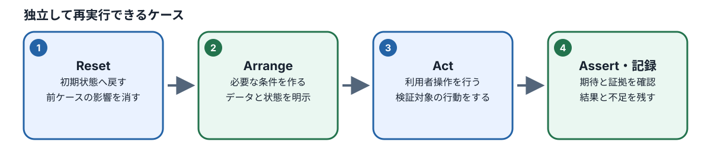
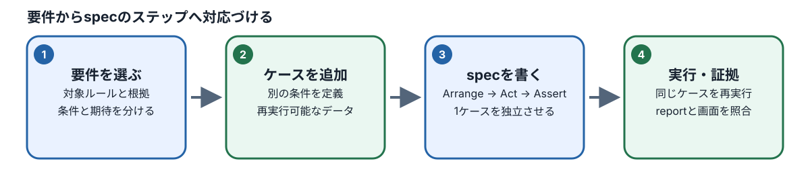

# M06：Playwright E2Eの実装と実行

## この章でできるようになること

この章では、M03で設計した「Case（テストケース）」と、M05で学んだ「テストコードの読み方」を組み合わせます。ここでのゴールは、**Caseに書かれた前提条件・操作手順・期待結果を、自分の手で実行可能なE2E（エンドツーエンド）テストコードとして組み立てられるようになること**です。

### E2Eテストとは何か？

E2Eテスト（End-to-End Test：端から端までのテスト）とは、実際の利用者がWebブラウザ（ChromeやSafariなど）を開いてボタンをクリックし、文字を入力して買い物を完了させる一連の流れを、コンピューターを使って自動的に再現・検証するテストです。
画面の見た目だけでなく、裏側で動くサーバーやデータベースとの通信も含め、システム全体が最初から最後まで正しく繋がって動いているかを確かめることができます。

本章では、あらかじめ用意されている固定の3つのCaseを完成させるだけでなく、別の新しいCaseをもとにしてゼロから新規のテストファイル（specファイル）を作成し、単独での実行や、別Run（別の実行記録）での再実行を行い、それぞれの実行結果を客観的な証拠とともに確認します。
なお、同じテストを2回実行して2回とも成功したからといって、それだけで「どんな環境でも絶対に壊れない安定したテストである」と証明できたわけではありません。偶発的に成功しただけの可能性（不安定なテスト：Flaky Test）を常に疑い、根拠を持って結果を判断する姿勢を身につけます。

もし過去のモジュールの成果物が手元にない場合でも、公式に提供されている「公開fallback（代替データ）」を使って本章の学習を進めることができます。ただし、公開fallbackの利用は本章の学習を止めずに継続するための救済措置であり、過去のPhase（フェーズ）の修了証明として使うことはできません。

| 学習目標ID | 本章で習得・確認する内容 |
| --- | --- |
| M06-01 | 固定Caseおよび別の新しいCaseから、短く簡潔な実行可能E2Eテストを構成できる |
| M06-02 | Seed（初期データ投入）/ Reset（状態初期化）とブラウザContext（コンテキスト）を用いて、テスト同士の独立性を確保できる |
| M06-03 | 操作対象を特定するLocator（ロケーター）と結果を検証するAssertion（アサーション）が、仕様上の期待結果を正しく検証できているか判断できる |
| M06-04 | 実行するテストファイル（spec）、実行コマンド、実行記録（Run）、テスト結果レポートを正しく対応付けて把握できる |
| M06-05 | テスト結果の4つの状態（PASS・FAIL・未実行・環境BLOCKED）を正しく区別して記録・報告できる |

## 1. Caseのどの部分をコードにするか

### 1.1 身近な疑問：テストケースはどのようにプログラムへ変換するのか？

人間が手動でテストを行うときは、テスト仕様書に書かれた手順を読み、「画面のここにあるボタンをクリックして、次にこの文字が表示されているか確かめる」と目で見て柔軟に判断します。ボタンの位置が少し右にずれていても、人間であれば「これがカート追加ボタンだな」と察して押すことができます。

しかし、コンピューター（テスト自動化ツールであるPlaywright）には「空気を読んで察する」能力はありません。画面の裏側にあるHTMLタグの構造や、ボタンに付けられた正確な名前を厳密に指示してあげなければ、画面のどこを触ればよいのか分からなくなってしまいます。

そこで、人間向けに日本語で書かれた「Case（テストケース）」を、コンピューターが迷わず実行できる「指示の組み合わせ」へと翻訳してあげる必要があります。

例えば、次のようなCaseを考えてみましょう。

> **対象ケース（CASE-CART-001の例）**：
> ゲスト（未ログインの利用者）が商品「マグ」を1点カートへ追加すると、カート画面にマグが表示され、数量が1になっていること。

このCaseを自動化するために、情報を**「準備（setup）」「操作（action）」「検証（assertion）」「根拠（traceability）」**の4つに分解して整理します。

| Caseに含まれる情報 | 自動化するときに必要な処理 | Playwrightコードでの役割 | 具体的な意味 |
| --- | --- | --- | --- |
| **前提条件** | ゲスト状態であり、対象商品が存在し、カートが空である開始状態を用意する | `setup`（準備・初期化） | 前のテストのゴミデータが残っていない綺麗な状態を作り出す |
| **操作手順** | 商品詳細画面を開き、「カートに追加」ボタンをクリックする | `action`（操作・入力） | 人間の代わりにブラウザを操作して目的の動作を行う |
| **期待結果** | カート画面を開き、対象の商品名が表示され、数量入力欄が「1」になっていることを検証する | `assertion`（検証・確認） | 画面の状態が仕様書で定められたとおりになっているかを判定する門番 |
| **仕様上の根拠** | このCaseの振る舞いが、製品仕様書（BR/AC）のどのルールに基づいているかを確認する | トレーサビリティ（追跡性）の確保 | 「なぜこのテストが必要なのか」を製品仕様の番号（BR-CART-001など）と結びつける |

いきなりAIに「テストコードを書いて」と丸投げする前に、**「どの画面を開き（準備）、どの要素をどう操作し（操作）、画面のどの値を見て仕様どおりかを確かめるのか（検証）」**を人間の頭で整理しておくことが極めて重要です。この整理ができていないと、AIが間違ったテストコードを出力してきたときに気づくことができません。

### 1.2 短いコードの意味を読み解く



Caseの「操作」と「期待結果の確認」に対応するPlaywrightのコード例を見てみましょう。
（※実際のテストファイルでは、`test` や `expect` の宣言、テスト前の初期化処理（Reset helper）の呼び出しが必要ですが、ここでは中心となる操作と検証の部分を抜粋しています）

```ts
// 1. 商品「マグ」の詳細ページを開く
await page.goto("/products/product-mug");

// 2. 「カートに追加」ボタンを見つけてクリックする
await page.getByRole("button", { name: "カートに追加" }).click();

// 3. 画面上に「カートへ追加しました」という通知メッセージが表示されたことを確認する
await expect(page.getByRole("status")).toContainText("カートへ追加しました");

// 4. カート画面へ移動する
await page.goto("/cart");

// 5. カート内に「セラミックマグ」という見出しが表示されていることを確認する
await expect(page.getByRole("heading", { name: "セラミックマグ", exact: true })).toBeVisible();

// 6. 数量の入力欄の値が「1」であることを確認する
await expect(page.getByLabel("数量")).toHaveValue("1");
```

#### 各行のコードが何をしているのか？

- **`await`（アウェイト）**：
  JavaScript/TypeScriptで「ブラウザの処理が終わるのを待つ」ための合図です。Webブラウザの画面遷移やボタンクリックは一瞬では終わらず、数ミリ秒〜数秒の時間がかかります。`await` を付けないと、前の操作（画面移動など）が終わる前に次の操作が実行されてしまい、テストがエラーで止まってしまいます。
- **`page.goto(...)`**：
  ブラウザのアドレスバーにURLを入力してページを移動する操作です。
- **`page.getByRole("button", { name: "カートに追加" })`**：
  画面の中から「カートに追加」という名前がついた「ボタン（button）」を探し出す命令（Locator）です。
- **`.click()`**：
  見つかった要素をマウスで左クリックする操作（Action）です。
- **`expect(...).toBeVisible()`**：
  指定した要素が画面上に実際に目に見える状態で表示されているかを検証する判定（Assertion）です。
- **`expect(...).toHaveValue("1")`**：
  入力欄（input要素など）の中に現在入力されている値が、期待どおり「1」になっているかを検証する判定です。

#### 初学者が最も陥りやすい落とし穴：通知メッセージだけで満足してしまうこと

上記のコードで、もし3行目の「カートへ追加しました」というポップアップ通知の確認だけでテストを終了してしまったらどうなるでしょうか。

身近な例で考えてみましょう。レストランの注文端末で「ご注文を受け付けました」と画面に出たのに、厨房のプリンターが壊れていて料理が届かなかったり、頼んだ料理とは違うものが届いたりした経験はないでしょうか。
ショッピングサイトのプログラムでも全く同じことが起こり得ます。「画面上には『カートへ追加しました』と通知が出たけれど、裏側のプログラムにバグがあり、カートの中身には別の商品が入ってしまった」あるいは「数量が0や2になっていた」という不具合があった場合、通知メッセージだけをチェックするテストは**合格（PASS）**してしまいます。

これではバグを見逃してしまいます。**「通知が表示されたこと」はボタンが押されてメッセージが出た合図にすぎず、業務上の本当の期待結果（カートに目的の商品が意図した数量で正しく保存されたこと）を証明したことにはなりません。**
そのため、ステップ4〜6のように、実際にカート画面へ移動して「商品名」と「数量」を直接検証するAssertion（アサーション）を必ず記述しなければなりません。

### 手順付き練習：Caseをコードへ写す前に対応表を作る（M06-01）

**目的**：
AIが提案したテストコードを正しく読み解き、検証の抜け漏れがないかを自分の目で判断できるようにするため、コードを書く前にCaseの要素を `setup / action / assertion` の3つに分類する対応表を作ります。

**準備**：
ノートまたはテキストエディタを開き、メモできる状態にしてください。

**手順**：

1. ショッピングサイトの「カートへの商品追加（正常系）」について、以下の項目を一行ずつ書き出します。
   - 対象仕様ID（例：BR-CART-001, AC-CART-001）
   - 対象商品の識別情報（SKU：例 `product-mug`）
   - 操作前の状態（例：カートは空、未ログインのゲスト状態）
   - 追加する数量（例：1点）
   - 行う操作（例：商品詳細ページを開いて「カートに追加」ボタンを押す）
   - 期待する業務結果（例：カート画面に対象商品が表示され、数量が1であること）
2. ノートに「準備（setup）」「操作（action）」「検証（assertion）」の3つの列を作ります。
3. 手順1で書き出した各情報が、3つのうちのどこに当てはまるかを振り分けます。
4. M06のワークスペースにある既存のspecファイルを開き、以下のコードがどの役割に該当するかを確認します。
   - `resetScenario(...)`
   - `page.goto(...)`
   - `page.getByRole(...).click()`
   - `expect(...).toBeVisible()`
5. もし開発支援AI（OpenCode等）が使える環境であれば、次のようにプロンプトを入力して相談してみましょう。
   > **AIへの依頼文例**：
   > 「カート追加機能のテストケースについて、setup / action / assertion の対応関係を整理したいです。仕様に基づいた3区分の整理案を提示してください。なお、正式課題の完成コードは出力せず、ファイルの変更もまだ行わないでください。」
6. AIが出してきた提案について、各行がCaseや正式仕様書のどこに根拠があるかを、自分の目で照合して確認します。

**解答と解説**：

- **setup（準備）**：
  テスト開始前の前提状態を整える処理です。カートが空であること、未ログイン状態であること、商品の在庫が存在することを確認・初期化します。コードでは `resetScenario` やブラウザコンテキストの新規作成が担当します。
- **action（操作）**：
  ユーザーが画面に対して行う能動的な働きかけです。コードでは `page.goto`（画面移動）、`click`（クリック）、`fill`（文字入力）などが担当します。
- **assertion（検証）**：
  操作の結果、仕様書どおりの状態になったかを確かめる判定です。コードでは `expect(...)` を使った検証が担当します。画面に「追加しました」と出たことだけでなく、カート明細に対象商品の見出し（heading）が存在し、数量入力欄（input）の値が「1」になっていることを直接確認する処理までが必須のassertionとなります。

## 2. 毎回同じ状態から始める（テストの独立性）

### 2.1 なぜ「初期化」が必要なのか？

自動テストを実行するとき、最も避けなければならないのが**「前のテストの後始末が残っていて、次のテストが失敗すること」**です。

理科の実験に例えてみましょう。前の実験で使った試験管に薬品のカスが残ったまま次の実験を始めたら、薬品同士が勝手に反応してしまい、実験が正しく成功したのか失敗したのか分からなくなってしまいます。

テストコードでも全く同じことが起こります。

1. 「テストA」が実行され、カートにマグカップを1個追加した。
2. テストAが終わり、カートを空にしないまま「テストB」が始まった。
3. 「テストB」は「マグカップを1個追加したら数量が1になること」を確かめるテストだった。
4. しかし、テストAで追加したマグカップがカートに残っているため、合計数量は「2」になってしまった。
5. テストBのAssertion（数量が1であること）が一致せず、不合格（FAIL）になった。

この場合、Webアプリ本体のプログラムには何のバグもありません。それなのに、テストの実行順序や前回のゴミデータのせいでテストが落ちてしまっています。このようなテストは、単独で動かすと成功するのに、まとめて動かすと失敗するなど、結果がコロコロ変わるため、開発現場で誰も信用してくれなくなります。

テストは、**「いつ、どの順番で、何度実行しても、必ず同じ結果になる」**ように作らなければなりません。この性質を「テストの独立性（Independence）」や「再現性（Reproducibility）」と呼びます。

### 2.2 ResetとブラウザContextの役割分担

テストの独立性を確保するために、本教材の環境では2つの仕組みを組み合わせて使用します。

| 仕組み | 主な役割 | リセットされる範囲 |
| --- | --- | --- |
| **Reset（リセット処理）** | サーバー側やアプリのデータベース状態を設定し直す | アプリ内のカートデータ、注文データ、在庫数などの保存データ |
| **ブラウザContext（コンテキスト）** | ブラウザ側の保存領域をまっさらな状態にする | Cookie（クッキー）、ログインセッション情報、ローカルストレージなど |

これらは守っている領域が明確に異なります。
「ブラウザのCookieを消した（Context分離）」だけでは、サーバー側のデータベースに保存されたカート情報は消えません。逆に「データベースを初期化した（Reset）」だけでも、ブラウザ側に古いログイン情報が残っていれば、未ログインのはずがログイン中として扱われて予期せぬ動作をします。
したがって、**両方を正しく組み合わせて、各テストの開始時にまっさらな状態を用意する**必要があります。

M06のテストコード（`workspace/M06/` 配下のファイル）から初期化ヘルパー（Reset helper）を呼び出すときは、次のようにimportしてテストの冒頭で呼び出します。

```ts
import { expect, test } from "@playwright/test";
// プロジェクト共通の初期化関数を読み込む
import { resetScenario } from "../../training/playwright/support/reset-scenario";

test.describe("カート機能の検証", () => {
  test.beforeEach(async ({ page }) => {
    // 各テスト（test）が実行される直前に、必ず指定の初期状態へリセットする
    await resetScenario(page, "default");
  });

  test("ゲストが商品をカートに追加できること", async ({ page }) => {
    // ここからテスト手順を開始する（必ずクリーンな状態から始まる）
  });
});
```

#### 注意すべき落とし穴：suite全体の最初に1回だけResetすることの危険性

`test.beforeAll`（テスト群全体の最初）で1度だけResetを実行し、各テスト（`test`）の直前にはResetを置かない書き方をしてしまうと、1番目のテストは綺麗な状態で始まりますが、2番目以降のテストは前のテストが汚した状態を引き継いでしまいます。
原則として、**テストケース（`test`）ごとに開始前の前提状態を整える契約（`test.beforeEach` を使うこと）**を確認してください。

**理解確認の練習**：
「2つのテストをまとめて実行すると両方PASSするのに、2番目のテストだけを単独で実行するとFAILする」という現象が起きました。最初に何を疑うべきでしょうか？

**解説**：
2番目のテストが、1番目のテストが作った状態（ログイン状態やカートの中身など）に依存している可能性が極めて高いです。1番目のテストを先に動かしたときだけ前提条件が偶然揃い、単独で動かすと前提条件が存在しないため失敗します。各テストが自分自身で必要な初期状態（Resetおよびセットアップ）を完結して用意できているかを点検します。

## 3. 仕様どおりのAssertionを選ぶ

### 3.1 弱い検証と強い検証の違い

テストコードの中で結果判定を行う `expect(...)` の部分を「Assertion（アサーション）」と呼びます。
Assertionの書き方によって、テストの強さ（バグを見つける能力）は大きく変わります。

次の2つのコードを比べてみましょう。

**パターンA（弱い検証）**：

```ts
// 「カートに追加」ボタンが画面に見えていることを確認
await expect(page.getByRole("button", { name: "カートに追加" })).toBeVisible();
```

**パターンB（仕様に基づいた強い検証）**：

```ts
// カート画面を開いたあと、対象の商品名と数量を直接確認
await expect(page.getByRole("heading", { name: "セラミックマグ", exact: true })).toBeVisible();
await expect(page.getByLabel("数量")).toHaveValue("1");
```

- **パターンAの弱点**：
  単に「ボタンが存在している」ことしか見ていません。ボタンを押した結果、注文処理で内部エラーが発生した場合や、商品がカートに入らなかった場合でも、このAssertionは合格（PASS）してしまいます。これではバグを検出できません。
- **パターンBの強さ**：
  操作が行われたあとに「指定の商品名が表示されているか」「数量入力欄が期待どおり1になっているか」という、**仕様書が定めている業務上の結果**を直接確かめています。プログラムに少しでも狂いがあれば、即座に不合格（FAIL）として検出できます。

### 3.2 業務ルールに応じたAssertionの選び方

テストするCaseの目的によって、確かめるべきポイントは異なります。画面の表面的な通知だけでなく、仕様の核心部分を捉えるAssertionを選びます。

| テストするCaseの種類 | 最低限確かめるべきAssertionの内容 | 単なる通知チェックだけでは不十分な理由 |
| --- | --- | --- |
| **正常追加** | カート画面に対象のSKU・商品名が存在し、数量が意図した数値であること | 画面に「追加しました」と出ても、中身が別の商品だったり数量が間違っている可能性があるため |
| **数量上限超過の拒否** | エラー通知または警告が表示され、**カート内の数量が変更前の数値を維持していること** | 「上限を超えています」と警告文が出ているのに、裏では上限を超えて数量が加算されてしまうバグを防ぐため |
| **明細の削除** | 削除ボタンを押したあと、**該当する商品の見出しや明細行が画面上に存在しないこと**（`not.toBeVisible()` や `toBeHidden()`） | 削除ボタンを押しても画面から消えていなければ、削除処理が失敗していると判断できるため |
| **在庫僅少（low-stock）** | 残りわずかである旨の表示が正しく現れ、在庫数を超える数量の指定が制限されること | 単に購入できるだけでなく、境界値における警告表示と制限動作の両方が仕様で定められているため |

テストを書くときは、「画面に何かしらの文字が出たからOK」ではなく、**「この操作によって、業務データ（カート・注文・在庫）が仕様どおりになったと確実に言える証拠は何か？」**を考えてAssertionを選びます。

## 4. 固定3 Caseと別Caseの実装

### 4.1 本章で扱う課題の構成



このモジュールでは、以下の課題構成で学習を進めます。

1. **固定3 Case（`cart-cases.spec.ts`）**：
   - 課題として提供される、カート機能の代表的な3つのテストケースです。
   - ① 正常追加（未ログインゲストによる商品の追加）
   - ② 上限超過の拒否（最大数量を超える追加のブロックと、既存数量の維持）
   - ③ 在庫僅少（low-stock境界での挙動検証）
2. **別Caseの自力実装（`new-case.spec.ts`）**：
   - 上記の固定3 Caseとは異なるCase（例：`CASE-CART-004` カート明細の削除）を、空のspecファイルから自分で設計・実装します。

課題ファイルは、以下のコマンドを実行することで自分の作業用フォルダ（`workspace/M06/`）に展開されます。

```bash
pnpm course:load M06
```

### 4.2 固定3 Caseの実装手順

#### 実装の順序

`workspace/M06/` に配置された `cart-cases.spec.ts` を開き、未完成になっている部分を補っていきます。

進め方の基本ステップ：

1. `inputs/M06/start.md` を開き、本章の開始条件、対象となるCase ID、および対応する仕様書のルール（BR/AC）を確認します。
2. Phase 1（M03/M04）で自分で作成したテスト設計成果物がある場合は、その条件と固定Caseが一致しているか照合します。内容が異なる場合は無理に同一視せず、別Caseとして扱います。
3. もし手元に過去の成果物がない場合は、教材規定の「公開fallback」の入力元と版数を記録した上で使用します（※過去Phase修了扱いにはなりません）。
4. 各Caseで必要となるユーザー種別（Role：ゲストかログイン会員か）、初期状態（State）、テストデータ（Data）、操作の流れ（Journey）、および必要な初期化（Reset）を整理します。
5. `cart-cases.spec.ts` の空欄やTODOコメントを確認し、Caseに対応する操作（Action）と業務結果の検証（Assertion）をコードとして記述します。
6. テストを実行し、失敗した場合は製品コード（Webアプリ本体のコード）を勝手に直すのではなく、テストコード側の記述（要素の指定方法や待ち時間、前提条件の不足）を見直して最小限の修正を行います。

固定Caseを実行するコマンドは次のとおりです。

```bash
pnpm course:run M06 cart-cases.spec.ts --label main
```

コマンドを実行しただけで満足してはいけません。ターミナルに表示された実行結果、テスト件数が3件すべて動いているか、レポートファイル（Report）がどこに出力されたかを確認します。

### 4.3 別Case（`CASE-CART-004`）を自力で実装する

#### 演習

固定の3つのCaseが完成したら、次は別のCaseである `CASE-CART-004`（カート明細の削除）を自分で実装します。

#### 自力実装前の設計メモ作成

コードを書く前に、以下の対応表を自分で埋めて考えを整理します。

| 設計項目 | 自分で決めて確認すること |
| --- | --- |
| **対象Case ID** | `CASE-CART-004`（カート明細の削除） |
| **仕様上の根拠** | カート仕様書（`docs/spec/features/cart.md` 等）の削除ルール・受入基準 |
| **初期状態（Reset）** | カートに削除対象の商品がすでに入っている状態（またはテスト内で追加操作を行う） |
| **操作手順** | カート画面を開き、対象明細の「削除」ボタンをクリックする |
| **事前の検証** | 削除ボタンを押す前に、対象商品が確かにカートに存在することを確認する |
| **事後の検証** | 削除ボタンを押したあと、対象商品がカート画面から消えていること（`not.toBeVisible()` 等）を確認する |
| **実行と再実行** | 初回実行（`initial`）と、再実行（`repeat`）の両方を行い、初回と再実行の結果・差を確かめる |

実装先ファイルは `workspace/M06/new-case.spec.ts` です。
固定3 Caseのコードをただコピー＆ペーストして名前だけ変えるのではなく、**「削除」という振る舞いに対して、どのような前提・操作・Assertionが必要なのか**を自分の言葉で説明できるように組み立ててください。

実行コマンド例：

```bash
# 初回実行
pnpm course:run M06 new-case.spec.ts --label initial

# 再実行（同じテストを別Runでもう一度動かして結果を確認する）
pnpm course:run M06 new-case.spec.ts --label repeat
```

### 実践：AIと協働してテストを実装する手順（M06-01〜M06-03）

本カリキュラムでは、AIエージェント（OpenCodeなど）をアシスタントとして活用しながらテストを実装します。
ただし、**AIにすべてを丸投げして完成コードを出力させ、中身を理解せずに貼り付ける行為は禁止**です。AIが出した提案を人間が仕様書と照らし合わせて評価・修正し、自分で実行証拠を作ることが学習の目的です。

1. **環境の準備と確認**：
   `pnpm course:load M06` を実行し、`workspace/M06/` に必要なファイルが配置されたことを確認します。`inputs/M06/start.md` を読み、自分の前提条件（過去成果物を使うか、公開fallbackを使うか）をメモします。
2. **Caseの整理**：
   最初に取り組むCaseを選び、前提条件・操作・期待結果を自分の手元で整理します。
3. **AIへの具体的な指示出し（プロンプトの工夫）**：
   AIにコードの相談をするときは、変更してよい範囲と守るべき制約を明確に指示します。
   > **プロンプトの例**：
   > 「PlaywrightのE2Eテストを作成しています。対象は `workspace/M06/cart-cases.spec.ts` の未完成部分です。
   > 検証したいCaseは『ゲストがマグカップ1個をカートに追加すると、カート画面にマグカップが表示され数量が1になること』です。
   > 【制約事項】
   > - 対象ファイル以外の製品コード、設定ファイル（Config）、他モジュールのファイルは変更しないでください。
   > - 操作対象のLocator（ボタンや見出し）と、結果を確認するAssertionの根拠を、初心者にも分かるように説明してください。
   > - 画面上の単なる通知メッセージだけでなく、カート画面の商品名と数量を直接検証するコードにしてください。
   > - 私が確認して許可を出すまで、ファイルを勝手に書き換えないでください。」
4. **AIの提案に対する人間の検証ポイント**：
   AIからコード案が提示されたら、次の3点を必ず自分の目で点検します。
   - **(a) 実在する要素を指定しているか**：画面上に存在しない架空のボタン名や属性を指定していないか。
   - **(b) 前提条件を満たしているか**：テストの冒頭で適切なReset処理が呼ばれているか。
   - **(c) 期待結果の検証が弱められていないか**：本当は商品名や数量を見なければならないのに、「通知が出たこと」だけでお茶を濁していないか。
5. **修正と固定Caseの実行**：
   納得したコードだけを作業ファイルに反映し、コマンドを実行します。

   ```bash
   pnpm course:run M06 cart-cases.spec.ts --label main
   ```

   3件のテストが意図どおりに実行され、証拠が残ったことを確認します。
6. **新規Case（`CASE-CART-004`）の構成**：
   次に、配布済みの `workspace/M06/new-case.spec.ts` を開き、`import { test } from "@playwright/test"` と `test(...)` の骨格、2つのTODO、仮の `throw new Error("TODO: ...")` を確認します。TODOを実際の操作と業務Assertionへ置き換え、仮の例外を削除します。ゼロからファイルを作り直す必要はありません。AIに相談する場合も、削除前後の状態確認が含まれているかをチェックします。
7. **別Runによる再実行と結果確認**：
   初回実行（`--label initial`）と再実行（`--label repeat`）を別々のRunとして行います。二つの実行で同じ結果を得られたか、その実行条件と証拠を比較します。これだけでFlaky testではないと断定しません。

### 4.4 似ているテストを読むときは「共通部分」と「判断が違う部分」を分ける

長いテストコードを読むときに、毎行を同じ重要度で覚えようとする必要はありません。M06のCaseでは、次の二つを分けると追いやすくなります。

| 観点 | 共通して確認する部分 | Caseごとに読み替える部分 |
| --- | --- | --- |
| 開始条件 | 対象SeedとReset、ロール、ブラウザContext | 商品・variant・操作前数量 |
| 操作 | 指定画面へ移動して対象を特定する | 追加、数量更新、削除などの動作 |
| 検証 | 仕様から期待結果を導く | 許可／拒否、変更後または維持される数量、明細の有無 |
| 証拠 | Runと実行したspecを紐付ける | Case ID、結果、失敗箇所、必要な追試 |

**練習（解答付き）**：上限超過のテストと明細削除のテストを比較したとき、ActionとAssertionのどちらが変わりますか？ **解答**：両方変わります。上限超過では指定数量の更新要求が拒否され、変更前の数量が保たれることを確認します。明細削除では削除操作後に対象明細がなくなることを確認します。共通するのは前提の確認と実行証拠の残し方です。

完全なコード例は前の節に残しています。**最初は通しで読み、2回目は差分に注目する**ための表です。コードを不自然に省略して、初心者が実行できなくなる状態にはしません。

## 5. テスト結果の4つの状態を正しく区別する

### 判定の注意

テストを実行したとき、結果を単に「動いた」「動かなかった」と大雑把に捉えてはいけません。
ソフトウェアテストの世界では、結果の状態を明確に区別して記録します。

| 状態名 | 状態の正確な意味 | 記録・報告すべき内容 | 具体例 |
| --- | --- | --- | --- |
| **PASS**（合格） | 実行したテストケースのすべての手順とAssertionが期待どおり成功した | 実行したファイル名、検証したAssertion、Run ID、合格の事実 | カートにマグが追加され、数量1が正しく確認できた |
| **FAIL**（失敗） | テストは最後まで実行されたが、Assertionが不一致だった、または途中の操作でエラーになった | 最初に失敗した行・要素、実際のエラー内容、予想される原因 | 数量1を期待したが「2」と表示されてAssertionErrorになった |
| **未実行** | テストコマンドを実行していない、またはテスト対象から除外されていた | 未実行である理由、まだ確認できていない条件 | 途中で作業を中断した、あるいは対象ファイルを間違えて指定した |
| **BLOCKED**（実行不能） | テストコード以前に、サーバーが起動していない、権限がない、ツールが壊れているなどの理由で**テストの実行自体が開始できなかった** | 発生した環境障害、実行を阻んでいる要因、解消に必要な作業 | ローカルサーバーが落ちていて `page.goto` で接続エラーになった |

### 初学者が最も間違いやすい点：「BLOCKED」を「FAIL」と報告してしまうこと

もしローカルサーバーが起動しておらず、ブラウザが画面を開けずにテストが止まった場合、これは「テストの対象機能にバグが見つかってFAILした」のではありません。**「テストを実行するための環境が整っておらず、判定すらできなかった（BLOCKED）」**状態です。

テスト結果を報告するときは、**「どの段階まで実行が進み、どこで止まったのか」**を正確に切り分けて報告してください。

**再実行の意味**：別Runで2回成功した場合に確認できるのは「その2回の条件下で成功した」という事実です。Flaky testではないことや、他の環境・時間帯でも安定して成功することまで証明したわけではありません。失敗が発生したときは、ログ・Trace・Reset条件と合わせて調査します。

## 6. 実行証拠（Evidence）を読む

### 6.1 実行証拠とは何か？

`course:run` コマンドを使ってテストを実行すると、システムは実行ごとに一意な「Run ID（実行識別子）」を発行し、そのときのテストコードの内容や実行結果レポートを証拠（Evidence）として記録します。

M06では、新規Caseの実行結果が以下の場所に保存されます。

- 各実行ごとの証拠：`workspace/M06/evidence/runs/<run_id>/`
- コース全体の集約出力：`output/training/ai-assisted-qa/` 配下

### 6.2 証拠の中に含まれる識別子の意味

レポートやログの中には、英数字の長い文字列（ハッシュ値）が含まれています。

- **`run_id`**：そのテスト実行を一意に特定するための識別子です（例：`run-20261028-193000-xxxx`）。
- **`source_sha`**：受講者に配布された教材・問題のバージョンを示す識別子です。
- **`spec_sha256`**：あなたがそのとき実行したテストコード（specファイル）の内容から計算されたハッシュ値です。コードを1文字でも変更すると、この値は変わります。

#### ハッシュ値を暗記する必要はありません

これらの英数字を覚える必要はまったくありません。
この仕組みが存在する理由は、**「提出されたレポートが、本当に今手元にある最新のコードを実行した結果なのか？」「過去の別人の成功レポートや、別のテストの成功結果を流用・偽造していないか？」**をシステムと人間が客観的に確認できるようにするためです。

以前の古いコードでPASSしたときのレポートを提出したり、固定Caseの成功レポートを新規Caseのレポートとして使い回したりすることは、改ざんとみなされます。

### 練習：Run結果を読み取り、AIの報告を検証する（M06-04・M06-05）

**目的**：
AIエージェントが「すべてのテストがPASSしました！」と報告してきたときに、それが本当かどうかを実行証拠と照らし合わせて検証できるようになります。

**手順**：

1. 自分が実行した `main`（固定Case）、`initial`（新規Case初回）、`repeat`（新規Case再実行）の実行結果から、以下の項目をノートに表としてまとめます。
   - `run_id`
   - 対象specファイル名
   - `spec_sha256`（レポート内の値）
   - テスト結果（PASS / FAIL / 未実行 / BLOCKED）
   - レポート（HTML/JSON）やTraceファイルの保存先パス
2. 実際に生成されたHTMLレポートを開き、以下の点を確認します。
   - 実行されたテストケースの件数は何件か？
   - すべてのCaseで意図したAssertionが実行されているか？
3. もしテストが失敗（FAIL）した場合は、以下の順序で原因を切り分けます。
   - ① 最初のエラーメッセージを読む（どの行で止まったか）
   - ② Reset処理で指定した前提データは正しかったか
   - ③ Locatorが探しているボタン名やラベル名は、実際の画面のテキストと一致しているか
   - ④ サーバーとの通信エラー（500エラー等）が発生していないか
4. AIにエラー原因を質問する場合も、単に「エラーが出たので直して」と頼むのではなく、ターミナルに出力された実際のエラーログをプロンプトに貼り付けて「このログのどこに問題があるか」を根拠とともに説明させます。

**条件を変えた練習問題**：
新規Caseの1回目の実行（`initial`）は正常にPASSしました。しかし、2回目の再実行（`repeat`）を行おうとした直前にCodespaceの接続が切断され、コマンドが実行できませんでした。
このとき、提出物や報告書にはどのように記録すべきでしょうか？

**解答と解説**：
`initial` は「PASS」、`repeat` は「未実行（環境BLOCKED）」として明確に分けて記録します。
「1回目が成功したから、2回目もきっと成功するだろう」と推測して「再実行もPASS」と報告してはいけません。実行した事実がないものは「未実行」と正直に記録することが、QAエンジニアとしての最も重要な倫理契約です。

## さらに理解を深める：テストケースを実行可能なコードへ変える

### 仕様・Case・コードの対応関係を自分の手で整理する

Playwrightの書き方のルール（文法）を覚えることと、テストが検証すべき業務ルールを正しく理解することは別物です。
自動テストを作成するときは、必ず次の3要素の対応関係を意識してください。

```text
【Caseの前提】  ---> 【コードでの準備】 : Seed投入 / resetScenario による初期化
【Caseの操作】  ---> 【コードでの操作】 : page.goto / getByRole(...).click / fill
【Caseの期待】  ---> 【コードでの検証】 : expect(...).toBeVisible / toHaveValue
```

**例題**：
「ゲストが初期状態のカートへマグカップを1個追加する」というCaseがあります。
このとき、テストコードの中に以下の行だけが書かれていました。

```ts
await page.getByRole("button", { name: "カートに追加" }).click();
```

このテストコードには何が不足しているでしょうか？

**解説**：
操作（Action）しか書かれておらず、前提の準備（Setup）と結果の検証（Assertion）の両方が抜け落ちています。

1. テスト開始前にカートが本当に空であるという保証（Setup）がありません。
2. ボタンをクリックしたあと、実際にカート画面にマグカップが数量1で存在していることを確かめる検証（Assertion）がありません。
操作しただけで終わるテストは、何の品質も保証していません。

### よく使われるLocatorとAssertionの組み合わせ

Playwrightでは、画面上の要素を特定する「Locator（ロケーター）」と、その要素の状態を判定する「Assertion（アサーション）」を組み合わせて使います。

```ts
// 1. ボタンを役割（Role）と名前で特定してクリックする
const addButton = page.getByRole("button", { name: "カートに追加" });
await addButton.click();

// 2. カート画面へ移動する
await page.goto("/cart");

// 3. 見出し（heading）を役割と完全一致の名前で特定し、画面に見えていることを検証する
const itemHeading = page.getByRole("heading", { name: "セラミックマグ", exact: true });
await expect(itemHeading).toBeVisible();

// 4. 入力フォームのラベル（Label）で特定し、入力欄の値が「1」であることを検証する
const quantityInput = page.getByLabel("数量");
await expect(quantityInput).toHaveValue("1");
```

- **`getByRole("button", { name: "..." })`**：HTMLの構造（`<button>` タグや `role="button"` 属性）と、ボタンに表示されているアクセシブルな名前をもとに要素を探します。見た目の変更に強く、最も推奨される指定方法です。
- **`getByLabel("...")`**：入力欄の近くにある `<label>` タグの文字をもとに入力フォームを探します。
- **`toBeVisible()`**：指定した要素が画面上に実際に表示されている（隠れていない）ことを確かめます。
- **`toHaveValue("...")`**：`<input>` などの入力欄に入力されている現在の値を確かめます。

**確認問題**：
「カート画面にマグカップの見出しが表示された（`toBeVisible` が成功した）のだから、数量のAssertion（`toHaveValue("1")`）は省略してもよいのではないか？」という意見がありました。この判断は妥当でしょうか？

**解説**：
妥当ではありません。商品名が表示されていても、数量の計算処理にバグがあって数量が「2」や「0」になっている可能性が十分にあります。Caseの要求に「数量が1になること」が含まれているのであれば、数量に対する直接の検証を省略してはいけません。

### 解説付き練習問題（全10問）

理解度を確かめるために、以下の10問にチャレンジしてみましょう。

#### 問題1：数量上限の境界値テスト

ショッピングサイトの仕様で「1商品あたりのカート投入上限は3個」と定められています。現在カートにマグカップが2個入っている状態で、さらに2個追加しようとしました（合計4個になる要求）。このとき、テストコードのAssertionでは何を確かめるべきでしょうか？

**解答**：

1. 「上限を超えているため追加できない」という警告やエラー表示が出ること。
2. **カート内のマグカップの数量が、変更前の「2個」のまま維持されていること。**
**解説**：
超過要求が拒否されたことだけでなく、カート内のデータが不正に書き換わっていないこと（既存数量の維持）まで確認して初めて、上限チェック機能が安全に働いていると証明できます。

#### 問題2：見出しだけの確認

カート画面を開き、画面の一番上にある「お買い物カート」という大見出しが表示されたことだけを確認してPASSするテストコードを作成しました。このテストは「マグカップが正しくカートに追加されたこと」を保証できるでしょうか？

**解答**：
保証できません。
**解説**：
「お買い物カート」という大見出しは、カートの中身が空であっても、別の商品が入っていても表示されます。テスト対象である「マグカップの明細」と「その数量」を直接検証するAssertionが必要です。

#### 問題3：実行順序による結果の変化

テストAとテストBをまとめて実行すると両方PASSするのに、テストBだけを単独で動かすと失敗します。最初に疑うべき原因は何でしょうか？

**解答**：
テストAとテストBの間で状態（データやブラウザ情報）が共有されており、テストBがテストAの実行結果に依存している可能性を疑います。
**解説**：
テストBの冒頭で必要な初期化（Reset）や前提データの投入が不足しており、テストAが残したゴミデータに依存している状態です。各テストが単独で完結して前提状態を用意できるようにコードを見直します。

#### 問題4：前提条件が作れないときの報告

あるCaseを実行しようとしましたが、必要な初期データ（Seed）を作成する機能がサーバー側でエラーを起こし、テストを開始できませんでした。このテスト結果のステータスは何と記録すべきでしょうか？

**解答**：
「BLOCKED（環境・前提障害による実行不能）」または前提未成立として記録します。
**解説**：
テスト対象の機能自体を動かして合否を判定する段階に達していないため、安易に「FAIL」や「0点」と記録してはいけません。「前提条件が整わなかったため実行不能」と区別して報告します。

#### 問題5：大雑把なLocatorの危険性

ボタンをクリックするコードで、エラーが出たため `page.locator("button")` と書き換えたところ、エラーが出なくなりました。この修正は適切でしょうか？

**解答**：
適切とは言えません。
**解説**：
画面内にボタンが1つしかなければ動きますが、通常画面には「検索」「ログイン」「カート」「メニュー」など複数のボタンが存在します。大雑把に `button` とだけ指定すると、画面の別のボタンを誤ってクリックしてしまう危険があります。`page.getByRole("button", { name: "カートに追加" })` のように、役割と名前を明示して一意に特定できるLocatorを使うのが鉄則です。

#### 問題6：`toBeVisible()` の保証範囲

`await expect(element).toBeVisible()` は何を保証し、何を保証しないでしょうか？

**解答**：

- 保証すること：その要素が画面のDOMツリーに存在し、非表示（`display: none` 等）にならず人間の目に見える状態であること。
- 保証しないこと：その操作によってサーバーのデータベースが正しく更新されたことや、他の画面・別項目の数値まで正しく反映されたこと。
**解説**：
表示確認は画面テストの基本ですが、表示以外の業務結果（数量、合計金額、注文確定など）は、それぞれに対応する個別のAssertionで検証する必要があります。

#### 問題7：不安定なテスト（Flaky Test）の扱い

作成したテストを3回実行したところ、「1回目：PASS」「2回目：FAIL」「3回目：PASS」という結果になりました。「2回成功したから、このテストは安定している」と報告してよいでしょうか？

**解答**：
報告してはいけません。
**解説**：
同じコード・同じ環境なのに実行するたびに結果が変わるテストを「Flaky Test（不安定なテスト）」と呼びます。原因として、画面描画の待ち時間不足、テスト間のデータ初期化漏れ、非同期処理のタイミング問題などが考えられます。失敗したRunの記録を隠さず、なぜ2回目に失敗したのか原因を調査・修正しなければなりません。

#### 問題8：AIが作成したテストコードに対する人間の責任

AIエージェントに依頼したところ、一見きれいなテストコードが出力され、実行するとPASSしました。このとき、人間が必ず確かめなければならないことは何でしょうか？

**解答**：

1. テスト対象のCase IDや仕様書のルール（BR/AC）と、コードの内容が合致しているか。
2. 適切な初期化処理（Reset）が含まれているか。
3. 画面の要素指定（Locator）が実在するアクセシブル名に基づいているか。
4. **期待結果を確かめるAssertionが、都合よく簡単な検証に薄められていないか。**
5. 指示していない余計なファイル変更を行っていないか。
**解説**：
AIは「テストをPASSさせること」を最優先して、あえて厳しい検証を削除したコードを提案してくることがあります。テストの意味的な正しさを担保する責任は、常に人間にあります。

#### 問題9：別々のRunの証拠の混同

Case Aを検証したときの「Run 1のレポート」と、後から修正して再実行した「Run 2のTraceログ」を組み合わせて、1つの成功証拠として提出してもよいでしょうか？

**解答**：
いけません。
**解説**：
異なるRunの証拠を切り貼りすることは証拠の捏造にあたります。必ず同一のRun ID、同一の `spec_sha256` に紐づく一連の成果物（レポート、トレース、スクリーンショット）を一揃いとして扱わなければなりません。

#### 問題10：公開fallbackの利用と評価の関係

過去のPhaseのテスト設計成果物が手元になかったため、M06で提供されている公式の公開fallbackを使ってM06の実技演習を完了しました。この場合、過去のPhase（Phase 1など）の修了評価も合格扱いになるでしょうか？

**解答**：
合格扱いにはなりません。
**解説**：
公開fallbackは、受講者が過去モジュールの未完了によって後続の学習を完全に止められてしまうのを防ぐための「学習継続用救済措置」です。過去のPhaseの修了を証明するためには、そのPhaseで課されている本来の課題を自分で遂行・提出する必要があります。

## 7. 章末演習と確認

### 理解度のセルフチェック

次の2つの問いに対して、自分の言葉で明確に答えられるか確認してください。

1. **確認1**：画面に「商品を追加しました」というポップアップ通知が表示されたことだけを確認するテストコードでは、なぜ品質保証として不十分なのですか？
2. **確認2**：教材に最初から用意されていた固定3 Case（`cart-cases.spec.ts`）を動かしてPASSさせました。これだけでM06の学習目標をすべて達成したと言えるでしょうか？

**解説**：

- **1の解答**：通知は単なる操作受付の合図にすぎず、裏側のプログラムのバグで「違う商品がカートに入った」「数量が0のままだった」という事態を検出できないためです。カート画面の実データ（商品名や数量）を検証して初めて業務的な正しさが保証されます。
- **2の解答**：達成したとは言えません。M06の重要な学習目標には「固定Caseだけでなく、別のCase（`CASE-CART-004`）をもとにゼロから新規specを自力で構成し、単独実行および別Runでの再実行を行い、結果を根拠付きで比較すること（M06-01, M06-04, M06-05）」が含まれているためです。

### 正式実技課題と提出物の作成

本章の実技を完了したら、`workspace/M06/submission.md` を開き、以下の内容を漏れなく記録して提出してください。

#### 提出物に記録する必須項目

1. **検証したCaseと仕様の根拠**：
   - 対象Case ID（固定3 Caseおよび自分で実装した別Case `CASE-CART-004`）
   - 対応する仕様書（`docs/spec/features/cart.md` 等）のBR/AC番号
2. **入力元とバージョン**：
   - Phase 1で自分が作成した成果物を使用したか、公開fallbackを使用したかの区別と、その版数（コミットハッシュや日付）
3. **テスト設計の対応関係**：
   - 各Caseにおける前提状態（Resetシナリオ名）
   - 操作対象のLocatorおよび実行したAction
   - 業務仕様を直接検証したAssertionの内容
4. **実行結果と証拠の対応**：
   - 固定Case実行（`main`）、新規Case初回実行（`initial`）、新規Case再実行（`repeat`）の各Run ID
   - レポートファイルおよびTraceファイルの保存先パス
   - それぞれの実行結果（PASS / FAIL / 未実行 / BLOCKED）
5. **未確認事項・課題**：
   - 実行環境の制約や、コード上で確認しきれなかった点があれば正直に記述する

> **注意**：
> AIエージェントが「すべて正常に完了しました」とチャット上で自己申告したメッセージは、実行証拠としては認められません。必ずシステムが生成したRunディレクトリとレポートファイルをもとに記録してください。
> また、正式提出用コード（`cart-cases.spec.ts` や `new-case.spec.ts` の完成答案）は受講者向け教本には掲載されません。あなた自身の判断で組み立てたコードを実行し、その証拠を提出してください。

次のM07では、テストが「FAIL」したときにどのように原因を調査し、コードや仕様の変更に合わせてテストを保守・改善していくかを学びます。

## 学習資料

- [M06 演習課題手順書](../../../../../training/ai-assisted-qa-course/exercises/M06/exercise.md)
- [M06 提出テンプレート](../../../../../training/ai-assisted-qa-course/exercises/M06/submission-template.md)
- [カート機能 正式仕様書](../../../../spec/features/cart.md)
- [初期化ヘルパー（Reset helper）実装コード](../../../../../training/playwright/support/reset-scenario.ts)
- [新課程Playwright設定ファイル（Config）](../../../../../playwright.ai-assisted-qa.config.ts)
- [M06 確認クイズ](../../quizzes/M06.json)
- [M06 学習目標マップ](../../../../plans/2026-10-16_qa-curriculum-ai-agent-redesign_learning-map.md)

> **AIチューターの活用について**：
> `pnpm course:tutor M06 --model provider/model-id` コマンドを実行することで、対話型のAIチューターを起動できます。AIが提示したテストコードや解説はそのまま鵜呑みにせず、必ず製品仕様書・Case設計・実際のテスト実行結果と照らし合わせて、自分自身で検証を行ってください。
