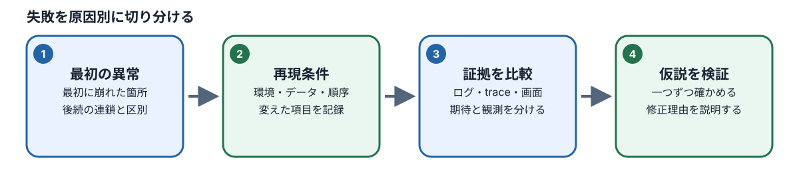
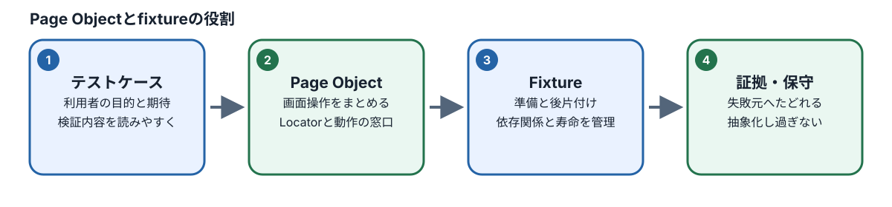

# M07：テスト失敗の分析と保守

## この章でできるようになること

テスト自動化ツール（Playwright）を実行した際、ターミナルや結果画面に赤い文字で「FAIL（失敗）」と表示されると、多くの初学者は「アプリにバグが見つかった！」と慌ててしまいがちです。

しかし、実際のソフトウェア開発やテストの現場において、テストが失敗する理由はアプリケーション本体の不具合（バグ）だけではありません。
テストコード側に書いた指定の誤り、テストを実行する環境の不備、データベースの初期データ不足、あるいはパソコンの処理速度や通信の揺らぎといった偶然のタイミングのズレなど、実に多種多様な要因が存在します。

もし、テストが落ちた原因を正しく突き止めないまま、開発者に「バグです！」と誤って報告してしまえば、開発チームを混乱させ、無駄な調査時間を発生させてしまいます。また逆に、「テストが不安定だから」と安易に待機時間を延ばしたり、テストコードの確認条件を緩めてしまったりすれば、本来検知すべき重大な製品バグを見逃してしまうことになります。

このM07では、テストの失敗に直面したときに決して慌てず、**「目に見えている客観的な事実」と「考えられる原因の仮説」を明確に切り分け、適切な調査証拠（エビデンス）を照合して、公式仕様書に基づいた最小限の正しい修正を行う一連の思考手順**を学びます。

さらに、テストの件数が増えても日々のメンテナンスに困らないよう、画面操作を部品化して共通管理する**Page Object（ページオブジェクト）**と、テストごとの事前準備を自動化する**fixture（フィクスチャ）**の仕組みと使い分けの境界線を身につけます。

### 本章の学習目標一覧

本章を修了した時点で、受講者は以下の行動ができるようになります。

| 学習目標ID | 本章で確認する行動 |
| ----- | ----- |
| **M07-01** | テストの失敗原因を、テスト側の不備（Test）・製品の不具合（Product）・環境の不備（Environment）・不安定なタイミング（Flaky）の4つに正しく分類できる。 |
| **M07-02** | エラーログ、スクリーンショット（Screenshot）、トレース（Trace）、実行レポート（Report）の役割の違いと、それぞれの証拠が持つ限界（単独では判断できないこと）を説明できる。 |
| **M07-03** | 失敗したテストに対し、再実行（Retry）の設定や待機時間（Timeout）の延長を安易に行うことが根本的な原因解決にならない理由を論理的に説明できる。 |
| **M07-04** | テストの検証意図や仕様書の受入基準を崩さずに最小限の修正を選択し、修正前と修正後を「別のRun（実行記録）」として客観的に比較・検証できる。 |
| **M07-05** | 重複する画面操作を小さなPage Objectやfixtureとして適切に共通化し、個別のテストに必要な業務検証（Assertion）を残したまま再実行して成功を確認できる。 |

## 1. テストがFAIL（失敗）になったら

### 1.1 FAILとはどういう状態ですか？

Playwrightなどの自動テストツールを使ってテストを実行すると、各テストケースの結果として「PASS（合格・成功）」または「FAIL（不合格・失敗）」が出力されます。

ここで、初学者が最初に心に刻むべき重要な事実があります。
**「FAIL」という表示が伝えている客観的な事実は、「テストコード内に記述された確認条件（Assertion：アサーション）が、あらかじめ決められた制限時間内に成立しなかった」ということだけ**です。

たとえば、カートに商品を追加した後のテストで、次のようなエラーが出力されたとします。

```text
Error: Timed out 5000ms waiting for expect(locator).toHaveText(expected)
Expected: "1"
Received: "0"
```

このエラーメッセージを注意深く読んでみましょう。

- `Timed out 5000ms waiting for ...`：指定された5000ミリ秒（5秒間）、条件が満たされるのを待ち続けましたが、時間切れになりました。
- `Expected: "1"`：テストコードは、画面の数量表示が「1」になることを期待していました。
- `Received: "0"`：しかし、実際に画面から受け取った文字は「0」のままでした。

このログから100%確実に断定できる「事実」は、**「5秒間待ったけれど、画面の対象要素の文字が『1』にならず『0』のままでタイムアウトした」**という現象だけです。

「なぜ『0』のままだったのか」という真の原因は、このエラーメッセージを眺めただけでは分かりません。
「アプリのカート追加処理が壊れている（製品バグ）」のかもしれませんし、「テストコードがそもそも別のボタンを押していた（テスト不備）」のかもしれません。あるいは「テストを実行する直前に、前回のテストで残ったゴミデータをリセットし忘れていた（データ準備不足）」のかもしれません。

このように、**「FAIL＝アプリのバグ」と直ちに決めつけるのは早合点**です。ログに記録された「事実」から出発し、冷静に可能性を広げて考える姿勢が求められます。

### 1.2 失敗の4つの原因候補

テストが失敗したとき、考えられる原因の候補は大きく次の4つのカテゴリーに分類できます。プロのQAエンジニアは、失敗に直面した瞬間にこの4つの引き出しを頭の中に思い浮かべます。

```text
【テスト失敗の4大原因】
├── 1. テスト側の問題（Test）
│     └── テストコードの記述ミス、期待値の勘違い、前提条件の準備不足
├── 2. 製品側の問題（Product）
│     └── アプリの実装バグ、画面の仕様不一致、サーバーの処理エラー
├── 3. 環境側の問題（Environment）
│     └── Webサーバーの未起動、ポート番号の誤り、初期データの欠落
└── 4. タイミングの問題（Flaky）
      └── 処理速度の偶然のブレ、描画待ちの不足、リソース競合
```

それぞれの内容と、現場でよく起きる具体例を詳しく見てみましょう。

#### 1. テスト側の問題（Test）

テストコードを作成した人（あなた自身や他のエンジニア）の書き間違いや勘違いに起因する失敗です。自動テストの現場において、実は最も頻繁に発生する失敗原因です。

- **Locator（操作対象の指定）の誤り**：ボタンの表示文字が「カートに追加」から「カゴに入れる」に変更されたのにテストコード側を更新していなかったり、画面内に同じ名前のボタンが2つあるのに曖昧な指定をして別の要素を触ってしまったりするケースです。
- **期待値（Expected）の勘違い**：仕様書には「未成年者の購入時は警告メッセージを表示する」と書かれているのに、テストコード作成者が「購入ボタンが非活性になる」と勘違いして期待値を書いてしまったケースです。
- **開始状態（前提条件）の準備不足**：テストを開始する前にカートを空にしておく（Reset）べきだったのに、初期化処理を呼び忘れたため、前のテストでカートに入れた商品が残ったまま計算が狂ってしまうケースです。

#### 2. 製品（アプリ）側の問題（Product）

テスト対象であるWebアプリケーション本体の不具合（バグ）や、仕様書との不一致に起因する失敗です。これを見つけ出すことこそが、QAエンジニアの本分です。

- **プログラムの実装バグ**：ユーザーが数量の「＋」ボタンを押したのに、JavaScriptの計算処理で例外エラーが発生し、画面の数値が更新されないケースです。
- **APIやサーバーの内部エラー**：サーバー側のデータベース接続が切断され、カート追加APIがステータスコード500（Internal Server Error）を返しているケースです。
- **仕様と実装の乖離**：仕様書には「最大購入数は5個まで」と定められているのに、アプリ側が10個まで買えるように実装されてしまっているケースです。

#### 3. 環境側の問題（Environment）

テストコードや製品のロジック以前に、テストを実行するための土台（サーバー、ネットワーク、データベース設定など）が正しく整っていないことに起因する失敗です。

- **Webサーバーの未起動**：テストを実行する対象のローカルサーバー（開発用サーバー）を立ち上げ忘れており、接続エラー（`ECONNREFUSED`）でテストが即座に落ちるケースです。
- **ポート番号や接続先URLの誤り**：サーバーはポート番号 `3000` で動いているのに、テストの設定ファイル（Config）で `localhost:8080` を見に行くように指定されているケースです。
- **シードデータ（初期データ）の欠落**：テストコードが「セラミックマグ」という商品を購入しようとしているのに、データベースに初期マスターデータが投入されておらず、商品詳細ページが「404 Not Found」になってしまうケースです。

#### 4. タイミングの揺らぎ（Flaky：フレイキー）

同じコード、同じ環境で実行しているにもかかわらず、あるときはPASSし、あるときはFAILになるような、実行結果が不安定なテストを「**Flaky test（フレイキーテスト）**」と呼びます。

- **非同期処理の待ち合わせ不足**：ボタンを押した後にサーバーと通信して画面を書き換える処理があるとき、パソコンのCPU負荷や通信速度のほんのわずかな遅れによって、Playwrightが画面を確認するタイミングよりも描画がコンマ数秒遅れてしまい、タイムアウトするケースです。
- **【重要】初学者が最も注意すべき点**：
  テストが失敗したあと、「もう一度実行したら今度は成功したから、タイミングのせい（Flaky）だろう」と安易に片付けてはいけません。1回目の実行によってデータベースに意図しないデータが書き込まれ、2回目の実行はそのデータを引き継いで偶然通っただけ（データの独立性の崩壊）というケースが極めて多いからです。原因を突き止めずに「たまたま通ったからOK」とすることは厳禁です。

### 1.3 事実・仮説・次の確認を分ける「3欄メモ」

#### 失敗を追う手順



テストが失敗した際、頭の中だけで考えてやみくもにテストコードを書き換えてしまうと、何が原因で何が直ったのかが分からなくなり、事態をさらに悪化させます。

そこで、プロのQAエンジニアは**「客観的事実」「原因の仮説」「次の確認アクション」の3つを明確に区別してメモを作成**します。さらに、期待値を取り違えないよう、**「公式仕様書に基づく期待結果」**も必ず併記します。

次の表は、カート画面のAssertionが失敗した場面を想定したメモの記入例です。

| 記録する欄 | 意味と役割 | 記入例（学習用の具体例） |
| --- | --- | --- |
| **事実（Fact）** | 実行ログや画面から、誰が見ても100%確実に確認できた客観的な出来事。推測を含めてはいけません。 | カート数量「1」を期待したAssertion（行番号: 42）が5000msでタイムアウトした。失敗時の画面スクリーンショットでは数量欄に「0」と表示されていた（※例示であり、未実行の証拠ではありません）。 |
| **仕様上の期待** | 公式仕様書の受入基準（AC）やビジネスルール（BR）に照らし、本来どう動くべきか。 | 対象商品の在庫が十分あり、開始数量が0個の状態で「追加」を1回押した場合、カート画面の該当商品の数量表示は「1」になる必要がある（BR-CART-001参照）。 |
| **原因の仮説** | 事実と仕様のギャップから考えられる原因の可能性。まだ確定していない推測の段階です。 | ① テストコードが「追加」ボタンのLocatorを取り違えて別の場所をクリックした可能性。 ／ ② テスト開始時のデータ初期化（Reset）が正常に完了しておらず、未認証状態になっていた可能性。 ／ ③ 製品側のカート更新APIがエラーを返している可能性。 |
| **次の確認** | 仮説が正しいかどうかを白黒ハッキリさせるために、最初に見るべき証拠とアクション。 | ① Trace Viewerでクリック操作の直前・直後プレビューを開き、赤枠で囲まれたクリック対象要素のアクセシブル名を確認する。 ／ ② ネットワークタブを開き、カート追加APIへのリクエストが送信されたか、レスポンスが200 OKかを照合する。 |

このように、「何が起きたか（事実）」と「なぜ起きたと思うか（仮説）」を紙やエディタの上で明確に分離することで、次に調べるべき証拠が自然と浮き彫りになり、見当違いのコード修正を防ぐことができます。

#### LocatorとAssertionのどこで失敗したか

教材用の `workspace/M07/failure-assertion.spec.ts` は、最後の確認を意図的に失敗させる例です。商品をカートへ追加し、追加完了の案内を確認したあと、テストは `/cart` へ移動します。その画面で `page.getByRole("heading", { name: "存在しない商品" })` を使って、存在しない見出し「存在しない商品」を探しています。Locatorの書式は正しくても一致する見出しがないため、このLocatorは要素を見つけられません。

失敗するのは `expect(...).toBeVisible()` のAssertionです。AssertionはLocatorが示す見出しの表示を待ちますが、対象要素がないためタイムアウトします。直前のカート追加確認は通っているので、ここでの原因は画面操作やアプリの故障ではなく、テスト側が存在しない見出しを期待したことです。Traceでは `/cart` への移動後にこのLocatorが0件であることと、最後の表示Assertionが失敗したことを確認します。

## 2. Trace、Screenshot、ログをどう使うか

### 2.1 実行のまとまり「Run（ラン）」とは？

テスト自動化の世界では、**テストを一連の条件で1回実行する単位を「Run（ラン）」**と呼びます。

テストを1回実行すると、その実行ごとに固有の識別情報（Run ID、実行日時、実行したコードのバージョンを示すGitのコミットSHAなど）が割り振られ、そのRunに完全に紐付いた形で調査用の証拠（エビデンス）が保存されます。

```text
1回のRun（実行単位）にまとめられる証拠群
├── メタ情報（Run ID、実行開始日時、対象コミットのSHA、実行引数）
├── 実行結果（PASS または FAIL、実行所要時間）
├── エラーログ（ターミナルの標準出力に出された文字情報）
├── スクリーンショット（失敗した瞬間のブラウザの静止画画像）
├── トレースファイル（操作・画面遷移・通信をコマ送り記録したzipファイル：Trace）
└── HTMLレポート（上記すべての証拠をブラウザ上で視覚的に閲覧できるHTMLページ）
```

#### 【鉄則】異なるRunの証拠を絶対に混ぜてはいけない

原因分析や修正前後の比較を行う際、**「前回失敗したRunのエラーログ」を見ながら、「今回実行したRunのスクリーンショット」を見比べるような行為は絶対に禁止**です。
実行時刻やコミットが異なれば、テストの前提条件もデータベースの状態も変わっています。異なるRunの証拠を混ざり合わて分析すると、存在しない幽霊のようなバグを追いかけることになり、極めて危険です。調査するときは、常に「調べたい1つのRun IDのフォルダの中にある証拠だけ」を開いてください。

### 2.2 4つの証拠の役割と限界

#### 3種類の診断素材

Playwrightが生成する代表的な4つの証拠には、それぞれ「得意なこと（分かること）」と「苦手なこと（単独では判断できない限界）」があります。それぞれの特性を正しく理解し、組み合わせて活用することが大切です。

| 証拠の種類 | どんなものか | 確認できること（得意なこと） | 単独では判断できないこと（限界） |
| --- | --- | --- | --- |
| **エラーログ** | ターミナルやレポートにテキストで出力されるエラー文 | ・最初に失敗した処理の行番号 ／ ・失敗したAssertionの内容（ExpectedとReceivedの差） ／ ・タイムアウトした秒数 | ・画面全体がどのような見た目だったか ／ ・操作の直前に画面遷移が起きていたかどうか ／ ・製品とテストコードのどちらに非があるか |
| **スクリーンショット** | テスト失敗の瞬間に自動撮影されたブラウザ画面の画像 | ・失敗した瞬間に画面に何が表示されていたか ／ ・エラーメッセージのダイアログが出ていたか ／ ・ボタンが非活性（グレーアウト）だったか | ・失敗に至るまでにどのような順序で操作されたか ／ ・画面の外（裏側）でネットワーク通信が失敗したかどうか ／ ・単に直前のページ遷移が遅れていただけなのか |
| **トレース（Trace）** | 操作、画面のDOM、通信、コンソールログなどをコマ送り記録した詳細データ | ・実行されたすべてのアクションの時系列 ／ ・各操作の「直前（Before）」と「直後（After）」の画面表示 ／ ・Locatorが画面上のどの要素を認識したか（赤枠表示） ／ ・ブラウザとサーバー間のネットワーク通信履歴 | ・仕様書上の「本来あるべき正解」そのもの ／ ・テスト実行時のパソコンの極端な負荷状態 |
| **HTMLレポート** | 上記のログ、画像、Traceを1つのWebページに集約した閲覧用画面 | ・全テストケースのPASS/FAIL一覧 ／ ・各テストの実行時間と失敗ステップの俯瞰 ／ ・添付された画像やTraceファイルへのリンク | ・失敗したAssertionの数値が、ビジネスルールとして本当に妥当であるかどうか |

たとえば、スクリーンショットを見て「カート追加ボタンが見当たらない！」と分かったとしても、それだけで「アプリにボタンが表示されないバグがある！」と開発チームに連絡してはいけません。
直前のTraceを確認すると、そもそも商品詳細ページへの移動に失敗していて、ログイン画面を開いたままボタンを探していただけかもしれないからです。**スクリーンショットは「静止画（1枚の写真）」に過ぎず、前後の「文脈（ストーリー）」を教えてくれるTraceと組み合わせて初めて正しい判断ができます。**

### 2.3 Trace Viewer（トレース ビューア）で調べる順番

Playwrightの**Trace Viewer**は、テスト実行中のブラウザ内部の出来事を、動画のコマ送りのように巻き戻して確認できる最高峰の診断ツールです。
しかし、情報量が非常に多いため、当てずっぽうに触っていても原因にはたどり着けません。必ず以下のステップに従って順番に確認を進めます。

```text
【Trace Viewerを使った調査の6ステップ】
Step 1: 対象Runの確認 ─── 調査対象のRun IDのTraceであることを確認する
   ↓
Step 2: 最初のFAILを特定 ─ タイムラインから「最初に赤色になった操作」を見つける
   ↓
Step 3: 直前画面の確認 ── 失敗した操作の直前（Beforeタブ）で画面がどうなっていたか見る
   ↓
Step 4: 操作対象の比較 ── テストのLocatorと画面上の要素（アクセシブル名）を突き合わせる
   ↓
Step 5: 前提操作への遡及 ─ 必要に応じてページ遷移やReset処理までタイムラインを遡る
   ↓
Step 6: 事実の記録 ────── 判明した客観的事実をメモし、仮説を更新する
```

#### 各ステップの詳細解説

1. **対象RunのTraceだけを開く**：
   調査したいRunのレポートから `trace.zip` を開きます。他のコミットや過去の実行記録が混ざっていないことを確認します。
2. **最初の失敗箇所（最初の赤色）を探す**：
   画面左側のアクションリスト（操作一覧）を上から見ていき、**「最初に赤色（FAIL）になったステップ」**をクリックします。テストは最初の1箇所が失敗すると、その後のステップも連鎖的に失敗（雪崩式にFAIL）することがほとんどです。2番目以降のエラーは単なる巻き添えである可能性が高いため、必ず「一番最初の失敗」に集中します。
3. **失敗直前の画面表示を確認する（Beforeタブ）**：
   画面中央のプレビュー上部にあるタブから「Before（操作前）」を選びます。たとえばクリック操作で失敗した場合、「クリックしようとしたまさにその瞬間、画面には何が映っていたのか」を観察します。
4. **Locatorと実画面を突き合わせる**：
   テストコードが探しているLocator（例：`getByRole('button', { name: 'カートに追加' })`）が、実画面のボタンの文字と完全一致しているかを確認します。Trace Viewer上のプレビュー画面にマウスを乗せると、Playwrightが認識している要素の名前やRoleがポップアップ表示されます。
5. **前提条件まで遡る**：
   もし画面上に目的のボタンが存在しない場合、タイムラインを数ステップ前（商品一覧からの遷移や、ログイン処理、テスト開始時のデータリセット処理）まで巻き戻します。「そもそも商品詳細ページに正しく遷移できていたか」「ログインは成功していたか」を確認します。
6. **事実を客観的に記録する**：
   「商品詳細画面には遷移していたが、ボタンのアクセシブル名が『カートに入れる』になっていた」など、自分の目で確認できた事実をメモに残します。

### 実践演習：Trace Viewerで失敗した箇所を探す（M07-01・M07-02）

実際に失敗するテストを実行し、生成されたレポートとTraceを使って原因を特定する一連の手順を体験してみましょう。

#### 演習の目的

失敗したテストのRunからエラーログとTraceを確認し、客観的な「事実」を抽出して原因の「仮説」を立てられるようになること。

#### 演習の準備

VS Codeのターミナルを開きます。作業対象のspecファイルは `repaired-assertion.spec.ts` です。
**【超重要】この段階では、まだテストコードを修正しないでください。**
修正前の「失敗した記録（before Run）」を確実に残すことが、後の比較検証において必須となるからです。

#### 手順1：修正前のテストを実行する（before Runの作成）

ターミナルで以下のコマンドを実行します。

```bash
pnpm course:run M07 repaired-assertion.spec.ts --label before
```

※ `--label before` というオプションを付けて実行することで、この実行記録が「修正前の状態」であることを示すラベルがシステムに保存されます。

#### 手順2：実行ログを確認する

テストが実行され、ターミナル上に赤い文字で「FAIL」と表示されて終了します。ターミナルに表示された出力ログから、以下の項目を作業メモに書き出してください。

- 失敗したテストケースの名前
- 最初にエラーを出力したファイルの行番号
- 出力されたエラーメッセージ（何を期待し、何を受け取ったか）
- レポートやTraceファイルの保存先パス

#### 手順3：レポートとTrace Viewerを開く

ターミナルの案内に表示されたコマンドに従い、HTMLレポートを開きます。レポート内の各テスト結果の右側にある添付ファイル欄（Attachments）から `trace.zip`（または「View Trace」リンク）をクリックし、Trace Viewerを起動します。
※プロジェクトで指定された正式な方法で開いてください。独自に推測したコマンドを創作して実行してはいけません。

#### 手順4：Trace Viewerで画面とActionを観察する

- 左側のアクションリストで、赤色でハイライトされている最初の失敗ステップをクリックします。
- 画面中央のプレビューで「Before」タブを選び、操作が行われようとした瞬間の画面表示を観察します。
- 画面右側の「Action」タブや「Console」「Network」タブを開き、通信エラーや警告が発生していないか確認します。
- 画面上の表示内容と、テストコードが期待しているAssertionの内容を比較します。

#### 手順5：本人の3欄メモを作成する

自分の作業用エディタやメモ帳に、以下のフォーマットで記録を書き込みます。

```text
- 事実：
- 仕様上の期待：
- 原因の仮説：
- 次の確認：
```

※画面やログに写っていないサーバー内部の出来事を、確たる証拠もないまま「製品のバグに違いない」と断定して書いてはいけません。

#### 手順6：AI（OpenCode）への安全な相談

もしAIツール（OpenCodeなど）に相談できる環境がある場合は、次のようにプロンプトを入力して、AIの回答と自分のメモを照合してみましょう。

> **AIへの相談プロンプト例：**
> 「この失敗Runのエラーログを共有します。このログから確実に言える『客観的な事実』と、そこから考えられる『原因の仮説候補』を分けて整理してください。また、仮説を検証するために追加で確認すべき証拠があれば教えてください。なお、ファイルを直接書き換える提案は行わず、分析の考え方のみを回答してください。」

AIの分析を受け取ったら、それをそのまま鵜呑みにするのではなく、自分がTrace Viewerで確認した事実と一致しているかを必ず自分の目で照らし合わせてください。

#### 練習問題

**問題**：
Trace Viewerでテストが失敗した直前の画面（Beforeプレビュー）を確認したところ、テストコードが探していた「カートに追加」ボタンが画面上に存在していませんでした。
この証拠だけをもとにして、開発チームに対し「製品コードにバグがあり、ボタンが表示されていません」と直ちに不具合報告（バグチケットの起票）を行ってよいでしょうか。その理由とともに答えてください。

**解答と解説**：
**直ちに不具合として報告してはいけません（×）。**

Trace Viewerのプレビューにボタンが写っていなかったことは確固たる「事実」ですが、それだけで原因が製品バグであると断定することはできません。以下のような別の原因候補が十分に考えられるからです。

1. **画面遷移の途中であった可能性**：直前のリンククリック後の画面移動が完了しておらず、まだ前の一覧画面が表示されている最中だった（テスト側の待ち合わせ不足、または遷移処理の指定ミス）。
2. **前提条件（データやログイン状態）が満たされていない可能性**：ログインが必要な画面なのにログインしていなかった、あるいは商品の在庫が0個で仕様通り「売り切れ」表示になってボタンが非表示になっていた（テスト準備不足、または仕様通りの正常動作）。
3. **ボタンの表示文字が変わった可能性**：仕様変更によってボタンの文言が「カゴに入れる」や「購入手続きへ」に変わっていた（テスト側のLocatorが古い）。
4. **製品側のプログラムのバグである可能性**：アプリ本体のJavaScriptエラーにより、ボタンのレンダリング（描画）が途中で停止した。

Traceは「ボタンが存在しなかった」という**事実（現象）**を教えてくれますが、**原因**までは自動的に教えてくれません。タイムラインを前の操作まで遡り、ネットワーク通信やコンソールログ、そして公式仕様書と突き合わせることで、初めて原因を絞り込むことができます。

## 3. RetryとTimeoutの正しい扱い

### 3.1 Timeout（タイムアウト）の本来の役割

**Timeout（タイムアウト）**とは、「ある処理や状態の変化が終わるのを待つ制限時間（上限時間）」のことです。
Webアプリケーションでは、ボタンを押したあとにサーバーと通信したり、アニメーションしながら要素が現れたりするため、操作の結果が画面に反映されるまでにわずかな時間がかかります。

Playwrightは非常に賢いツールであり、ボタンをクリックするときやAssertionで文字を確認するとき、画面がその状態になるまで自動的に数秒間（デフォルトでは5秒間や30秒間など）繰り返し確認しながら待機してくれます（これを**Auto-waiting：自動待機**と呼びます）。

しかし、もし何らかの異常があり、指定された制限時間を過ぎても期待した状態にならなければ、テストは「これ以上待ち続けても無駄である」と判断し、テスト実行を打ち切ってTimeoutエラー（FAIL）を出します。
つまり、Timeoutは**「無限に待ち続けてテストが永遠に終わらなくなる事故を防ぐための安全装置」**なのです。

### 3.2 Retry（リトライ）の本来の役割

**Retry（リトライ）**とは、「テストがFAILになったとき、同じテストケースを自動的にもう一度最初からやり直す設定」のことです。
主にGitHub ActionsなどのCI（継続的インテグレーション）環境において、クラウドサーバーの一時的な通信瞬断や、外部サービスの偶発的な応答遅延によってテスト全体が失敗扱いになってしまうのを防ぐための「救済措置」として利用されます。

### 3.3 なぜ「待機時間の延長」や「リトライ」で解決してはいけないのか？

テストがタイムアウトで失敗したとき、プログラミングや自動テストの初心者が最もやってしまいがちな悪手（アンチパターン）が、以下の2つです。

1. **「待つ時間が足りないのかな？とりあえずTimeoutを5秒から60秒に増やしてみよう」**
2. **「もう1回動かしたらたまに成功するな。Retry回数を3回に増やしておこう」**

これは、医療に例えるなら**「激しい腹痛で苦しんでいる患者に対し、痛みの原因（虫垂炎など）を検査せず、痛み止めだけを大量に飲ませて痛みを麻痺させている」**のと同じです。

もしボタンの名前（Locator）の指定を間違えていた場合、待機時間を60秒に延ばしたところで、存在しないボタンが60秒後に突然現れることは絶対にありません。単に「テストが失敗するまでに60秒間待たされる」ようになり、1回のテスト実行にかかる時間が無駄に何分も長くなるだけです。

また、「1回目はFAILしたが、Retryによる2回目の実行でPASSした」という場合、CIの結果表示だけを見れば緑色の合格マークが付くかもしれません。しかし、これは「問題が解決した」のではなく、**「1回目と2回目で結果が変わるほど不安定な何かが潜んでいる」という危険信号**です。
もしその不安定さの原因がアプリ本体の非同期通信のバグであった場合、テストを強引に通して本番環境にリリースすれば、実際のユーザーの画面でも「ボタンを押してもたまに反応しない」という重大な障害が発生してしまいます。

```text
【危険な対処（アンチパターン：失敗の隠蔽）】
テストがタイムアウトで落ちた！
  ↓
・Timeoutを60秒に延長する ── 根本原因は解決していない。テスト実行が遅くなるだけ。
・Retryを3回に増やす ────── 不安定さを隠しているだけ。本番でユーザーに不具合が起きる。

【正しい対処（プロのQA：原因の特定と治療）】
テストがタイムアウトで落ちた！
  ↓
Trace Viewerで最初の失敗箇所を開く。
  ↓
・指定したLocatorのアクセシブル名やRoleは実画面と一致しているか？
・直前のReset処理は正常に行われ、期待通りの初期状態に戻っていたか？
・アプリが仕様書通りの画面状態に遷移しているか？
  ↓
特定された根本原因に合致する「最小限の1箇所」を正しく修正する。
```

#### 練習問題

**問題**：
カート画面の自動テストを実行したところ、「カートの合計金額が表示されるまで待機する」というステップでタイムアウトエラーが発生しました。
次のうち、テストエンジニアとして最初にとるべき行動として適切なものはどちらでしょうか。

- **(A)** 確実に金額が計算されて描画されるよう、テストコードのタイムアウト時間を30秒延長し、リトライ設定を2回追加する。
- **(B)** Trace Viewerを開いて失敗直前の画面表示とネットワーク通信を確認し、合計金額が描画されなかった事実の原因（APIエラーなのか、計算遅延なのか、Locator誤りなのか）を調べる。

**解答と解説**：
**正解は (B) です。**
まず実画面の表示内容とTraceを確認し、なぜ合計金額が現れなかったのかという客観的事実を調査します。APIがエラーで止まっているなら製品のバグですし、合計金額の要素の指定方法が間違っているならテストコードの修正が必要です。待機時間の延長が必要かどうかは、そうした原因を確かめた後にのみ検討されるべき例外的な処置です。

### 3.4 練習：不安定さを「タイミングが悪い」の一言で片付けない

ここでは、タイミングによるテストの不安定さを理解するために、**学習用の合成ログ（説明用の架空データ）**を用いて思考を深めてみましょう。
※注意：以下のデータは説明のための合成ログであり、実環境のScenario Shopで発生した証拠ではありません。教材にない遅延機能がアプリ側に実装されているとみなしてはいけません。

**状況の設定**：
あるWeb画面で、ボタンを押した後に画面のステータス表示が「処理中」から「完了」へと非同期で切り替わります。
しかし、古いテストコードでは「処理の完了を待つAssertion」を使わず、「ボタンを押したあと、無条件に200ミリ秒（200ms）だけ固定時間待つ（sleepする）」という不適切な書き方をしていました。

| 合成Run | 状態が「完了」に変わるまでにかかった実時間 | テストコード側の固定待機時間 | 固定待機直後の確認結果 | テスト合否 |
| --- | ---: | ---: | --- | --- |
| **Run A** | 100ms | 200ms | すでに「完了」になっていた | **PASS（成功）** |
| **Run B** | 350ms | 200ms | まだ「処理中」のままだった | **FAIL（失敗）** |
| **Run C** | 180ms | 200ms | ちょうど「完了」になっていた | **PASS（成功）** |

#### 問いと考察

1. **Run A〜Cはまったく同じテストコードを実行していますが、結果は一致していますか？**
   - **解答**：一致していません。Run AとCは成功（PASS）していますが、Run Bだけが失敗（FAIL）しています。
2. **固定待機時間を「200ms」から「500ms」に延ばせば、根本的な原因は解決したと言えますか？**
   - **解答**：解決したとは言えません（断定できません）。パソコンの負荷がさらに高まり、処理に600msかかった瞬間に再びFAILしてしまいます。固定時間を待つ方式は「実際の画面状態」を監視していないため、本質的な解決になりません。
3. **UIの状態変化を正しく待つためには、どのようなコードに改修すべきでしょうか？**
   - **解答**：Playwrightが提供する「Web優先Assertion（自動再試行付きアサーション）」を使用します。

```typescript
// 【説明用のコード例】※Scenario Shopに同名の要素が存在すると断定するものではありません
// 固定時間を待つのではなく、「完了」という文字が表示されるまでPlaywrightに自動監視させる
await expect(page.getByRole("status")).toHaveText("完了");
```

Playwrightの `expect(...).toHaveText(...)` などのWeb Assertionは、あらかじめ設定されたタイムアウト上限（例: 5秒）に達するまで、ブラウザ画面の変化をミリ秒単位で繰り返しチェックし続けます。
状態が100msで「完了」になればわずか100msで次のステップへ進みますし、350msかかったとしても5秒以内であれば正しく完了を検知してPASSします。そして、もし本当にアプリが壊れて5秒経っても完了にならなければ、**正しくFAILとして検知**してくれます。

1. **もし製品側のプログラムに問題があり、特定の条件下で永遠に「完了」にならない不具合があった場合、待機時間を延ばす対策はどう評価されますか？**
   - **解答**：不具合の検知を遅らせるだけの有害な変更と評価されます。正しくFAILさせることこそがテストの価値であり、時間を延ばして誤魔化してはいけません。

**応用（解答付き）**：
Run Bにおいて、「完了」になるまでに350msかかって失敗した事実だけを見て、「製品のバグだ」と断定できますか？

- **解答**：まだ断定できません。仕様書において「この処理の応答時間は200ms以内とする」という非機能要件が定められているのであれば製品の性能不具合と言えますが、そのような規定がなく一般的なWeb通信の範疇であれば、テストコード側の待ち合わせ設計の不備（固定待機を使っていたこと）が原因である可能性が高いからです。

#### 別環境で試す：固定時間を待つだけでは不十分な理由

「固定時間待機（sleep）がいかに不安定であるか」を、ブラウザを使わずに**Node.jsの短いプログラムだけで体感する独立した練習**を行ってみましょう。
※この練習は概念理解のためのものであり、Scenario Shopの本体コードやM07の正式なテストファイルは一切変更しません。

VS Codeで `workspace/M07/practice-timing.mjs` という新しいファイルを作成し、以下のコードを記述して保存してください。

```javascript
// workspace/M07/practice-timing.mjs
// 指定したミリ秒だけ待機するヘルパー関数
const sleep = (ms) => new Promise((resolve) => setTimeout(resolve, ms));

async function exercise(renderDelayMs) {
  let status = "処理中";

  // renderDelayMs ミリ秒後に、非同期で状態が「完了」に更新される模擬処理
  const updatePromise = sleep(renderDelayMs).then(() => {
    status = "完了";
  });

  // 【悪い例】相手の状態を見ず、決め打ちで60ミリ秒だけ待つ
  await sleep(60);

  // 60ミリ秒経過した瞬間の状態を記録する
  const resultAfterFixedWait = status;

  // 後続の処理にタイマーを持ち越さないよう、更新完了を待って終了する
  await updatePromise;

  return { renderDelayMs, resultAfterFixedWait };
}

// 実験1：処理が10ミリ秒で終わる場合（待機時間60msより速い）
console.log(await exercise(10));

// 実験2：処理が180ミリ秒かかる場合（待機時間60msより遅い）
console.log(await exercise(180));
```

リポジトリのルートディレクトリで、ターミナルから次のコマンドを実行します。

```bash
node workspace/M07/practice-timing.mjs
```

#### 実行結果の予測と解説

- `exercise(10)` の結果：`{ renderDelayMs: 10, resultAfterFixedWait: '完了' }` と出力されます。
- `exercise(180)` の結果：`{ renderDelayMs: 180, resultAfterFixedWait: '処理中' }` と出力されます。

処理にかかる時間（10ms / 180ms）が環境や状況によって変動すると、「60ms待つ」という固定待機では結果が簡単に狂ってしまいます。
さらに、PCのCPU負荷によっては、Node.jsのタイマー自体にも数ミリ秒から数十ミリ秒のブレが発生します。
自動テストにおいては、**「時間を止めて待つ（sleep）」のではなく、「期待する状態になるまで再試行しながら待つ（Auto-waiting Assertion）」を採用すること**が、**待機条件の不備が原因である場合に**Flaky testを減らす有効な方法です。テストデータの競合、テスト間依存、外部サービス障害など別の原因には、証拠に基づく別の対応が必要です。

## 4. 修正前後の別Runで効果を確かめる

### 4.1 最小修正（Minimal Fix）の原則

テストの失敗原因が特定できたら、テストコードを修正します。この作業においてプロのQAが徹底するのが**「最小修正（Minimal Fix：ミニマルフィックス）」の原則**です。

テストが失敗した際、焦るあまり「あちこちの行を同時に書き換える」「ついでに関係のないリファクタリングも行う」「待機処理をあちこちに挟み込む」といった大掛かりな変更を一気に行ってはいけません。
複数の変更を同時に加えてしまうと、たとえテストが通るようになったとしても、**「結局どの行の修正が効いたのか」**が分からなくなります。さらに最悪なのは、知らず知らずのうちに重要なAssertionを削除してしまい、テストの判定基準を骨抜きにしてしまうことです。

修正作業は、必ず次のステップを遵守します。

```text
【最小修正の手順】
1. 仕様書の確認 ── 公式仕様書（受入基準）を開き、本来あるべき正しい期待値を確認する
   ↓
2. 原因行の特定 ── 失敗に直結している1行（Locatorの指定値や期待値の数値など）を特定する
   ↓
3. ピンポイント修正 ── その1箇所のみを変更する（関係ないAssertionを消したり緩めたりしない）
   ↓
4. 製品コードの保護 ── 指示のない限り、アプリ本体（製品側）のソースコードは絶対に触らない
```

### 4.2 before Runとafter Runを比較する

修正が本当に正しかったことを自分自身やチーム、評価者に客観的に証明するためには、**「修正前は確かに失敗しており、最小限の修正を行った後は、全く同じ条件で確実に成功するようになった」という2つの実行記録（before Run / after Run）**を揃える必要があります。

```bash
# 1. 修正前の実行（失敗した客観的証拠を確実に記録に残す）
pnpm course:run M07 repaired-assertion.spec.ts --label before

# （ここで原因を分析し、specファイルに必要な最小限の修正を1箇所だけ行う）

# 2. 修正後の実行（成功した記録を「別のRun」として新しく保存する）
pnpm course:run M07 repaired-assertion.spec.ts --label after
```

もし、修正前の失敗Runを削除してしまったり、同じRunを上書きしてPASSの記録だけを残してしまったりすると、後から振り返ったときに「本当にそのテストは失敗していたのか？」「修正によって直ったのか、それとも最初から通っていたのか？」を検証することが不可能になってしまいます。
**「修正前の失敗」と「修正後の成功」が2つ並んで初めて、あなたの行った修正作業の正当性が証明されます。**

### 実践演習：AIの修正提案をレビュー・比較する（M07-03・M07-04）

近年、AIエージェントにエラーログを読ませて修正案を出してもらう開発スタイルが普及しています。しかし、AIの提案が常に正しいとは限りません。AIの提案を鵜呑みにせず、QAの視点でレビューする力を養いましょう。

#### 演習のシチュエーション

カート画面の数量確認テスト（`repaired-assertion.spec.ts`）がタイムアウトで失敗した際、AIツールが次の2つの修正案を提示してきました。

- **案A**：
  「テスト全体の待機時間を毎回30秒延長しましょう。そして、失敗している数量Assertion（`toHaveText("1")`）を、要素が画面に存在するかどうかだけを確認する緩いチェック（`toBeVisible()`）に書き換えれば、エラーが出なくなります。」
- **案B**：
  「直前のReset処理ログとTraceを確認したところ、カート画面自体は開けていますが、テストコードが『別の商品の数量欄』をLocatorで指定していました。仕様書の受入基準（数量1の確認）は維持したまま、対象商品の数量欄を正しく指すようLocatorの指定行のみを修正しましょう。」

#### 手順1：2つの案のリスクを評価する

あなた自身の作業メモに、案Aと案Bのそれぞれについて「何を変更しようとしているか」「どのようなリスクやメリットがあるか」を文章で書き出してください。

#### 手順2：実機でbefore Runを確認し、最小修正を実施する

- ターミナルで `pnpm course:run M07 repaired-assertion.spec.ts --label before` を実行します（まだ実行していない場合）。
- レポートとTrace Viewerを確認し、どのAssertionがなぜ失敗しているのか、事実を突き止めます。
- 指定されたspecファイル（`repaired-assertion.spec.ts`）のみを開き、仕様書に合致する最小限の修正を施します。

#### 手順3：after Runを実行し、比較表を作成する

- ターミナルで `pnpm course:run M07 repaired-assertion.spec.ts --label after` を実行します。
- before Runとafter Runについて、以下の項目を比較表にまとめます。
  - 各Runのラベル（before / after）
  - 各Runの合否結果（FAIL / PASS）
  - specファイルの修正行と、その変更が必要だった技術的理由

#### 解答と解説

- **案Aのリスク評価**：
  **極めて危険なアンチパターンです。**
  待機時間をいたずらに延ばしてテストの実行速度を低下させているだけでなく、最も致命的なのは「数量が1個になっているか」という業務ルールの検証を「単に要素が見えているか」という無意味なチェックに格下げしてしまっている点です。
  もしアプリ側に「ボタンを押してもカート内の数量が0のまま増えない」という重大なバグが存在していたとしても、案Aのコードではテストが緑色（PASS）になってしまい、バグを見逃してしまいます。
- **案Bの妥当性評価**：
  **完全に正当なプロの対応です。**
  事実（Traceの操作対象）を調査し、仕様書が要求する受入基準（数量が1であること）を一切崩さずに、誤っていたLocator指定のみを最小修正しています。これにより、テストの信頼性と品質保証の価値が強固に保たれます。
  ※受講者本人の自力解決を促すため、課題コード自体の完成答案は本文中には掲載しません。上記の考え方に沿って修正を行ってください。

## 5. テストコードを保守しやすくする（共通化の基礎）

### 5.1 なぜテストコードの共通化が必要なのですか？

テスト自動化を長期間運用していると、アプリケーションの画面変更やデザイン変更に合わせて、テストコードを書き直すメンテナンス作業が必ず発生します。

たとえば、5本のテストファイルが存在し、そのすべてのファイルに「商品一覧画面を開き、検索窓に『マグ』と入力して検索ボタンを押し、検索結果の最初のリンクをクリックしてカート画面へ移動する」という一連のコードが直接（ベタ書きで）書かれていたとします。

ある日、UIデザイナーの変更によって「検索」ボタンの名前が「商品を探す」に変わったらどうなるでしょうか。
5つのファイルを開き、該当するコードを泥臭く手作業で探し出して、1箇所ずつ修正して回らなければなりません。もし1箇所でも直し忘れたファイルがあれば、そのテストは翌朝のCIで失敗してしまいます。

このように、**「画面の変更によってテストが壊れたとき、直す場所を1箇所に集中させたい」**という切実な課題を解決するために、画面操作を部品化して共通管理する設計手法を用います。

#### 【注意】過剰な共通化（過度な抽象化）の罠

ただし、何でもかんでも共通化すれば良いというわけではありません。
「2度と使い回さない1回限りの特殊な操作」や「たった1行の単純なクリック」まで無理にクラスを作って部品化すると、コードのあちこちを行ったり来たりしなければ全体の流れが読めなくなり、かえってメンテナンス性が低下します。**「共通化は、重複が現実に発生し、保守上のメリットが明確にある場合にのみ行う」**のが健全な設計です。

### 5.2 Page Object（ページオブジェクト）とは何か？

**Page Object（ページオブジェクト）**とは、**「特定のWeb画面に関する操作手順や要素の探し方（Locator）を、1つのまとまり（クラス）として定義する設計パターン」**のことです。

身近な例えで言うと、**「テレビのリモコン」**のようなものです。
テレビ本体の内部にある複雑な電子回路や配線の仕組みを知らなくても、リモコンの「電源ボタン」や「音量アップボタン」を押せばテレビを操作できるように、テストコード側から「画面を開く」「商品を追加する」といった分かりやすい名前のメソッド（ボタン）を呼び出すだけで画面を操作できるようにします。

まず、最小限の小さなPage Objectのコードを見てみましょう。

```typescript
import { type Page } from "@playwright/test";

// 商品カタログ画面を操作するためのPage Objectクラス
export class CatalogPage {
  // constructor（コンストラクタ）：このクラスを使う準備をするときに動く処理
  constructor(private readonly page: Page) {}

  // 商品カタログ画面をブラウザで開く操作（メソッド）
  async open() {
    await this.page.goto("/products");
  }

  // 指定した名前の商品をクリックして詳細ページへ移動する操作
  async selectProduct(productName: string) {
    await this.page.getByRole("link", { name: productName }).click();
  }
}
```

#### 初心者向けコード解説

- `class CatalogPage { ... }`：
  `class`（クラス）とは、関連するデータと操作をひとまとめにするための「設計図」です。ここでは「商品カタログ画面を操作するための設計図」を定義しています。
- `constructor(private readonly page: Page)`：
  `constructor`（コンストラクタ）は、このクラスの実物（インスタンス）を生成するときに最初に呼び出される準備処理です。Playwrightがブラウザ画面を操作するために必要な `page` オブジェクトを受け取り、クラス内部で大切に保持します。`private readonly` はTypeScriptのキーワードで、「クラスの外部からこの変数を勝手に書き換えられないように保護する」という安全のための宣言です。
- `async open()` / `async selectProduct(...)`：
  画面に対する具体的な操作をまとめた関数（メソッド）です。将来、商品一覧ページのURLが `/products` から `/catalog` に変わったとしても、テストコード側を何十箇所も直す必要はなく、この `open()` メソッドの中の1行を修正するだけで、すべてのテストが再び動くようになります。

### 5.3 Playwrightのfixture（フィクスチャ）とは何か？

**fixture（フィクスチャ）**とは、**「各テストを実行する前に必要な準備（お膳立て）を自動的に行い、テストが終わったら後片付けまでを引き受けてくれる仕組み」**のことです。

身近な例えで言うと、**「料理番組のアシスタントさん」**のようなものです。
料理人（テストコード）が調理台の前に立ったときには、すでにピカピカに洗われた鍋や、計量済みの食材（準備された状態）が用意されており、調理が終わったら使った調理器具の片付けまでアシスタントさんが引き受けてくれます。

Playwrightでは、標準機能である `test.extend` を使って、独自のfixtureを定義できます。

```typescript
import { test as base, type Page } from "@playwright/test";

// カート画面を操作するPage Object
class CartPage {
  constructor(readonly page: Page) {}
}

// 基本のtestを拡張して、独自のfixture「cart」を使えるようにする
export const test = base.extend<{ cart: CartPage }>({
  // cartという名前のfixtureの準備手順を定義する
  cart: async ({ page }, use) => {
    // 1. 【事前準備】：CartPageのインスタンスを作成する
    const cartPage = new CartPage(page);

    // 2. 【テストへの受け渡し】：useを呼んでテスト本体へ手渡す
    await use(cartPage);

    // 3. 【後片付け】：（必要であればテスト終了後に実行したい片付け処理をここに書く）
  },
});
```

#### 初心者向けコード解説

- `base.extend<{ cart: CartPage }>`：
  Playwright標準の `test`（base）を拡張し、「このテストスイートでは、新しく `cart` という名前の `CartPage` オブジェクトをテストに届けることができます」と型を宣言しています。
- `cart: async ({ page }, use) => { ... }`：
  fixtureの具体的な振る舞いを記述する関数です。Playwrightから標準の `page` を受け取り、さらに `use` という特別な関数を受け取ります。
- `await use(cartPage)`：
  **ここがfixtureの最も重要な仕組みです！**
  準備した `cartPage` を `use(...)` の引数に渡して呼び出すことで、テストコード側へ「はい、準備ができました。どうぞ使ってください！」と手渡します。テストコードが実行されている間、プログラムの処理はこの `use` の行で一時停止し、テストコードが最後まで走り終えると、再びこの行に戻ってきて、その下にある後片付け処理へと進みます。

#### 【重要】M07演習におけるfixtureとResetの契約

上記のコードは、fixtureがオブジェクトをテストに手渡す最も基本的な構造を示した最小サンプルです。
実際のM07演習では、テスト同士がお互いの実行結果（カートに残った商品データなど）に影響されない独立した状態を保証するため、**「配布されているReset helper（初期化処理）を、各テストの実行前に確実に呼び出す契約」**が存在します。

単にサンプルコードをコピー＆ペーストするだけでは課題をクリアできません。
「テストが始まる直前に毎回確実にデータを初期化すること（fixtureの責務）」と、「初期化された綺麗な画面を使って個々の業務ルールを確かめること（テストケースの責務）」を正しく分離して実装する必要があります。

### 5.4 共通化するもの／個別のテストに残すもの

#### 保守性の判断



Page Objectやfixtureを導入するとき、初心者が最も陥りやすい重大な失敗が、**「テストコードの行数が減ってスッキリするから」という理由で、Assertion（結果の確認・検証）まで全部Page Objectの中に押し込んで隠してしまうこと**です。

これは絶対に避けてください。何でもかんでも共通部品の中に隠してしまうと、テストファイルを読んだときに「このテストケースは一体どんな業務ルールを保証しているのか」が誰にも分からなくなってしまいます。

以下の境界線を明確に意識してコードを書いてください。

| 共通化するもの（Page Object / fixtureに置く） | 個別のテストコードに残すもの（テスト本体に置く） |
| --- | --- |
| ・同じURLへの画面遷移処理（`page.goto`） ／ ・共通で使われるボタンのクリックや文字入力操作 ／ ・テストごとの事前準備（Reset helperの確実な実行） ／ ・画面部品（Locator）の定義とカプセル化 | ・**何を検証するテストケースか**という目的とCase ID ／ ・テストケース固有の入力値（商品名や入力数量など） ／ ・**仕様書の受入基準（AC）に基づく業務Assertion**（例：数量が「1」であること、特定のエラー文が表示されること） |

共通化するのは、複数のテストで繰り返し登場する「機械的な画面操作」や「環境の初期化」です。
一方で、数量「1」を確かめたいテストと、上限エラーを確かめたいテストは、途中で触る画面が同じであっても「検証したいビジネスルール」が全く異なります。そのため、**合否判定を下す最後のAssertion（`expect`）は、個々のテストコード側に誇りを持って明示的に残す**のが正しいテスト設計です。

また、データ初期化（Reset）は「全テストの最初に1回だけまとめて実行する」のではなく、**「各テストケースの開始直前に毎回実行する」**ように設計します。途中のテストが途中でコケたとしても、次のテストが綺麗な初期状態からスタートできるようにするためです。

## 6. 保守演習のbefore / after（M07-05）

### 6.1 演習の目的と全体像

演習ファイル `workspace/M07/maintenance.spec.ts` には、2件のテストケースが含まれています。
どちらのテストも「商品詳細画面を開き、マグをカートに追加して、カート画面を開き、数量を確認する」という操作を行っていますが、現在はその手順がそれぞれのテストにベタ書きされています。

この演習では、テストの検証内容（受入基準）を一切変えずに、重複した画面操作を小さなPage Objectとfixtureへ整理するリファクタリング（構造改善）を行います。

```text
【保守演習の進行ステップ】
Step 1: 修正前の実行（before Run） ── 変更前のコードで2件ともPASSすることを確認・記録
   ↓
Step 2: 重複コードの洗い出し ────── 2つのテストで共通している画面操作を特定する
   ↓
Step 3: 小さなPage Objectの作成 ──── 共通操作をまとめたクラスを定義する
   ↓
Step 4: fixtureによるResetの適用 ─── 各テストの開始前に確実に初期化を行う
   ↓
Step 5: 業務Assertionの維持 ──────── 個別の数量確認（expect）をテスト側に残す
   ↓
Step 6: 修正後の実行（after Run） ─── 変更後のコードで別Runとして再実行し、PASSを確認
```

### 6.2 段階的な思考練習

いきなりコードを書き換えるのではなく、まずは頭の中で設計を整理する3つの思考練習に取り組みましょう。

#### 練習A：重複している操作を見つける

`workspace/M07/maintenance.spec.ts` を開き、2つのテストケースを見比べます。
「商品画面へ移動する」「マグを追加する」「カートへ移動する」という操作の行をそれぞれ抜き出してください。そして、それぞれのテストが最後に確認している「数量の期待値」が何個と何個になっているかをメモしてください。

#### 練習B：クラスの役割を言葉で説明する

第5節で学んだPage Objectのコードを見直してください。`constructor` が「ブラウザのページを受け取って保持すること」、メソッドが「画面固有の定型操作をカプセル化すること」を担っている理由を、同僚に説明するつもりで自分の言葉で説明してみましょう。

#### 練習C：Resetのタイミングを考える

「全テストスイートの最初に1回だけResetを行う設計」と、「fixtureを使ってテストケースごとに毎回Resetを行う設計」を比較してください。なぜ各テストが始まる直前に毎回Resetを行う必要があるのでしょうか？（1つ目のテストでカートに入れた商品が、2つ目のテストの開始時に残っていると、数量計算が狂ってしまうためです）。

### 6.3 実践演習の手順

#### 手順1：修正前のbefore Runを実行する

ターミナルで以下のコマンドを実行し、修正前の状態で2件のテストが成功することを記録します。

```bash
pnpm course:run M07 maintenance.spec.ts --label before
```

#### 手順2：AIへの安全な共通化相談

AIに設計の相談をする場合は、以下のようにプロンプトを入力します。

> **AIへの相談プロンプト例：**
> 「`maintenance.spec.ts` の2つのテストで重複している画面操作について、保守性を高めるための最小限のPage Object共通化案を提示してください。その際、個々のテストケースが持つ業務Assertion（数量の確認）を共通部品の中に入れず、テストファイル側に残すべき理由も合わせて解説してください。なお、ファイルを直接変更せず、説明のみ出力してください。」

#### 手順3：Page Objectとfixtureを実装する

AIの提案や本章の解説を参考にしながら、必要な範囲で小さなPage Objectクラスを作成し、fixtureを適用します。テストケース本体から業務Assertionが消えてしまわないよう注意深く編集します。

#### 手順4：修正後のafter Runを実行する

修正が完了したら、必ず別Runとして再実行します。

```bash
pnpm course:run M07 maintenance.spec.ts --label after
```

#### 手順5：差分と別Runの確認

- before Runとafter Runの2つの記録がそれぞれ独立して保存されていることを確認します。
- どちらのRunでも2件のテストが確実に成功（PASS）していることを確認します。
- 変更後のコードにおいて、重複操作はすっきりとまとまりつつ、個別の数量確認（受入基準）がテストケース側に明示的に残っていることを確認します。

#### 解答と解説

共通化すべき対象は、ボタンクリックやURL遷移などの「機械的な反復操作」です。
一方で、テストケースごとに異なる「数量1の確認」「数量2の確認」といったAssertionは、そのテストケースが存在する理由そのもの（保証すべき業務ルール）であるため、テストケース側に明示的に残すのが正解です。
また、fixtureを通じたテストごとのReset呼び出しは、テストケース同士が互いの実行順序やゴミデータに依存しない「テストの独立性」を担保するために不可欠な設計です。

## 7. さらに理解を深める：失敗の原因を証拠で絞り込む

日常のQA活動で迷ったときに立ち返るべき重要な指針を、手本の深掘りとQ&A形式で学んでおきましょう。

### 7.1 FAILは「製品が壊れた」と同じ意味ではない（手本の深掘り）

**具体例で考える手本**：
テストコードで `page.getByRole("link", { name: "Mug" })` という指定が見つからず、テストがFAILになったとします。
ブラウザの実画面を目視で確認したところ、リンクの表示文字が「セラミックマグ」になっていました。

このとき、プロのQAエンジニアはどう判断すべきでしょうか？

1. **画面の見た目だけで判断しない**：
   画面上に「セラミックマグ」と自然な日本語で表示されていても、それが仕様書通りなのかどうかは目視だけでは分かりません。
2. **正本となる公式仕様書（受入基準）を確認する**：
   - **仕様書に「表示名は『セラミックマグ』とする」と記載されていた場合**：
     アプリの実装は正しく、テストコード側の指定が古い（テスト側の不備）と判断できます。テストコードのLocatorを修正します。
   - **仕様書に「英語表記の『Mug』と表示すること」と記載されていた場合**：
     テストコード側の期待は正しく、アプリの実装が表示名を間違えている（製品側の不具合）と判断できます。開発チームへ不具合報告書を作成します。

このように、画面上の表示とテストコードの指定が食い違っているときは、**必ず「正本となる仕様書」を審判（基準）にしてどちらが誤っているかを判断します。**

### 7.2 事実・仮説・次の確認の深掘り一覧

エラーが発生したときの典型的なパターンと、その分析手順は下表の通りです。

| 観測された事実 | 考えられる原因の仮説 | 次に行うべき確認アクション |
| ----- | ----- | ----- |
| Locatorの待機がタイムアウトした | 画面上のアクセシブル名やRole属性が、テストの指定と食い違っている。 | Trace Viewerで対象画面を開き、PlaywrightのLocatorツールを使って実際のアクセシブル名を確認する。 |
| 要素は画面に見えているが、数量AssertionがFAILした | 操作自体は成功したが、アプリ側の更新処理が拒否された。またはテスト側の期待値の数値を勘違いしている。 | 操作直前の前提条件（在庫数やカート上限）と、仕様書のビジネスルール（BR/AC）を照合する。 |
| テスト開始直後に接続エラー（ECONNREFUSEDなど）が出た | テスト対象のWebサーバーが起動していない。ポート番号が間違っている。 | 設定ファイル（Config）、ポート番号、テストサーバーの起動ログを確認する。 |
| 1回目失敗、Retryで2回目だけ成功した | テスト前のデータ初期化（Reset）が不十分で、偶然前のデータが影響した。または非同期処理の待ち合わせが不足している。 | 1回目と2回目のRunの前提条件、実行前後のデータ状態、Traceのタイムラインを比較する。 |

### 7.3 解説付き章末問題（全10問）

本章で学んだ知識の定着度を確認するために、以下の問題に取り組んでみましょう。

#### 問題1

画面上のリンク名が変わったことでLocatorが見つからず、テストがFAILになりました。このとき、最初に確認すべき資料は何ですか？
> **解答と解説**：
> **対象画面の実際の表示（アクセシブル名）と、正式な仕様書（受入基準）の表示要件です。**
> テストコードを直すべきか、製品の不具合として開発チームに報告すべきかは、仕様書と実画面を照合して初めて判定できます。

#### 問題2

Trace Viewerを確認したところ、「カートに追加」ボタンは確かにクリックされていましたが、その後のカート数量AssertionがFAILしていました。この失敗原因を「クリック操作の失敗」と断定できますか？
> **解答と解説**：
> **断定できません（×）。**
> ボタンがクリックされた証拠がある以上、クリック操作自体は成功しています。失敗したのはその後の処理です。「クリック後にアプリ側が数量更新APIでエラーを起こした」「別の商品の数量を確認してしまっている」「前のテストのデータが残っていて期待数量とズレた」など、業務処理やデータ側の原因を調べる必要があります。

#### 問題3

CI環境でテストを実行したところ、1回目と2回目はFAILになり、自動Retryされた3回目だけPASSしました。このテスト結果を見て、「最終的にPASSしたから問題なし」としてよいでしょうか？
> **解答と解説**：
> **よくありません（×）。**
> 1回目と2回目の失敗をなかったことにしてはいけません。同じコード・同じ環境であるにもかかわらず結果が揺らいでいる（Flakyである）という重大な兆候です。各回のRunやTrace、前提データ、実行タイミングの差を調査し、不安定さの原因を突き止めて記録する必要があります。

#### 問題4

テストがタイムアウトで失敗したため、待機処理を追加しようと考えています。コードに待機を追加する前に、まず何を確認すべきですか？
> **解答と解説**：
> **「本当に待ち時間が足りないことが原因なのか」を確認します。**
> 探しているLocatorの名前やRoleが間違っていないか、画面遷移が正常に行われているか、Playwrightが標準で備えている自動待機（auto-waiting）やWeb優先Assertionで正しく表現できないかを先に確かめます。固定待機（sleep）の安易な追加は避けるべきです。

#### 問題5

「テストコードを綺麗にするため、すべてのAssertion（期待値の確認）をPage Objectの中に移動させて、テストファイル側には1行も `expect` を書かないようにした」という設計は、保守性の観点から適切と言えるでしょうか？
> **解答と解説**：
> **適切とは言えません（一概に推奨されません）。**
> 個々のテストケース固有の業務確認（数量が1であること、特定のエラー文が出ることなど）までPage Objectの中に隠してしまうと、テストファイルを見ただけでは「そのテストが何を保証しているのか」が分からなくなります。共通の画面操作と、個別の業務Assertionの責務は明確に分離すべきです。

#### 問題6

fixtureの中でReset処理を1回だけ呼び出すように実装しました。これだけで、すべてのテストケースが確実に独立して実行できると断定できますか？
> **解答と解説**：
> **断定できません。**
> fixtureのスコープ（テストごとに動くのか、全テストの最初に1回だけ動くのか）や、アプリ側が保持しているデータ（ブラウザのストレージやサーバー側のDB）がどのように初期化されるかに依存します。各テストが始まる直前に、確実に必要な初期状態へ戻っていることを実行結果と契約で確認する必要があります。

#### 問題7

修正前のbefore RunがFAILで、コード修正後のafter RunがPASSになりました。これだけで「修正は完全に正しい」と断定してよいでしょうか？
> **解答と解説**：
> **まだ十分ではありません。**
> 修正したコード差分（git diff）を確認し、「Assertionを安易に削除したり緩めたりしていないか」「仕様書の受入基準を満たす最小限の修正になっているか」「同じ前提条件・同じ対象ファイルで実行されているか」を確かめて初めて、修正の正しさを保証できます。

#### 問題8

AIにエラーログを貼り付けて相談したところ、「テストが落ちないように、Timeoutの値を2倍に増やしましょう」と提案されました。あなたはこの提案をどのようにレビュー・判断しますか？
> **解答と解説**：
> **提案をそのまま採用せず却下（または再検討）します。**
> 何の処理を待っているのか、本当に処理遅延が根本原因なのかをTrace Viewerで調査します。原因を確かめずに待機時間だけを延ばす変更は、根本治療にならずテスト時間を肥大化させるだけだからです。

#### 問題9

新しく作成したテストファイルには、画面操作が2行しかなく、他のテストファイルで再利用される予定もありません。この場合でも、必ず新しいPage Objectクラスを作成して部品化すべきでしょうか？
> **解答と解説**：
> **必ずしも作成する必要はありません（作らない選択が適切な場合があります）。**
> 重複が存在せず、保守上の具体的なメリットがない場合にまで無理にクラスやファイルを追加すると、コードを読む場所が増えてかえって管理が煩雑になります。必要になった時点で共通化を検討するのが適切な判断です。

#### 問題10

手元にTraceファイルがありますが、それがいつ、どのコミット（コードの版）で実行されたRunのものなのかが分からなくなってしまいました。このTraceを正式な修正の証拠（エビデンス）として提出してよいでしょうか？
> **解答と解説**：
> **提出してはいけません（×）。**
> 実行対象の同一性が証明できない証拠は、客観的なエビデンスとして成立しません。Run ID、対象コードのSHA、レポートの生成時刻を照合し、紐付きが確認できない場合は「未確認」として扱い、正しい手順で再実行して新たな証拠を取得する必要があります。

## 8. Phase 2総合演習と引継ぎ

### 8.1 Phase 2での到達基準

本カリキュラムのPhase 2では、先行するM06で作成した新規テストケースとその実行結果に加え、本章（M07）で学んだ以下の能力を総合的に評価します。

1. **異なる原因構造を持つ失敗の診断**：エラーログやTraceから客観的事実を抽出し、4つの原因カテゴリーへ正しく分類できること。
2. **仕様を守った最小修正の実施**：検証意図を緩めることなく、原因となっている行だけをピンポイントで修正できること。
3. **適切な保守構造へのリファクタリング**：重複する操作を小さなPage Objectやfixtureに整理し、業務Assertionを明示的に残した保守性の高いテストコードを構成できること。

### 8.2 引き継ぎ資料（handoff）の作成

M07での学習・実践成果は、後続のモジュール（M08以降）へ確実に引き継ぐために、`workspace/M07/phase2-handoff.md` に整理して記録します。

この引き継ぎ資料には、以下の客観的事実を漏れなく記述してください。

- 実際に検証を行ったspecファイルのパスと、そのコミット版（SHA）
- 使用した設定ファイル（Config）およびReset helperの呼び出し方法
- before Run（修正前・失敗）のRun ID、実行日時、観測された事実
- after Run（修正後・成功）のRun ID、実行日時、最小修正の具体的な内容
- 保守構造として導入したPage Objectおよびfixtureの責務分担

後続のモジュールを担当するエンジニアがこの資料を読んだとき、「どのファイルを使って、どんな客観的証拠をもとに検証が行われたのか」が誰の目にも一目瞭然であるように記述することが目的です。

### 8.3 正式評価（Assess）の受け方

受講者本人がM07の正式修了評価を起動する際は、ターミナルで以下のコマンドを使用します。

```bash
pnpm course:assess M07 --model provider/model-id
```

※日常の疑問点解消や壁打ちに使うAIチューター（`pnpm course:tutor`）と、修了判定を行う正式評価（`pnpm course:assess`）は、全く異なる役割を持った独立した工程です。
必要な証拠（before/afterのRun記録など）が不足している場合、確認できない内容を合格とみなすことはありません。`not_run`、`ungradable`、`blocked`などの状態は、実際の原因と評価契約に従って厳密に区別され、証拠不足を一律に`BLOCKED`と言い換えることもありません。証拠のない成功を創作したり、結果を捏造して報告することは固く禁じられています。

### 8.4 本章のまとめチェック

次の3つの質問に、自信を持って答えられるか確認してみましょう。

1. **スクリーンショットにボタンが見当たらないとき、それだけで「アプリのバグだ」と開発者に報告してよいですか？**
   - **答え**：不可（×）です。直前の画面遷移や前提条件、テストコード側のLocator指定ミスなど、他の原因候補をTrace等で確認する必要があります。
2. **失敗したテストがRetryによって2回目でPASSした場合、不具合は解消されたとみなしてよいですか？**
   - **答え**：不可（×）です。偶然成功しただけであり、実行タイミングやデータリセットの不備など、テストが不安定になっている根本原因を調査しなければなりません。
3. **テストコードを綺麗にするために、画面の操作だけでなく、個々のテストケースが確認している業務Assertion（数量の確認など）もすべてPage Objectの中に移してよいですか？**
   - **答え**：不可（×）です。共通操作とCase固有の確認は責務が異なります。受入基準に基づくAssertionは、各テストケース側に明示的に残す必要があります。

## 学習資料

- [M07演習手順書](../../../../../training/ai-assisted-qa-course/exercises/M07/exercise.md)
- [M07提出用テンプレート](../../../../../training/ai-assisted-qa-course/exercises/M07/submission-template.md)
- [Phase 2 公開評価基準（ルーブリック）](../../../../../training/ai-assisted-qa-course/assessment/phase-2-rubric.md)
- [M07確認クイズ](../../quizzes/M07.json)
- [カリキュラム全体学習マップ](../../../../plans/2026-10-16_qa-curriculum-ai-agent-redesign_learning-map.md)

> **AIチューターの活用について：**
> 学習中の疑問点や概念の壁打ちには、`pnpm course:tutor M07 --model provider/model-id` を利用できます。質問文の中にAPIトークンや個人情報などの機密情報を含めないよう注意してください。

## 理解ノード別の追加確認

次の理解事項について、本人が別条件で判断・操作できるかを確認します。例題の正答だけで正式な達成を認定しません。

### K-M07-06

**確認する内容**：画面操作をPage Objectへまとめ、仕様Assertionの責務を保持して別Runで検証できる

**練習**：本文にある対応する問題・コード例の条件を変えて、期待・観測・根拠を自分の言葉で記録してください。

### K-M07-07

**確認する内容**：fixtureのスコープを理解し、各テスト前Resetとテスト間独立性を確認できる

**練習**：本文にある対応する問題・コード例の条件を変えて、期待・観測・根拠を自分の言葉で記録してください。
