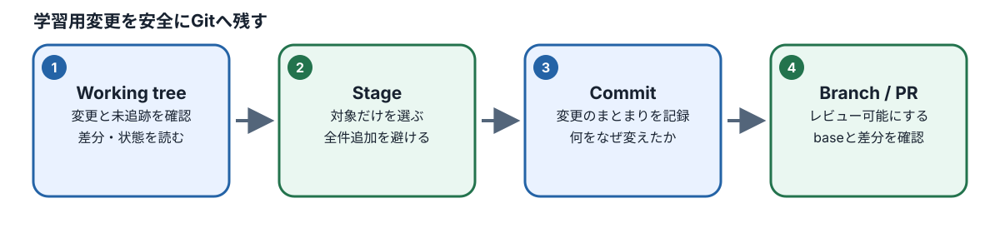
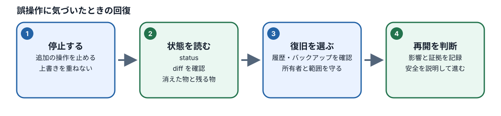

# M08：Git・GitHubとレビュー

## この章でできるようになること

M07までに作成してきたテストコードを、ご自身の学習用リポジトリに安全に記録し、変更した理由やテスト結果をチームのメンバーやレビュアー（確認者）へ正確に説明・レビューできるようにします。

ここから先の「Phase 3」は、より実践的な開発現場の共同作業プロセスを体験するための選択制カリキュラムです。**Phase 1およびPhase 2の修了条件にGitの操作は含まれていません**ので、未経験の方も焦らず基礎から着実に学んでください。

Gitを扱う上で最も大切な原則は、**「何を変更したかを自分の目で確かめてから、共有してよいものだけを選んで記録する」**ことです。

| 学習目標ID | 本章で確認する行動 |
| --- | --- |
| M08-01 | working tree、stage、commit、branchの違いと役割を説明できる |
| M08-02 | ファイルの差分（diff）を正しく読み、必要なファイルだけを選んでcommitできる |
| M08-03 | プルリクエスト（PR）の説明文で、仕様・コード・テスト結果を照合して記述できる |
| M08-04 | AIによる誤った指摘や不要な抽象化の提案を、仕様とテスト証拠に基づいて判断できる |

## 1. GitとGitHubは何のために使うのか

### 1.1 なぜ変更履歴を管理する必要があるのか

コンピューターでプログラムやテストコードを作成していると、次のようなトラブルを誰もが一度は経験します。

- 「昨日まで正常に動いていたテストが急に失敗するようになったけれど、コードのどこを書き換えたか思い出せない」
- 「試しにコードを書き換えて実験してみたけれど、うまくいかなかったので元の動く状態に戻したい。しかし元の状態を保存していなかった」
- 「同じファイルを複数人で同時に編集してしまい、お互いに上書きして相手の変更内容を消してしまった」

普段の一般的なPC操作（Wordやメモ帳など）では、ファイルを「上書き保存（Ctrl+S または Cmd+S）」すると、古い状態のデータは消えて最新の内容に置き換わってしまいます。

過去の状態を残すために、ファイルをコピーして「テストコード_20261028.ts」「テストコード_修正版.ts」「テストコード_最終版_本当に完成.ts」のように名前を変えて手動で保存する方法もあります。しかし、この方法ではファイルがフォルダ内に散らかり、どれが本当に最新なのか、それぞれのファイルで具体的に何行目がどう書き換わったのかを後から正確に追跡することは不可能です。

このような問題を根本から解決するために作られた仕組みが**Git（ギット）**です。

1. **名前と読み方**: Git（ギット）と呼びます。
2. **意味**: ファイルの変更履歴（バージョン）を記録・追跡するための「バージョン管理システム（VCS: Version Control System）」と呼ばれるソフトウェアです。
3. **背景**: 世界中のプログラマーが大規模なソフトウェアを共同開発する際、ファイルの変更履歴を失わず、安全に過去へ戻ったり共同作業を合流させたりするために開発されました。
4. **目的**: ファイルの変更の歴史を、「いつ、だれが、どのファイルのどの行を、なぜ変更したのか」というメッセージとともに永久に安全な記録として残すことです。
5. **GitHubとの違い**:
   - **Git（ギット）**: あなたの手元のパソコン（ローカル環境）の中で動き、ファイルの変更履歴を記録・管理するツール（ソフトウェア）本体です。インターネットに繋がっていなくても手元で動作します。
   - **GitHub（ギットハブ）**: Gitで記録した履歴データをインターネット上で保管し、世界中のチームメンバーと共有したり、Webブラウザ上で変更内容を確認・相談（レビュー）したりするためのクラウドWebサービスです。

「Git」が手元の記録ノートだとすれば、「GitHub」は完成した記録ノートをみんなで閲覧・共有できるWeb上の保管庫（クラウド本棚）のような関係です。

### 1.2 Gitで最も大切な「4つの領域」を区別する

#### working-treeからpull-requestまで



Gitを初めて学ぶときに多くの方がつまずく原因は、一度にたくさんの新しいカタカナ専門用語が登場し、頭の中で混ざってしまうことにあります。

まずは、Gitが手元のファイルをどのように管理しているのか、その「4つの領域（場所と考え方）」をしっかりと頭の中で区別しましょう。

身近な例として、**「学校や職場でレポートを作成し、先生や上司に提出トレイを経て提出するまでの流れ」**に例えて整理します。

| 用語 | 読み方 | 役割・意味 | 身近な例え | 本章での具体例 |
| --- | --- | --- | --- | --- |
| **working tree** | ワーキングツリー（作業ツリー） | 今まさにエディタで開いて文字を入力・編集している手元の作業ファイルそのもの | 自分の机の上で広げて鉛筆で書いている「下書きのレポート用紙」 | VS Codeで編集中の `workspace/M08/review-candidate.md` |
| **stage** | ステージ（インデックス） | 次の記録（commit）に含めるファイルだけを選び、載せておく準備場所 | 提出トレイに「今回の提出に含めるもの」として選んで置いた書類 | `git add` コマンドで指定して載せたファイル |
| **commit** | コミット | 変更履歴として確定し、Gitの記録台帳に永久保存された記録の単位 | 日付と提出理由を添えて、提出箱に投函して確定した記録 | 「レビュー条件を明確化」という確定した履歴レコード |
| **branch** | ブランチ | 履歴の枝分かれ（特定の作業を行うための独立したタイムライン）に付けた名前 | 本番用のノートを汚さないために用意した「自分専用の練習用ノート」 | `practice/m08-review` という練習用の枝 |

#### なぜ「作業場所（working tree）」からいきなり「記録（commit）」しないのか？

一般的なソフトウェアであれば「保存ボタン」を押せばそれで完了ですが、Gitではなぜわざわざ「stage（ステージ）に選んで載せる（`git add`）」という二段階の手順を挟むのでしょうか？

テスト自動化の業務や開発の現場では、テストコード本体の修正だけでなく、テストを実行したときに自動生成される大量の実行ログファイル、一時的なスクリーンショット、個人的な下書きメモ、さらにはパスワードやAPIキーといった認証用の「秘密情報（Secret）」など、さまざまなファイルが机（working tree）の上に散乱します。

もし「手元のファイルをすべて無差別に一括記録する」という設計になっていた場合、共有してはならないパスワードや、他の人には不要な大容量の実行ログファイルまで一緒に履歴台帳へ焼き付けられ、GitHubを通じて全世界やチーム全体に流出してしまうという重大な事故が起きます。

そのため、Gitは非常に慎重な二段階設計を採用しています。

1. **working tree（作業場所）** で自由にコードを書き、テストを実行して試行錯誤する。
2. 変更が完了したら差分を目視で確認し、記録して安全なファイルだけを **stage（準備トレイ）** に厳選して載せる（`git add`）。
3. **stage** に載っているファイルだけを、変更理由のメッセージを添えてひとまとまりの確定記録として **commit（台帳記録）** する（`git commit`）。

**注意**: stageに載せていない変更は、commitを実行しても履歴には一切記録されません。一方で、過去の作業でstageに載せたまま忘れていたファイルがある場合、意図せず新しいコミットに混ざってしまう危険があります。作業の開始前と終了後には、必ず全体の状況を確認する習慣を身につけましょう。

## 2. `git status`から始める現状把握

### 2.1 ターミナルで実行する基本コマンド

Gitの操作は、Visual Studio Code（VS Code）の画面下部にあるターミナル（Terminal）にコマンドをキーボードから入力して実行します。

コマンドを実行する前に、必ず**プロジェクトの最も上のフォルダ（リポジトリのルートディレクトリ）**にいることを確認してください。

まずは、作業を始める前に現在の状態を確かめるための3つの基本コマンドを実行します。

```bash
git status --short
git diff --cached --name-only
git branch --show-current
```

それぞれのコマンドが何を教えてくれるのかを順番に理解しましょう。

1. `git status --short`（ギット ステータス ショート）:
   - 手元のファイルが現在どのような状態にあるのか（まだGitに登録されていないのか、手元で編集されたのか、stageに載っているのか）を、アルファベットの短い記号で一覧表示します。
2. `git diff --cached --name-only`（ギット ディフ キャッシュト ネーム オンリー）:
   - すでに **stage に載っている（次のcommitに含まれる予定の）ファイルの名前一覧**だけを表示します。
3. `git branch --show-current`（ギット ブランチ ショー カレント）:
   - あなたが今、どの **branch（作業用の枝分かれライン）** の上に立って作業しているかを表示します。

### 2.2 `git status --short` の表示の読み方

`git status --short` をターミナルで実行すると、変更があるファイル名の左側に「2文字分の記号」が表示されます。初めはこの2文字の意味を正しく読み解けるようになることが第一歩です。

```text
?? workspace/M08/review-candidate.md
 M workspace/M07/some-file.ts
A  workspace/M08/another-file.md
```

ファイル名の左側にある2文字分のスペースは、それぞれ担当する領域が決まっています。

- **1文字目（左側の列）**: **stage（次のcommitに入る準備場所）** の状態を表します。
  - 空白（スペース）: stageには載っていません。
  - `A`: 新しく追加されたファイルがstageに載っています（Added）。
  - `M`: 変更された内容がstageに載っています（Modified）。
- **2文字目（右側の列）**: **working tree（手元の作業ファイルそのもの）** の状態を表します。
  - 空白（スペース）: 手元で新しく編集された差分はありません。
  - `M`: 前回のコミットまたはstageの状態から、手元でさらに編集されています（Modified）。
- **`??`（2文字とも?マーク）**: **未追跡（Untracked: アントラックト）** を表します。
  - Gitが「ファイルがフォルダ内に新しく置かれたことは気づいているけれど、まだ一度もGitの管理台帳（追跡対象）として登録されていない新しいファイル」であることを示しています。

**重要**: 本カリキュラムで `pnpm course:load M08` コマンドを実行すると、M08の学習に必要な演習ファイルが手元に新しく配布されます。新しく配置された `workspace/M08/review-candidate.md` は、Gitから見れば初めて出会うファイルであるため、最初は必ず `??`（未追跡）として表示されます。これは教材が正しく配置された証拠であり、不具合やエラーではありません。

### 2.3 実習：既存の変更と、これから作る変更を区別する（M08-01）

#### 目的

Gitで作業を始める前に、現在のブランチ名、新しく追加された未追跡ファイル、すでにstageに乗っている変更を正確に区別し、過去の作業のゴミが混ざらないクリーンな状態で安全に作業を開始できることを確認します。

#### 準備

- 本人用の学習リポジトリでVS Codeを開いていること。
- ターミナルで `pnpm course:load M08` の実行が完了していること。

#### 操作手順

1. ターミナルで次の3つのコマンドを順番に入力し、現在の状態を確認します。

   ```bash
   git status --short
   git diff --cached --name-only
   git branch --show-current
   ```

2. ターミナルに表示された内容を、次の3つのグループに分類して確認します。
   - **グループA：追跡中の手元変更**（ファイル名の2文字目に `M` が出ているもの）
   - **グループB：新しい未追跡ファイル**（ファイル名の左に `??` が出ているもの）
   - **グループC：既にstageに乗っている変更**（`git diff --cached --name-only` でファイル名が表示されるもの）
3. 今回のM08教材ロードによって新しく配置されたファイル（`workspace/M08/review-candidate.md` など）がグループB（未追跡）に存在することを確認します。
4. もし、自分が編集した覚えのないファイルや、前回のM07作業などでstageに乗せたまま残っているファイルが見つかった場合は、独断で `git reset` や `git stash`、ファイルの削除コマンドを実行してはいけません。作業をいったん停止し、何が残っているのかをメモして確認します。
5. AIツール（OpenCodeなど）に状況を相談する場合は、次のように明確な制約を設けて依頼します。
   - **AIへの依頼文例**:
     > 「現在の `git status --short` の表示結果を共有します。この表示が意味する状態と、安全に作業を始めるために確認すべき点を教えてください。なお、コマンドやファイルの自動変更は実行しないでください。また、すべてのファイルを一括追加するコマンド（`git add -A` や `git add .` など）は提案しないでください。」
   - **セキュリティ注意事項**: ターミナルの出力結果をAIに貼り付ける際は、パスワード、個人情報、外部サービスのアクセストークンなどの秘密情報（Secret）が含まれていないことを必ず人間の目で確認してから送信してください。

#### 期待される結果

- 現在立っているブランチ名が正しく表示されること。
- M08教材ロードによって配置された初期ファイルと、それ以外の予期せぬ変更が明確に区別できていること。

#### 詳しい解答と解説

`??` で始まる未追跡ファイルは、まだGitの監視対象として登録されていません。そのため、後述する通常の `git diff` コマンドを実行しても差分内容は画面に表示されません。「diffが出ないから何も変更されていない」と勘違いして放置したり、逆に中身を確認せずに一括で追加したりするのは危険です。

また、すでにstageに乗っているファイル（グループC）が存在する場合、そのまま次のcommitを実行してしまうと、過去の作業内容が意図せず今回の新しいコミットに紛れ込んでしまいます。作業を始める前に「どこまでが前回の状態か」「どこからが今回の作業対象か」の境界線をはっきり分けることが、安全なバージョン管理の第一歩です。

## 3. 練習用branchを作る

### 3.1 ブランチ（branch）とは何か

ブランチ（branch: 枝）とは、本流の安定した履歴の流れから枝分かれさせて、他の作業やチームメンバーに影響を与えずに独立して作業を進めるための仕組みです。

例えば、製品として完成しているコードや安定したテストコードが置かれている本流のライン（通常は `main` ブランチと呼ばれます）の上で直接ファイルを書き換えてしまうと、作業途中の動かない壊れたコードが本番に混ざってしまいます。

そのため、新しい機能を作ったり、テストコードの練習をしたりするときは、必ず本流から自分専用の枝（ブランチ）を生やし、その独立した世界の中で安全に作業を行います。

### 3.2 ブランチの作成と切り替え

現在の手元状態に問題がないことを確認したら、M08の練習用ブランチを作成し、そのブランチへ作業場所を切り替えます。

```bash
git switch -c practice/m08-review
git branch --show-current
```

- `git switch -c <ブランチ名>`:
  - `switch` は「作業ブランチを切り替える」コマンドです。
  - `-c` は「create（作成）」を意味するオプションです。現在の位置から新しいブランチを作成し、同時にそのブランチへ作業場所を移動します。
- `git branch --show-current`:
  - 切り替え後の現在のブランチ名を表示します。ターミナルに `practice/m08-review` と表示されれば成功です。

### 3.3 注意すべきポイント

- **同名のブランチが既に存在する場合**:
  - もし過去に同じ名前のブランチを作成していた場合、`fatal: a branch named 'practice/m08-review' already exists` というエラーが表示されます。この場合は無理に上書きしようとせず、過去の自分が作成したブランチに大切な作業が残っていないかを確認した上で、別名（例: `practice/m08-review-2` など）を指定して作成してください。
- **ローカル環境の操作であることの理解**:
  - `git switch -c` を実行した段階では、GitHub（インターネット上のリモートサーバー）には何一つ送信されていません。あくまで**あなたの手元のパソコン（ローカル環境）の内部だけ**で新しい作業ブランチが作られた状態です。

## 4. 差分（diff）を読み、記録対象を選ぶ（stage）

### 4.1 `git diff` と `git diff --cached` の違い

Gitで最も重要かつ頻繁に使う操作が「差分（diff: ディフ）の確認」です。ここでも「手元の変更」と「stageに乗った変更」で確認するためのコマンドが分かれています。

- `git diff -- <ファイルパス>`:
  - **working tree（手元）** で編集された内容と、前回のコミット（またはstage）との差分を表示します。
  - **重要**: まだ一度もGitに登録されていない新規の未追跡ファイル（`??`）は、比較対象となる過去の記録が存在しないため、通常の `git diff` を実行しても何も表示されません。未追跡ファイルの内容は、VS Codeのエディタで直接開いて確認します。
- `git diff --cached -- <ファイルパス>`:
  - **stage に載っている変更**（次のcommitに含まれる予定の内容）を表示します。
- `git diff --cached --check`:
  - コミットに含まれる変更内容の中に、不要な行末の空白（スペース）などの構文上の乱れがないかを機械的に検査します。

### 4.2 指定したファイルだけをstageに追加する手順

M08の演習用ファイル `workspace/M08/review-candidate.md` をVS Codeのエディタで編集・保存したら、そのファイル**だけ**を限定してstageに追加します。

```bash
git add -- workspace/M08/review-candidate.md
git diff --cached --name-only
git diff --cached --check
git diff --cached -- workspace/M08/review-candidate.md
```

#### 各行の確認ポイントと安全管理

1. `git add -- <パス>`:
   - 指定したファイルだけを厳密にstageに追加します。
   - **絶対禁止事項**: `git add .` や `git add -A` のような「手元の変更をすべて一括追加するコマンド」は現場でも本カリキュラムでも使わないでください。一時的なログや意図しない変更、秘密情報が無差別に混入する最大の原因になります。
2. `git diff --cached --name-only`:
   - stageに載っているファイル名の一覧を表示します。
   - **確認**: 表示されたファイル名が、自分が意図して追加した `workspace/M08/review-candidate.md` だけになっているかを目視で確認します。
3. `git diff --cached --check`:
   - 行末の余計な空白文字などのフォーマット警告が出力されないことを確認します。
4. `git diff --cached -- <パス>`:
   - stageに載った変更内容の全文を行単位で画面に表示します。
   - **最重要チェック**: 追加された行（緑色の `+` で表示される行）の中に、パスワード、認証トークン、個人の氏名やパスワード、本番データなどの秘密情報が含まれていないかを、必ず人間の目で1行ずつ確認してください。

### 4.3 誤ってstageに追加した場合の取り消し（unstage）



もし意図しないファイルを誤って `git add` してしまった場合は、次のコマンドを使って安全にstageから降ろす（unstage: アンステージする）ことができます。

```bash
git restore --staged -- <取り消したいファイルパス>
```

#### 注意：似たコマンドとの混同に気をつける

- `git restore --staged -- <ファイルパス>`（`--staged` オプションあり）:
  - **stageから降ろすだけ**の安全なコマンドです。手元で編集したファイルの内容（working treeの変更）はそのまま残ります。
- `git restore -- <ファイルパス>`（`--staged` を付けない場合）:
  - **手元の作業ファイルの変更を捨てて、前回の状態に戻してしまう**破壊的な操作です。手元で書いていた未保存のコードが消えてしまう危険があるため、今回の演習では使いません。

コマンドを実行する際は、`--staged` という単語が正しく含まれているかを必ず二度確認してください。

### 4.3.1 手順付き練習：ダミーファイルをstageから外す

これは安全に手順を身につけるための**通常練習**です。正式演習でcommitする `review-candidate.md` とは別に、機密情報を含まない安全なダミーファイル `workspace/M08/unstage-practice.md` を作成して操作します。

**事前確認**: ターミナルで `git branch --show-current` を実行し、練習用ブランチにいることを確認します。さらに `git diff --cached --name-only` を実行し、見覚えのないstage済み差分がないことを確認してください。

1. VS Codeで `workspace/M08/unstage-practice.md` というファイルを新規作成し、「これはstage取り消しの練習用ダミーファイルです」と1行だけ入力して保存します。
2. ターミナルで次のコマンドを実行し、ダミーファイルをstageに載せます（**この段階ではcommitしません**）。

   ```bash
   git add -- workspace/M08/unstage-practice.md
   ```

3. stageに載ったことを確認します。

   ```bash
   git diff --cached --name-only
   ```

   一覧に `workspace/M08/unstage-practice.md` が表示されれば成功です。
4. 次のコマンドを実行し、練習用ダミーファイルだけをstageから安全に降ろします。

   ```bash
   git restore --staged -- workspace/M08/unstage-practice.md
   git diff --cached --name-only
   git status --short
   ```

5. 表示結果を確認します。
   - `git diff --cached --name-only` の出力からダミーファイルの名前が**消えていること**。
   - `git status --short` の表示で、ダミーファイルの左側が `?? workspace/M08/unstage-practice.md`（未追跡）に戻っていること。
   - **重要**: 手元のファイル自体は削除されておらず、エディタ上にも下書きがそのまま残っていることを確認してください。
6. 次の正式演習では、指定された課題ファイル（`workspace/M08/review-candidate.md`）だけをパス指定で追加します。練習用ダミーファイルはcommitに含めません。

**理解確認と解答**:

- **質問**:「stageから降ろした後に `git status --short` を見ると `??` と表示されますが、これは取り消しに失敗したのでしょうか？」
- **解答**: いいえ、失敗ではありません。大成功です。`git restore --staged` は「stage（提出トレイ）から降ろしただけ」であり、手元の作業机（working tree）の上には新規ファイルがそのまま残っているため、Gitは正常に「未追跡ファイル（`??`）」として認識しています。

### 4.4 `.gitignore` の意味と落とし穴

#### `.gitignore` は何をする設定ファイルか

リポジトリの中には、テストを実行するたびに自動生成される膨大なログファイル、ブラウザの実行証拠（Traceデータ、録画動画、スクリーンショット）、外部ツールが書き出す一時ファイルなど、「最初からGitの記録対象にしたくないファイル」がたくさん存在します。

これらを毎回 `git status` に表示させないようにするため、Gitに「このファイルやフォルダは無視してください」と指定する設定ファイルが **`.gitignore`（ギットイグノア）** です。

本リポジトリでは、`workspace/.gitignore` の中に次のような設定が記述されています。

```text
/M08/local-only-run.log
```

これにより、M08の練習用として用意されている一時ログ `local-only-run.log` は、通常の手順ではGitの追跡候補から自動的に除外されます。

除外設定が正しく効いているかどうかは、次のコマンドで確認できます。

```bash
git check-ignore -v workspace/M08/local-only-run.log
git status --ignored --short workspace/M08/local-only-run.log
```

- `git check-ignore -v <パス>`: 指定したファイルが `.gitignore` のどの行の設定によって除外されているかを表示します。
- `git status --ignored --short <パス>`: 指定したファイルが正しく無視（ignore）されている状態を確認します。

#### `.gitignore` に関する重大な注意点

1. **すでに追跡されているファイルには効かない**:
   過去のcommitですでにGitの台帳に登録されてしまっているファイルは、あとから `.gitignore` に名前を書いても自動的には追跡解除されません。
2. **強制追加オプション（`-f`）で追加できてしまう**:
   `git add -f`（force: 強制）を実行すると、`.gitignore` に書かれているファイルであっても無理やりstageに追加されてしまいます。
   したがって、**「`.gitignore` に書いてあるから秘密情報を誤ってコミットする心配は絶対にない」と過信してはいけません**。

#### M07のファイルを例外的に追加する場合のルール

カリキュラムの設計上、`workspace/M07/` 配下のファイルは通常ignoreされています。しかし、Phase 3の課題提出などで特定の修正ファイル（例: `workspace/M07/repaired-assertion.spec.ts`）をリポジトリで共有する必要がある場合は、教材の指示に従って限定的に強制追加を行います。

```bash
git check-ignore -v workspace/M07/repaired-assertion.spec.ts
git add -f -- workspace/M07/repaired-assertion.spec.ts
git diff --cached --name-only
```

**禁止事項**: `workspace/M07` フォルダ全体を `git add -f workspace/M07` のように一括追加してはいけません。テスト実行時の巨大なTraceファイルや個人ログ、他の成果物が混ざり、リポジトリの容量を肥大化させて破壊する原因になります。必ず「指定された1ファイルのみ」をフルパス指定で追加してください。

## 5. commitとプルリクエスト（PR）

### 5.1 コミット（commit）を実行する

stageに乗っている変更内容が目的のファイルだけであり、秘密情報が含まれていないことを確認したら、ローカル履歴として確定記録（commit）を作成します。

```bash
git commit -m "学習用レビューを記録"
git status
git log -1 --oneline
```

- `git commit -m "<メッセージ>"`:
  - `-m` の後ろに、変更内容や目的を簡潔に表すメッセージ（コミットメッセージ）をクォーテーションで囲んで指定します。
- `git log -1 --oneline`:
  - 直近（`-1` 件）のコミットの要約を1行で表示します。コミットIDとメッセージが正しく記録されたことを確認できます。

**注意**: commitは、あくまで**あなたの手元のパソコン（ローカル環境）の履歴台帳に記録されただけ**です。GitHubなどの共有サーバーへ変更を送信（push）する操作とはまったく別物です。

### 5.2 プルリクエスト（Pull Request: PR）とは何か

#### 仕様差分テストと証拠を結び付ける

プルリクエスト（PR: ピーアール）とは、GitHub上で自分が作成したブランチの変更内容をチームメンバーに提示し、「この変更を本体（mainブランチなど）に取り込んでもよいか、レビュー（確認作業）をお願いします」と依頼するWeb上の仕組みです。

PRの作成画面では、変更の目的、影響範囲、テスト結果などを説明文に記述します。単に「修正しました」「テストPASSしました」とだけ書いても、レビューする相手は何を確認したのか判断できません。

#### レビューが成立するPR説明文の基本構成

PRの説明文には、以下の項目を漏れなく記述します。

1. **目的**: なぜこの変更を行ったのか（対象のCase番号や、関連する仕様ID BR/AC）。
2. **変更内容**: どのファイルのどの部分を変更したのか。
3. **参照した仕様とテスト証拠**: どの仕様書や受入基準に基づいて変更したのか。
4. **テストの実行状態**: 実際にテストを実行して確認したのか、未実行なのか（未実行なら「未実行」と正直に書く）。
5. **未確認事項・残課題**: 自分の手元では確認できていない懸念点や、後続工程で確認が必要な内容。

### 5.3 M08での学習範囲について

M08の通常演習では、GitHubへの実際の `git push` や、Web上でのPR作成ボタンの押下を必須条件にはしていません。これは、受講者ごとのリポジトリ権限や共有先（公開リポジトリなのか組織用なのか）が確定した安全な実地環境で行う必要があるためです。

M08では、**「差分を安全に選んでローカルコミットを作成すること」**と、**「レビューに耐えうる正確なPR説明文の下書きを作成すること」**に集中して学習します。

### 5.4 実践：差分を安全に選び、AIレビューを採否する（M08-02〜M08-04）

#### 目的

編集したファイルだけを限定してstageに追加し、余計なファイルが含まれていないことを検証した上で安全にcommitします。さらに、AIツール（OpenCodeなど）から得られたコードレビュー指摘を鵜呑みにせず、仕様と証拠に基づいて適切に採否（採用・修正反映・却下・保留）を判断する技術を習得します。

#### 操作手順

1. **ブランチの確認**:
   ターミナルで `git branch --show-current` を実行し、練習用ブランチ（`practice/m08-review`）にいることを確認します。
2. **課題ファイルの編集**:
   VS Codeのエディタで `workspace/M08/review-candidate.md` を開き、演習の指示に従って指定された箇所だけを編集して保存します。
3. **手元の状態確認**:

   ```bash
   git status --short
   ```

   編集した `review-candidate.md` が表示されていることを確認します（新規ファイルの場合は `??`、既存ファイル編集の場合は `M`）。
4. **対象限定での追加（stage）**:

   ```bash
   git add -- workspace/M08/review-candidate.md
   ```

5. **stage内容の検証**:
   次のコマンドを順番に実行し、結果を自分の目で厳格にチェックします。

   ```bash
   git diff --cached --name-only
   git diff --cached --check
   git diff --cached -- workspace/M08/review-candidate.md
   ```

   - `git diff --cached --name-only` の出力が `workspace/M08/review-candidate.md` **だけ**であること。
   - `local-only-run.log`、パスワードや秘密情報、個人の作業メモが混入していないこと。
   - もし意図しないファイルが入っていたら、`git restore --staged -- <誤ったファイル>` で即座に除外すること。
6. **AI（OpenCode）へのレビュー依頼と照合**:
   AIエージェントにレビューを依頼できる環境であれば、次のように依頼します。
   - **依頼文の例**:
     > 「現在stageに乗っている `workspace/M08/review-candidate.md` の差分について、仕様書およびテスト証拠に照らしてレビュー観点を挙げてください。コードやファイルの変更は実行しないでください。また、根拠のない共通化や、課題で指定されていない別ファイルの変更は提案しないでください。」
   - AIから返ってきた指摘を読み、本人が確認した実際のdiff内容と照らし合わせます。
7. **AI指摘の分類と判断**:
   AIの各指摘を以下の4つに分類し、判断理由をメモします。
   - **採用（Accept）**: 仕様の記載漏れや受入基準の不整合など、具体的な根拠がある指摘。
   - **修正して反映（Modify）**: 指摘の着眼点は正しいが、AIの提案コードが過剰なため、最小限の修正に留めるもの。
   - **却下（Reject）**: 「将来のために共通化すべき」「使われていない別ファイルも直すべき」といった、課題の範囲を超えた不要な提案。
   - **未決・保留（Pending）**: 現時点の資料だけでは仕様が確定できず、後続の確認が必要なもの。
8. **commitの実行と確認**:
   内容に納得できたら、コミットを実行します。

   ```bash
   git commit -m "M08: レビュー候補の安全な差分記録"
   git show --stat --oneline HEAD
   ```

   - `git show --stat --oneline HEAD` で、直前のコミットで記録されたファイルが指定の1ファイルだけであることを確認します。
   - **注意**: 演習環境の指示がない限り、勝手に `git push` やリモートへの送信を行わないでください。

### 5.5 練習問題と詳しい解答

#### 練習問題

ターミナルで `git diff` を実行したところ、何も表示されず画面が空でした。しかし、`git status --short` を実行すると `?? workspace/M08/review-candidate.md` と表示されています。

このとき、「手元の作業ファイルには何の変更もない」と判断して作業を終了してもよいでしょうか？理由とともに答えてください。

#### 解答

**いいえ、変更なしと判断してはいけません。**

#### 解説

`??` という記号は、そのファイルが「未追跡（Untracked）」、つまりGitの台帳にまだ一度も登録されていない新しいファイルであることを示しています。
通常の `git diff` コマンドは、「すでにGitで追跡されているファイルの手元の変更差分」を比較して表示するコマンドであるため、新しく作成された未追跡ファイルの内容は表示されません。

したがって、差分が空だからといって「ファイルの中身がない」「変更がない」と即断するのは誤りです。
正しい対応手順は次のとおりです。

1. `git status` で `??` と表示されている未追跡ファイルを確認する。
2. エディタでそのファイルを開き、中身が正しく保存されているか確認する。
3. 記録対象であることが確認できたら、`git add -- <ファイルパス>` でstageに追加する。
4. stageに追加された後で、`git diff --cached` を実行して記録予定の内容を検査する。

AIツールに画面出力を渡して相談した際、AIが「git diffが空なので変更はありません」と回答することがありますが、ツールの発言よりも `git status` の実態を優先して人間が判断しなければなりません。

## 6. AIレビューを検証する

### 6.1 AIのレビュー指摘をどのように吟味するか

#### aiレビューの採否

AIエージェント（LLM）は非常に便利な相談相手ですが、テスト自動化やコードレビューにおいて、時として「現場の状況を無視した過剰な提案」を行うことがあります。

よくあるAIの誤指摘パターンとして、次のようなものがあります。

- **不要な抽象化の推奨**:
  - たった1箇所でしか使わない簡単なテストコードに対して、「保守性を高めるために、Page Objectクラスを作り、Factoryパターンを導入し、共通基盤層を設計しましょう」と提案してくる。
- **無関係なファイルへの修正拡大**:
  - カート機能の1ケースを直したいだけなのに、「プロジェクト全体の20個のテストファイルすべてで使われている変数の書き方を統一しましょう」と提案してくる。
- **仕様の勝手な推測**:
  - 仕様書に書かれていない境界値やエラーメッセージを、「一般的なECサイトならこうあるべきです」と推測して必須条件に書き換えてしまう。

これらの提案を無批判に受け入れると、変更範囲が不必要に膨らみ、デバッグが極めて困難になります。

**判断の鉄則**: 指摘された「数」や「もっともらしい専門用語」に惑わされてはいけません。**「対象の仕様書（BR/AC）にその条件が明記されているか」「現在のテスト課題の範囲（スコープ）を超えていないか」「再現可能な具体的な不具合に基づいているか」**という証拠だけを根拠にして判断してください。

逆に、「数量変更後の合計金額に対するAssertion（アサーション：期待結果の検証）が欠落している」という指摘であれば、カート機能の受入基準（BR/AC）を確認し、必要な検証が抜けている客観的証拠があるため「採用」と判断できます。

### 6.2 応用練習：PRの説明案を書く（M08-03）

#### 課題

`workspace/M08/review-candidate.md` の変更をチームに共有するという想定で、実際のGitHub上でのPR作成は行わず、手元でPRの説明文（下書き）を作成してください。

説明文には、以下の必須5項目を含める必要があります。

1. **目的**
2. **変更内容**
3. **参照した仕様とCase**
4. **テストの実行有無（実行状態）**
5. **未確認事項**

#### 作成のルール

- 自分が実際に変更したファイルの内容だけに基づいて目的を記述すること。
- 手元でPlaywrightやCIを実行していない場合は、見栄を張らずに `未実行` と明記すること（「Gitのコミットが成功したこと」は「テストが成功したこと」の証拠にはなりません）。
- AIレビューを受けた場合は、客観的な根拠が確認できた指摘のみを反映すること。

#### 解答例と詳しい解説

```markdown
## 目的
M08の学習演習に基づき、レビュー候補資料（review-candidate.md）における対象Caseと検証観点の記述を明確化するため。

## 変更内容
- `workspace/M08/review-candidate.md` のレビュー対象Caseの説明文を更新
- 仕様書との照合に必要な受入基準（BR/AC）の参照IDを追記

## 参照した仕様とCase
- 対象Case: カート内数量変更検証
- 関連仕様: `docs/spec/features/cart.md` 内の受入基準（BR-CART-001, AC-CART-001）

## テストの実行状態
- Playwrightテスト: 未実行（本変更はドキュメントの記述整理であり、specコードの変更を含まないため）
- 差分整合性確認: `git diff --cached --check` を実行し、フォーマット違反がないことを確認済み

## 未確認事項
- GitHubリモート環境上でのPR作成およびCI連携パイプラインの動作確認（Phase 3の後続工程にて実施予定）
```

#### 解説

良いPR説明文の条件は、**「変更の範囲」と「確認された証拠の範囲」が過不足なく一致していること**です。
テストを実行していないにもかかわらず「CI成功」「動作確認済み」と記載することは、開発現場では最も重大な虚偽報告（アンチパターン）となります。「確認したこと」と「確認していないこと」を境界線としてはっきり分けて書くことが、レビュアーからの信頼につながります。

## 7. さらに理解を深める：Gitの安全な使い方を練習する

### 7.1 Gitを使う前に、どの変更を記録するか考える

Gitはファイル変更の歴史を記録するタイムマシンですが、乗せる荷物を選ばなければ、過去に戻ったときに大変な混乱を引き起こします。

テストの実行ログ、Traceデータ、画面の録画動画、個人設定ファイル、そしてパスワードなどの秘密情報（Secret）がリポジトリに一度でもcommitされてしまうと、後から履歴から完全に消去するのは非常に難しくなります。

Gitの操作は、コマンドを暗記することではなく、**「今から自分が記録しようとしている内容は何なのかを自分の目で確かめること」**から始まります。

#### 確認問題

手元の作業フォルダに `workspace/M08/review-candidate.md` と `workspace/M08/local-only-run.log` の2つのファイルが存在します。両方を手早く追加したいとき、`git add -A` を使うべきでしょうか？

#### 解答

**使ってはいけません。**

#### 詳しい解説

課題で指定されている記録対象は `review-candidate.md` のみです。`local-only-run.log` はローカル環境でのみ使用する一時的な合成ログであり、Gitで履歴管理する設計にはなっていません。
`git add -A` や `git add .` は、現在の手元の変更をすべて無差別にstageに乗せてしまうコマンドです。意図しないログやゴミファイル、秘密情報が混入する典型的な原因となるため、学習段階から「追加したいファイルだけをパス指定で `git add -- <ファイルパス>` する」という確実な習慣を身につけてください。

### 7.2 working tree、stage、commitの三つを区別する

理解を確実にするため、もう一度3つの領域の関係を復習しましょう。

- **working tree**: 手元の作業ファイル。エディタで文字を打ち込んで保存（Ctrl+S / Cmd+S）しただけの状態。まだGitの記録台帳には一切載っていません。
- **stage**: 「この変更を次の履歴に載せる」と選んでトレイに乗せた状態（`git add` 後）。
- **commit**: トレイに乗った書類を束ねて、日付とメッセージを付けて確定保存した状態（`git commit` 後）。

#### 例題

エディタで `review-candidate.md` を修正し、上書き保存しました。この直後、`git status` には変更が表示されますが、まだ新しいcommitは作られていません。
次に `git add -- workspace/M08/review-candidate.md` を実行すると変更がstageに乗ります。この段階でもまだcommitは作られていません。`git diff --cached` で選んだ内容を十分に確認した後、`git commit -m "..."` を実行して初めて新しい履歴が確定します。

#### 練習

手元で「ファイルA」と「ファイルB」の2つのファイルを編集しました。
その後、`git add -- ファイルA` だけを実行しました。
この状態で `git commit` を実行したとき、新しく作られるコミットの履歴に含まれる変更はどちらでしょうか？

#### 解答

**ファイルAの変更だけが含まれます。**

#### 詳しい解説

commitに含まれるのは、その時点で「stageに乗っている変更」だけです。ファイルBはstageに追加されていないため、working tree（手元の作業場所）に変更が残ったままとなり、コミットには含まれません。
ただし、注意点があります。ファイルAを `git add` してstageに乗せた**後**に、さらにエディタでファイルAを編集した場合、「stageに乗っているファイルAの変更」と「手元にある最新のファイルAの変更」に食い違いが生じます。この場合、commitに含まれるのは「`git add` を押した時点の内容」だけになります。最新の手元変更も含めたい場合は、再度 `git add` を実行する必要があります。この状態は `git diff`（手元の未stage差分）と `git diff --cached`（stage済み差分）を使い分けることで確認できます。

### 7.3 `git status` の未追跡ファイルを読む

Gitを使い始めたばかりの受講者が非常によく遭遇する混乱が「ファイルを作ったのに `git diff` に何も出てこない」という現象です。

#### 例題

`git status --short` を実行したところ、画面に `?? workspace/M08/review-candidate.md` と表示されました。
そこで中身の差分を見ようとして `git diff -- workspace/M08/review-candidate.md` を実行しましたが、ターミナルには何も表示されずプロンプトが戻ってきました。
このファイルは中身が空っぽなのでしょうか？

#### 解答

**そうとは限りません。中身がぎっしり書かれていても、未追跡ファイルであれば `git diff` には何も表示されません。**

#### 詳しい解説

`??` は未追跡（Untracked）を示します。Gitはファイルの存在を認識していますが、まだ一度もコミットされたことがない新規ファイルであるため、「前回の状態との比較差分」を計算する基準がありません。そのため、通常の `git diff` は差分なし（何も表示しない）となります。
内容を確認したい場合は、VS Codeのエディタでファイルを開くか、ターミナルで `cat workspace/M08/review-candidate.md` を実行してファイルそのものを読みます。内容が正しいことを確認した上で `git add` を行えば、`git diff --cached` で登録予定の内容を確認できるようになります。

### 7.4 `.gitignore` を誤解しない

#### 練習

`workspace/M07/repaired-assertion.spec.ts` は、プロジェクトの `.gitignore` 設定によって除外対象になっています。しかし、今回のPhase 3の課題提出では、このテストコードをリポジトリに記録して共有する必要があります。どのように対処すべきでしょうか？

#### 解答

1. 対象ファイルの内容をエディタで開き、パスワードや秘密情報、不要な個人ログが含まれていないことを確認する。
2. 課題としてそのファイルの追加が明示的に指示されていることを確認する。
3. フォルダ全体を一括追加するのではなく、`git add -f -- workspace/M07/repaired-assertion.spec.ts` のように対象ファイルを1つだけ厳密に指定して強制追加する。
4. `git diff --cached --name-only` と `git diff --cached --check` で、指定したファイルだけが正しくstageに乗ったことを検証する。

#### 詳しい解説

`.gitignore` は普段の誤操作を防ぐための安全網ですが、絶対的な壁ではありません。`-f` オプションを使うことで設定を無視して追加できますが、その分だけ人間に強い確認責任が求められます。
もし `workspace/M07` フォルダ全体を `git add -f workspace/M07` としてしまうと、Playwrightが自動生成した巨大なテスト結果や動画ファイルまでリポジトリに永久保存されてしまい、リポジトリの容量肥大化やCIの極端な遅延を引き起こします。「必要なファイルを、1ファイルずつ、フルパスで指定する」という原則を徹底してください。

### 7.5 branch・remote・PRの役割

それぞれの用語が担当する「舞台」を整理しましょう。

- **branch（ブランチ）**:
  - 作業履歴の分岐です。「本番用」「新機能開発用」「バグ修正用」「自分の練習用」のように作業目的ごとに分けるために使います。
- **remote（リモート）**:
  - 自分のパソコンの外（GitHubのサーバー上など）にある共有先リポジトリのことです。`git remote -v` で接続先URLを確認できます。
- **PR（プルリクエスト）**:
  - リモートに送信されたブランチをもとに、「この変更内容を本体ブランチに合流させてよいか」をチームで確認するためのWeb上の会議室です。

#### 練習

ターミナルで `git remote -v` を実行したところ、自分の個人アカウントのリポジトリではなく、会社の共通リポジトリや組織の公式リポジトリのURLが表示されました。このまま `git push` を実行してもよいでしょうか？

#### 解答

**絶対にpushしてはいけません。即座に操作を中止してください。**

#### 詳しい解説

自分の練習用ブランチであっても、宛先のリモートリポジトリが組織や他人のリポジトリになっていた場合、意図しない外部への変更送信や、秘密情報・未完成コードの誤流出につながります。
リポジトリの名前だけでなく、所有者（ユーザー名や組織名）と公開範囲（Public / Private）が想定通りであるかを `git remote -v` で確認し、不明な点がある場合は講師や管理者に確認するまでpushを保留するのが安全な行動です。誤った宛先に送信してから取り消すのは極めて困難ですが、送信前ならコマンドを止めるだけで100%事故を防ぐことができます。

### 7.6 AIレビュー指摘の扱い

#### 例題

学習用の非常に短いテストコード（15行程度）に対して、AIにレビューを依頼したところ、「保守性を高めるため、共通のテストデータ生成Factoryクラスを新設し、テスト設計パターンに沿って3つの別ファイルに責務を分割すべきです」という提案を受けました。しかし、現状のテストコードに重複はなく、課題の要件も満たしています。この指摘をどう判断しますか？

#### 解答

**「却下（Reject）」と判断し、提案を採用しません。**

#### 詳しい解説

ソフトウェア開発において「将来使うかもしれないから」という理由だけで作られる過剰な設計は、「YAGNI原則（You Aren't Gonna Need It：今必要なものだけを作れ）」に反するアンチパターンです。
特に学習段階や単一ケースの修正において不要なクラスやファイル分割を行うと、変更差分が増大してコードの可読性が著しく低下し、かえってバグを生み出す原因になります。
AIの指摘を採用するかどうかは、「いま解決すべき具体的な課題や仕様違反があるか」という客観的な事実に基づいて判断してください。「AIが言っているから正しいはずだ」と思い込んではいけません。

### 7.7 解説付き章末問題

知識の定着度を確認するための10問です。問題を解いたら、考え方のプロセスと解説をしっかり読み込んでください。

#### 問題1

新しいMarkdownファイルを作成してエディタで保存しましたが、ターミナルで `git diff` を実行しても何も表示されません。考えられる理由は何ですか？

- **考え方の手順**:
  1. ファイルは新規作成か、既存ファイルの編集か？
  2. 新規作成の場合、Gitはそのファイルを追跡しているか？
- **解答**: そのファイルが「未追跡（Untracked）」ファイルだからです。
- **解説**: まだ一度もGitの管理対象になっていない新規ファイルは、比較対象となる過去の記録が存在しないため、通常の `git diff` には表示されません。`git status --short` を実行してファイル名の前に `??` が付いているかを確認し、エディタ等で内容を確かめてから `git add` でstageに追加してください。

#### 問題2

手元の変更を記録しようとして、うっかり `git add -A` を実行してしまいました。直後に `git status --short` を見ると、テストの実行ログファイルまでstageに乗ってしまっていることに気づきました。このまま `git commit` を実行してよいでしょうか？また、どう対応すべきですか？

- **考え方の手順**:
  1. commitに含まれるのはどの領域にあるファイルか？
  2. 実行ログをそのままcommitすると何が起きるか？
  3. 手元の編集内容を消さずに、stageから降ろすコマンドは何か？
- **解答**: commitしてはいけません。`git restore --staged -- <ログファイルのパス>` を実行して、ログファイルだけをstageから降ろしてからcommitします。
- **解説**: stageに乗った状態でcommitを実行すると、不要なログファイルが永久にリポジトリの履歴に焼き付けられてしまいます。手元の作業内容を消してしまう `git restore` ではなく、必ず `--staged` オプションを付けて実行し、stageから安全に除外してください。

#### 問題3

コミットの直前に `git diff --cached --check` を実行したところ、何もエラーが出力されず正常に終了しました。この結果は「変更内容にパスワードなどの秘密情報が含まれていないこと」を保証してくれますか？

- **考え方の手順**:
  1. `--check` オプションは何を検査する機能か？
  2. 秘密情報（パスワードやトークン）の意味内容をコマンドが理解できるか？
- **解答**: 保証しません（×）。
- **解説**: `--check` オプションは、行末の無駄なスペース（空白文字）や改行コードの乱れなど、構文上の軽微な差分問題を機械的に検査するためのコマンドです。書かれている文字列がパスワードなのか安全な文字列なのかは判定できません。秘密情報が含まれていないかどうかは、必ず人間が `git diff --cached` で変更内容を1行ずつ読んで確認する必要があります。

#### 問題4

ローカル環境で `git switch -c practice/my-task` を実行して新しいブランチを作成しました。この操作だけで、GitHub上のリモートリポジトリにもそのブランチが共有されますか？

- **考え方の手順**:
  1. `git switch -c` はどこの環境に対する操作か？
  2. リモートへ変更を反映させるには何が必要か？
- **解答**: 共有されません（×）。
- **解説**: ブランチの作成やコミットは、すべて自分の手元のパソコン（ローカル環境）の中だけで完結しています。GitHubに反映させるためには、明示的に接続先リモートと権限を確認した上で `git push` コマンドを実行する必要があります。

#### 問題5

GitHub上でプルリクエスト（PR）を作成しました。この時点で、対象のテストコード（spec）はCI（継続的インテグレーション）でPASSしたと断定してよいでしょうか？

- **考え方の手順**:
  1. PRの役割とは何か？
  2. CIの合否判定は何をもって確認するものか？
- **解答**: 断定できません（×）。
- **解説**: PRは「レビューをお願いします」と変更を提示する入口に過ぎません。テストが成功したかどうかは、GitHub Actionsの実行結果画面（ChecksタブやRunログ、Artifact）を開き、すべての必須テストジョブが緑色のチェックマーク（PASS）になっている客観的証拠を確認するまで分かりません。

#### 問題6

`workspace/M07` フォルダ全体が `.gitignore` に指定されています。M10の課題で必要なテストファイルが1つだけこの中にある場合、手っ取り早く `git add -f workspace/M07` を実行してフォルダごと追加すべきでしょうか？

- **考え方の手順**:
  1. フォルダごと強制追加すると何が混入するか？
  2. 最小限の変更原則に沿った指定方法は何か？
- **解答**: すべきではありません（×）。必要な1ファイルのみをフルパスで指定して `git add -f -- workspace/M07/repaired-assertion.spec.ts` のように追加すべきです。
- **解説**: フォルダ全体を強制追加すると、テスト実行時に作られた大容量の動画やTrace、個人ログまで一緒にstageに乗ってしまいます。リポジトリを汚染しないよう、常に最小限の対象だけを指定してください。

#### 問題7

ターミナルで `git status` を実行したとき、画面にファイル一覧が表示されて出力が空ではありませんでした。これは作業環境が壊れている（異常事態である）ことを意味しますか？

- **考え方の手順**:
  1. `pnpm course:load M08` を実行した直後、ファイルはどうなるか？
  2. 表示されているファイルは意図したものか、意図しないものか？
- **解答**: 必ずしも異常とは言えません（×）。
- **解説**: カリキュラムの教材ロードコマンド（`course:load`）を実行すると、新しく学習用ファイルが配置されるため、それらが未追跡ファイル（`??`）として表示されるのは正常な動作です。「ロードによって配置された想定内の初期ファイル」と「過去の作業で散らかってしまった無関係な差分」を区別して判断することが重要です。

#### 問題8

AIエージェントにコードの修正を依頼したところ、「指示されたファイルを修正しておきました」とチャットで報告を受けました。AIの言葉が本当かどうかを確かめるために、まず実行すべきGitコマンドは何ですか？

- **考え方の手順**:
  1. AIの報告メッセージを証拠として信用してよいか？
  2. 手元のファイルが本当に書き換わったか確認するコマンドは何か？
- **解答**: `git status --short` および対象ファイルを指定した `git diff`（未追跡ファイルの場合はエディタでの目視確認）です。
- **解説**: AIが「修正した」と答えても、実際にはファイルが保存されていなかったり、指示と全く違う箇所が書き換わっていたりすることがあります。AIの報告を差分の代わりにしてはいけません。必ずGitのコマンドを用いて、手元の物理ファイルがどう変化したかを直接確認してください。

#### 問題9

コミットを実行して `git commit -m "修正完了"` と記録しました。その直後、エディタで同じファイルに数行のコードを書き足して保存しました。この新しく書き足した数行は、直前に作ったコミットの中に自動的に含まれますか？

- **考え方の手順**:
  1. コミットとはどの時点の記録か？
  2. コミットした後のエディタの変更はどの領域にあるか？
- **解答**: 含まれません（×）。
- **解説**: コミットは、そのコマンドを実行した瞬間のstageの状態を切り取ったスナップショット（写真のようなもの）です。コミットが完了した後にエディタでどれだけファイルを編集しても、過去のコミット内容が自動的に書き換わることはありません。新しい変更を記録するには、改めて `git add` でstageに乗せ、新しいコミットを作成する必要があります。

#### 問題10

自分の個人リポジトリに練習成果をpushするつもりでしたが、コマンドを実行する直前に、設定されているremoteが会社の共通リポジトリ（組織のリポジトリ）を向いていることに気づきました。あなたは何をすべきですか？

- **考え方の手順**:
  1. このままpushするとどうなるか？
  2. 事故を防ぐために最初に取るべき行動は何か？
- **解答**: pushの実行を直ちに中止し、`git remote -v` でリモート設定、所有者、権限、リポジトリの公開範囲を確認します。
- **解説**: 誤った宛先に一度送信してしまうと、他人の作業環境を破壊したり、秘密情報を流出させたりする大事故につながります。送信した後に慌てて修正するよりも、「送信する直前で止める」ことが最大の防御です。確信が持てない場合は作業を止め、設定を見直してください。

## 8. 章末総合演習

これまでに学んだ手順を統合し、安全な差分管理とレビューの全工程を実際に体験してみましょう。

### 総合演習の手順

1. **初期状態の確認**:
   - `pnpm course:load M08` を実行します。
   - `git branch --show-current` と `git status --short` を実行し、教材配置による初期状態（`workspace/M08/review-candidate.md` が存在すること）を確認します。
2. **練習用ブランチの準備**:
   - 既存の未コミット差分がない状態で、自分専用の練習ブランチを作成・移動します。

     ```bash
     git switch -c practice/m08-review
     ```

3. **課題ファイルの編集**:
   - VS Codeで `workspace/M08/review-candidate.md` を開き、演習の指示に従って指定された箇所を編集・保存します。
4. **対象限定のstage追加と差分検証**:
   - 指定ファイルだけをstageに追加します。

     ```bash
     git add -- workspace/M08/review-candidate.md
     ```

   - 次の3つのコマンドを実行し、**指定したファイルだけが過不足なくstageに乗っていること**、および**秘密情報や空白エラーが含まれていないこと**を検証します。

     ```bash
     git diff --cached --name-only
     git diff --cached --check
     git diff --cached -- workspace/M08/review-candidate.md
     ```

5. **除外ファイルの確認**:
   - `local-only-run.log` などの不要なファイルがstageに含まれていないことを確認します。これは教材が用意した合成練習用資料であり、実際のテスト結果ではありません。commitに含めてはいけません。
6. **コミットの記録と履歴確認**:
   - 内容に問題がなければ、ローカルコミットを作成します。

     ```bash
     git commit -m "M08: レビュー候補の記述を更新"
     git log -1 --oneline
     git show --stat --oneline HEAD
     ```

7. **PR説明文案の作成とAIレビュー検証**:
   - 本文第6章のテンプレートに従って、PR説明文の下書き（目的、変更内容、参照仕様、テスト実行状態、未確認事項）を作成します。
   - AIにレビューを依頼した場合は、指摘内容を鵜呑みにせず、仕様（BR/AC）とdiffの事実に基づいて採否を判断し、記録してください。

### 確認問題

エディタで `workspace/M08/review-candidate.md` を作成して保存した直後、ターミナルで `git diff -- workspace/M08/review-candidate.md` を実行しましたが、差分が1行も出力されませんでした。しかし、`git status` を実行すると未追跡ファイルとして表示されています。このファイルは存在していないのでしょうか？

#### 解説

存在していないわけではありません。
未追跡ファイル（Untracked file）はGitの追跡台帳にまだ登録されていないため、通常の `git diff` の比較対象になりません。エディタや `cat` コマンドでファイルが存在し中身が書かれていることを確認した上で、`git add -- <パス>` を実行してstageに追加すれば、`git diff --cached` で差分を確認できるようになります。

## 学習資料

- [M08演習問題](../../../../../training/ai-assisted-qa-course/exercises/M08/exercise.md)
- [M08提出用テンプレート](../../../../../training/ai-assisted-qa-course/exercises/M08/submission-template.md)
- [Phase 3公開評価基準（ルーブリック）](../../../../../training/ai-assisted-qa-course/assessment/phase-3-rubric.md)
- [M08確認クイズ](../../quizzes/M08.json)
- [M08学習目標（学習マップ）](../../../../plans/2026-10-16_qa-curriculum-ai-agent-redesign_learning-map.md)

> **AIチューターの活用について**:
> 学習中の疑問点は、ターミナルで `pnpm course:tutor M08 --model provider/model-id` を実行してAIチューターに質問できます。
> AIからの操作提案を受ける際は、破壊的なコマンド（未確認の `git reset --hard` や `git clean -fd` など、手元の作業を消去する操作）が含まれていないかを必ず確認し、無断での実行を許可しないでください。

## 理解ノード別の追加確認

次の理解事項について、本人が別条件で判断・操作できるかを確認します。例題の正答だけで正式な達成を認定しません。

### K-M08-05

**確認する内容**：ローカルbranch・commit・push・PR・CIを区別して未実行の操作を完了扱いしない

**練習**：本文にある対応する問題・コード例の条件を変えて、期待・観測・根拠を自分の言葉で記録してください。
