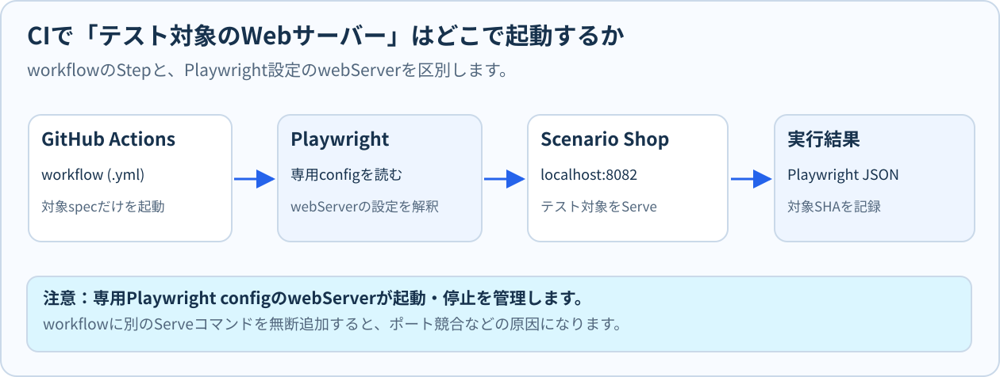

# M09：GitHub ActionsとCIの基礎

## この章でできるようになること

前章のM08では、手元のパソコンで行った変更をGitの「コミット（commit）」として記録し、GitHub上で「プルリクエスト（Pull Request、略してPR）」を作成して他の開発者やレビュアーにコードを確認してもらう一連の流れを学びました。

しかし、人間が画面上でプログラムの差分（変更前と変更後の違い）を目視で確認するだけでは、「その変更を加えたことで、既存の機能が壊れていないか」「自動テストが本当にすべて合格するか」を確実に保証することはできません。開発者の手元のパソコンでは正常に動いていたとしても、他のメンバーのパソコンや、実際にユーザーがアクセスする本番サーバーの環境ではエラーになるケースが頻繁に発生するためです。

そこでソフトウェア開発の現場で不可欠となるのが、プログラムが変更されるたびに自動でテストを実行し、品質を検証し続ける**CI（継続的インテグレーション：Continuous Integration）**という仕組みです。

本章（M09）では、GitHubが提供している自動化プラットフォームである**GitHub Actions（ギットハブ・アクションズ）**を題材に、以下の内容を基礎から体系的に学びます。

1. **CIの全体像と仕組み**：なぜ手元のテストだけでは不十分なのか、クラウド上のサーバーでテストを自動化するメリットとは何か。
2. **基本用語と構造**：workflow（ワークフロー）、trigger（トリガー）、job（ジョブ）、step（ステップ）、runner（ランナー）の役割と相互関係。
3. **設定ファイル（YAML）の読解**：インデント（字下げ）のルール、各行の設定内容、テストを実行するための手順定義。
4. **コミットと実行結果の厳密な照合**：PR head（提出コミット）とマージコミットの違い、Run・Check・Artifactの正しい関連付け。
5. **失敗ログの分析（切り分け）**：エラー画面の末尾だけを見て誤認するのを防ぎ、最初に失敗した原因（初因）を論理的に特定する技術。
6. **安全設計とコスト管理**：最小権限の原則（read権限のみの付与）、秘密情報（Secret）の保護、クラウドの実行費用と起動条件（trigger）のトレードオフ。

> **学習上の最重要ルール（M09の安全規約）**
>
> - **本章では「無効化された設定ファイルの内容を安全に読み解き、正しく点検・修正する読解と設計」が学習の中心となります。**
> - 演習で使用するワークフローファイル（`workspace/M09/course-e2e.workflow.yml.disabled`）の末尾にある `.disabled` は、**絶対に削除しないでください**。
> - また、このファイルを `.github/workflows/` ディレクトリへ移動したりコピーしたりしてはいけません。
> - 実際にクラウド上で自動実行を有効化し、本物の実行結果（Run）を取得・照合する実技演習は、次章のM10で安全手順を確認したうえで実施します。本章で独断で有効化を行うと、意図しない課金やエラー通知の混乱を招くため、必ず無効化された安全な状態で学習を進めてください。

### 本章の学習目標

| 学習目標ID | 本章で習得・確認すること |
| --- | --- |
| **M09-01** | workflow（ワークフロー）・trigger（トリガー）・job（ジョブ）・step（ステップ）・runner（ランナー）の役割と相互の関係性を、自分の言葉で図やたとえを用いて説明できる |
| **M09-02** | Run（実行記録）・Check（検証ステータス）・Artifact（成果物）と、対象となるcommit（コミットSHA）の対応関係を正しく把握し、古い証拠の流用を防ぐ判断ができる |
| **M09-03** | CIの失敗ログを上から順に読み解き、最初に失敗した段階（環境準備・ビルド・テスト実行・成果物保存等）を特定し、調査に必要な情報を適切に切り分けられる |
| **M09-04** | クラウドサーバーの利用費用（実行分数やプラン）、起動条件（trigger）、実行対象の範囲（テストスコープ）を考慮して、過剰な負荷のない適切なCI構成を選択できる |
| **M09-05** | 最小権限の原則（contents: read のみ指定）、不要なSecret（秘密情報）の排除、対象外機能テストとの分離をセキュリティと安全性の観点から判断できる |

## 1. CI（継続的インテグレーション）とは何か？

### 1.1 手動テストが抱える課題

自分のパソコン（ローカル環境）でPlaywrightのテストを実行し、無事に「PASS（合格）」したとします。一人で完結する小さな実験であれば問題ありませんが、チームで本格的なWebシステムを開発・運用する現場では、手動テストだけに頼っていると次のような深刻なトラブルが日常的に発生します。

#### ① 環境依存の問題（「私のPCでは動きました」問題）

開発者のパソコンは、一人ひとり設定や状態が異なります。

- Macを使っている人もいれば、Windowsを使っている人もいます。
- パソコンにインストールされている Node.js やブラウザの細かなバージョンが異なっていることがあります。
- 手元のパソコンにだけ過去のキャッシュファイルや未保存の設定が残っており、たまたま動いていただけというケースもあります。

その結果、「開発者のPCでは動いたのに、同僚のPCで動かすとエラーになる」「本番環境（Linuxサーバー）に公開した瞬間に画面が表示されなくなる」という事故が起こります。

#### ② 確認漏れと先送り（リグレッション / 先祖返り）

プログラムに小さな修正（例：ボタンの文言変更や色の調整）を加えたとき、開発者は「ちょっとした修正だからテストを動かさなくても大丈夫だろう」と考えがちです。
しかし、その変更が思わぬ形で裏側の購入処理やカート機能に影響を与え、以前は正しく動いていた別の機能が壊れてしまうことがあります。これを**リグレッション（退行・先祖返り）**と呼びます。毎回手作業で数十個〜数百個のテストをすべて動かすのは時間がかかるため、確認が怠られ、壊れたコードがそのままGitHubに送信されてしまいます。

#### ③ レビューコストと時間の浪費

プルリクエストを受け取ったレビュアー（先輩エンジニアやQA担当者）が、送られてきたコードを毎回手元のPCにダウンロードし、自分でコマンドを叩いてテストを動かして合否を確認するのは非常に非効率です。人間のレビュアーは、「プログラムの設計がきれいか」「業務要件を正しく満たしているか」といった、より高度な判断に時間を使うべきです。

### 1.2 CIという「自動点検ライン」

こうした課題を解決するのが**CI（継続的インテグレーション：Continuous Integration / 継続的統合）**です。

CIを一言で言えば、**「リポジトリのコードが更新されるたびに、クリーンな専用サーバー上でビルドや自動テストを毎回自動的に実行し、品質を検証し続ける仕組み」**です。

工場の製造ラインに例えると分かりやすいでしょう。
ベルトコンベアに部品が流れてくるたびに、自動検査ロボットがサイズや重量、耐久性を精密にチェックします。もし基準を満たさない不良品（バグを含んだコード）が流れてきたら、ロボットが即座に警告ランプを赤く光らせてラインを止め、作業員に不良箇所を知らせます。不合格の部品は次の工程（本番公開）には決して進みません。

```text
【開発者】コードを変更し、GitHubにプッシュ（push）してPRを作成・更新する
   │
   ▼（設定されたトリガーが検知して自動起動）
【CIサーバー（クラウド上の仮想マシン）】
   ├─ 1. 指定されたコミットのソースコード一式をまっさらな環境にダウンロードする（Checkout）
   ├─ 2. Node.jsや指定された依存ライブラリを正確なバージョンで導入する（Install）
   ├─ 3. テストに必要なブラウザ（Chromium）やWebサーバーをバックグラウンドで起動する
   ├─ 4. Playwrightの自動テストを一括実行し、受入基準を満たしているか検証する（Test）
   └─ 5. 合否判定（PASS/FAIL）をPR画面に表示し、失敗時の証拠（ログ・画像等）を保存する（Report / Artifact）
```

この一連の作業が、**人間の手を一切煩わせることなく、数分程度で完全に自動実行**されます。開発者は、テストの合否結果をGitHubのプルリクエスト画面で待つだけで済みます。

### 1.3 CIの判定結果を正しく理解する

CIを導入すると、PRの画面に「緑色のチェックマーク（PASS / 成功）」または「赤色の×印（FAIL / 失敗）」が表示されます。
ここでテストエンジニアとして絶対に忘れてはならない重要な心構えがあります。

**「CIが緑色（成功）だからといって、システムにバグがないとは限らない」**ということです。

CIの自動判定が保証するのは、**「そのCI設定の中に組み込まれ、実際に実行されたテストコードの検証範囲だけ」**です。

- もし、画面のタイトルが表示されることだけを確認するテストしかCIに設定されていなければ、裏側で「クレジットカード決済」や「在庫の引き落とし」が完全にクラッシュしていても、CIは緑色（合格）になります。
- 逆に、テストコード自体は正しくても、テストを実行するためのWebサーバーがポートの衝突などで立ち上がらなければ、アプリの機能とは無関係にCIは赤色（失敗）になります。

優秀なQA担当者は、単に「緑色がついたから安心」と盲信するのではなく、常に**「このCIワークフローは、システムのどこからどこまでを検証していて、何を実行対象から除外しているのか」**を意識して設定ファイルを読み解きます。

## 2. GitHub Actionsとworkflowの基本用語

GitHubがリポジトリ利用者に提供しているクラウド型の自動化実行環境が**GitHub Actions（ギットハブ・アクションズ）**です。
GitHub Actionsでは、あらかじめ決められた構造に従って設定ファイルを記述します。まずは、絶対に押さえておくべき5つの重要用語と概念を整理しましょう。

```text
[ Trigger（起動のきっかけ：例 pull_request の作成・更新） ]
   │
   ▼
┌─ [ Workflow（自動化処理全体の設計図：.github/workflows/*.yml） ] ───────┐
│                                                                        │
│  ┌─ [ Job（独立した作業環境：例 course-e2e） ] ──────────────────────┐  │
│  │   稼働環境: [ Runner（クラウド仮想マシン：例 ubuntu-latest） ]     │  │
│  │                                                                   │  │
│  │   実行手順:                                                       │  │
│  │     ├─ Step 1: コード取得（actions/checkout Actionの呼出）        │  │
│  │     ├─ Step 2: ライブラリ導入（pnpm install コマンドの実行）       │  │
│  │     ├─ Step 3: ブラウザ準備（playwright install コマンドの実行）    │  │
│  │     ├─ Step 4: 指定specのPlaywright実行（webServer起動含む）    │  │
│  │     └─ Step 5: 同じRunのテスト証拠をArtifactに保存              │  │
│  └───────────────────────────────────────────────────────────────────┘  │
└────────────────────────────────────────────────────────────────────────┘
```

### 5つの重要用語の解説

| 用語 | 読み方・概念 | 役割と具体例 |
| --- | --- | --- |
| **workflow** | ワークフロー | 自動化処理の全体設計図です。1つのファイル（YAML形式）としてリポジトリの `.github/workflows/` フォルダ内に配置します。1つのリポジトリに複数のワークフロー（例：テスト用、デプロイ用、コード整形検査用）を作成できます。 |
| **trigger** | トリガー | ワークフローを起動する「きっかけ・条件」です。「プルリクエストが作成・更新されたとき（`pull_request`）」「メインブランチにコードがマージされたとき（`push`）」「毎晩午前2時になったとき（`schedule`）」「管理者が手動でボタンを押したとき（`workflow_dispatch`）」などがあります。 |
| **job** | ジョブ | ワークフローの中で実行される、ひとまとまりの独立した作業単位です。原則として**ジョブごとに新しいクリーンな仮想マシン（runner）が1台割り当てられます**。複数のジョブを並行（パラレル）して実行させることも可能です。 |
| **runner** | ランナー | ジョブを実行するために、GitHubがクラウド上に一時的に起動してくれる仮想マシン（サーバー計算資源）です。OSとして Ubuntu Linux（`ubuntu-latest`）、Windows（`windows-latest`）、macOS（`macos-latest`）などが選択できます。ジョブが完了すると、この仮想マシンは破棄され、初期化されます。 |
| **step** | ステップ | ジョブの中で、上から順番に1つずつ実行される個別の具体的な作業手順です。シェルコマンドを直接実行する（`run`）か、誰かが作った共通部品のアクションを呼び出す（`uses`）かのどちらかを行います。途中のステップが1つでも失敗すると、後続のステップは原則として中断（キャンセル）されます。 |

### 2.1 ビルド（Build）とテスト（Test）の違い


CIのステップの中には、大きく分けて「ビルド」と「テスト」という2つの異なるフェーズが存在します。プログラミング未経験の方が最も混同しやすいポイントですので、明確に区別しておきましょう。

- **ビルド（Build：組み立て）**：
  人間が書いたプログラムコード（TypeScriptやReactのコンポーネント、Sassのスタイルシートなど）を、コンピューターやWebブラウザが解釈・実行できる単一の形式（JavaScriptファイルやHTMLファイル、CSSバンドル）に**変換・組み立て・梱包する作業**です。
  - 大工仕事に例えると、「木材を設計図どおりに切断し、釘を打って椅子の形に組み立てる作業」です。
  - ビルドが成功した（エラーが出なかった）ということは、「文法的な誤りがなく、ファイルとして正しく組み立てられた」という事実しか意味しません。
- **テスト（Test：検証）**：
  組み立てられたプログラムに対して、実際にテストコードを走らせて「ボタンを押したときに期待どおりの計算が行われるか」「注文完了画面へ正しく遷移するか」といった**期待動作（受入基準）を確かめる作業**です。
  - 大工仕事に例えると、「完成した椅子に実際に大人が座ってみて、壊れたりガタついたりしないか強度を検査する作業」です。

「ビルドが成功したから、テストも合格するはずだ」と考えるのは誤りです。形としては組み立てられていても、座った瞬間に脚が折れる（ボタンを押しても注文できない）欠陥は、テストを実行して初めて発見されます。

## 3. 設定ファイル（YAML）の読み方

GitHub Actionsのワークフローは、**YAML（ヤムル：YAML Ain't Markup Language）**という形式のテキストファイルで記述します。
YAMLは、人間にとって読みやすく書きやすいデータ表現形式ですが、**「半角スペースによる字下げ（インデント）でデータの階層構造（親子関係）を表現する」**という非常に厳格なルールがあります。

### YAMLの基本文法ルール

1. **インデントは必ず「半角スペース」を使う**：
   タブ文字（Tabキーで入力される特殊文字）を使ってはいけません。多くのエディタ（VS Codeなど）では、Tabキーを押した際に自動的に半角スペース2文字へ変換する設定になっています。
2. **同じ深さの階層は、左端の位置を完全に揃える**：
   本講座の例では子項目を半角スペース2つ分右側に字下げします。YAMLの仕様が字下げ幅を必ず2文字と定めているわけではありません。重要なのは同じ階層の字下げ幅を揃えることです。
3. **キーと値の間にはコロンと半角スペースを置く**：
   `name: value` のように、同じ行に値を書く場合は `:` と値を半角スペースで区切ります。一方、`pull_request:` のように子要素や空の値が続くキーでは、コロン直後に空白を置かず改行しても構文上問題ありません。
4. **リスト（箇条書き）はハイフンと半角スペースで始める**：
   `- item` のように、ハイフン記号の後ろにも半角スペースを置きます。
5. **シャープ（`#`）以降はコメントになる**：
   コンピューターには無視され、人間用のメモとして扱われます。

以下は、本講座の学習リポジトリで設計されているE2Eテスト用ワークフローの構造を理解するための抜粋コードです。

```yaml
name: AI QA course checks
on:
  pull_request:
permissions:
  contents: read
jobs:
  course-e2e:
    runs-on: ubuntu-latest
    steps:
      - uses: actions/checkout@v4
        with:
          ref: ${{ github.event.pull_request.head.sha }}
          persist-credentials: false
      - run: pnpm install --frozen-lockfile
      - run: pnpm exec playwright install --with-deps chromium
      - run: pnpm run training:ai-assisted-qa:test -- workspace/M07/repaired-assertion.spec.ts
        env:
          PLAYWRIGHT_TEST_ROOT: workspace/M07
```

> **注意：この抜粋コードは読解学習用の断片です。**
> 学習用リポジトリの完成見本は `course/templates/phase3/course-e2e.workflow.yml.disabled` です。抜粋の `PLAYWRIGHT_TEST_ROOT` は探索対象のディレクトリを指定するだけで、実行する1件のspecはコマンド末尾でも限定します。M07には故意にFAILする教材用specもあるため、ディレクトリ全体を実行対象にはしません。
> 完成見本のArtifactは `target-sha.txt` と `playwright-result.json` の2ファイルだけです。 `if-no-files-found: error` で欠落を検知します。サーバーは独立したServe stepではなく、専用Playwright設定の `webServer` で起動します。

### 3.1 一行ずつ意味を紐解く

#### workflowを読む

一見すると複雑な英単語の羅列に見えますが、1行ずつ意味を分解していくと、驚くほど整然とした論理で組み立てられていることが分かります。

#### 1行目：`name: AI QA course checks`

- ワークフロー全体の表示名（タイトル）です。
- GitHubの「Actions」タブやプルリクエストの検証結果一覧に、この名前が表示されます。誰が見ても何のテストを行っているかが分かる名前を付けます。

#### 2〜3行目：`on:` と `pull_request:`

- **`on:`** は、このワークフローを動かす「起動トリガー」を定義するブロックの開始を示します。
- その配下にある **`pull_request:`** は、「プルリクエストが新しく作成されたとき、またはオープン中のプルリクエストに対して新しいコミットがプッシュされたとき」に自動実行することを意味します。

#### 4〜5行目：`permissions:` と `contents: read`

- ワークフローが実行される際、GitHubのシステムからrunnerに対して一時的なアクセス許可証（GitHubトークン）が自動発行されます。そのトークンに付与する権限の強さを定めます。
- **`contents: read`** は、リポジトリ内のソースコードやファイルを「読み取る（閲覧・取得する）」ことだけを許可する設定です。
- リポジトリのコードを勝手に書き換えたり、設定を変更したりする権限（write権限）を与えないことで、万が一テストコード内にセキュリティ上の欠陥があってもリポジトリが改ざんされる事故を防ぎます（**最小権限の原則**）。

#### 6〜7行目：`jobs:` と `course-e2e:`

- **`jobs:`** は、ここから具体的な作業ジョブの定義が始まることを示します。
- **`course-e2e:`** は、ジョブの識別子（ジョブID）です。「コース用のE2Eテスト」という意味を込めて命名されています。GitHub Actionsの画面上では、このIDがジョブの名前として表示されます。

#### 8行目：`runs-on: ubuntu-latest`

- このジョブを実行する仮想マシン（runner）のOSを指定しています。
- `ubuntu-latest` は、世界中で最も広く使われているオープンソースのLinux OSである「Ubuntu（ウブントゥ）」の最新安定版をクラウド上に起動することを指定しています。Linux環境はWindowsやmacOSに比べて起動が速く、利用コストも低く抑えられます。

#### 9行目：`steps:`

- このジョブの中で、上から下へと順番に実行していく個別の作業手順一覧を開始するキーワードです。各手順の先頭には `-`（ハイフン）を付けます。

#### 10〜13行目：ソースコードの取得（チェックアウト）

```yaml
      - uses: actions/checkout@v4
        with:
          ref: ${{ github.event.pull_request.head.sha }}
          persist-credentials: false
```

- **`uses: actions/checkout@v4`**：
  `uses` は、GitHub公式や世界中の開発者が公開している再利用可能な共通プログラム（Action）を呼び出すキーワードです。ここでは、起動したばかりのまっさらな仮想マシン内に、GitHub上のソースコードをダウンロード（チェックアウト）してくる公式アクションのバージョン4を使用しています。
- **`with:`**：Actionに対して追加の設定パラメータ（引数）を渡すキーワードです。
- **`ref: ${{ github.event.pull_request.head.sha }}`**：
  取得するコミットのバージョンを明示的に指定しています。`${{ ... }}` はGitHub Actionsの特殊な変数参照記法です。ここでは「プルリクエストの送信元ブランチの最新コミットのハッシュ値（head SHA）」をピンポイントで指定し、後述するマージシミュレーション用コミットとの混同を防いでいます。
- **`persist-credentials: false`**：
  コード取得が完了したあと、仮想マシン内にGitの認証情報（トークン）を保存したまま残さないというセキュリティ設定です。後続のステップで悪意のある第三者スクリプトが認証情報を盗み出すリスクを排除します。

#### 14行目：`- run: pnpm install --frozen-lockfile`

- **`run`** は、runnerのターミナル（シェル）でコマンドを直接実行する設定です。
- ここではNode.jsの高速なパッケージ管理ツールである `pnpm` を使い、プロジェクトに必要なライブラリ群を一括導入しています。
- **`--frozen-lockfile`** は非常に重要なオプションです。「`pnpm-lock.yaml` に記録された厳密なバージョン番号から1ビットたりとも勝手に更新してはいけない」という制限をかけます。手元の環境とCI環境で導入されるライブラリのバージョンが勝手に食い違うのを防ぎます。

#### 15行目：`- run: pnpm exec playwright install --with-deps chromium`

- Playwrightが自動テストを実行するために必要なブラウザ本体（Chromium：Google Chromeのオープンソース版）と、Linux OS上でブラウザを動かすために必要な周辺システムライブラリ（`--with-deps`）を自動ダウンロードしてrunnerにセットアップしています。
- このステップがないと、テスト実行時に「ブラウザが見つかりません」というエラーで即座に落ちてしまいます。

#### 16〜18行目：テスト実行と対象ディレクトリの限定

```yaml
      - run: pnpm run training:ai-assisted-qa:test -- workspace/M07/repaired-assertion.spec.ts
        env:
          PLAYWRIGHT_TEST_ROOT: workspace/M07
```

- **`pnpm run training:ai-assisted-qa:test`**：リポジトリにあらかじめ設定されているテスト実行スクリプト（Playwrightの起動コマンド）を呼び出します。
- **`env:`**：このステップの実行中だけに有効となる「環境変数（Environment Variable）」を定義します。
- **`PLAYWRIGHT_TEST_ROOT: workspace/M07`**：
  テストの実行対象とするフォルダを `workspace/M07` に限定しています。リポジトリ全体にある無関係なテスト（他モジュールのテストやNativeアプリ用のテストなど）を勝手に走らせず、今回の学習範囲だけに絞り込んで高速かつ安定してテストを完了させるための設計です。

### 3.2 つまずきやすいYAMLの字下げを見分ける

YAMLの文法で初心者が最もつまずくのが、**インデントのズレ**です。
Pythonなどのプログラミング言語と同様に、YAMLでは字下げの深さによって「どの項目がどの項目の配下にあるか」を判定します。

以下の2つの例を見比べてみましょう。

```yaml
# 正しい階層の例（半角スペース2文字の深さが揃っている）
jobs:
  sample-job:
    runs-on: ubuntu-latest
    steps:
      - run: echo "正しい設定です"
```

```yaml
# 誤った階層の例（stepsの深さが浅く、sample-jobの外に出てしまっている）
jobs:
  sample-job:
    runs-on: ubuntu-latest
  steps:
    - run: echo "エラーになります"
```

#### なぜ後者はエラーになるのか？

GitHub Actionsの文法規則では、「`steps`（実行手順）は、必ず個別の `job`（作業単位）の中に含まれていなければならない」という親子関係のルールがあります。
しかし、誤った例では `steps` が `sample-job` と同じ左端の深さ（インデント）になってしまっています。これでは、コンピューターから見ると「`sample-job` というジョブ」と「`steps` という別のジョブ」が並んでいるように解釈されてしまい、YAML自体は読み取れても、GitHub Actionsが要求するjob構造を満たさないため、workflowの設定検証でエラーになります。この問題を「YAMLの字下げ文法が壊れている」と混同してはいけません。

#### 構文チェックと実際の動作保証は別

ここで一つ、非常に重要な確認問題を通して理解を深めましょう。

**追加の確認問題**
VS Codeなどのエディタで構文チェック機能（YAML Validator）を使い、「構文エラーはありません」と表示されました。この時点で、「GitHub Actionsのワークフローとして100%正しく動作し、テストが成功し、PRのヘッドコミットSHAまで正しく検証される」と断定できますか？

**解答**：断定できません。
**解説**：構文チェックが確認しているのは、あくまで「YAMLの字下げや記号の使い方がテキストとして文法通りであるか」だけです。

- 指定したコマンド（`pnpm install` など）が実際にサーバー上で正常終了するかどうか
- 起動条件や環境変数のパス（`workspace/M07` など）が実在するファイルを指しているか
- 取得したコミットSHAがPRの最新コードと一致しているか
これらは、クラウド上で実際にワークフローを起動し、実行結果のログや成果物（Artifact）を確認して初めて検証できる事柄です。「構文チェックに通ること」と「CIが意図どおりに正しく動くこと」を絶対に混同してはいけません。

### 実習 3-1：ワークフローの設定行を読み解き、練習ファイルを点検する（M09-01）

#### 目的

ワークフローの基本構成要素（`on`、`permissions`、`jobs`、`runs-on`、`steps`）がどのように組み合わさっているかを理解し、未完成の設定ファイルから不足している設定やインデントの誤りを自力で特定・修正できるようになる。

#### 準備

1. VS Codeで作業環境（Codespacesまたはローカル環境）を開きます。
2. 演習資材が展開されていることを確認します（展開コマンド：`pnpm course:load M09`）。
3. 比較する2つのファイルを確認します。
   - **学習者が編集する練習用ファイル**：`workspace/M09/course-e2e.workflow.yml.disabled`
   - **読み取り専用の完成見本ファイル**：`course/templates/phase3/course-e2e.workflow.yml.disabled`

> **安全上の厳格なルール**
>
> - **ファイル末尾の `.disabled` を絶対に外さないでください。**
> - **このファイルを `.github/workflows/` フォルダへ移動したりコピーしたりしてはいけません。**
> - M09の目的は、安全な状態で設定ファイルを正しく読み解き、構造上の欠陥を見抜く力を養うことです。無効化を解除すると、予期せぬ自動実行によってクラウド利用料金の発生やCI実行枠の浪費につながるため、必ず `.disabled` のまま作業します。

#### 操作手順

1. VS Codeのエディター画面を左右に分割し、左側に練習用ファイル（`workspace/M09/...`）、右側に完成見本ファイル（`course/templates/...`）を開いて並べます。
2. 両方のファイルを見比べながら、以下の5大ブロックがどこに配置されているかを確認します。
   - 起動条件：`on:`
   - 権限設定：`permissions:`
   - ジョブ定義：`jobs:`
   - ランナー指定：`runs-on:`
   - 実行ステップ：`steps:`
3. 練習用ファイル（左側）を観察し、完成見本（右側）と比較して**何の設定が欠落しているか**をメモ帳などに箇条書きで書き出します。
   - **チェック観点A（コード取得）**：PR headコミットを明示してチェックアウトする設定（`ref` や `persist-credentials: false`）が含まれているか？
   - **チェック観点B（ブラウザ準備）**：Playwrightのブラウザ（Chromium）を依存パッケージ付きで導入するステップ（`playwright install --with-deps chromium`）があるか？
   - **チェック観点C（サーバー起動）**：Playwrightの学習専用設定 `playwright.ai-assisted-qa.config.ts` の `webServer` がShopを起動する構成か？完成見本に独立したServe stepはありません。重複して追加しないでください。
   - **チェック観点D（成果物保存）**：テスト結果レポートや、コミットハッシュを記録したテキストファイル（`target-sha.txt`）をArtifactとして保存するステップがあるか？
4. 練習用ファイル（`workspace/M09/...`）に不足しているステップを、完成見本を参考にしながら書き加えて補います。
   - コピー＆ペーストを行う際、インデント（半角スペースの深さ）が崩れていないか、前後のステップとハイフン `-` の位置が完全に一致しているかを慎重に目視確認してください。
5. AIエージェント（OpenCodeなど）が利用可能な環境であれば、ターミナルやチャットで次のようにプロンプトを入力し、自分の点検結果と照合してみましょう。
   - **AIへの依頼文例**：
     > 「`workspace/M09/course-e2e.workflow.yml.disabled` の内容を点検してください。完成見本である `course/templates/phase3/course-e2e.workflow.yml.disabled` と比較し、不足しているステップやインデントの誤りがないかレビューをお願いします。なお、学習安全規約に基づき、ファイル名の `.disabled` は絶対に外さず、ワークフローの有効化やファイルの自動移動は行わないでください。権限設定、実行対象スコープ、成果物保存ステップの3点に絞ってアドバイスをお願いします。」

#### 期待される結果

- ワークフローの各ステップが「どのような目的で配置され、なぜその順序で実行されなければならないのか」を、自分の言葉で論理的に説明できるようになる。
- 修正後の練習用YAMLファイルが、構文エラーのない正しいインデントで保存されている。

#### 実習確認問題

**問い**：ワークフローの `steps` の中で、「ブラウザ導入（`playwright install`）」のステップを書き忘れたままテスト実行ステップに進んでしまい、ジョブがエラー（赤色）で中断しました。このとき、あるQA担当者が不具合管理票に「カート画面の数量変更アサーションが失敗しました。開発チームは修正してください」と不具合報告を提出しました。この報告は適切でしょうか？ 理由とともに答えてください。

##### 解答と解説：ブラウザ準備の失敗

- **正解**：不適切です（重大な誤認報告）。
- **解説**：テストコードが実行される前段階である「ブラウザ環境の準備ステップ」でエラーが発生し、ジョブ全体が中断したため、後続のテストスクリプトやアサーション（期待値の検証）は**まだ1度も実行されていません**。
  テストコードが1行も動いていないにもかかわらず、「数量変更アサーションが失敗した」と報告するのは完全な事実無根であり、開発チームに無駄な調査コストを負わせることになります。この場合の正しい報告は、「**環境準備（ブラウザ導入）ステップで失敗したため、テスト自体は未実行（未検証）である**」となります。



図の左から順にたどると、workflowのStepがPlaywrightを開始し、専用のPlaywright設定にある`webServer`が学習用アプリケーションを起動する関係を確認できます。workflowへ別のServe用Stepを追加する指示ではありません。テストが失敗した場合は、workflowの設定エラー、Playwrightの`webServer`準備エラー、Assertion失敗を区別してください。

## 4. CI環境で動くアプリケーションとテスト対象

手元のパソコンでWebアプリケーションの開発やテストを行うときは、ターミナルで `npm run dev` などのコマンドを叩いてWebサーバーを立ち上げ、Google Chromeなどのブラウザを自分で起動して操作します。

CI環境（GitHub Actionsのrunner）でも全く同じことが行われますが、画面を持たないクラウドサーバー（仮想マシン）の中で、**すべてがプログラムによって全自動で実行**されます。

```text
【一般的なフルビルド構成のCI（時間がかかる）】
  ソース取得 ──> アプリ全体の巨大なビルド（数分〜十数分） ──> 全機能のテスト実行（コスト大）

【本講座の専用軽量CI（高速・低コスト）】
  ソース取得 ──> 事前配布されたShop成果物を参照 ──> 軽量サーバー即時起動 ──> 対象モジュールのテストのみ実行（数分で完了）
```

本講座の学習リポジトリ（`qa-training-store`）では、初学者がストレスなく素早くフィードバックを得られるように、CIの設計に特別な工夫が施されています。

1. **管理者が固定した配布版アプリケーションを利用する**
   - 本格的なWebアプリケーション全体をゼロからビルド（`build:web` など）すると、それだけで膨大なCPU資源と数分〜十数分の時間がかかってしまいます。
   - そこで本講座のCIでは、リポジトリ内の `course/shop/` に用意された学習用の配布物を、専用Playwright設定 `playwright.ai-assisted-qa.config.ts` の `webServer` が起動するサーバーで配信し、Playwrightを接続する構成です。workflowに独立したServe stepを追加する必要はありません。
2. **環境変数 `PLAYWRIGHT_TEST_ROOT` でテスト範囲を限定する**
   - 環境変数 `PLAYWRIGHT_TEST_ROOT` で探索対象のディレクトリを絞り、テスト実行コマンド末尾に `-- workspace/M07/repaired-assertion.spec.ts` のように**許可された1つのspec**を指定して実行範囲を限定します。ディレクトリだけでは複数の `.spec.ts` が実行される可能性があります。
   - 例えば、M07で作成した自分のテストコードを検証する場合は `workspace/M07` を指定します。手元にテストコードがない状態で模範解答のテストを動かす場合は、フォールバック用として用意されている公開サンプル `workspace/M10/public-sample` を指定します。

### 4.1 テスト対象を無断で増やさない原則

自動テストを学び始めると、「せっかくCIがあるのだから、リポジトリ内にあるすべてのテスト（Nativeアプリ用テストや他のモジュールのテストなど）を一気に全部実行するように設定を書き換えよう」と考える受講者がいます。
一見すると熱心で良いことのように思えますが、品質保証の実務においては**重大なアンチパターン（やってはいけない悪手）**です。

テスト対象を無断で広げると、以下の3つの問題が必ず発生します。

1. **クラウド費用の無駄遣いと実行時間の長期化**：
   関係のないテストまで走らせると、CIの完了までに10分も20分も待たされることになり、開発テンポが著しく悪化します。また、GitHub Actionsの無料枠をあっという間に使い果たしてしまいます。
2. **無関係な不具合によるCIの赤色化（ノイズの混入）**：
   自分が今回修正した箇所とは全く関係のない、別の開発者が作業中の未完成機能のテストが失敗し、CIが赤色（×印）になってしまいます。こうなると、「今回の自分の変更が正しかったのかどうか」を判定できなくなります。
3. **PRの検証目的の喪失**：
   プルリクエストのCIの目的は、「**今回の変更内容が、今回の受入基準を満たしているか**」を証明することです。関係のないテストを含めることは、検証の焦点をぼやけさせるだけです。

「テスト範囲は、今回の変更目的に合わせて必要最小限に絞り込む」というのが、プロのテストエンジニアの鉄則です。

## 5. Run・Check・Artifactとコミットの対応関係

CIを正しく運用し、テスト結果を品質の証拠として扱うためには、GitHub上で使われる3つの主要な概念（Run、Check、Artifact）を明確に区別し、**「いま見ている結果が、どのコミット（コードの版）に対して実行されたものか」**を1対1で正確に対応付けられなければなりません。

```text
[ 開発者のコミット (例: コミットSHA a1b2c3d) ] ── (PRの作成 / push)
   │
   ▼
[ Run (ワークフローの1回の実行インスタンス) ] ──> [ Check (PR画面の合否ステータス表示) ]
   │
   └─ 実行中に生成・保存された成果物 ──> [ Artifact (例: target-sha.txt, テストレポート) ]
```

### 3つの重要概念の整理

| 用語 | 意味と実体 | 確認すべき情報・役割 |
| --- | --- | --- |
| **Run（ラン / 実行）** | ワークフローがトリガーによって起動し、終了するまでの「1回の実行インスタンス（実行記録そのもの）」です。 | - **Run ID**：実行ごとに割り当てられる一意の数字（URLに含まれる）。 ／ - **実行ステータス**：Success（緑）、Failure（赤）、In Progress（黄）など。 ／ - **実行日時と所要時間**。 |
| **Check（チェック / 検証ステータス）** | プルリクエストの画面下部やコミット一覧に表示される「合否判定の表示バッジ」です。 | - 緑のチェックマーク（合格）や赤の×印（不合格）。 ／ - 関連付けられているJob名と、詳細ログ（Details）へのリンク。 |
| **Artifact（アーティファクト / 成果物）** | ワークフローの実行中に生成され、runnerからクラウド上にアップロードされて保存された「ファイル群」です。 | - ZIP圧縮されたPlaywrightのテストレポート、エラー時のスクリーンショット。 ／ - 本講座の契約である実行コミット記録ファイル（`target-sha.txt`）。 |

### 5.1 PR head と Merge commit の違いに注意する

#### 対象shaとrunのartifactを照合する

GitHubのプルリクエスト上でCIを動かす際、初学者が最も混乱しやすいのが**コミットハッシュ（SHA）の不一致**です。

Gitのコミットには、変更内容や日時から計算された40桁（短縮形では7桁）の英数字の識別番号（SHAハッシュ値、例：`a1b2c3d`）が必ず付いています。GitHubのプルリクエストには、実は以下の2種類の異なるコミットが存在します。

1. **PR head（ヘッドコミット）**：
   プルリクエストを作成したブランチ上で、**開発者本人が手元で作成し、GitHubにプッシュした最新のコミット**です。開発者が「このコードをレビューしてください」と提出した正本です。
2. **Merge commit（マージコミット）**：
   GitHubのシステムが裏側で自動的に生成する、**「もし今、このPRをメインブランチ（main）にマージしたらどうなるか」をシミュレーションした一時的な統合コミット**です。

GitHub Actionsの標準的な設定（`on: pull_request` で単にチェックアウトした場合）では、開発者が意図せずこの「マージコミット」がチェックアウトされてテストが走ってしまうことがあります。
しかし、QAの厳格な証拠管理においては、「**提出されたコミット（PR head SHA）そのものに対してテストが実行され、合格したのか**」を確実に証明する必要があります。マージシミュレーションのコミットハッシュは一時的なものであり、開発者のローカル履歴には存在しないため、後から追跡（トレーサビリティの確保）ができなくなってしまうからです。

本講座のワークフローでは、前述のとおり `ref: ${{ github.event.pull_request.head.sha }}` を明示してPR headをチェックアウトし、さらに実行されたコミットハッシュを `target-sha.txt` というファイルに書き出してArtifactとして保存する契約を採用しています。

#### 過去の成功証拠の流用は絶対禁止

テストの証拠管理において、次のようなミスが非常に多く見られます。

```text
【時系列の流れ】
1. 開発者がコミット AAAA をプッシュした。
   ──> CIが走り、緑色の成功（PASS）になった（Run #1）。
2. その後、コードのコメントの誤字（Typo）に気づき、修正してコミット BBBB をプッシュした。
3. コミット BBBB に対するCIは、まだ実行していない（または実行待ち）。
```

このとき、開発者やQA担当者が「さっきコミットAAAAのRun #1で緑色になっていたから、このPRはテスト合格です。マージして大丈夫です」と報告してはいけません。
なぜなら、Run #1はあくまで「コミットAAAA」に対する合格証拠であって、新しく追加された「コミットBBBB」の品質を何一つ保証していないからです。誤字の修正に見えても、誤ってプログラムの必要な記号を消してしまい、コミットBBBBでは動かなくなっている可能性が常にあります。

**「品質の証拠として有効なのは、現在の最新コミット（HEAD）と完全に一致するRunの証拠だけである」**という原則を徹底してください。

### 実習 5-1：GitHub Actionsの画面構造を読み解く（M09-02）

#### 目的

GitHubのWeb画面上で、Run、Job、Step、Artifact、コミットSHAがそれぞれどこに配置・表示されているかを目視で確認し、手元のコードと実行結果を正しく紐付けられるようになる。

#### 準備

- Webブラウザで、閲覧権限のあるリポジトリ（講師から指定された参照用リポジトリ、または公式の画面サンプル）を開きます。
- **注意**：M09では自分のリポジトリのワークフローを有効化しないため、閲覧が許可されている既存の公開Runを参照します。存在しないRunのURLや結果を推測で捏造してはいけません。

#### 操作手順

1. リポジトリのトップ画面上部にあるナビゲーションバーから、**Actions** タブをクリックします。
2. 画面の左側に並んでいるワークフロー一覧から、確認したいワークフロー名を選択します。
3. 画面中央に表示される「All workflows」の実行履歴一覧（Runの一覧）から、過去に実行されたRunを1つ選んでクリックします。
4. 開いたRunの詳細画面で、以下の要素がどこに表示されているかを探し、ノート等にメモします。
   - **実行ステータス**：成功（緑のチェック）、失敗（赤の×）、進行中（黄色の回転アイコン）のどれか。
   - **コミットSHA**：このRunがどのコミット（7桁または40桁の英数字）に対して実行されたものか。コミットメッセージの横に表示されます。
   - **Job一覧**：左側のナビゲーションメニューに表示されているジョブ名（例：`course-e2e`）をクリックします。
   - **Stepの展開とログ**：右側に表示されるステップ一覧から、各ステップ（例：`Run Playwright tests`）をクリックしてアコーディオンを展開し、ターミナルに出力されたログが表示されることを確認します。
5. 画面の下部（または右上）にある **Artifacts** セクションを確認します。
   - 保存されている成果物ファイル名（例：`course-e2e-artifact` や `playwright-report`）があるか確認します。
   - ワークフローにArtifact保存ステップがない場合は「Artifactなし」と判断します。

#### 実習確認問題

**問い**：ActionsタブのRun一覧に、緑色の成功マークがついたRunがありました。しかし、そのRunからダウンロードした成果物 `target-sha.txt` を開くと `a1b2c3d` と記録されていました。一方、現在レビュー中のPRの最新コミットは `e5f6g7h` です。このRunは、現在のPRの合格証拠として提出できますか？ 理由とともに答えてください。

##### 解答と解説：PR head SHAの照合

- **正解**：提出できません（採用不可）。
- **解説**：テストが実行された対象のコミットSHA（`a1b2c3d`）と、現在レビュー対象となっている最新のPR headコミットSHA（`e5f6g7h`）が食い違っているためです。
  古いコードでテストが成功していても、最新のコミットで別の不具合が混入している可能性があります。現在のPR headコミットを対象として新しく実行されたRunの証拠を待って確認する必要があります。

## 6. 失敗ログの最初の場所（初因）を特定する

CIが赤色（FAIL / 失敗）になったとき、多くの初学者は画面の一番下にスクロールし、最後に表示されている赤い文字だけを見て「Playwrightのテストコードが間違っている！」「アサーションを直さなきゃ！」と思い込んでしまいます。

しかし、CI環境における失敗原因の半分以上は、テストコードそのものではなく**環境構築の不備、依存ライブラリの欠落、Webサーバーの起動失敗**など、テストが始まる前の段階にあります。

トラブルシューティングにおける鉄則は、**「上から順番にステップを見ていき、最初に×印（赤色）がついたステップはどこか（初因：First Failure）」**を特定することです。

### 失敗段階と調査観点の切り分けマトリクス

| 最初に失敗したステップ | 何が起きたのか（失敗の原因） | まだ確かめられていないこと | 最初に調査すべき情報 |
| --- | --- | --- | --- |
| **checkout（コード取得）** | リポジトリからのソースコード取得に失敗した。 | アプリケーションが動くかどうかのすべて。 | 指定したコミットSHAやブランチ名が実在するか、ワークフローの権限（token）設定。 |
| **install dependencies（ライブラリ導入）** | `pnpm install` などのパッケージ導入に失敗した。 | ビルドやテストが正常に動作するかどうか。 | `package.json` の記述ミス、`pnpm-lock.yaml` の不整合、ネットワーク接続。 |
| **browser install（ブラウザ導入）** | テスト用ブラウザ（Chromium）のダウンロードに失敗した。 | ブラウザテストが合格するかどうか。 | Playwrightのバージョン、Linux OSの依存パッケージ不足（`--with-deps` の有無）。 |
| **server start（サーバー起動）** | テスト対象となるWebサーバーが立ち上がらなかった。 | 各画面の表示やE2Eシナリオの成否。 | ポート番号の重複（競合）、ビルド成果物のパス指定ミス、起動コマンドの誤り。 |
| **test execution（テスト実行）** | Playwrightのアサーション（期待値の検証）が失敗した。 | 失敗したテストケース以外の仕様適合性。 | テストコードのアサーション、製品仕様書の受入基準、Trace Viewerの実行履歴。 |
| **Artifact upload（成果物保存）** | テストレポートや証拠ファイルのクラウド保存に失敗した。 | テスト自体は成功していても、客観的な証拠が残らない。 | アップロード対象のディレクトリパスの指定ミス、ファイル名の誤り、容量制限。 |

### 6.1 ログの切り分け実例

#### 最初の失敗箇所から結果を分類する


例えば、GitHub Actionsの実行ログを開いたところ、以下のような表示になっていたとします。

```text
❌ Step 2: Run pnpm install --frozen-lockfile  (Failed - exit code 1)
   ERR_PNPM_LOCKFILE_CONFIG_MISMATCH: Cannot install with "frozen-lockfile"
   because pnpm-lock.yaml is not up to date with package.json
⚪ Step 3: Run pnpm exec playwright install   (Skipped)
⚪ Step 4: Run Playwright tests (webServer含む) (Skipped)
⚪ Step 5: Upload test artifacts              (Skipped)
```

この画面を見たとき、不具合報告書に「カート機能のアサーションエラーが発生しました」と書いてはいけません。
ログをよく見ると、Step 2の `pnpm install` の段階でロックファイルの不整合によって失敗しており、それ以降のステップ（ブラウザ導入、テスト実行。テスト内部の`webServer`起動も含む）はすべて「**Skipped（スキップ / 未実行）**」になっています。

したがって、この場合の正確なQA報告は以下のようになります。
> **正しい報告内容**：
> 「依存パッケージ導入ステップ（`pnpm install`）において、`package.json` と `pnpm-lock.yaml` の不整合によるエラーが発生し、ジョブが中断しました。テスト実行ステップはスキップされたため、**テストコード自体の合否は未検証**です。まず `package.json`、`pnpm-lock.yaml`、Node.js・pnpmのバージョンとエラー全文を調査してください。依存関係やlockfileの修正・commitは、変更権限と正しい修正内容が確認されてから担当者が行います。」

このように、**「何が原因で止まり、その結果としてどこが未検証のまま残っているのか」**を正確に区別して伝える能力が、QAエンジニアには強く求められます。

## 7. クラウド利用費用と最小権限の原則

### 7.1 利用費用を考える：自動実行のトレードオフ

#### runner費用を確認する

GitHub Actionsのrunnerは、クラウド上に用意された本物のサーバー計算資源を使って動いています。
そのため、実行には当然ながらコスト（利用料金や無料枠の消費）が伴います。

料金体系（毎月の無料枠分数や超過時の従量課金）は、**リポジトリの公開設定（PublicかPrivateか）、アカウントの契約プラン（Free、Team、Enterprise）、使用するrunnerのOS種別（Linux、Windows、macOS）**によって大きく異なります。
特に、macOSのrunnerはLinuxのrunnerに比べて10倍近く高い課金レートが設定されていることが一般的です。

そのため、「教材にこう書いてあったから無料だ」「〇回実行したから必ず〇〇円だ」と勝手に決めつけてはいけません。**利用する時点のGitHub公式の料金ドキュメントおよび自身のアカウントの請求設定画面（Billing）**を確認して判断する必要があります。

#### 実行トリガーの設計判断（自動 vs 手動）

ワークフローを起動するトリガーには、主に「PR更新ごとの自動実行」と「ボタン操作による手動実行」の2つの設計パターンがあります。

- **案A：プルリクエストの更新ごとに毎回自動実行する設定（`on: pull_request`）**
  - **メリット**：コードがプッシュされた瞬間に自動でテストが走るため、バグが混入したときに最速で気づくことができる。未検証のコードが放置される期間を最小化できる。
  - **デメリット**：細かいコミットを何度もプッシュすると、そのたびにrunnerが起動するため、実行分数（コスト）を多く消費する。
- **案B：開発者やレビュアーがボタンを押したときだけ実行する手動設定（`on: workflow_dispatch`）**
  - **メリット**：必要なタイミング（例：レビュー直前の最終確認時）だけに絞って実行できるため、無駄な実行を減らし、費用を節約できる。
  - **デメリット**：ボタンを押し忘れたままマージされてしまう人的ミスのリスクがある。テストの実行を先送りにした結果、マージ直前に大きなバグが見つかって手戻りが発生しやすい。

品質保証の現場では、**「開発スピード（早期検知）」「かけられる予算」「人的ミスによるリスク」**のバランスを総合的に考慮して、最適なトリガーを選択します。

### 7.2 最小権限の原則（Least Privilege）

#### 最小権限を設定する

セキュリティの世界における最も重要かつ基本的な原則が**最小権限の原則（Principle of Least Privilege）**です。
これは、「プログラムやユーザー、ワークフローには、**その作業を果たすために必要最低限の権限だけを与え、不要な権限は一切与えてはならない**」という考え方です。

本講座のE2Eテストワークフローが行う作業は、「リポジトリからコードを読み込み、ブラウザ上でテストを実行して結果を報告する」ことだけです。リポジトリ内のコードを書き換えたり、リポジトリの設定を変更したり、新しいリリースを作成したりする必要は一切ありません。

したがって、ワークフロー内の権限設定には、必ず以下のように**読み取り専用（read）**を指定します。

```yaml
permissions:
  contents: read
```

#### やってはいけない危険な例

CIの設定エラーや権限不足のエラーに遭遇した際、初学者やAIエージェントが「権限が足りないのが原因かもしれないので、権限を全部許可しておきましょう」として、以下のような設定を提案してくることがあります。

```yaml
# 危険な設定例：重大なセキュリティリスクを招くため絶対に真似しないでください
permissions: write-all
```

`write-all`（全書き込み権限）を設定すると、ワークフローに対してリポジトリの改ざん、コードの強制削除、権限の変更など、あらゆる操作が許可されてしまいます。
もし、プロジェクトが使っている外部のオープンソースライブラリ（依存パッケージ）の中に悪意のあるスクリプトが混入していた場合（サプライチェーン攻撃）、そのスクリプトがCIの実行中にリポジトリのコードを勝手に書き換えたり、秘密情報を外部サーバーに送信したりする恐れがあります。

**「動かないからといって安易に権限を広げる」ことは絶対に禁止**です。必ずステップごとに必要な権限を精査し、最小の読取専用権限（`read`）を維持してください。

## 8. M09での作業ルールと失敗分析実習

ここで改めて、本章における重要な作業ルールを確認します。

- **読み取り専用の完成見本**：`course/templates/phase3/course-e2e.workflow.yml.disabled`
- **学習者が編集する練習用ファイル**：`workspace/M09/course-e2e.workflow.yml.disabled`

拡張子に `.disabled` が付いているファイルは、GitHub Actionsのシステムから完全に無視されるため、自動実行されることはありません。
M09では、この練習用ファイルを完成見本と比較しながら修正し、正しいワークフローの構成とインデントを学ぶ演習を行います。

> **警告：`.disabled` を外したり、`.github/workflows/` ディレクトリへ移動してはいけません。**
> 本物のワークフローを安全に有効化し、実際のCI Runを生成・確認する実技演習は、次章（M10）で段階を追って行います。

また、失敗分析の演習で使用する `workspace/M09/failure-cases.md` に記載されているエラーログは、学習のためにあらかじめ用意された**合成資料（シミュレーション用データ）**です。本物のGitHub Actions上で実行された結果ではありません。合成素材のログと、実際の画面に表示される本物のRun記録を明確に区別して扱ってください。

### 実習 8-1：合成ログの失敗段階特定と安全設計の評価（M09-03〜M09-05）

#### 目的

エラーログから最初に失敗した段階（初因）を論理的に切り分けられるようになるとともに、CIのセキュリティ権限や実行コストについて妥当な設計判断ができるようになる。

#### 準備

- エディタで `workspace/M09/failure-cases.md` を開きます。

#### 操作手順

##### ステップ1：失敗段階の分類（M09-03）

1. `failure-cases.md` に記載されている「Case 1」〜「Case 3」の合成エラーログを読みます。
2. それぞれのケースについて、最初に失敗した段階を次の4区分のいずれかに分類し、ノート等に記録します。
   - `準備（環境構築・依存関係導入・ブラウザ導入）`
   - `ビルド（アプリケーションの組み立て）`
   - `テスト（Playwrightの実行・検証）`
   - `成果物保存（Artifactアップロード）`
3. 最初に失敗したステップ以降の「実行されずにスキップされたステップ（未実行ステップ）」をすべて書き出します。
4. AIエージェントに次のように依頼し、自分の分類結果と比較・検証します。
   - **依頼文例**：
     > 「`workspace/M09/failure-cases.md` のログを分析してください。このログから確実に判断できる失敗ステップと、実行されていないため成否が判断できないステップを論理的に分けて説明してください。なお、このログは学習用の合成資料であり、実Runではありません。workflowの有効化は絶対に行わないでください。」

##### ステップ2：セキュリティ権限の評価（M09-05）

1. ある開発者が作成したE2Eテスト用ワークフローの中に、`permissions: contents: write` という設定が記述されているのを見かけたとします。
2. 今回のテスト（リポジトリのコードを読み込んでローカルWebサーバーとブラウザを起動し、E2Eテストを実行する処理）において、この「書き込み権限（write）」が必要であるかどうか、理由とともに判断を記述してください。

##### ステップ3：実行トリガーとコストの比較（M09-04）

1. 1日に平均5回プルリクエストが更新（コミットがプッシュ）される開発プロジェクトを想定します。計算を単純にするため、ここでは「各更新で対象ワークフローが1回だけ起動し、他イベント・手動再実行・重複起動・再試行はない」という前提条件を置きます（※この前提は実運用の最大起動回数を保証するものではありません）。
2. 次の2つの運用案について、比較検討を行ってください。
   - **案A**：コミットがpushされるたびに毎回自動実行する（`on: pull_request`）。
   - **案B**：開発者が手動でボタンを押したときだけ実行する（`on: workflow_dispatch`）。
3. 比較観点：**上記の前提条件の下での**想定起動回数、不具合検知の早さ、実行忘れのリスク、不要な実行の有無、費用と未検証期間のトレードオフ。

#### 期待される結果と解答・解説

##### 失敗段階分類の解答・解説

- **Case 1の解説**：ログの最後にテストフレームワークのエラーが表示されていても、その直前で専用Playwright設定の `webServer` がポート衝突などで起動できなければ、失敗段階は「**準備（サーバー起動）**」です。後続のテストステップは実行されていません。未実行のテストについて「テストコードがバグっている」と報告してはいけません。
- **Case 2の解説**：ライブラリ導入コマンド（`pnpm install --frozen-lockfile`）でロックファイルの不整合エラーが出ている場合、失敗段階は「**準備（依存関係導入）**」です。アプリケーションのコード自体はまだ1行も評価されていません。
- **Case 3の解説**：ブラウザとサーバーが正常に起動し、テストスクリプトが動いた結果として `expect(locator).toBeVisible()` 等でタイムアウトしている場合は、正しく「**テスト（Playwright実行）**」の失敗段階となります。

##### 権限評価の解答・解説

- **判断**：`contents: write` は不要であり、**`contents: read` に変更すべき**です。
- **理由**：今回のE2Eテストワークフローが行う処理は、リポジトリからソースコードを取得し、ブラウザ上で動作検証することだけです。テスト結果をリポジトリに直接コミットしたり、Gitタグを発行したりする処理は含まれていません。不要な書き込み権限を与えることは、外部スクリプトの脆弱性によるリポジトリ改ざん等のセキュリティ脅威を無駄に招く行為です。

##### 実行トリガー比較の解答・解説

| 比較項目 | 案A：毎回自動実行（`pull_request`） | 案B：手動実行（`workflow_dispatch`） |
| --- | --- | --- |
| **上記の前提下での起動回数** | 5回（各PR更新につき1回起動） | 手動実行した回数（0回〜数回） |
| **不具合検知の早さ** | **最速**（push直後に自動で判定結果が出る） | **遅れる可能性がある**（実行を忘れるとマージ直前まで気づけない） |
| **実行コスト・消費分数** | 実行回数に比例して増えやすい | 必要なときだけに絞れるため低く抑えやすい |
| **品質管理上のリスク** | 設定ミスによる重複実行、誤ったPASS解釈、対象外テストの未確認リスク | 実行忘れ、変更が積み重なってからの大量エラー、未検証期間が長引くリスク |

※注意：実際の運用では、`push` イベントと `pull_request` イベントが重複して二重起動したり、開発者が手動で再試行（Re-run）を行ったりするため、上記の「5回」を超える起動もあり得ます。また、実際の請求額や消費分数は、組織の契約プラン、使用するrunnerのOS種別、1回の実行にかかる実時間によって変動します。回数だけで「無料」「〇〇円」と短絡的に断定してはいけません。

## 9. 基礎を固めるための補足と練習問題

### 9.1 CIが自動化するもの・しないもの

CIは開発を強力に支援してくれる仕組みですが、決して「万能の魔法」ではありません。CIができることと、人間にしかできないことの境界線を正しく理解しておきましょう。

- **CIが自動化すること（機械の仕事）**：
  - 人間があらかじめ決めた手順（ステップ）を、クリーンな環境で淡々とミスなく実行すること。
  - テストスクリプトを実行し、画面要素を操作し、合否（PASS/FAIL）を判定すること。
  - エラーログを出力し、スクリーンショットやレポートを成果物（Artifact）として保存すること。
- **CIが自動化しないこと（人間の責任・QAの仕事）**：
  - 書かれたテストコードが、製品仕様書の受入基準を本当に網羅しているかを判断すること。
  - テストが実行されずにスキップされたステップを見落とさず、ログを正しく読み解くこと。
  - テストが赤色になったとき、それが「アプリのバグ」なのか「テストコードの不備」なのか「環境の不調」なのかを論理的に切り分けること。

### 9.2 理解度確認クイズ（全10問）

以下の各問題について、理由とともに解答を考えてみましょう。各問の直後に詳しい解説を掲載しています。

#### 第1問

**問題**：GitHub Actionsにおいて、`job` と `step` の関係性を説明してください。どちらがどちらを含んでいますか？

**解答**：`job` の中に複数の `step` が含まれます。
**解説**：`job` は仮想マシン（runner）上で実行される独立した大きな作業単位であり、そのジョブの中で上から下へ順番に実行される個々の具体的な処理手順（コマンド実行やAction呼出）が `step` です。

#### 第2問

**問題**：CIのログを確認したところ、Webサーバーを立ち上げるステップでエラーになり、その後の「Playwrightテスト実行」ステップには「Cancelled（中断）」と表示されていました。QA担当者として、この結果をどのように開発チームへ報告するのが正しいでしょうか？

**解答**：「Playwrightの `webServer` によるサーバー準備で失敗したため、テスト本体は未実行（未検証）」と報告するのが正しいです。
**解説**：「テスト失敗」とだけ報告すると、テストコードのアサーション（期待値の検証）が落ちたのかと誤解されます。テストスクリプトが1行も動いていない事実を正確に伝える必要があります。

#### 第3問

**問題**：PRの画面でコミット一覧を見ると最新コミットは `1111aaa` ですが、ActionsのRun画面には別のハッシュ値 `2222bbb` が表示されています。この不一致だけで、直ちに「不正なRunだ」と断定できますか？

**解答**：直ちに不正とは断定できません。まずそのハッシュ値がGitHubの自動生成した「マージコミット」ではないかを確認します。
**解説**：GitHubのPRトリガーでは、メインブランチとの統合シミュレーション用コミットが裏側で自動生成される仕様があります。ワークフローがどのrefをチェックアウトしたか、また同じRunのArtifact内の `target-sha.txt` に何が記録されているかを確認して照合します。

#### 第4問

**問題**：以前のコミット `aaaa111` で緑色（PASS）になったRunのURLを、最新のコミット `bbbb222` をプッシュしたあとのPRレビューで「テスト成功の証拠」として提出しました。これは認められますか？

**解答**：認められません（提出禁止）。
**解説**：コミットが異なれば、テスト対象のプログラムコードも異なります。過去の成功証拠を新しいコミットの証拠として流用することはできません。現在の最新コミットに対して実行されたRunの証拠が必要です。

#### 第5問

**問題**：GitHub Actionsのrunnerの利用料金や無料枠は、世界中のすべてのGitHubリポジトリで全く同じ条件でしょうか？

**解答**：いいえ、同じではありません。
**解説**：リポジトリがパブリック（公開）かプライベート（非公開）か、アカウントの契約プラン（Free / Team / Enterpriseなど）、使用するrunnerのOS種別（Linux / Windows / macOS）によって無料枠や課金レートが大きく異なります。

#### 第6問

**問題**：CIのRun画面に `playwright-report` という名前のArtifact（成果物）が添付されていました。これがあるということは、テストがすべて合格したことを意味しますか？

**解答**：いいえ、合格を意味するとは限りません。
**解説**：多くのCI設計では、テストが失敗したときこそ原因究明のためにエラー画面のスクリーンショットや詳細レポートをArtifactとして保存するように設定します。Artifactが存在することと、テストの合否は別問題です。

#### 第7問

**問題**：ワークフローの権限エラーを解消するために、`permissions: write-all` を設定すればすべての問題が安全に解決するでしょうか？

**解答**：いいえ、重大なセキュリティリスクを招きます。
**解説**：必要以上の権限（書き込み権限など）をワークフロー全体に与えると、悪意のある外部スクリプトや設定ミスによってリポジトリが改ざんされるリスクが生じます。必ず必要な操作を特定し、最小権限（`contents: read` など）を維持してください。

#### 第8問

**問題**：`workspace/M09/course-e2e.workflow.yml.disabled` というファイルをVS Codeで編集して保存しました。この保存によって、GitHub上でCIが自動的に動き始めますか？

**解答**：動き始めません。
**解説**：ファイル末尾に `.disabled` が付いているため、GitHub Actionsの正規のワークフロー定義としては認識されません。また、有効なワークフローは `.github/workflows/` フォルダ配下に配置されている必要があります。

#### 第9問

**問題**：同じワークフローを5回起動した場合、常にまったく同じ利用料金が請求されると断定できますか？

**解答**：断定できません。
**解説**：キャッシュの有無やネットワーク速度、テスト実行にかかった実時間（分数単位の端数切り上げ計算など）、月間の無料枠の残量によって実際の課金計算は変動します。

#### 第10問

**問題**：`workspace/M09/failure-cases.md` に記載されているエラーログをコピーして、本物のCIテストが失敗した証拠として提出してもよいでしょうか？

**解答**：いけません（提出禁止）。
**解説**：`failure-cases.md` の内容は学習用の合成資料（シミュレーション用データ）です。本物の実行証拠は、GitHub Actions上で実際に実行されたRunのURL、画面、同じRunからダウンロードしたArtifact等で確認しなければなりません。

## 10. 章末演習と自己点検

本章のまとめとして、以下の項目をすべて確認し、自分の言葉で説明できるか自己点検を行いましょう。

### 点検チェックリスト

- [ ] **M09-01**：配布された `.disabled` ワークフローから、`trigger`、`job`、`step`、`runner` に該当する行をそれぞれ指し示し、その役割を説明できる。
- [ ] **M09-02**：PRの画面において、開発者がプッシュしたコミット（PR head SHA）と、マージシミュレーション用のコミットの違いを理解し、現在のコードに対するRunを確認できる。
- [ ] **M09-03**：エラーログの最初の失敗ステップ（環境構築、ビルド、テスト実行、成果物保存）を特定し、未実行のステップを「テスト失敗」と誤認しないように切り分けられる。
- [ ] **M09-04**：PRの更新ごとの自動実行と手動実行のメリット・デメリットを比較し、コストと未検証期間のバランスを説明できる。
- [ ] **M09-05**：テスト実行に必要な最小権限が `contents: read` である理由を説明でき、安易な `write-all` の危険性を指摘できる。
- [ ] **安全ルール**：M09の期間中、`.disabled` ファイルの拡張子を勝手に変更したり、`.github/workflows/` フォルダへ移動させたりしないルールを遵守している。

### 次の章（M10）への接続

M09では、ワークフローを有効化せず、安全な状態で設計図を読み解く力と失敗分析の基礎を養いました。

次章の**M10**では、いよいよ自分のリポジトリ上で専用のワークフローを安全に配置・有効化し、本物のGitHub Actions Runを起動させます。そして、生成されたCheckやArtifactをダウンロードして、自分自身のコミットと厳密に照合する「公式E2E検証」の実技に進みます。

## 学習資料・参照リンク

- [M09 演習手順書](../../../../../training/ai-assisted-qa-course/exercises/M09/exercise.md)
- [M09 提出用テンプレート](../../../../../training/ai-assisted-qa-course/exercises/M09/submission-template.md)
- [無効化ワークフロー完成見本（読み取り専用）](../../../../../training/ai-assisted-qa-course/templates/phase3/course-e2e.workflow.yml.disabled)
- [M09 確認クイズデータ](../../quizzes/M09.json)
- [カリキュラム学習マップ](../../../../plans/2026-10-16_qa-curriculum-ai-agent-redesign_learning-map.md)
- [GitHub Actions ワークフロートリガー公式ドキュメント](https://docs.github.com/ja/actions/using-workflows/events-that-trigger-workflows)

> **AIチューターの活用**
> 疑問点がある場合は、ターミナルで `pnpm course:tutor M09 --model provider/model-id` を実行してAIチューターに質問できます。
> 質問する際も、無料枠や権限の不明点は推測で断定せず、学習用ワークフローの無断有効化を行わない前提を保って相談してください。
