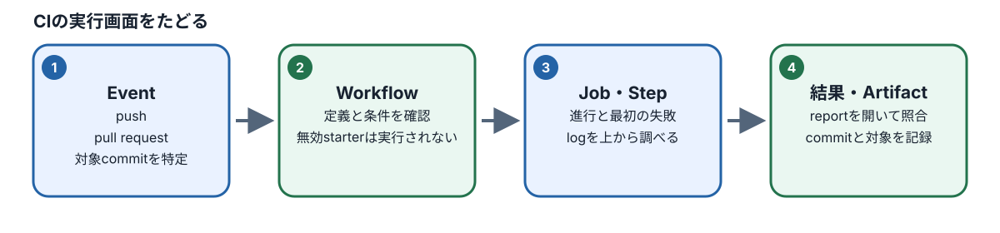
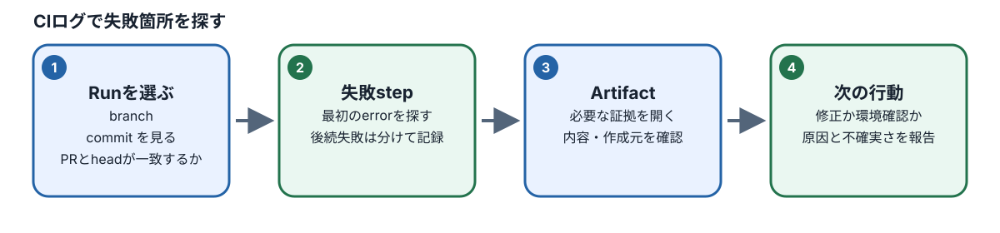

# M09：CIと品質ゲート

## このモジュールで学ぶこと

- **目的と必要な理由：** CI（継続的インテグレーション）が、どの変更に対して何を実行したかを確かめます。古いRunや別のcommitの成功を現在の確認結果と取り違えないためです。
- **到達点：** workflow、起動条件、job、stepの関係を読み、失敗した段階、対象commit、RunとArtifactの対応、費用と権限を説明できます。
- **前提と前章とのつながり：** M08のbranch、commit、Pull Requestの考え方を使います。必要なら[M08を復習](../M08/README.md)してください。YAMLやCIの経験は不要です。
- **準備するもの：** この章の.disabledのままのworkflow例と合成ログを使います。課題ではworkflowを有効化せず、実行画面がない場合も実行済みと報告しません。

> **任意の補助：** 本文と演習だけで学べます。AIチューターを使わなくても進められます。利用する場合はCodespacesでM09をロードした後に `pnpm course:tutor M09 --model provider/model-id` を実行できます。利用条件を確認して起動し、質問にはToken・API key・個人情報を含めないでください。チューターはM09の公開資料と本人の成果物を読み取り専用で使い、正式評価やファイル変更は行いません。

## 図で全体の流れをつかむ

図の番号を左から追い、各段階で「何を根拠に決めるか」「何を見て確認するか」を本文の説明と結び付けてください。図は要約です。具体的な条件・例外・手順は続く節と演習で確認します。



*図：PRのcommitからRun、job、stepへ進み、最初の失敗を探します。*



*図：Artifactは名前だけで判断せず、作成元のRunとcommitを照合します。*

CIは指定イベントでRunner上の手順を実行する仕組みです。workflowは自動化の定義、triggerは起動条件、jobは実行単位、stepはjob内の処理です。管理者が固定SHAからScenario Shopをビルドして同期し、受講者のworkflowは配布済みの`course/shop/`をServeしてTestします。受講者側で`build:web`を実行しません。ローカルとCIの環境差、対象SHA、Run、Artifactを一緒に確認します。

## workflowを読む

完成見本は`course/templates/phase3/course-e2e.workflow.yml.disabled`、M09で修正する未完成案は`workspace/M09/course-e2e.workflow.yml.disabled`です。未完成案ではPR HEADの照合、Playwright browserの導入、対象SHAと実行結果Artifactの対応を補います。M07の本人specを使うときは`PLAYWRIGHT_TEST_ROOT: workspace/M07`を明記します。M10専用fallbackを使う場合は`workspace/M10/public-sample`を指定します。どちらも同じ同期済みShopを使い、受講者側のフルBuildは行いません。修正後も`.disabled`を保ち、Templateの`.github/workflows/`には配置・有効化しません。Phase 3を選ぶ学習者が自分の作業用リポジトリで実行するかは、その環境・権限を確認したうえで別途判断します。workflowは新課程specに限定し、`permissions: contents: read`、Secretなし、deployなしを基本とします。

GitHubの実行画面を調べるときは、自分のリポジトリで **Actions** を開き、対象workflow、branch、PR、実行commitを確認します。Runを開いたらJobs一覧から失敗したjobを選び、stepを上から順に見て最初に止まった箇所とその直前のログを読みます。成功していても **Artifacts** を開き、対象commitの記録とテスト結果が同じRunから作られたことを確認します。教材の`.disabled`ファイルは実行画面に現れないため、誤ってworkflowとして有効化せず、公開された合成ログで画面上の確認順を練習します。

```yaml
name: AI QA course checks
on:
  pull_request:
permissions:
  contents: read
jobs:
  course-e2e:
    runs-on: ubuntu-latest
    steps:
      - uses: actions/checkout@v4
        with:
          ref: ${{ github.event.pull_request.head.sha }}
          persist-credentials: false
      - run: pnpm install --frozen-lockfile
      - run: pnpm exec playwright install --with-deps chromium
      - run: pnpm run training:ai-assisted-qa:test
        env:
          PLAYWRIGHT_TEST_ROOT: workspace/M07
```

このworkflowは`pull_request`のmerge commitではなく`github.event.pull_request.head.sha`をcheckoutします。GitHub Actionsの既定ではmerge commitがcheckoutされるため、受講者はPR HEADとテスト対象を明示して照合します。Playwright Configは同期manifestと`course/shop/`内のファイルを検証し、固定revisionが合わない場合はspec実行前に失敗します。同期対象の無効サンプルはcheckout直後に`git rev-parse HEAD`をArtifactへ記録し、専用のPlaywright結果と同じRunから保存します。教材例は読み方を示す短い抜粋です。完全な無効サンプルは必要なNode/pnpm準備、事前ビルド済みShopのServe、Playwright依存、Artifact保存を含み、契約テストで検証します。Templateではworkflowを有効化しません。古いSHAの成功Runを現在のHEADの証拠に使いません。

M08の実成果物がない場合は、`workspace/M09/public-sample/handoff.md`の合成branch履歴とレビュー可能なPR記録を前工程契約の代替入力として読みます。`TRAINING-*`は教材内IDで、実commit、GitHub PR、Run、Artifactの証拠ではありません。未完成workflow starterと完成見本は別入力です。

## 失敗調査・費用・権限

### 対象SHAとRunのArtifactを照合する

現在のPR HEADと、同じRunから取得したArtifact内の`target-sha.txt`を照合し、Run・Check・Artifactの由来と結果を結び付けます。GitHubがRun/CheckにPRのmerge SHAを記録する場合は、そのSHAをPR headと取り違えず、同じRunと対象PRの対応を確認します。Artifactのtarget SHAが現在のPR HEADと一致しなければ成功証拠に使いません。一致する証拠が見つからない場合は未確認と報告し、古いPASSを引き継ぎません。

### 最初の失敗箇所から結果を分類する

依存導入、Build、サーバー起動、Test、Artifact保存のどこで最初に失敗したか、Runのstepとlogで確認します。Buildが失敗してTestが始まっていなければ、Build failureとTest未実行を分けて記録します。原因を特定する前に期待値を変更したり、再実行で最初の失敗logを置き換えたりしません。

初回は合成ログの一行目から読み、最初のerrorに印を付けます。次に、Build失敗・Test失敗・Artifact未生成を別々に分類し、まだ実行されていない工程には「未実行」と書きます。最後に別のworkflow断片を読み、triggerと権限を自分で確認してから、実行可否と理由を提出メモにまとめます。

### Runner費用を確認する

Runnerの料金は公開/非公開repository、runner種別、契約、組織設定で条件が異なります。利用時点の公式条件と対象組織の契約・設定を確認し、確認できない場合は未決として扱います。一般論から無料と断定しません。

たとえばPRへのpushごとにworkflowが動き、1日5回更新するなら1日5回分の実行が候補です。1回あたりの所要時間と利用するRunner、他のworkflowも確認し、契約の無料枠・上限と比較します。この計算は回数の見積もりで、実際の請求額を保証しません。条件が確認できないときはworkflowを有効化せず、対象者に確認します。

次に、変更が少ない間だけ手動実行にする提案を考えてください。自動で検出できる頻度が下がること、誰がいつ実行するか、PRへ反映されるまでの未確認期間を記録し、費用とリスクを比較します。費用だけでなく品質ゲートの目的から選びます。

### 最小権限を設定する

課題workflowは必要な操作だけを許可し、基本は`permissions: contents: read`とします。読み取りだけのテストに書込token、Secret、deploy権限を追加しません。追加権限が必要な場合は操作と理由を明示し、教材の範囲を越える設定は有効化しません。

## 演習と提出

`workspace/M09/failure-cases.md`には、実行証拠ではないと明記したBuild失敗・Test失敗・Artifact未生成の合成ログがあります。workflow断片のtrigger・Runner・job・step・権限と、合成ログで最初に見るstepを提出メモへ対応付けます。合成ログを実際に起きたCI結果として報告しません。

## 確認と復習

[M09の確認クイズ](../../quizzes/M09.json)を回答します。SHAとRunの対応を誤った場合は「commit作成→workflow起動→Runのhead_sha→Artifact」の順に追い直します。

## 参考

- [M09の学習項目と基準](../../../../plans/2026-10-16_qa-curriculum-ai-agent-redesign_learning-map.md)
- [Phase 3無効workflow見本](../../../../../training/ai-assisted-qa-course/templates/phase3/course-e2e.workflow.yml.disabled)
- [GitHub Actionsのpull_requestイベントとSHA](https://docs.github.com/en/actions/reference/workflows-and-actions/events-that-trigger-workflows)
