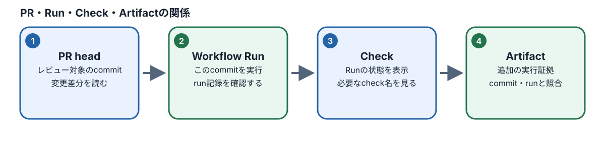
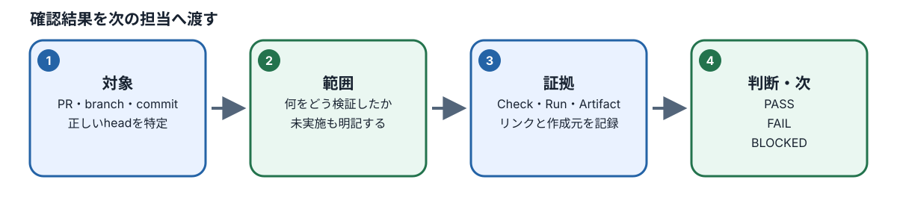

# M10：Phase 3総合演習

## このモジュールで学ぶこと

- **目的と必要な理由：** これまでのテストとCIの証拠を一つの報告へ結び、何を確認できていないかも伝えます。部分的な成功を全体の成功として扱わないためです。
- **到達点：** 公開範囲を確かめ、対象テストと最小権限のworkflowを選び、現在のPull Requestに対応するRun/Check/Artifactを確認し、残るリスクを報告できます。
- **前提と前章とのつながり：** M05〜M07のテスト実行・失敗調査と、M08〜M09のGit/CIの考え方を結びます。必要なら[M09を復習](../M09/README.md)してください。
- **準備するもの：** M10の公開証拠テンプレートと前章までの成果物、または本文のサンプルを使います。Secretを入力せず、workflowの有効化やmergeは許可された課題でない限り行いません。

> **任意の補助：** 本文と演習だけで学べます。AIチューターを使わなくても進められます。利用する場合はCodespacesでM10をロードした後に `pnpm course:tutor M10 --model provider/model-id` を実行できます。利用条件を確認して起動し、質問にはToken・API key・個人情報を含めないでください。チューターはM10の公開資料と本人の成果物を読み取り専用で使い、正式評価やファイル変更は行いません。

## 図で全体の流れをつかむ

図の番号を左から追い、各段階で「何を根拠に決めるか」「何を見て確認するか」を本文の説明と結び付けてください。図は要約です。具体的な条件・例外・手順は続く節と演習で確認します。

*図：それぞれが指すcommitと役割を照合します。*

*図：結果・証拠・未確認事項をそろえ、次の担当者が追跡できる形で渡します。*

M10ではPhase 2で動作確認した同じspecを使い、Git差分からPull Request、専用CI、PRの現在HEADに結び付くRun/Check/Artifactまでつなぎます。workflowのRun/CheckがPR merge SHA上に現れる場合があるため、PR head SHA、Runが示すSHA、Artifact内のtarget-shaを区別して確認します。テストケース一式を作り直す課題ではありません。Phase 3を受講しない場合、Phase 1・2の修了状態は変わりません。

GitHubの画面では、PRを開いて **Files changed** で対象specとworkflowの差分を確認し、**Checks** から該当Runへ移動します。Run詳細のjob・step・Artifactsを順に開き、PRが現在指すcommit、実行記録、保存された結果が同じ変更を指すか照合します。更新後に古いRunしかない場合は、新しい結果がそろうまで未確認です。ログインが必要な受講者リポジトリの画面を教材に再現したり、架空の成功画面を証拠として扱ったりしません。

## 通し演習の流れ

### diffと公開対象を確認する

1. M07から保全したspec、Config、依存、Reset、コマンド、直近Runを確認する。specがない場合はM10公開fallbackを選び、選択した入力のpathとrevisionを記録する。
2. Git差分を見て必要なコード・設定だけを選び、ログ・Secret・不要な生成物を除外する。

### 対象specとworkflowを限定する

1. 学習用リポジトリに変更をcommitし、PRにCase/仕様ID、ローカル実行結果、残る制約を書く。
2. Phase 3用workflowが同じspecを対象にすること、権限が最小でdeploy/Secretがないことをレビューする。

workflowは必要なPlaywright specとBrowserだけを指定します。Native suiteや他の教材を無条件に実行対象へ広げず、`permissions: contents: read`を基本にしてdeployやSecretを加えません。

### 対象SHAとRunの証拠を照合する

1. PR HEADとworkflow runの対象SHAを照合し、実際の結果とArtifactを確かめる。未実行なら未実行と報告する。

PRの現在HEAD、pull_requestイベントのRun、同じRunに属する成功Check、Artifact内の`target-sha.txt`とPlaywright JSONを照合します。GitHubがRun/CheckにPR merge SHAを記録しても、それをPR headと取り違えず、Artifactのtarget SHAが現在のPR headと完全一致することを確認します。不一致のArtifactや古いPASSは現在のPRの成功証拠に使わず、一致する結果がない場合は未確認とします。

例えばPRを更新する前のRunが成功し、その後にcommitを追加した場合、古いRunは前の版の証拠です。PRの現在HEADとRunの対象を確認し、同じRunのArtifactにある`target-sha.txt`とPlaywright結果を読みます。新しいHEADの結果がまだない場合は「新HEADのCIは未確認」と書き、古い成功を転記しません。Runが失敗または未開始なら、その状態と最初の失敗stepを分けて記録します。

### CI失敗の最初の段階を分類する

1. CIだけの失敗、テストの問題、製品の問題を最初のログから区別し、必要なら別Runで調べる。

最初に失敗したstepを確認し、Build失敗でTestが未開始ならその二つを分けて報告します。browser起動前の失敗をAssertion failureと断定せず、依存・Runner・browser条件を調べます。最初のRunのログを残し、追加実行は別Runとして記録します。

公開サンプルはworkflowの構成と期待契約を検査します。外部Templateから作成した学習者リポジトリの実際のRunはfixtureで代替せず、実地検証として別記録に残します。

## Phase 3修了評価

[`assessment/phase-3-rubric.md`](../../../../../training/ai-assisted-qa-course/assessment/phase-3-rubric.md)の公開観点で、差分の選択、安全なworkflow、PR headとRun/Check/Artifactの結び付き、失敗分類、未確認事項を確認します。本人はCIが確認した内容と保証しない内容を分けます。別PRや古いSHAの成功Runは現在の合格証拠にできません。

M07の本人成果物があれば`workspace/M07/repaired-assertion.spec.ts`をそのまま使い、`test_file`をこのpath、`test_root`を`workspace/M07`に設定します。本人の過去ファイルは修正・上書きしません。M07成果物がない場合はM10専用fallbackを選び、`test_file`を`workspace/M10/public-sample/handoff-smoke.spec.ts`、`test_root`を`workspace/M10/public-sample`にします。fallbackにはM07相当の安全なspec・Config・依存/Reset参照・実行結果と、M09の無効化workflow見本を同梱します。いずれの経路も同期済み`course/shop/`をServeし、学習者側で`build:web`を実行しません。workflowは本人が`.github/workflows/`へ配置して有効化します。M10ロード自体はM10の成果物だけを配置し、他モジュールを自動ロードしません。

正式評価で実Run/Check/Artifactを照合するときは`workspace/M10/ci-run-evidence.json`へ本人repo、PR番号、PRが指すcommitのID、実行記録のIDと選択specを記録します。GitHub API tokenは対象repoの読取り権限だけとし、環境変数から与えます。Tokenはファイル・提出物・AIプロンプトへ含めません。`course:check`の構造一致だけではCI証拠を認定しません。

### 結果と未確認事項を報告する

報告には変更理由、確認したdiffと仕様、対象SHA、Run/Check/Artifact、失敗・未実行の項目、残る不明点を含めます。最後の成功だけを切り出さず、現在のHEADで確認できた範囲を説明します。CIが緑でも、CIが実行していない利用条件や運用判断を完了扱いにしません。

## 確認と復習

[M10の確認クイズ](../../quizzes/M10.json)を回答します。SHA・Run・Artifactのいずれかが一致しない場合は、その組を証拠として採用せず、現在のHEADで検証を再実行します。

## 参考

- [M10の学習項目](../../../../plans/2026-10-16_qa-curriculum-ai-agent-redesign_learning-map.md)
- [Phase 3評価基準](../../../../../training/ai-assisted-qa-course/assessment/phase-3-rubric.md)
