# Admin Catalog

## Purpose / Scope

オペレーターおよび管理者が、Product Aggregate、Category、Brand、Image Asset、および公開状態を管理する際の仕様規約を定義します。

## Business Rules

### BR-ADMINCAT-001 — Productの公開可否と状態遷移を検証する

公開するには、有効な（active）Category、有効なBrand、有効なSKU、Image、およびPrimary Imageが必須です。通常のProduct Aggregate編集処理ではStatusを変更せず、専用の状態変更処理のみが状態遷移を実行します。

### BR-ADMINCAT-002 — Product AggregateとAsset関連をTransactionで更新する

Product、Variant、Image関連、初期在庫履歴、およびReview Summaryを同一トランザクション内で一貫性を保って保存し、商品編集処理によって既存在庫やリリース済みのアセットバイナリ（Release済みAsset Binary）が損なわれないようにします。

## UI / Behavior Contract

オペレーターおよび管理者は未保存フォームのプレビューを確認できますが、プレビューによってデータベースへの書き込みは行われません。Draft（下書き）状態でのみ許可されるCode/SKUの変更と、公開後に可能となるSKUの追加や無効化の境界条件を定義します。

### SCREEN-ADMIN-DASHBOARD — Admin Dashboard

Screen Catalog: [Screen Catalog](../screen-catalog.md)

#### Functions

- オペレーターおよび管理者が管理対象の概要と主要な管理動線を確認する。
- デスクトップ表示の要件を満たさないビューポートでは、管理操作UIの代わりに警告（Warning）を表示する。

#### Important UI States

| State slug | Type | Audience / Role | Condition / Scenario | Expected UI | Visual requirement | Required platforms | Visual detail | Related Oracle |
|---|---|---|---|---|---|---|---|---|
| `default` | baseline | `operator, admin` | `default` | 管理概要とナビゲーションを表示する。 | `required` | `web-desktop, web-tablet` | `-` | `BR-ADMINCAT-001`, `AC-ADMINCAT-001` |
| `admin-mobile-warning` | responsive | `operator, admin` | `default` | 1024px未満では専用の警告メッセージを表示する。 | `required` | `web-mobile, web-small-mobile` | `-` | `BR-ADMINCAT-001`, `AC-ADMINCAT-001` |

#### Visual References

##### `default`

###### Web Desktop

[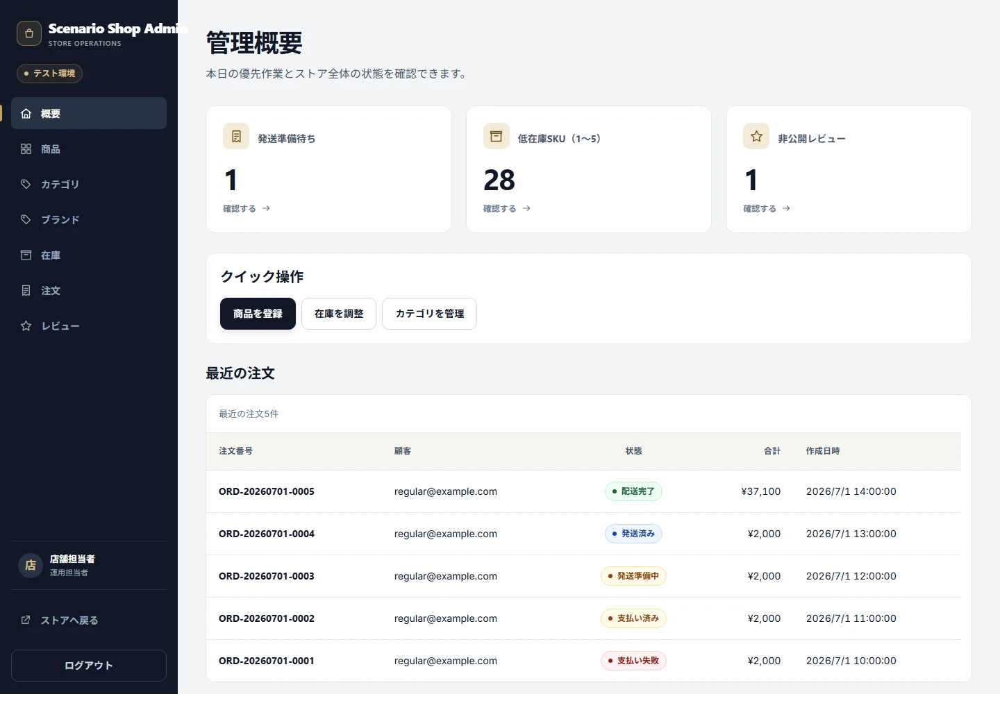](../assets/screens/SCREEN-ADMIN-DASHBOARD/default/web-desktop.webp)

###### Web Tablet

[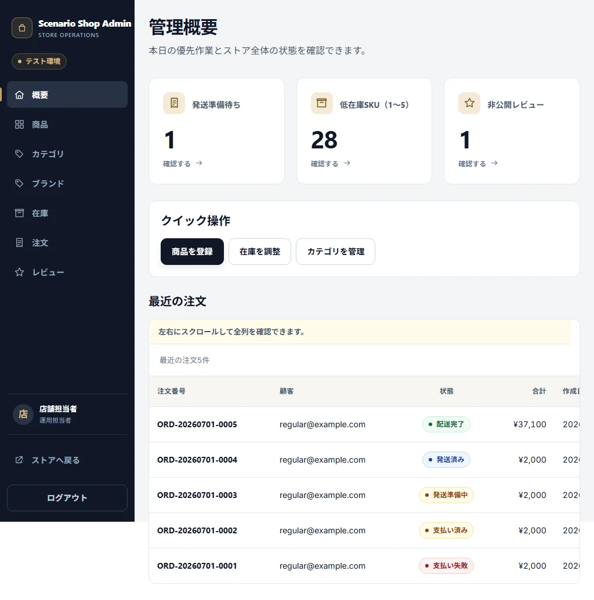](../assets/screens/SCREEN-ADMIN-DASHBOARD/default/web-tablet.webp)

##### `admin-mobile-warning`

###### Web Mobile

[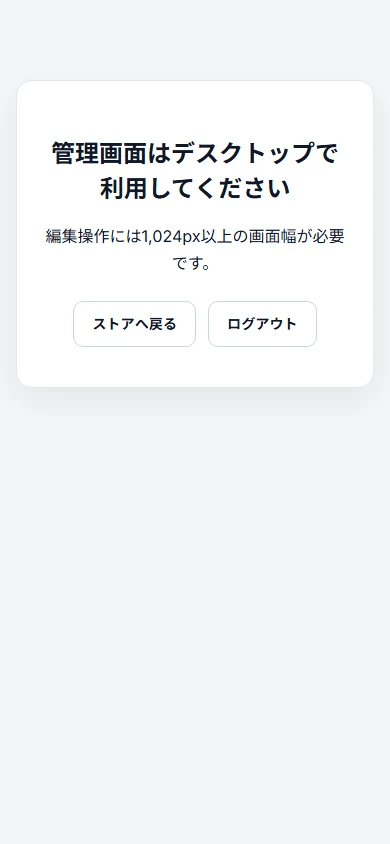](../assets/screens/SCREEN-ADMIN-DASHBOARD/admin-mobile-warning/web-mobile.webp)

###### Web Small Mobile

[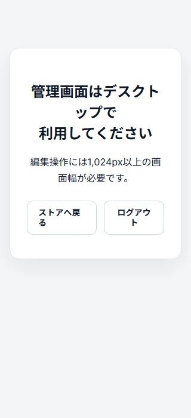](../assets/screens/SCREEN-ADMIN-DASHBOARD/admin-mobile-warning/web-small-mobile.webp)

### SCREEN-ADMIN-PRODUCTS — Admin Products

Screen Catalog: [Screen Catalog](../screen-catalog.md)

#### Functions

- 商品（Product）、公開状態、フィルター条件、一括操作の結果を表示する。
- 商品新規登録（Product New）および詳細（Product Detail）への管理動線を提供する。

#### Important UI States

| State slug | Type | Audience / Role | Condition / Scenario | Expected UI | Visual requirement | Required platforms | Visual detail | Related Oracle |
|---|---|---|---|---|---|---|---|---|
| `default` | baseline | `operator, admin` | `default` | 商品一覧と管理アクションを表示する。 | `required` | `web-desktop, web-tablet` | `-` | `BR-ADMINCAT-001`, `AC-ADMINCAT-001` |
| `many-products` | domain | `operator, admin` | `many-products` | 多数の商品一覧とフィルターを表示する。 | `required` | `web-desktop` | `-` | `BR-ADMINCAT-001`, `AC-ADMINCAT-001` |

#### Visual References

##### `default`

###### Web Desktop

[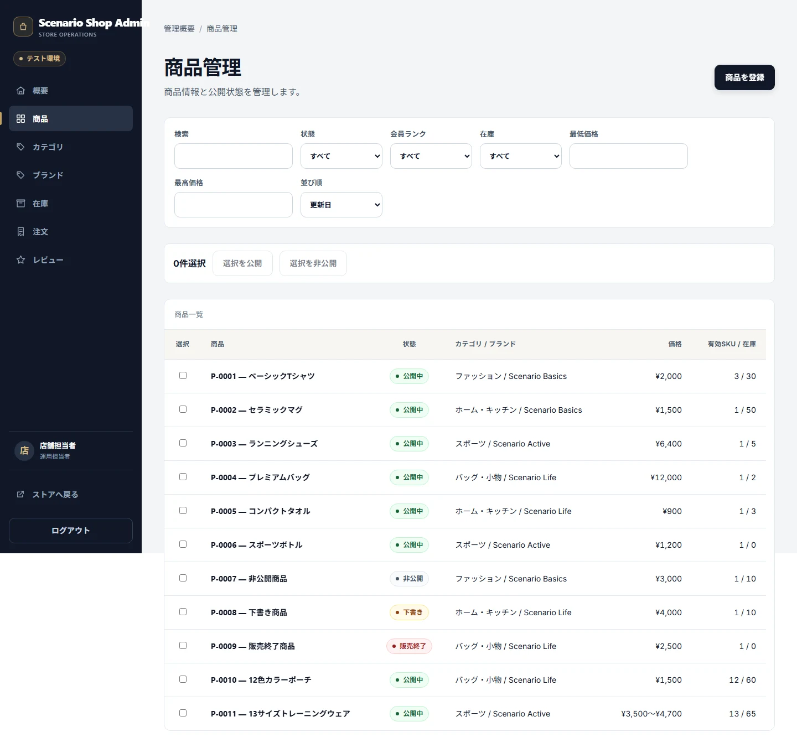](../assets/screens/SCREEN-ADMIN-PRODUCTS/default/web-desktop.webp)

###### Web Tablet

[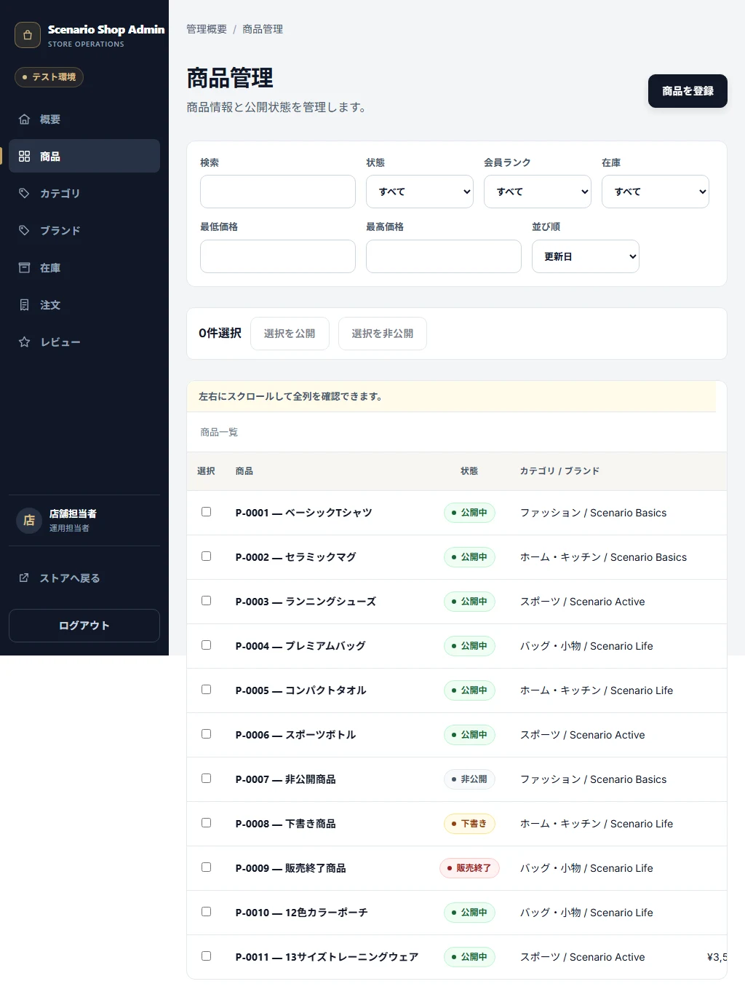](../assets/screens/SCREEN-ADMIN-PRODUCTS/default/web-tablet.webp)

##### `many-products`

###### Web Desktop

[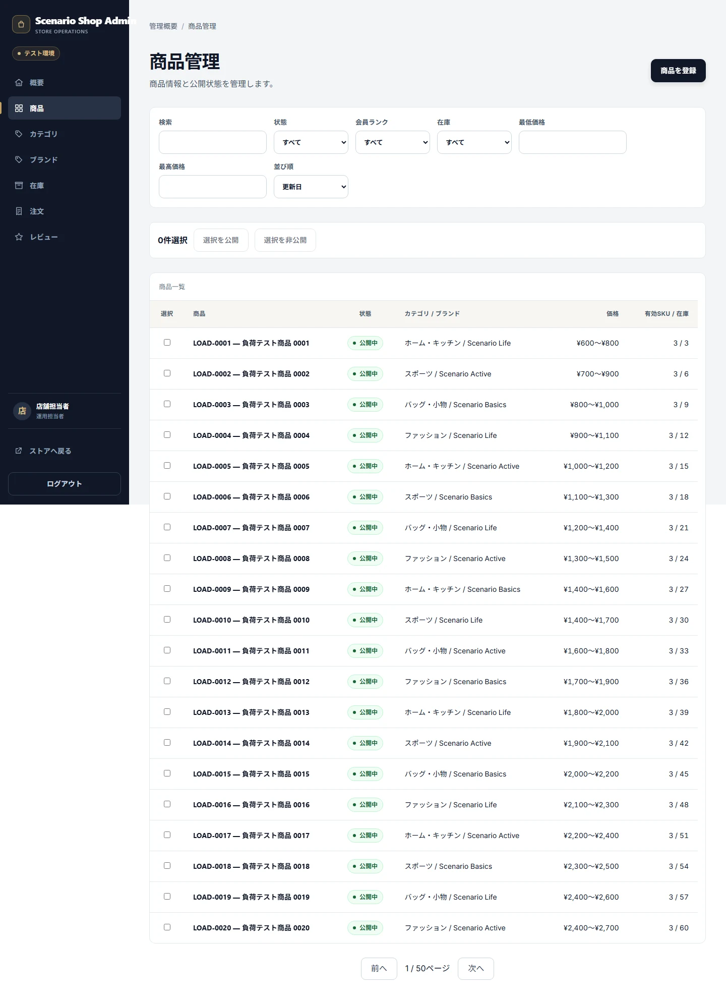](../assets/screens/SCREEN-ADMIN-PRODUCTS/many-products/web-desktop.webp)

### SCREEN-ADMIN-PRODUCT-NEW — Admin Product New

Screen Catalog: [Screen Catalog](../screen-catalog.md)

#### Functions

- Product Aggregateの新規入力、バリデーション、プレビュー機能を提供する。
- 保存前のプレビュー表示中はデータベースへ書き込まれないことを、画面表示上でも明確に区別する。

#### Important UI States

| State slug | Type | Audience / Role | Condition / Scenario | Expected UI | Visual requirement | Required platforms | Visual detail | Related Oracle |
|---|---|---|---|---|---|---|---|---|
| `default` | baseline | `operator, admin` | `default` | 新規商品登録フォームを表示する。 | `required` | `web-desktop, web-tablet` | `-` | `BR-ADMINCAT-001`, `AC-ADMINCAT-001` |

#### Visual References

##### `default`

###### Web Desktop

[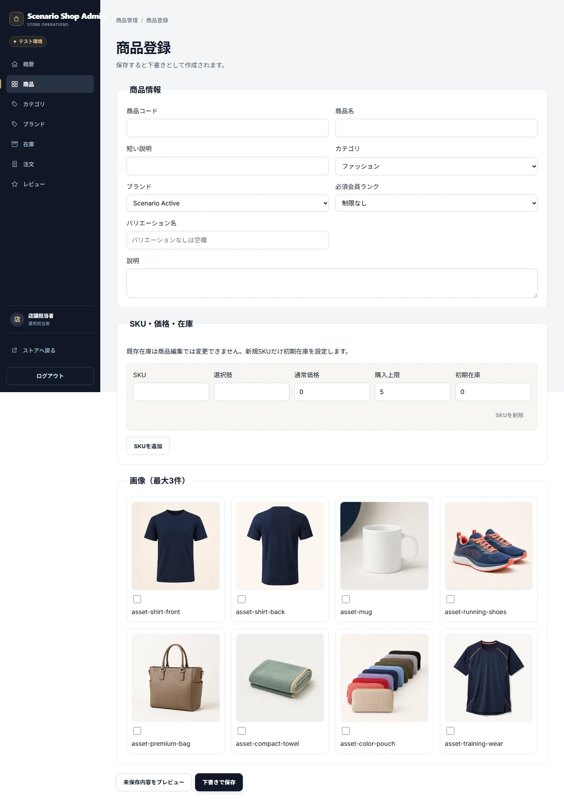](../assets/screens/SCREEN-ADMIN-PRODUCT-NEW/default/web-desktop.webp)

###### Web Tablet

[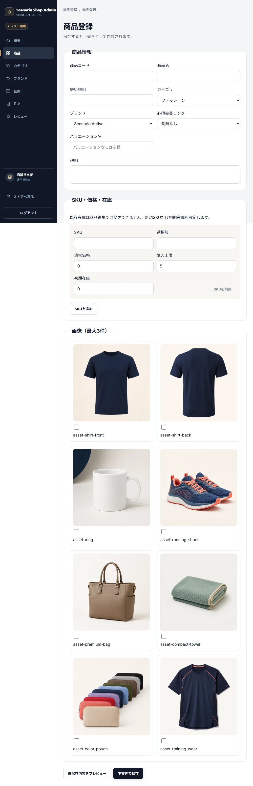](../assets/screens/SCREEN-ADMIN-PRODUCT-NEW/default/web-tablet.webp)

### SCREEN-ADMIN-PRODUCT-DETAIL — Admin Product Detail / Edit

Screen Catalog: [Screen Catalog](../screen-catalog.md)

#### Functions

- 既存商品のAggregate、Variant、Image、在庫、および公開状態を編集する。
- 未保存変更（Dirty）、プレビュー、販売終了（Discontinue）、削除不可（Delete blocked）などの確認ダイアログやステータスを表示する。

#### Important UI States

| State slug | Type | Audience / Role | Condition / Scenario | Expected UI | Visual requirement | Required platforms | Visual detail | Related Oracle |
|---|---|---|---|---|---|---|---|---|
| `default` | baseline | `operator, admin` | `default` | 商品編集フォームと現在のステータスを表示する。 | `required` | `web-desktop, web-tablet` | `-` | `BR-ADMINCAT-001`, `AC-ADMINCAT-001` |
| `discontinue-confirm` | conflict | `operator, admin` | `default` | 販売終了の確認ダイアログを表示する。 | `required` | `web-desktop` | `-` | `BR-ADMINCAT-001`, `AC-ADMINCAT-001` |

#### Visual References

##### `default`

###### Web Desktop

[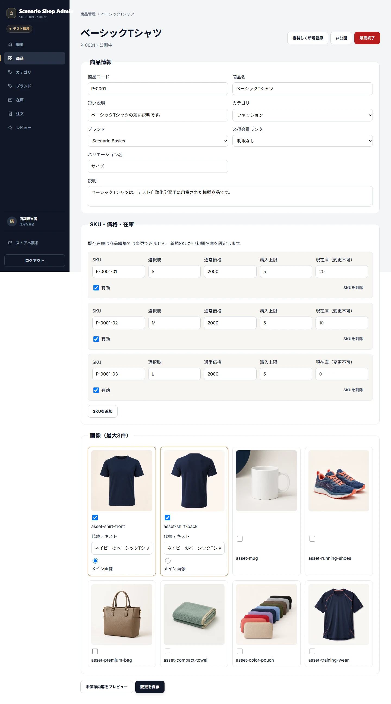](../assets/screens/SCREEN-ADMIN-PRODUCT-DETAIL/default/web-desktop.webp)

###### Web Tablet

[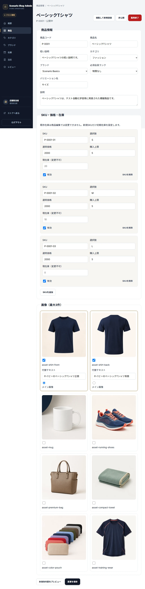](../assets/screens/SCREEN-ADMIN-PRODUCT-DETAIL/default/web-tablet.webp)

##### `discontinue-confirm`

###### Web Desktop

### SCREEN-ADMIN-CATEGORIES — Admin Categories

Screen Catalog: [Screen Catalog](../screen-catalog.md)

#### Functions

- カテゴリーの一覧表示、新規作成、編集、およびバリデーション機能を提供する。

#### Important UI States

| State slug | Type | Audience / Role | Condition / Scenario | Expected UI | Visual requirement | Required platforms | Visual detail | Related Oracle |
|---|---|---|---|---|---|---|---|---|
| `default` | baseline | `operator, admin` | `default` | カテゴリー一覧と管理フォームを表示する。 | `required` | `web-desktop, web-tablet` | `-` | `BR-ADMINCAT-002`, `AC-ADMINCAT-002` |

#### Visual References

##### `default`

###### Web Desktop

[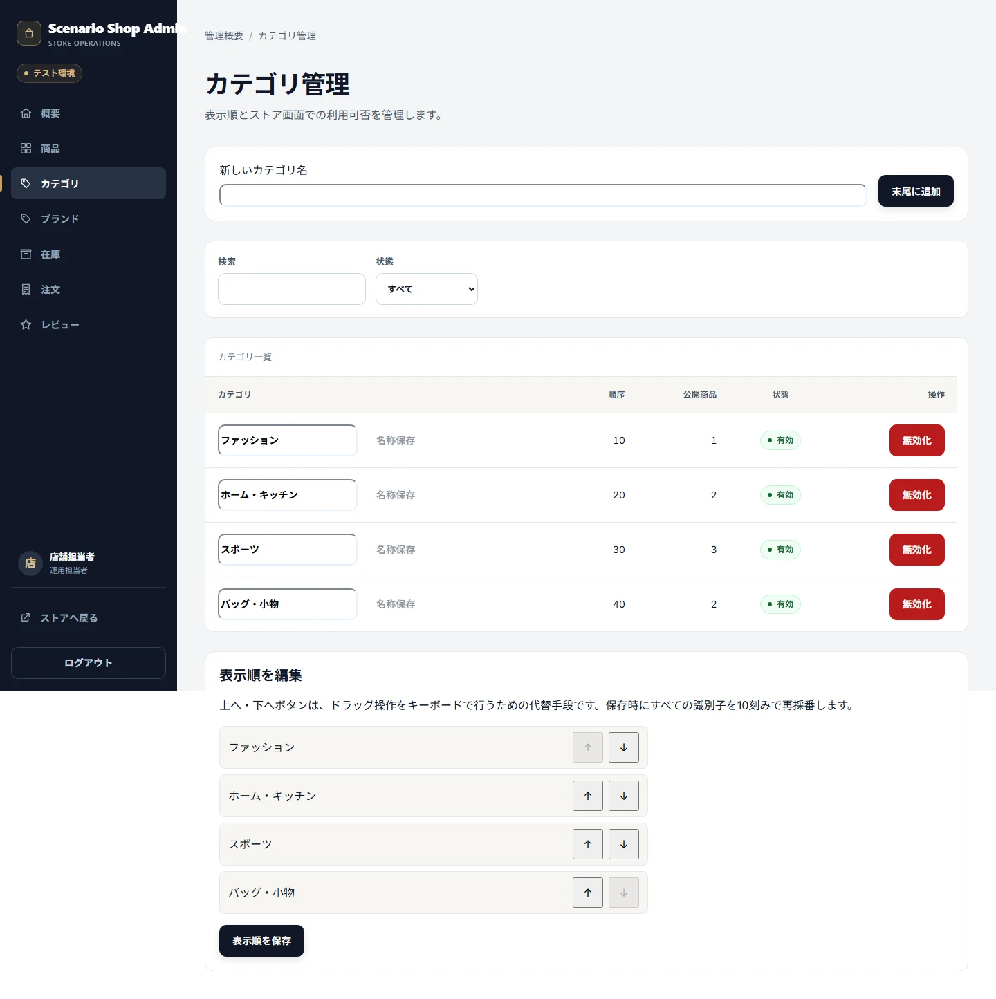](../assets/screens/SCREEN-ADMIN-CATEGORIES/default/web-desktop.webp)

###### Web Tablet

[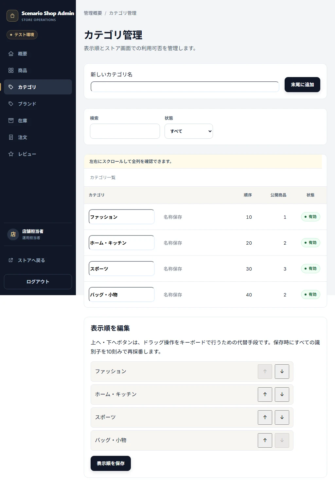](../assets/screens/SCREEN-ADMIN-CATEGORIES/default/web-tablet.webp)

### SCREEN-ADMIN-BRANDS — Admin Brands

Screen Catalog: [Screen Catalog](../screen-catalog.md)

#### Functions

- ブランドの一覧表示、新規作成、編集、およびバリデーション機能を提供する。

#### Important UI States

| State slug | Type | Audience / Role | Condition / Scenario | Expected UI | Visual requirement | Required platforms | Visual detail | Related Oracle |
|---|---|---|---|---|---|---|---|---|
| `default` | baseline | `operator, admin` | `default` | ブランド一覧と管理フォームを表示する。 | `required` | `web-desktop, web-tablet` | `-` | `BR-ADMINCAT-002`, `AC-ADMINCAT-002` |

#### Visual References

##### `default`

###### Web Desktop

[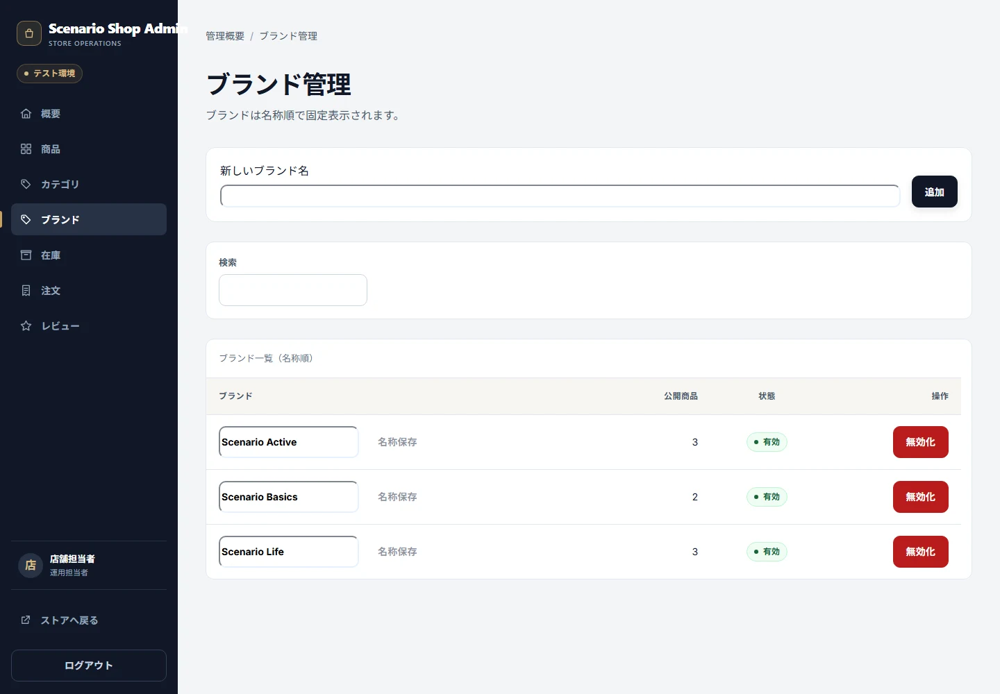](../assets/screens/SCREEN-ADMIN-BRANDS/default/web-desktop.webp)

###### Web Tablet

[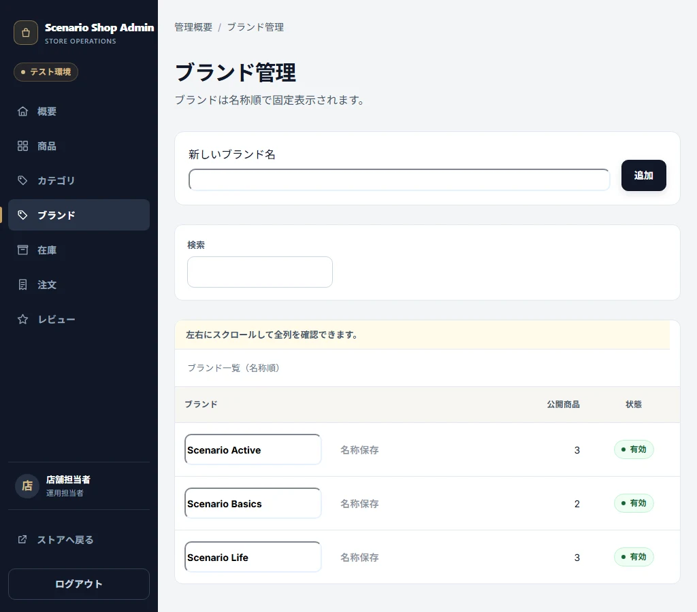](../assets/screens/SCREEN-ADMIN-BRANDS/default/web-tablet.webp)

## Acceptance Criteria

### Criteria

#### AC-ADMINCAT-001 — 不完全なProductを公開しない

Related BR: `BR-ADMINCAT-001`

必須となるCategory、Brand、SKU、Image、Primary Imageの条件を満たさないProductは公開されず、許可された状態遷移のみが正常に完了すること。

#### AC-ADMINCAT-002 — Previewと保存の責務を分離する

Related BR: `BR-ADMINCAT-002`

プレビュー、保存、初期在庫、Review Summary、アセット関連の各処理がトランザクション規約を満たし、プレビューの実行のみではデータベースが変更されないこと。

## Executable Canonical Sources

- `src/application/use-cases/admin-product-use-cases.ts`
- `src/application/use-cases/admin-master-use-cases.ts`
- `src/domain/policies/state-transitions.ts`
- `src/infrastructure/image-assets/`
- `app/admin/products/`, `app/admin/categories/`, `app/admin/brands.tsx`
