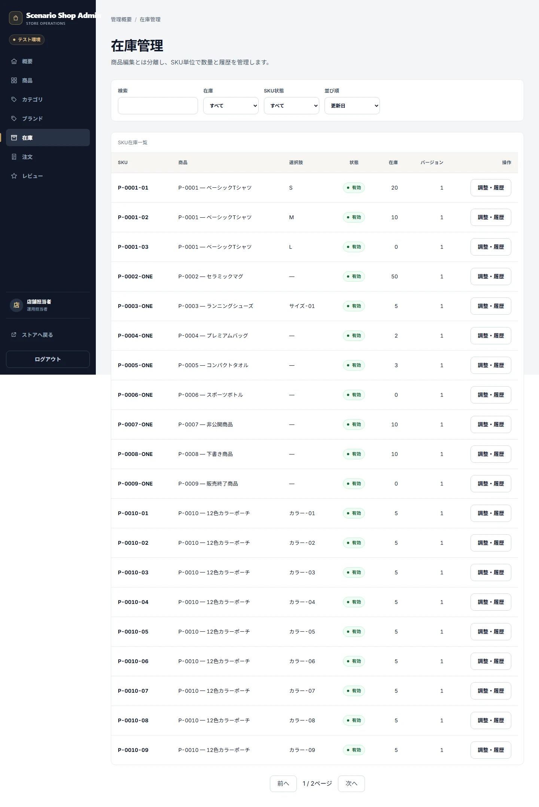
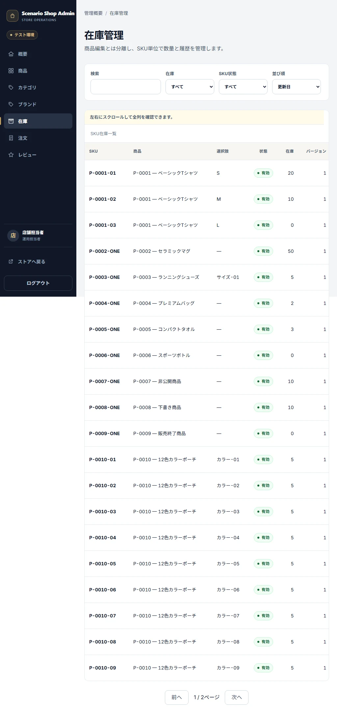

# Admin Inventory

## Purpose / Scope

オペレーターおよび管理者が、SKU単位の在庫と在庫履歴を管理する際の仕様・規約を定義します。

## Business Rules

### BR-ADMININV-001 — 在庫はSKU単位の非負整数として調整する

在庫数0は `out_of_stock`、1〜5は `low_stock`、6以上は `available` として扱い、在庫数0を `low_stock` へ二重計上しません。

### BR-ADMININV-002 — すべての在庫変更を履歴と一緒に保存する

手動調整（Manual adjustment）および決済成功時の購入による減算は、変更前後の値（Before/After）、理由、実行者（Actor）、注文（Order）を含む履歴とともに、同一トランザクション内で保存します。

## UI / Behavior Contract

在庫一覧ではSKU単位の絞り込み（Filter）、検索（Search）、並び替え（Sort）機能を提供し、商品一覧における総在庫（Aggregate stock）表示とは明確に境界を分離します。処理の失敗時に中途半端な部分更新を表示することはありません。

### SCREEN-ADMIN-INVENTORIES — Admin Inventories

Screen Catalog: [Screen Catalog](../screen-catalog.md)

#### Functions

- SKU単位の在庫数、ステータス分類、絞り込み、在庫調整、変更履歴を表示する。
- 0 / 1〜5 / 6以上の境界値判定とバージョン競合（Version Conflict）について明示する。

#### Important UI States

| State slug | Type | Audience / Role | Condition / Scenario | Expected UI | Visual requirement | Required platforms | Visual detail | Related Oracle |
|---|---|---|---|---|---|---|---|---|
| `default` | baseline | `operator, admin` | `default` | 在庫一覧とステータス分類を表示する。 | `required` | `web-desktop, web-tablet` | `-` | `BR-ADMININV-001`, `AC-ADMININV-001` |
| `stock-boundaries` | boundary | `operator, admin` | `default` | 0、1〜5、6以上をそれぞれ異なるステータスとして表示する。 | `required` | `web-desktop` | `-` | `BR-ADMININV-001`, `AC-ADMININV-001` |

#### Visual References

##### `default`

###### Web Desktop

###### Web Tablet

##### `stock-boundaries`

###### Web Desktop

## Acceptance Criteria

### Criteria

#### AC-ADMININV-001 — 在庫状態を正しく分類する

Related BR: `BR-ADMININV-001`

0、1、5、6の各境界値において、SKU一覧と商品概要（Product Overview）の表示内容および件数が分類規約と一致します。

#### AC-ADMININV-002 — 在庫履歴をAtomicに保存する

Related BR: `BR-ADMININV-002`

在庫調整または購入成功時に在庫数と履歴の内容が一致し、処理失敗時は双方が変更されず元の状態を維持します。

## Executable Canonical Sources

- `src/application/use-cases/admin-operations-use-cases.ts`
- `src/domain/contracts/entities.ts`
- `src/infrastructure/database/dexie/`
- `app/admin/inventories.tsx`
