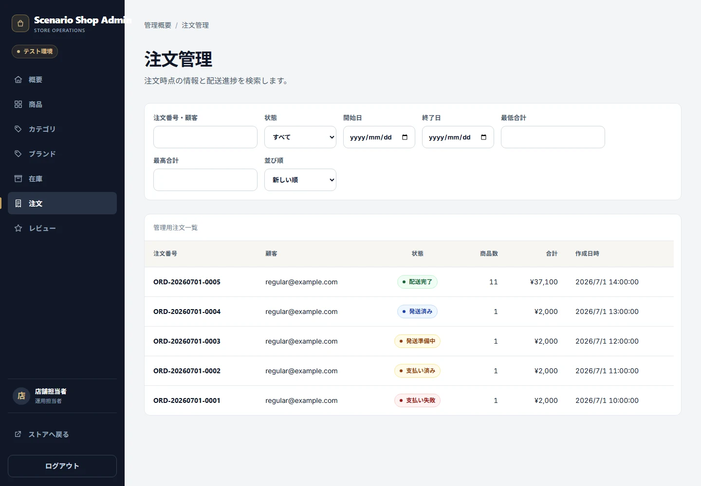
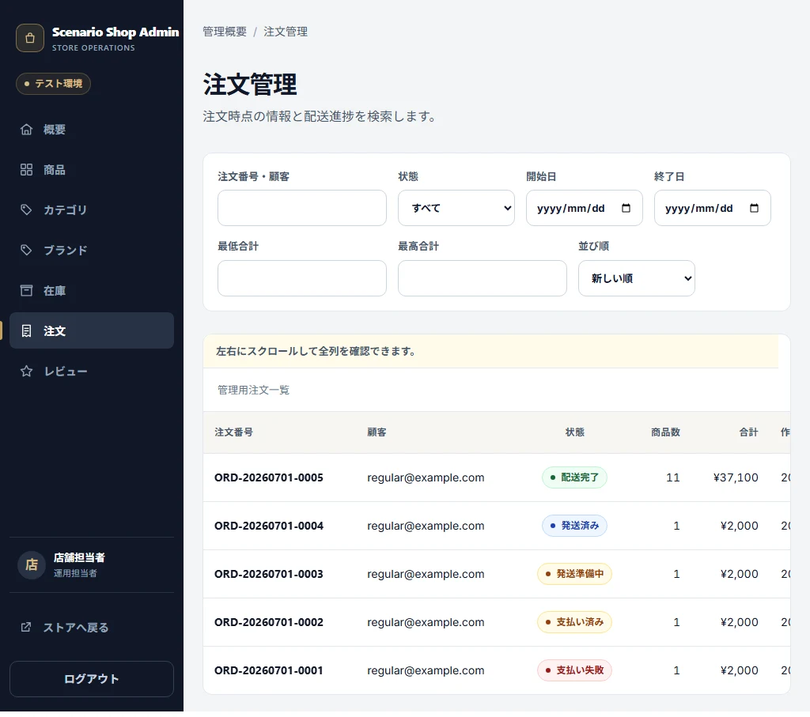
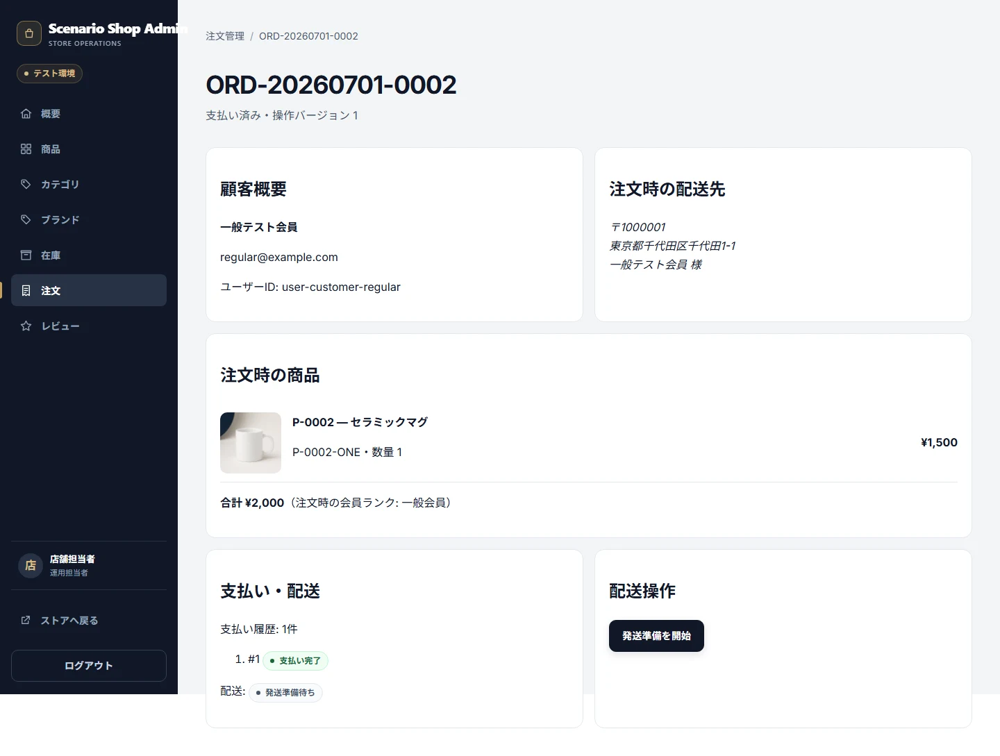

# Admin Orders

## Purpose / Scope

オペレーターおよび管理者が、注文（Order）を準備中、発送済み、配送完了へと進行させるための管理契約（仕様）を定義します。

## Business Rules

### BR-ADMINORD-001 — OrderとShipmentを同じ状態順で進める

「paid → preparing」「preparing → shipped」「shipped → delivered」の遷移のみを許可し、対応する配送情報（Shipment）も同一トランザクションで更新します。

## UI / Behavior Contract

注文一覧および注文詳細では、顧客スナップショット（Customer Snapshot）、現在の状態、次のアクション、注文アクションバージョン、配送情報を表示します。古いバージョンでの操作は競合（Conflict）として拒否します。

### SCREEN-ADMIN-ORDERS — Admin Orders

Screen Catalog: [Screen Catalog](../screen-catalog.md)

#### Functions

- 注文一覧、決済ステータス、配送ステータス、フィルターを表示する。
- 注文詳細のバージョン付きアクションへ進める。

#### Important UI States

| State slug | Type | Audience / Role | Condition / Scenario | Expected UI | Visual requirement | Required platforms | Visual detail | Related Oracle |
|---|---|---|---|---|---|---|---|---|
| `default` | baseline | `operator, admin` | `orders-phase1-statuses` | 複数ステータスの注文一覧を表示する。 | `required` | `web-desktop, web-tablet` | `-` | `BR-ADMINORD-001`, `AC-ADMINORD-001` |

#### Visual References

##### `default`

###### Web Desktop

###### Web Tablet

### SCREEN-ADMIN-ORDER-DETAIL — Admin Order Detail

Screen Catalog: [Screen Catalog](../screen-catalog.md)

#### Functions

- 顧客スナップショット、注文・配送ステータス、次のアクション、バージョンを表示する。
- 許可された状態遷移のみを実行する。

#### Important UI States

| State slug | Type | Audience / Role | Condition / Scenario | Expected UI | Visual requirement | Required platforms | Visual detail | Related Oracle |
|---|---|---|---|---|---|---|---|---|
| `default` | baseline | `operator, admin` | `orders-phase1-statuses` | 注文詳細と次のアクションを表示する。 | `required` | `web-desktop, web-tablet` | `-` | `BR-ADMINORD-001`, `AC-ADMINORD-001` |

#### Visual References

##### `default`

###### Web Desktop

###### Web Tablet

## Acceptance Criteria

### Criteria

#### AC-ADMINORD-001 — 配送操作をVersion付きで実行する

Related BR: `BR-ADMINORD-001`

準備、発送、配送完了が正しい順序とバージョンに従って実行され、注文のみ、または配送情報のみが単独で更新される不整合な状態を発生させません。

## Executable Canonical Sources

- `src/application/use-cases/admin-operations-use-cases.ts`
- `src/domain/policies/state-transitions.ts`
- `app/admin/orders/`