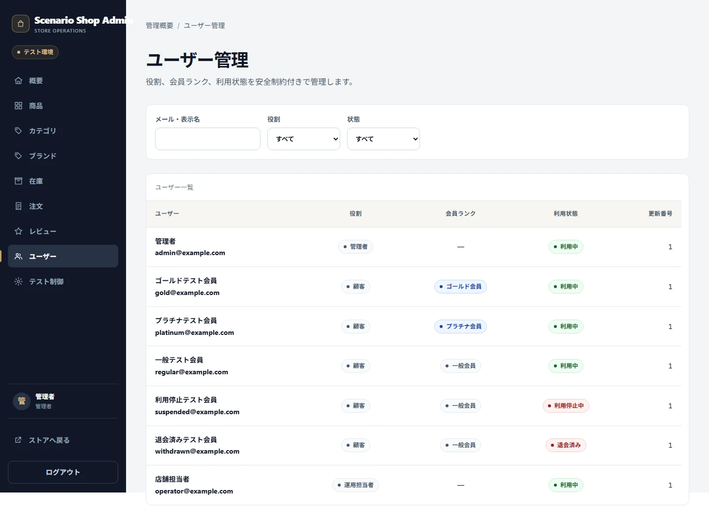
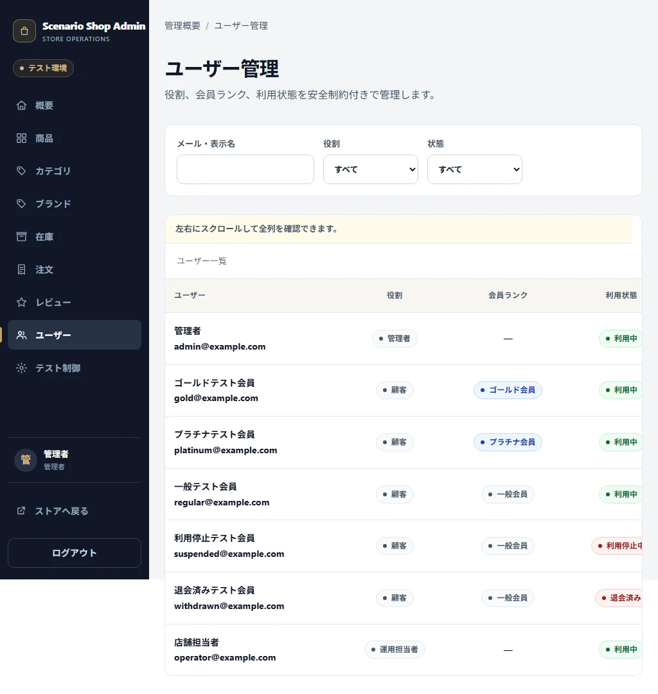
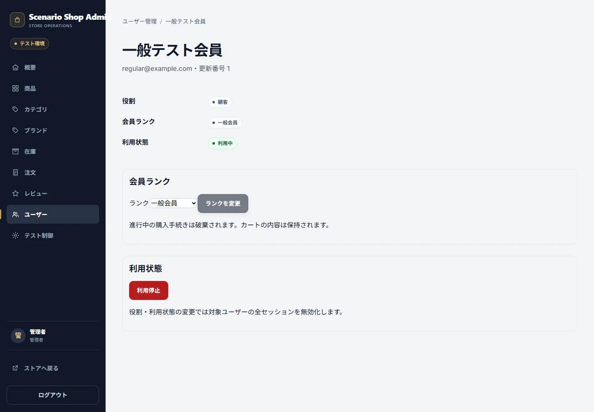
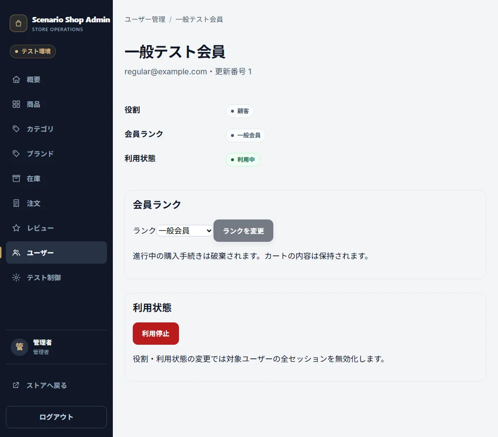

# Admin Users

## Purpose / Scope

管理者がユーザーの会員ランク（Customer Rank）、オペレーター／管理者ロール（Operator/Admin Role）、アカウントステータス（Account Status）を管理する契約（コントラクト）を定義します。

## Business Rules

### BR-ADMINUSER-001 — User変更はRole、Status、最終Admin保護を守る

会員ランクはカスタマー内のみ、ロールはoperator／admin間のみ、ステータスはactive／suspended間のみ変更可能です。最後の管理者の変更、自身の権限を失わせる自己破壊的変更、退会済み（withdrawn）ユーザーに対する変更操作は拒否します。

## UI / Behavior Contract

操作を拒否する際はその理由を提示し、操作者自身のアカウントに対するロール／ステータス変更や、退会済み（withdrawn）ユーザーに対する更新（Mutation）を操作可能に見せないようにします。ステータス変更時は、必要なセッション（Session）やチェックアウト（Checkout）の無効化について利用者へ説明を表示します。

### SCREEN-ADMIN-USERS — Admin Users

Screen Catalog: [Screen Catalog](../screen-catalog.md)

#### Functions

- ユーザーのロール、ランク、アカウントステータス、および絞り込み条件（フィルター）を表示する。
- 操作者自身、退会済み（withdrawn）、最後の管理者などに対する変更（Mutation）の境界条件を説明する。

#### Important UI States

| State slug | Type | Audience / Role | Condition / Scenario | Expected UI | Visual requirement | Required platforms | Visual detail | Related Oracle |
|---|---|---|---|---|---|---|---|---|
| `default` | baseline | `admin` | `default` | ユーザー一覧とステータス／ロールを表示する。 | `required` | `web-desktop, web-tablet` | `-` | `BR-ADMINUSER-001`, `AC-ADMINUSER-001` |

#### Visual References

##### `default`

###### Web Desktop

###### Web Tablet

### SCREEN-ADMIN-USER-DETAIL — Admin User Detail

Screen Catalog: [Screen Catalog](../screen-catalog.md)

#### Functions

- ユーザー詳細と、許可されたロール／ランク／ステータスの操作を表示する。
- 自己破壊的変更、退会済み（withdrawn）ユーザーに対する変更操作（Mutation）、最後の管理者に対する変更操作をUI上で操作可能に見せない。

#### Important UI States

| State slug | Type | Audience / Role | Condition / Scenario | Expected UI | Visual requirement | Required platforms | Visual detail | Related Oracle |
|---|---|---|---|---|---|---|---|---|
| `default` | baseline | `admin` | `default` | ユーザー詳細と保護理由を表示する。 | `required` | `web-desktop, web-tablet` | `-` | `BR-ADMINUSER-001`, `AC-ADMINUSER-001` |

#### Visual References

##### `default`

###### Web Desktop

###### Web Tablet

## Acceptance Criteria

### Criteria

#### AC-ADMINUSER-001 — User Mutationの境界を守る

Related BR: `BR-ADMINUSER-001`

許可されたランク／ロール／ステータスの変更のみが成功し、最後の管理者の変更、自身に対する変更、退会済み（withdrawn）ユーザーの変更、ロールの不整合は拒否されます。

## Executable Canonical Sources

- `src/application/use-cases/admin-master-use-cases.ts`
- `src/domain/policies/permissions.ts`
- `app/admin/users/`
