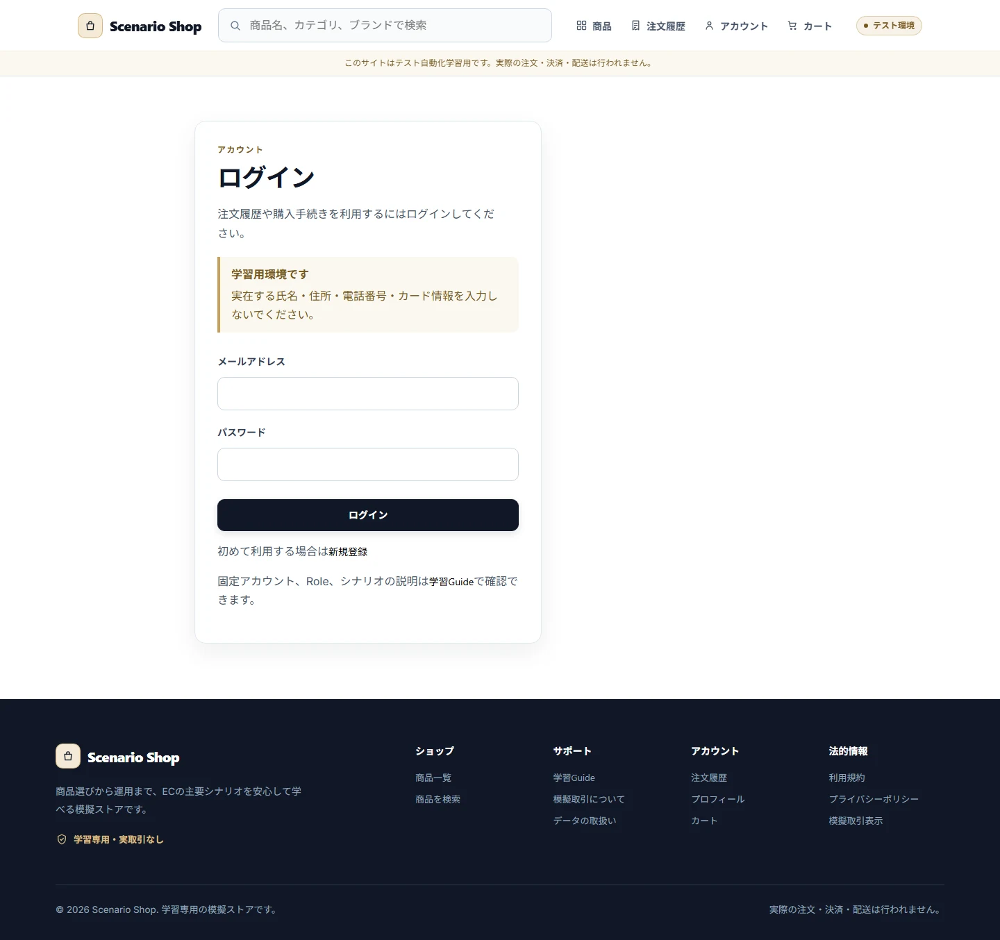
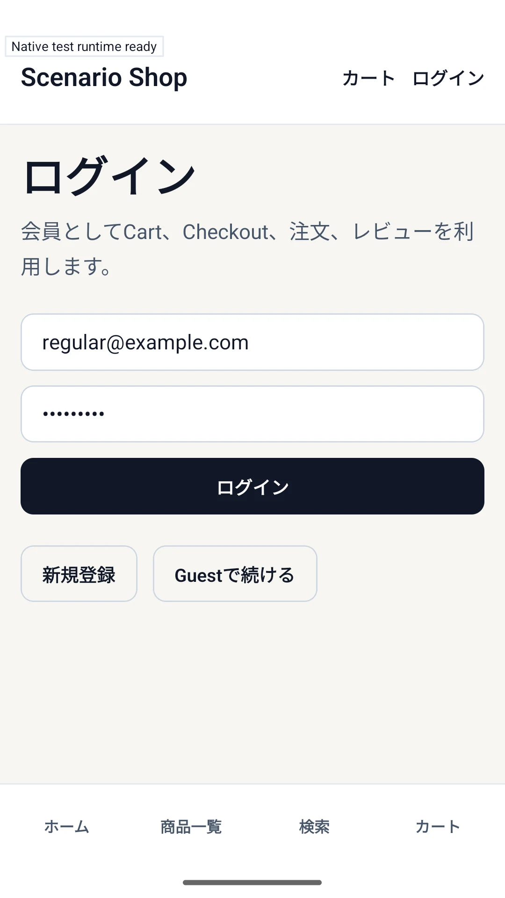
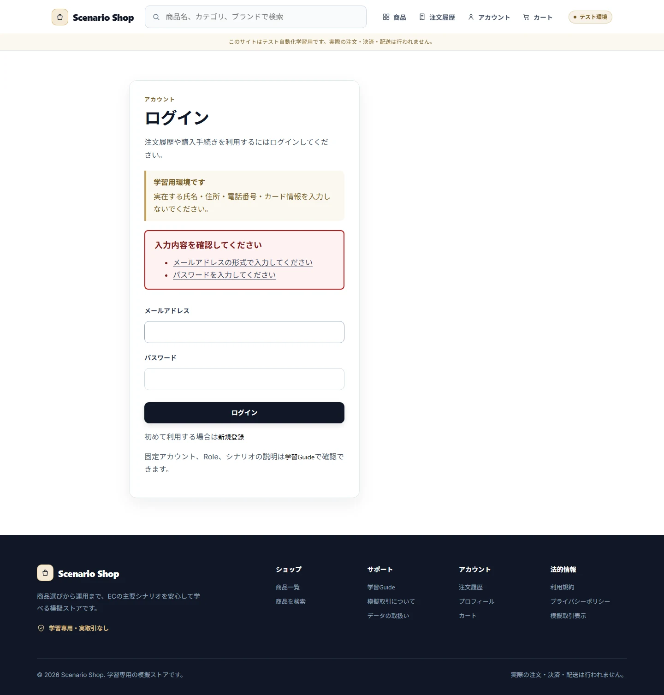
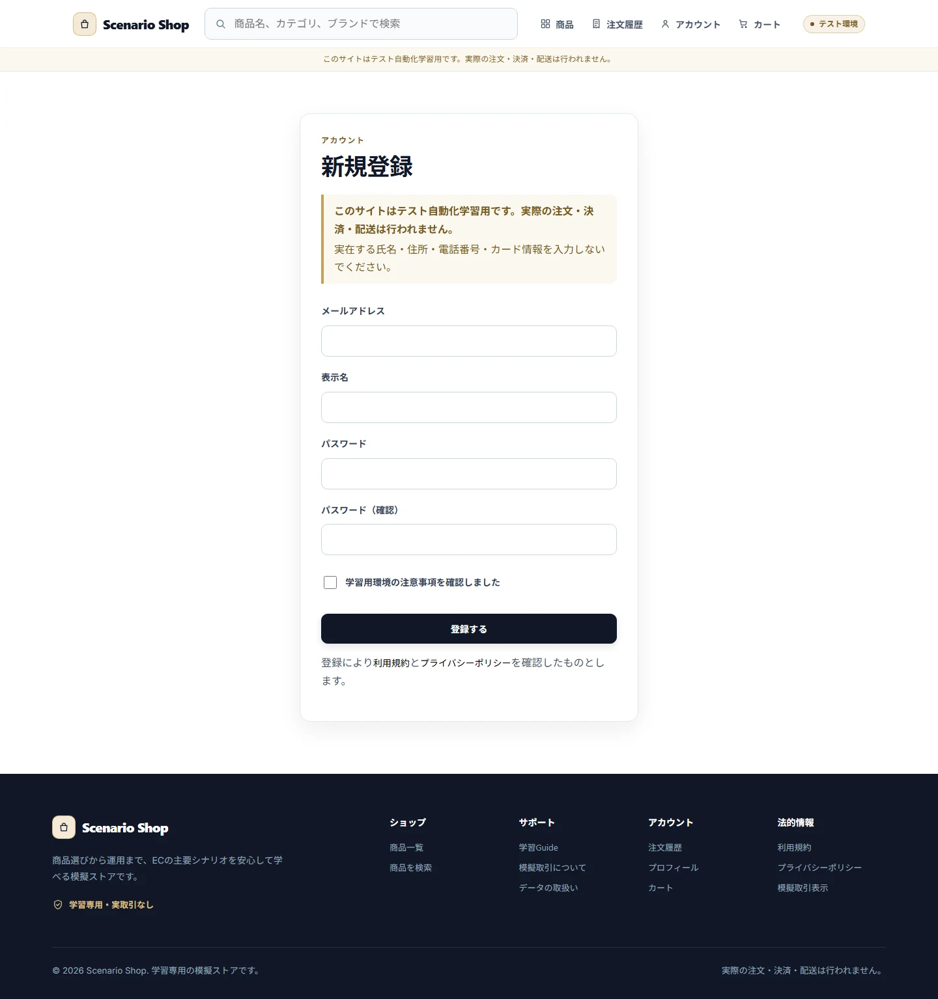
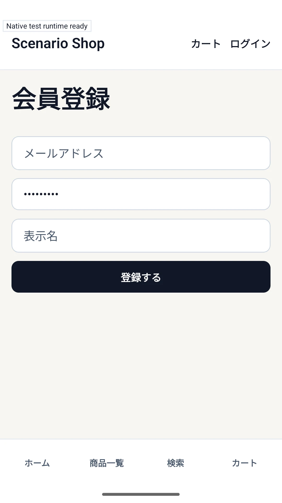
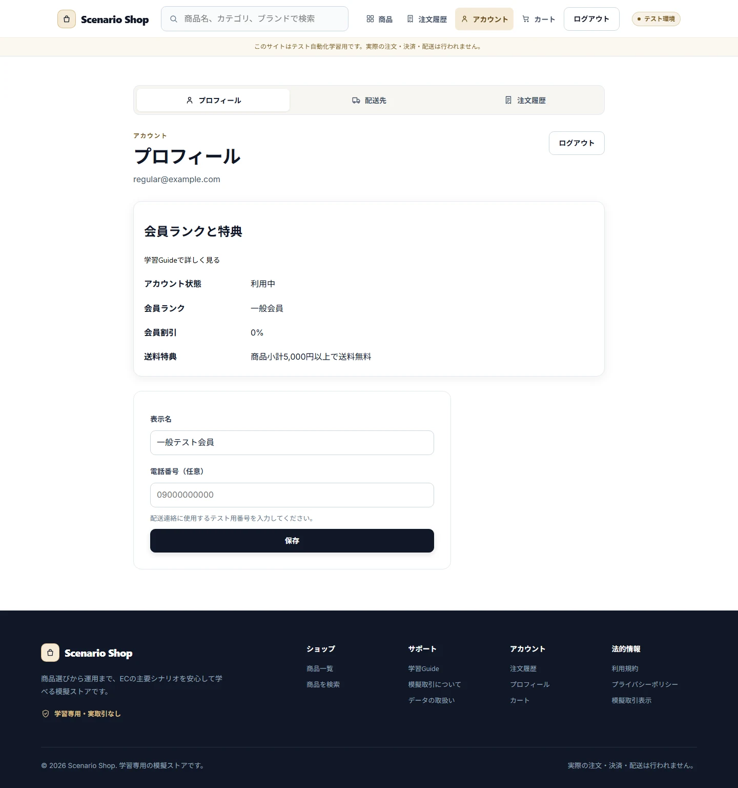
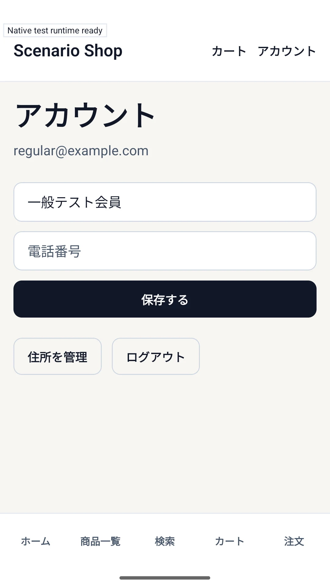

# 認証

## 目的・対象範囲

ログイン、サインアップ、セッション管理、アカウント状態、ロール、顧客向けリダイレクト先、およびゲストカート統合について定義します。

## ビジネスルール

### BR-AUTH-001 — ログイン時はアカウント状態とロールを検証してセッションを生成する

有効（`active`）なアカウントのみがログインできます。これにはサインアップによって作成された有効なアカウントも含まれます。停止中（`suspended`）または退会済み（`withdrawn`）のアカウントからのログインは拒否し、セッションを作成しません。

### BR-AUTH-002 — 顧客以外の権限を購入導線へ渡さない

顧客（`customer`）のみがチェックアウトおよび顧客データを利用し、オペレーター（`operator`）や管理者（`admin`）はストア管理のみを行います。ログイン成功時も、各ロールに応じた専用画面へ遷移します。

## UI・振る舞い契約

認証の失敗理由は利用者向けの分かりやすい文言で表示し、内部ハッシュやアクターIDなどのシステム情報は露出させません。顧客のログイン成功時は、許可された内部リダイレクト先のみへ遷移し、外部URLや親ディレクトリへの相対パスは受け付けません。

### SCREEN-AUTH-LOGIN — ログイン

画面カタログ: [画面カタログ](../screen-catalog.md)

#### 機能一覧

- メールアドレスとパスワードを受け取り、許可されたアカウント状態およびロールであることを検証する。
- ログインの拒否理由は利用者向け文言で表示し、安全な内部リダイレクト先のみを採用して遷移する。

#### 主要なUI状態

| 状態スラグ | 種別 | 対象者・ロール | 条件・シナリオ | 期待されるUI | 視覚要件 | 必須プラットフォーム | 視覚詳細 | 関連オラクル |
|---|---|---|---|---|---|---|---|---|
| `default` | baseline | `guest` | `default` | ログインフォームとサインアップへの導線を表示する。 | `required` | `web-desktop, android` | `-` | `BR-AUTH-001`, `AC-AUTH-001` |
| `validation-error` | error | `guest` | `default` | 必須入力項目の不足をサマリー表示で説明する。 | `required` | `web-desktop` | `-` | `BR-AUTH-001`, `AC-AUTH-001` |

#### 画面リファレンス

##### `default`

###### Webデスクトップ

###### Android — 正本画面リファレンス

##### `validation-error`

###### Webデスクトップ

### SCREEN-AUTH-SIGNUP — サインアップ

画面カタログ: [画面カタログ](../screen-catalog.md)

#### 機能一覧

- 新規顧客の表示名、メールアドレス、パスワードを受け付ける。
- 入力バリデーション結果やアカウントの重複状況を明示し、登録成功時は安全な購入導線の入口へ遷移する。

#### 主要なUI状態

| 状態スラグ | 種別 | 対象者・ロール | 条件・シナリオ | 期待されるUI | 視覚要件 | 必須プラットフォーム | 視覚詳細 | 関連オラクル |
|---|---|---|---|---|---|---|---|---|
| `default` | baseline | `guest` | `default` | サインアップフォームを表示する。 | `required` | `web-desktop, android` | `-` | `BR-AUTH-001`, `AC-AUTH-001` |
| `validation-error` | error | `guest` | `default` | 入力エラーと修正方法を表示する。 | `not-applicable` | `-` | `reason: 同じフォームバリデーションの視覚差分はログイン画面のバリデーションリファレンスで代表する` | `AC-AUTH-001` |

#### 画面リファレンス

##### `default`

###### Webデスクトップ

###### Android — 正本画面リファレンス

##### `validation-error`

### SCREEN-AUTH-ACCOUNT-PROFILE — アカウントプロフィール

画面カタログ: [画面カタログ](../screen-catalog.md)

#### 機能一覧

- 顧客本人のプロフィール、会員ランク、アカウント状態を表示する。
- 顧客権限以外の機能や内部IDは表示しない。

#### 主要なUI状態

| 状態スラグ | 種別 | 対象者・ロール | 条件・シナリオ | 期待されるUI | 視覚要件 | 必須プラットフォーム | 視覚詳細 | 関連オラクル |
|---|---|---|---|---|---|---|---|---|
| `default` | baseline | `customer` | `regular-member` | プロフィール情報と会員ランク特典を表示する。 | `required` | `web-desktop, android` | `-` | `BR-AUTH-002`, `AC-AUTH-002` |

#### 画面リファレンス

##### `default`

###### Webデスクトップ

###### Android — 正本画面リファレンス

## 受入基準

### 基準

#### AC-AUTH-001 — ログイン拒否時にセッションを作成しない

関連ビジネスルール: `BR-AUTH-001`

`active`、`suspended`、`withdrawn` の各アカウント状態において、ログインの成功・拒否、セッション作成の有無、および画面上のエラー表示が正しく行われることを確認できます。

#### AC-AUTH-002 — ロール境界と安全なリダイレクト先を保護する

関連ビジネスルール: `BR-AUTH-002`

顧客（`customer`）、オペレーター（`operator`）、管理者（`admin`）の間で表示される権限機能と遷移先が厳密に分離され、外部URLや不正なリダイレクト先が採用されないことを確認できます。

## 実行可能な正本ソース

- `src/application/use-cases/auth-use-cases.ts`
- `src/domain/policies/permissions.ts`
- `src/presentation/browser/return-to.web.ts`
- `src/seeds/default-dataset.ts`
- `app/login.tsx`, `app/signup.tsx`, `app/_layout.tsx`
