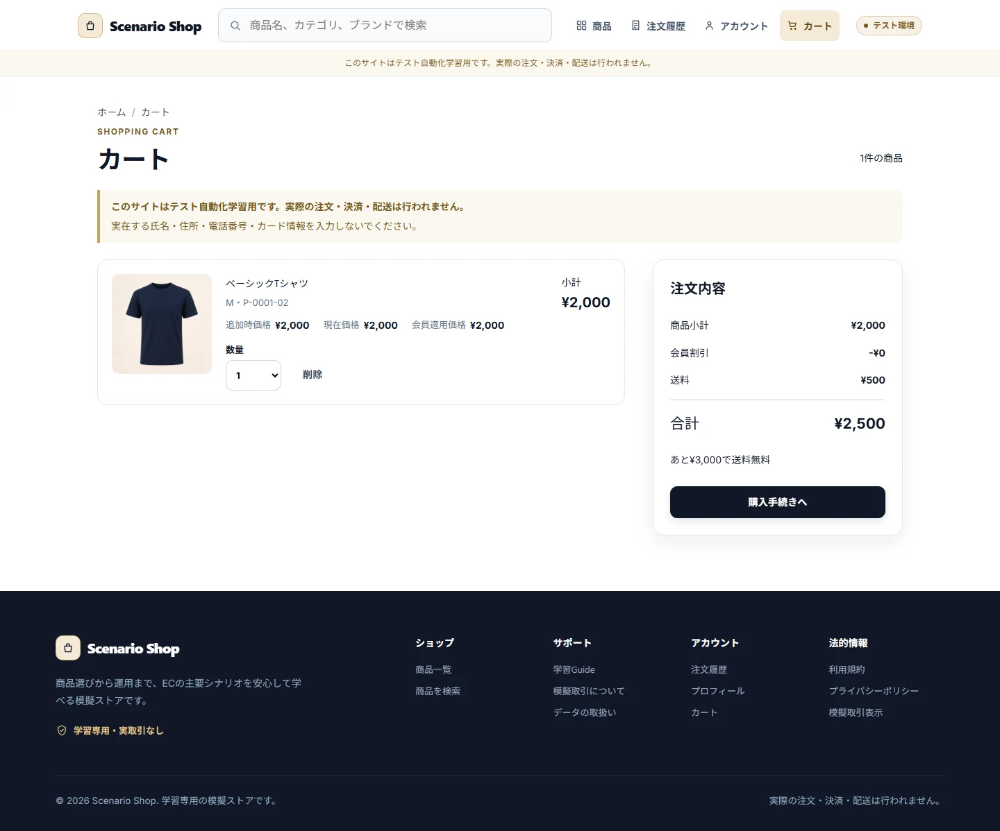
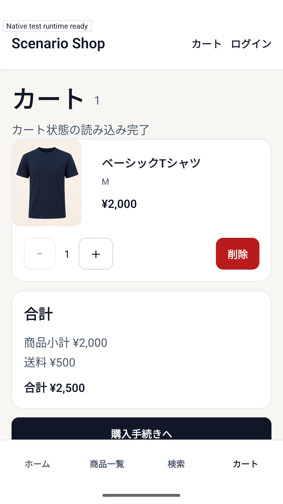
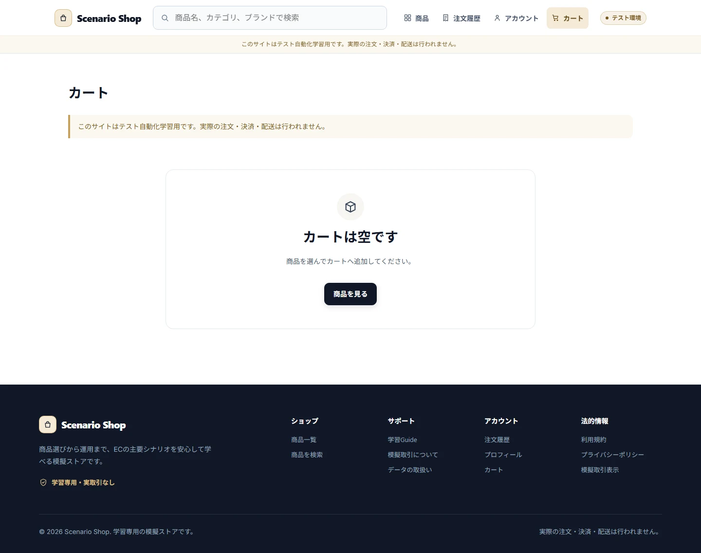
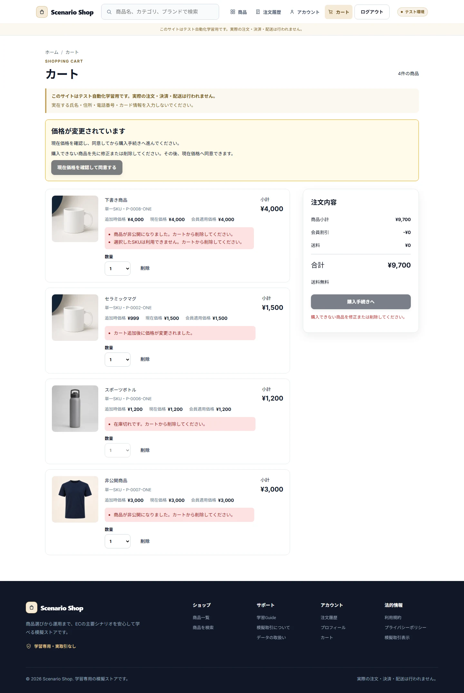

# カート

## 目的・対象範囲

ゲストおよび会員のカートに対する商品追加、数量変更、削除、状態の再検証、ならびにログイン時のゲストカート統合仕様を定義します。なお、注文データへの変換処理はチェックアウト・注文機能側で定義します。

## ビジネスルール

### BR-CART-001 — カート内の数量は「在庫数」「購入上限数」「99」のうち最小値を超えない

同一SKUの商品は合算して判定します。上限を超える指定があった場合は数量の自動補正を行わずに操作全体を拒否し、変更前の数量を維持します。数量を0に指定した場合は該当明細をカートから削除します。

### BR-CART-002 — ログイン時は会員カートを基準としてゲストカートを統合する

SKU単位で数量を合算します。許容上限を超える数量分、非公開商品、会員ランク不足の商品、無効なSKU、在庫0の商品は統合対象から除外し、その理由を明示します。統合元のゲストカートは破棄済み（abandoned）状態へ遷移します。

### BR-CART-003 — カート画面の表示時およびチェックアウト開始時に商品状態を再検証する

商品の公開状態、購入権限、価格、在庫数を再検証します。価格変更が発生している場合は、会員の承認が得られるまでチェックアウト手続きへ進めません。

## UI・振る舞い規約

カートはゲストまたは会員のみが利用できます。カート明細には商品情報、画像、現在価格、数量、上限数、問題点、合計金額、空状態を表示します。また、更新処理の実行中は同一カートに対する変更操作の二重実行を防止します。

### SCREEN-STOREFRONT-CART — カート

画面カタログ: [画面カタログ](../screen-catalog.md)

#### 機能一覧

- ゲストおよび会員カートの明細、数量、現在価格、問題が発生している理由、合計金額を表示する。
- 在庫数、購入上限数、公開状態、価格を再検証し、問題がある明細の修正や削除を行えるようにする。

#### 主要なUI状態

| 状態スラグ | 種別 | 対象者・ロール | 条件・シナリオ | 期待されるUI | 視覚要件 | 必須プラットフォーム | 視覚詳細 | 関連オラクル |
|---|---|---|---|---|---|---|---|---|
| `default` | baseline | `guest, customer` | `default` | カート明細と数量の変更操作を表示する。 | `required` | `web-desktop, android` | `-` | `BR-CART-001`, `AC-CART-001` |
| `empty` | empty | `guest, customer` | `default` | カートが空である旨と商品を探すための導線を表示する。 | `required` | `web-desktop` | `-` | `BR-CART-001` |
| `invalid-items` | error | `guest, customer` | `cart-with-invalid-items` | 購入できない理由と修正用のアクションを表示する。 | `required` | `web-desktop` | `-` | `BR-CART-003`, `AC-CART-003` |

#### 画面リファレンス

##### `default`

###### Webデスクトップ

###### Android — 正本画面リファレンス

##### `empty`

###### Webデスクトップ

##### `invalid-items`

###### Webデスクトップ

## 受入基準

### 基準一覧

#### AC-CART-001 — 上限超過時の操作を拒否すること

関連ビジネスルール: `BR-CART-001`

在庫数、購入上限数、99の各境界値において、上限を超える指定があった場合に数量が自動補正されず、現在の数量が維持されること。

#### AC-CART-002 — ゲストカートを会員カートへ統合できること

関連ビジネスルール: `BR-CART-002`

ゲストカートの明細と会員カートの明細の統合結果、除外理由、カートバージョン、およびゲストカートの状態が仕様どおり一致すること。

#### AC-CART-003 — 問題のある明細が含まれる場合はチェックアウトへ進めないこと

関連ビジネスルール: `BR-CART-003`

価格変更、在庫切れ、公開停止、会員ランク不足が正しく再検証され、ユーザーによる承認または明細の修正が行われない限りチェックアウトへ進めないこと。

## 実行可能な正本ソース

- `src/application/use-cases/cart-use-cases.ts`
- `src/domain/services/cart.ts`
- `src/domain/policies/permissions.ts`
- `src/seeds/scenarios.ts`
- `app/cart.tsx`, `app/cart.native.tsx`
