# チェックアウトと決済

## 目的と対象範囲

顧客の配送先住所、チェックアウトセッション、カートバージョン、価格確認、ローカルモック決済、および処理中／完了／失敗の境界を定義します。

## 業務ルール

### BR-CHECKOUT-001 — 顧客ごとのチェックアウトセッションを再開または置換する

同一のユーザー、カート、カートバージョンに紐づく有効なセッションは再開し、カートやバージョンが異なる場合は旧セッションを破棄扱いにして新しいセッションを作成します。なお、セッションは24時間で有効期限切れとなります。

### BR-CHECKOUT-002 — カートバージョンと価格を注文作成直前に再検証する

カートバージョンの不一致または価格の差異がある場合、注文および決済は作成せずカート画面へ戻します。URLへ直接アクセスした場合は、未完了のステップへ戻します。

### BR-CHECKOUT-003 — モック決済結果を注文・在庫と一貫して確定する

TEST-SUCCESSの場合のみ在庫を再検証し、決済完了、注文支払い済み、在庫の減算を確定します。明確に失敗した場合はpayment_failedとし、在庫は変更しません。処理中の状態では再試行およびキャンセルを禁止します。

## UI・振る舞い規約

配送先一覧、配送先選択、決済、確認、処理中、完了、失敗の各画面では、注文の所有権と決済状態を検証します。決済遅延はテストコントロールから変更可能ですが、外部通信は行いません。

### SCREEN-CHECKOUT-ADDRESSES — 配送先一覧

画面カタログ: [画面カタログ](../screen-catalog.md)

#### 機能

- 顧客自身の配送先を一覧表示し、追加・編集・選択へと進める。
- 未登録時にチェックアウトへ進むための登録導線を表示する。

#### 重要なUI状態

| 状態スラグ | 種別 | 対象者・ロール | 条件・シナリオ | 期待されるUI | 視覚要件 | 必須プラットフォーム | 視覚詳細 | 関連オラクル |
|---|---|---|---|---|---|---|---|---|
| `default` | baseline | `customer` | `regular-member` | 配送先一覧と管理アクションを表示する。 | `required` | `web-desktop, android` | `-` | `BR-CHECKOUT-001`, `AC-CHECKOUT-001` |
| `empty` | empty | `customer` | `default` | 未登録状態の案内と追加フォームへの導線を表示する。 | `required` | `web-desktop` | `-` | `BR-CHECKOUT-001`, `AC-CHECKOUT-001` |

#### 画面リファレンス

##### `default`

###### Webデスクトップ

[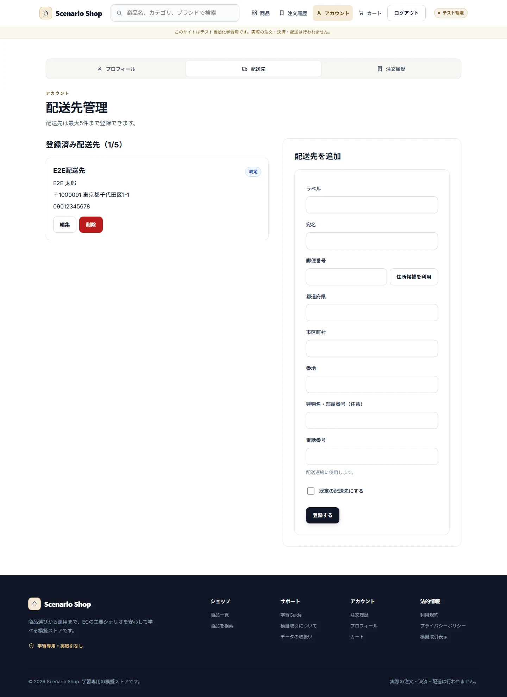](../assets/screens/SCREEN-CHECKOUT-ADDRESSES/default/web-desktop.webp)

###### Android — 正本画面リファレンス

[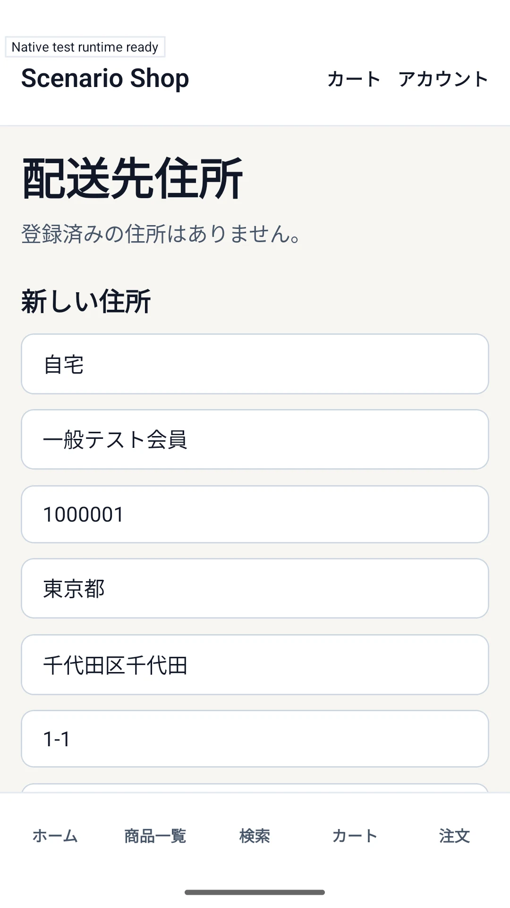](../assets/screens/SCREEN-CHECKOUT-ADDRESSES/default/android.webp)

##### `empty`

###### Webデスクトップ

[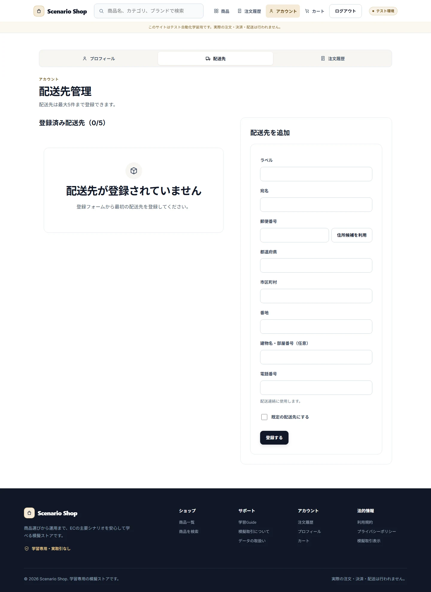](../assets/screens/SCREEN-CHECKOUT-ADDRESSES/empty/web-desktop.webp)

### SCREEN-CHECKOUT-ADDRESS — 配送先選択

画面カタログ: [画面カタログ](../screen-catalog.md)

#### 機能

- チェックアウトセッションで使用する配送先を選択し、決済画面へ進める。
- 再開、置換、古い状態に関する通知と、次に行うアクションを表示する。

#### 重要なUI状態

| 状態スラグ | 種別 | 対象者・ロール | 条件・シナリオ | 期待されるUI | 視覚要件 | 必須プラットフォーム | 視覚詳細 | 関連オラクル |
|---|---|---|---|---|---|---|---|---|
| `default` | baseline | `customer` | `regular-member` | 配送先選択と次ステップへのアクションを表示する。 | `required` | `web-desktop, android` | `-` | `BR-CHECKOUT-001`, `AC-CHECKOUT-001` |
| `resume-notice` | transient | `customer` | `checkout-resume` | 再開されたチェックアウトセッションであることを一度だけ通知する。 | `required` | `web-desktop` | `-` | `BR-CHECKOUT-001`, `AC-CHECKOUT-001` |

#### 画面リファレンス

##### `default`

###### Webデスクトップ

[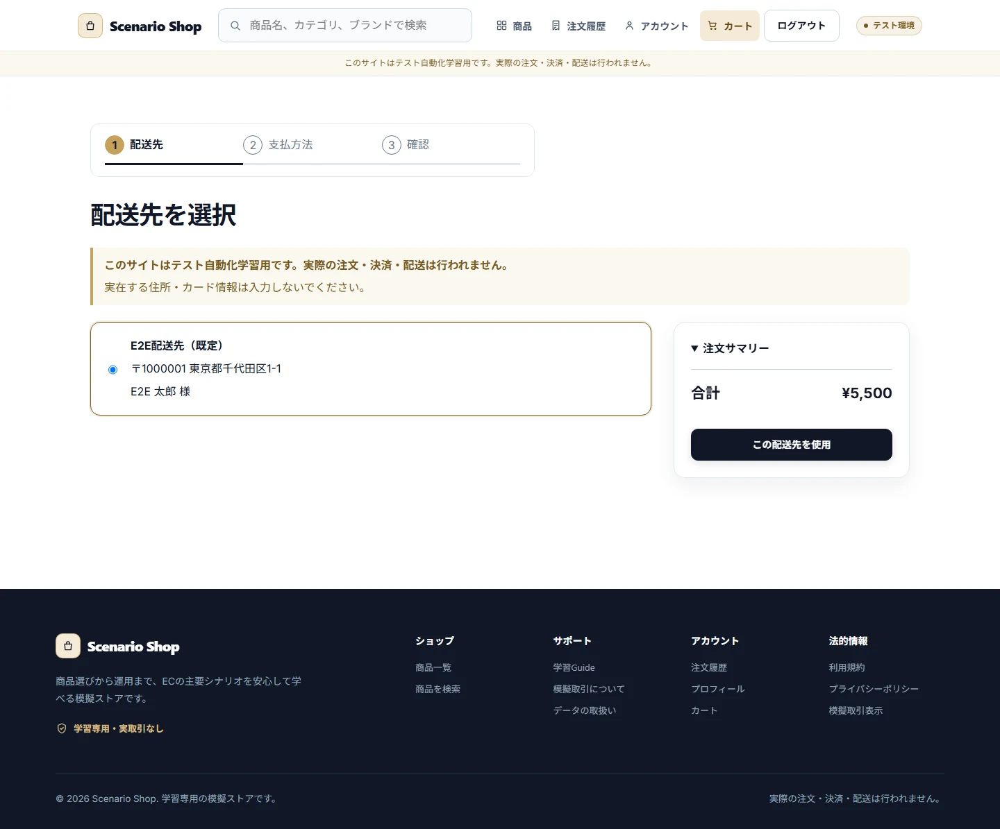](../assets/screens/SCREEN-CHECKOUT-ADDRESS/default/web-desktop.webp)

###### Android — 正本画面リファレンス

[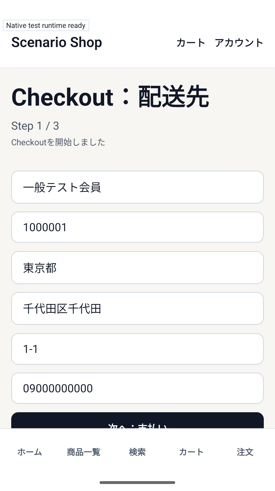](../assets/screens/SCREEN-CHECKOUT-ADDRESS/default/android.webp)

##### `resume-notice`

###### Webデスクトップ

[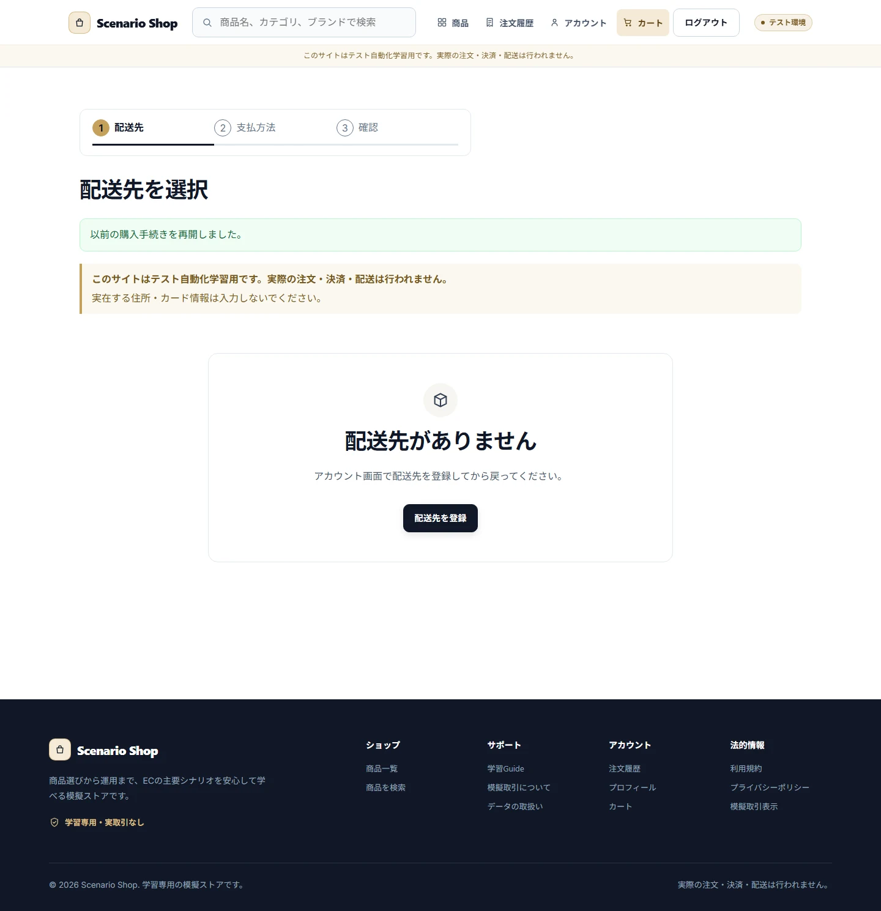](../assets/screens/SCREEN-CHECKOUT-ADDRESS/resume-notice/web-desktop.webp)

### SCREEN-CHECKOUT-PAYMENT — 決済

画面カタログ: [画面カタログ](../screen-catalog.md)

#### 機能

- モック決済オプションを選択し、確認画面へ進める。
- 不完全なセッションやカートバージョンの不一致を安全に処理する。

#### 重要なUI状態

| 状態スラグ | 種別 | 対象者・ロール | 条件・シナリオ | 期待されるUI | 視覚要件 | 必須プラットフォーム | 視覚詳細 | 関連オラクル |
|---|---|---|---|---|---|---|---|---|
| `default` | baseline | `customer` | `regular-member` | 決済オプションと確認アクションを表示する。 | `required` | `web-desktop, android` | `-` | `BR-CHECKOUT-002`, `AC-CHECKOUT-002` |

#### 画面リファレンス

##### `default`

###### Webデスクトップ

[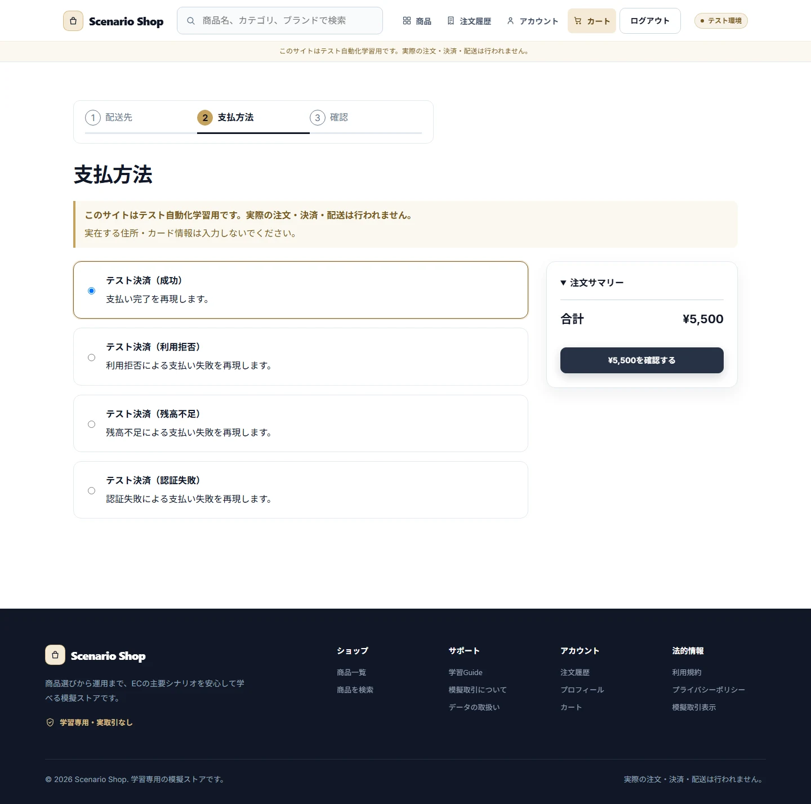](../assets/screens/SCREEN-CHECKOUT-PAYMENT/default/web-desktop.webp)

###### Android — 正本画面リファレンス

[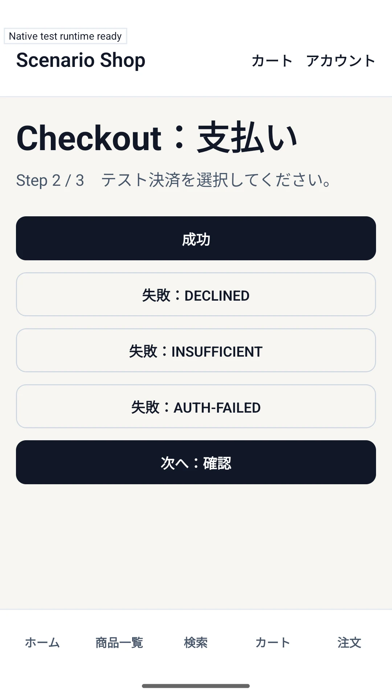](../assets/screens/SCREEN-CHECKOUT-PAYMENT/default/android.webp)

### SCREEN-CHECKOUT-CONFIRM — 注文確認

画面カタログ: [画面カタログ](../screen-catalog.md)

#### 機能

- 注文内容、配送先、価格、決済方法を最終確認する。
- カート情報が古い場合や価格の不一致が発生している場合は注文を確定せず、修正のための導線を表示する。

#### 重要なUI状態

| 状態スラグ | 種別 | 対象者・ロール | 条件・シナリオ | 期待されるUI | 視覚要件 | 必須プラットフォーム | 視覚詳細 | 関連オラクル |
|---|---|---|---|---|---|---|---|---|
| `default` | baseline | `customer` | `regular-member` | 注文内容と確定アクションを表示する。 | `required` | `web-desktop, android` | `-` | `BR-CHECKOUT-002`, `AC-CHECKOUT-002` |
| `stale-cart` | conflict | `customer` | `cart-version-invalidates-checkout` | 不一致の内容を説明し、カートまたは該当するステップへ戻す。 | `required` | `web-desktop` | `-` | `BR-CHECKOUT-002`, `AC-CHECKOUT-002` |

#### 画面リファレンス

##### `default`

###### Webデスクトップ

[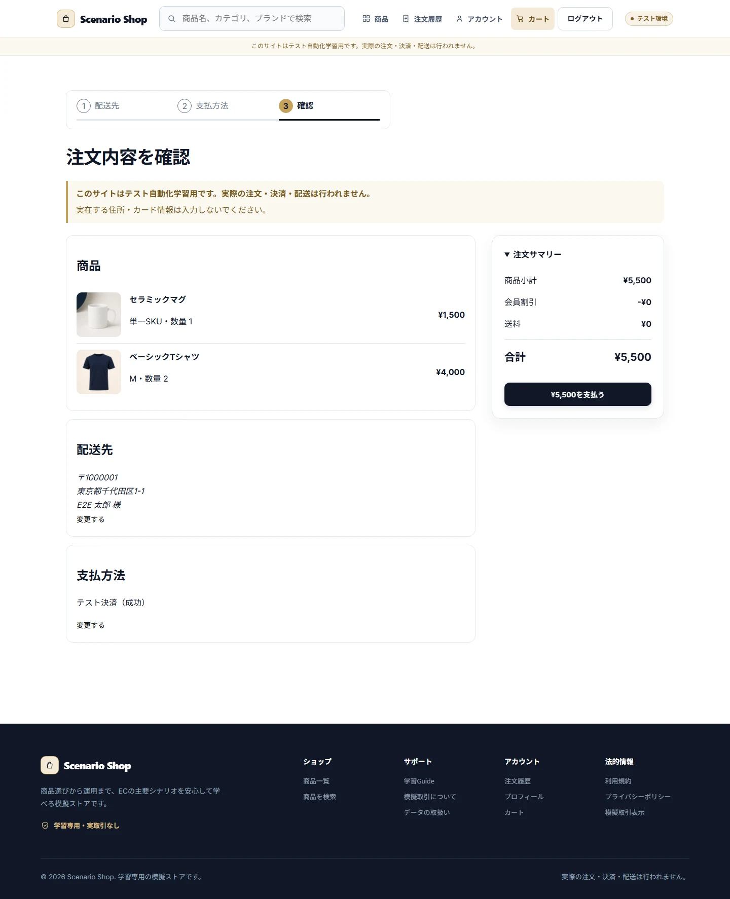](../assets/screens/SCREEN-CHECKOUT-CONFIRM/default/web-desktop.webp)

###### Android — 正本画面リファレンス

[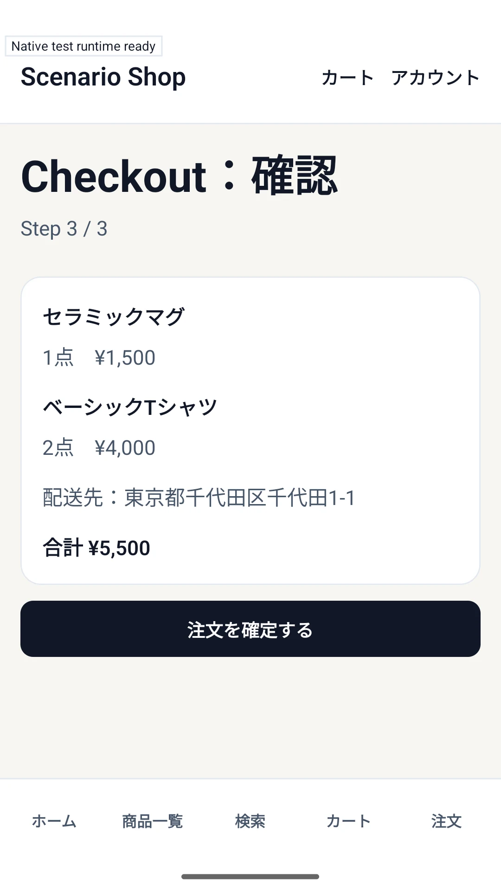](../assets/screens/SCREEN-CHECKOUT-CONFIRM/default/android.webp)

##### `stale-cart`

###### Webデスクトップ

[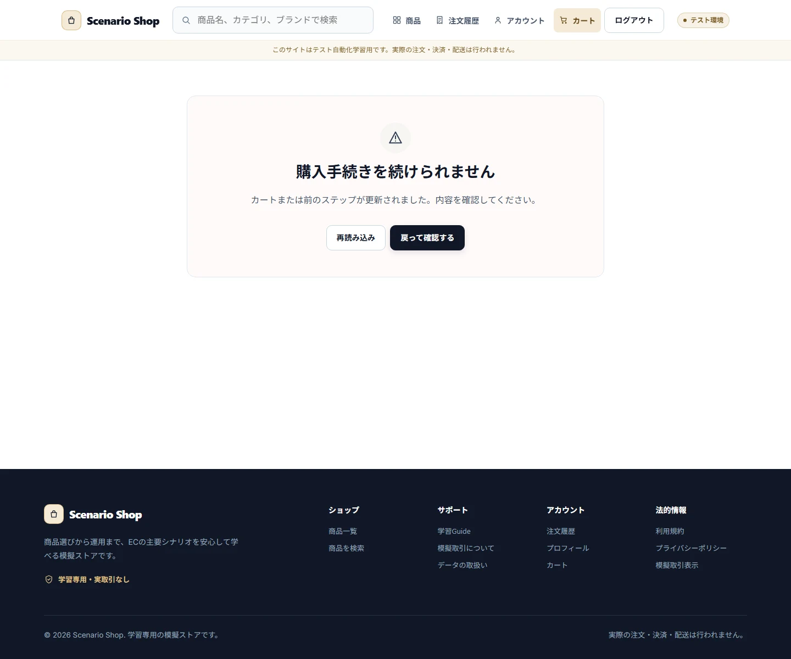](../assets/screens/SCREEN-CHECKOUT-CONFIRM/stale-cart/web-desktop.webp)

### SCREEN-CHECKOUT-PROCESSING — 処理中

画面カタログ: [画面カタログ](../screen-catalog.md)

#### 機能

- 決済処理中の状態を表示し、再読み込みや再開の導線を表示する。
- 処理中の二重確定、再試行、キャンセルを禁止する。

#### 重要なUI状態

| 状態スラグ | 種別 | 対象者・ロール | 条件・シナリオ | 期待されるUI | 視覚要件 | 必須プラットフォーム | 視覚詳細 | 関連オラクル |
|---|---|---|---|---|---|---|---|---|
| `default` | baseline | `customer` | `payment-processing` | 決済処理中の状態と待機アクションを表示する。 | `required` | `web-desktop, android` | `-` | `BR-CHECKOUT-003`, `AC-CHECKOUT-003` |

#### 画面リファレンス

##### `default`

###### Webデスクトップ — 正本画面リファレンス

[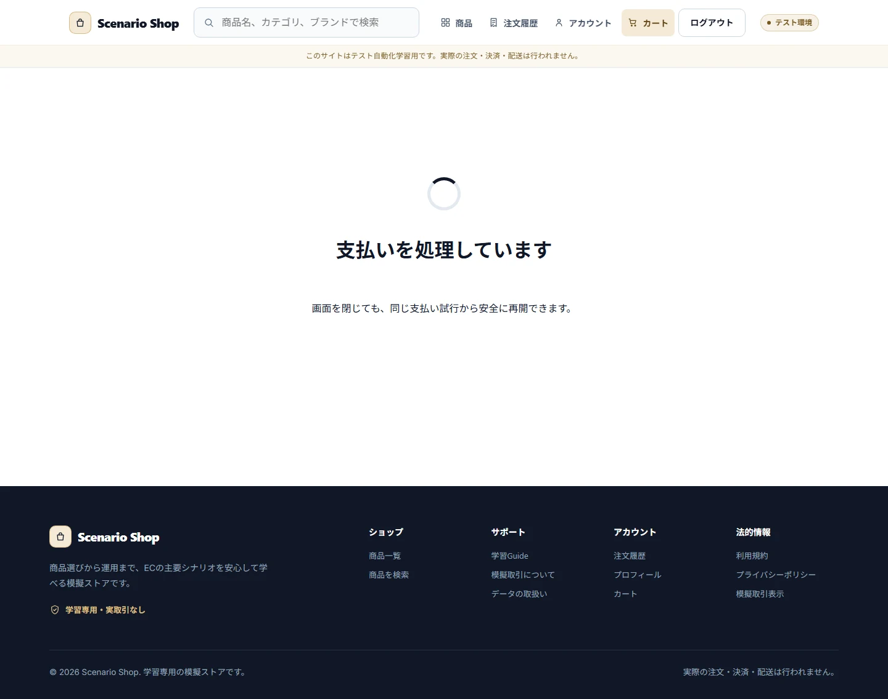](../assets/screens/SCREEN-CHECKOUT-PROCESSING/default/web-desktop.webp)

###### Android — 正本画面リファレンス

[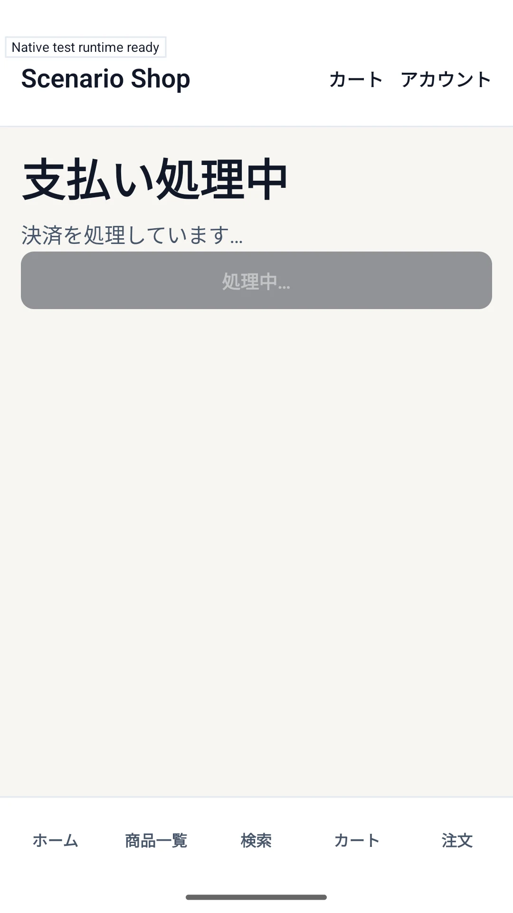](../assets/screens/SCREEN-CHECKOUT-PROCESSING/default/android.webp)

### SCREEN-CHECKOUT-COMPLETE — 完了

画面カタログ: [画面カタログ](../screen-catalog.md)

#### 機能

- 決済完了、注文番号、および注文履歴への導線を表示する。

#### 重要なUI状態

| 状態スラグ | 種別 | 対象者・ロール | 条件・シナリオ | 期待されるUI | 視覚要件 | 必須プラットフォーム | 視覚詳細 | 関連オラクル |
|---|---|---|---|---|---|---|---|---|
| `default` | baseline | `customer` | `default` | 注文完了と注文確認アクションを表示する。 | `required` | `web-desktop, android` | `-` | `BR-CHECKOUT-003`, `AC-CHECKOUT-003` |

#### 画面リファレンス

##### `default`

###### Webデスクトップ

[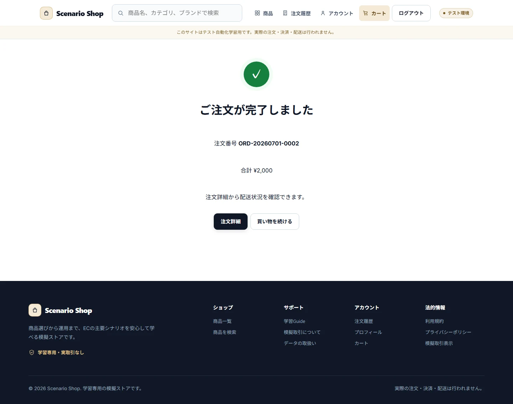](../assets/screens/SCREEN-CHECKOUT-COMPLETE/default/web-desktop.webp)

###### Android — 正本画面リファレンス

[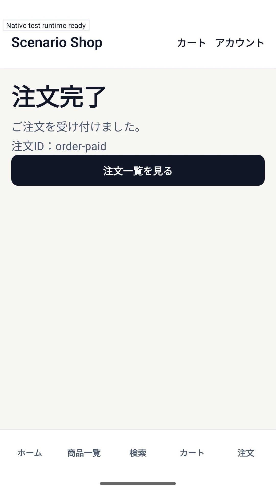](../assets/screens/SCREEN-CHECKOUT-COMPLETE/default/android.webp)

### SCREEN-CHECKOUT-FAILED — 失敗

画面カタログ: [画面カタログ](../screen-catalog.md)

#### 機能

- 決済拒否の通知、再試行、カート画面や注文内容確認への導線を表示する。
- 決済失敗時に、在庫や注文を完了・成功状態へ変更しない。

#### 重要なUI状態

| 状態スラグ | 種別 | 対象者・ロール | 条件・シナリオ | 期待されるUI | 視覚要件 | 必須プラットフォーム | 視覚詳細 | 関連オラクル |
|---|---|---|---|---|---|---|---|---|
| `default` | baseline | `customer` | `payment-declined` | 失敗理由と再試行アクションを表示する。 | `required` | `web-desktop, android` | `-` | `BR-CHECKOUT-003`, `AC-CHECKOUT-003` |

#### 画面リファレンス

##### `default`

###### Webデスクトップ

[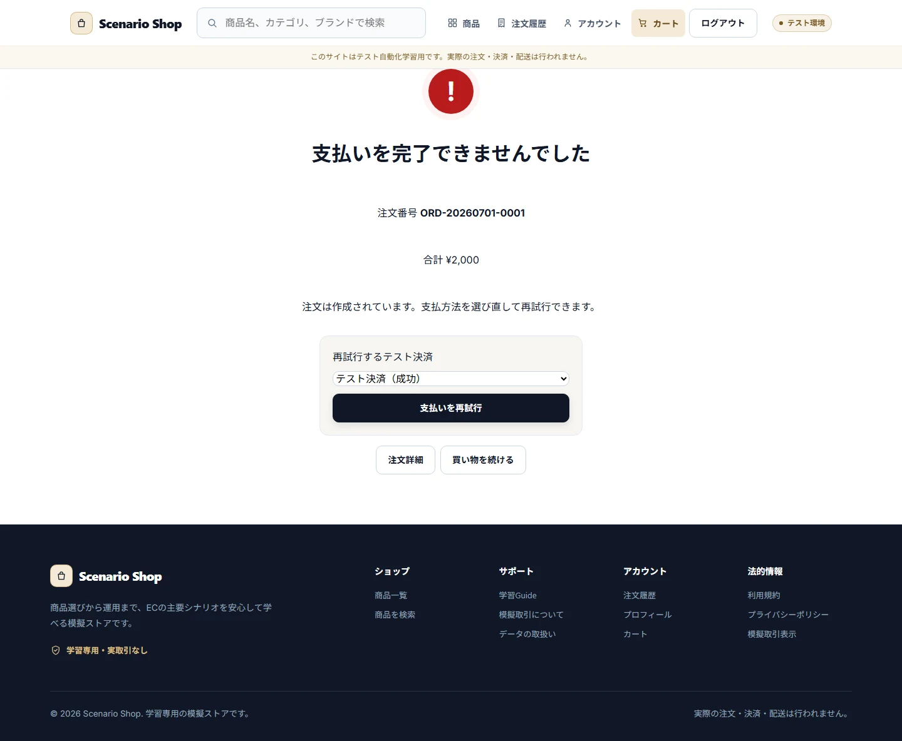](../assets/screens/SCREEN-CHECKOUT-FAILED/default/web-desktop.webp)

###### Android — 正本画面リファレンス

[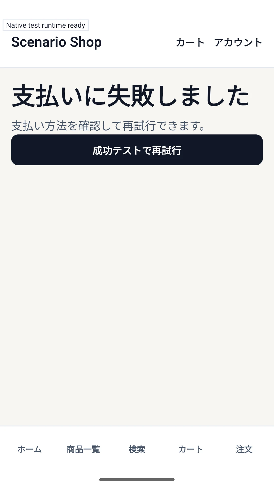](../assets/screens/SCREEN-CHECKOUT-FAILED/default/android.webp)

## 受入基準

### 判定基準

#### AC-CHECKOUT-001 — セッションを再開・置換する

関連BR: `BR-CHECKOUT-001`

同一のカートおよびバージョンにおける再開、異なるバージョンでの置換、有効期限切れ時の処理、ならびにログアウト後の再ログインによる復帰が確認できること。

#### AC-CHECKOUT-002 — 古いカート情報を確定しない

関連BR: `BR-CHECKOUT-002`

カートバージョンまたは価格が変更された状態において、注文や決済が作成されず、必要なステップまたはカートへ戻ること。

#### AC-CHECKOUT-003 — 決済結果を一度だけ確定する

関連BR: `BR-CHECKOUT-003`

成功、明確な拒否、処理中（`processing`）からの再開、最終的な在庫不足のいずれのケースにおいても、注文、決済、在庫、注文履歴の整合性が保たれること。

## 実行可能な正本ソース

- `src/application/use-cases/checkout-order-use-cases.ts`
- `src/infrastructure/payment/mock-payment-gateway.ts`
- `src/domain/policies/state-transitions.ts`
- `src/test-controls/`
- `app/checkout/`, `app/checkout/*.native.tsx`
