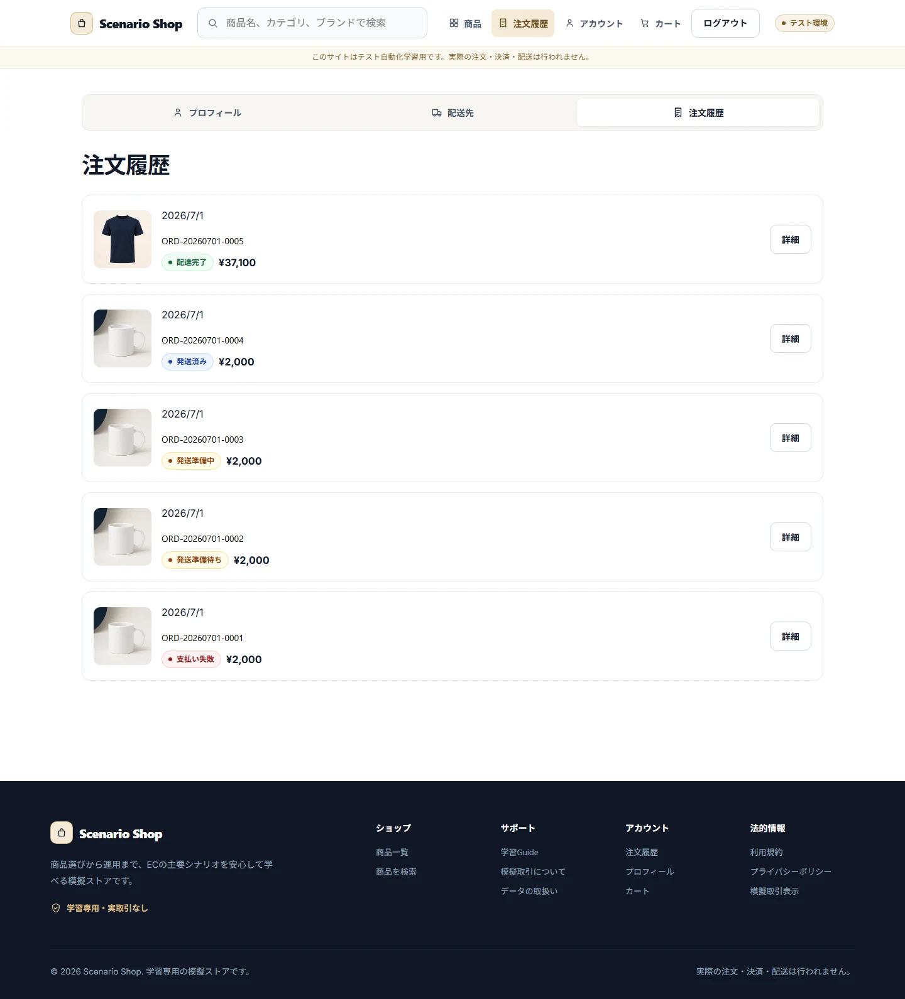
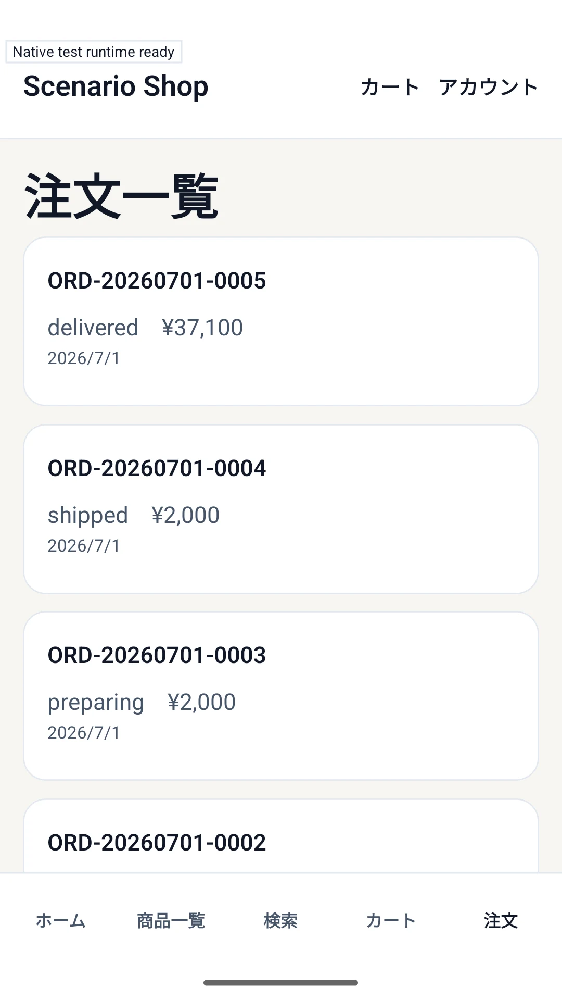
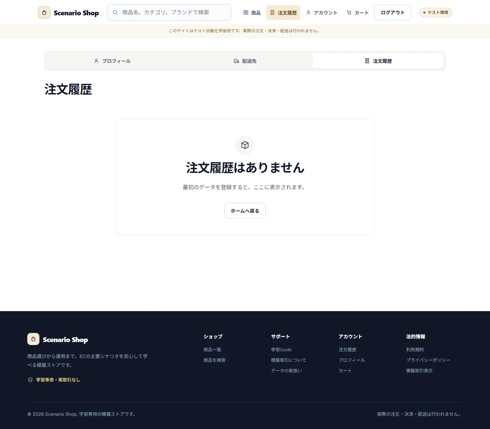
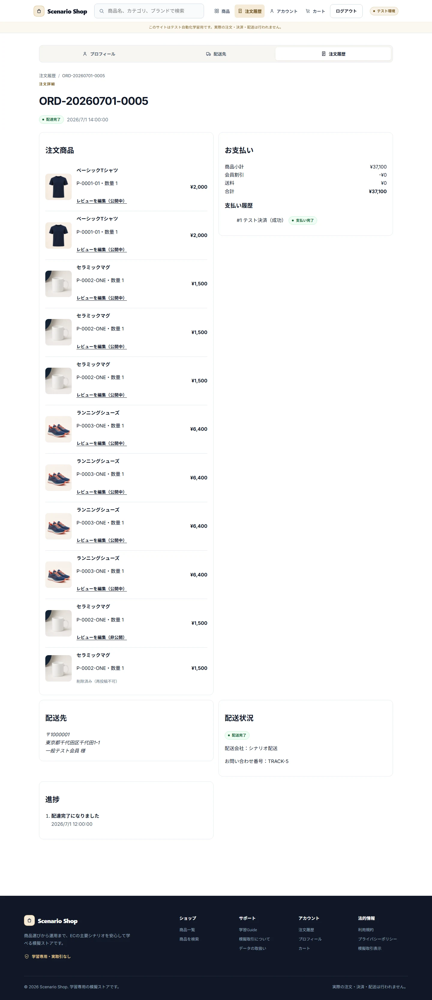
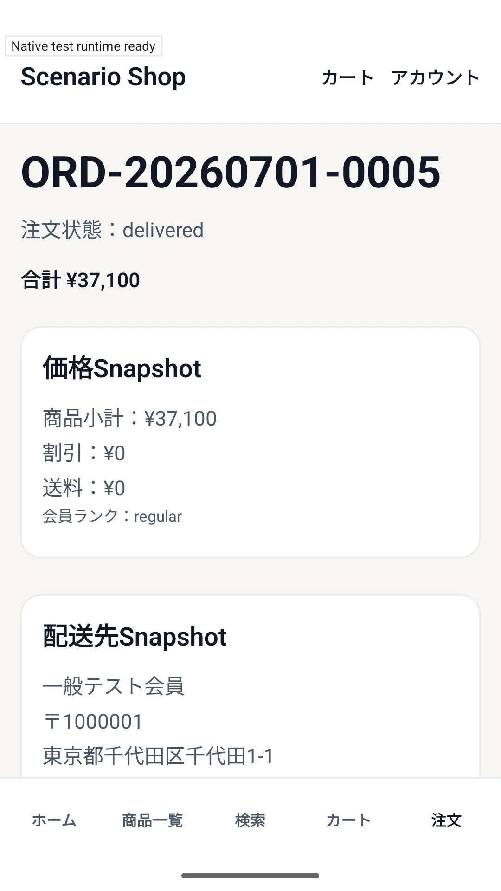
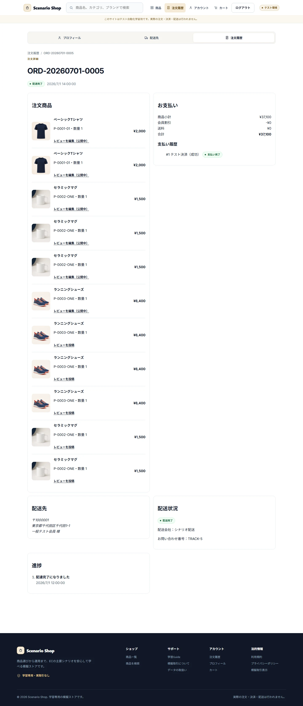

# Orders

## Purpose / Scope

注文（Order）のスナップショット保持、カスタマー向け表示、オペレーターや管理者（Operator/Admin）による準備・発送・配送完了処理、ならびに注文と配送（Order/Shipment）の状態整合性について定義します。

## Business Rules

### BR-ORDER-001 — Orderは作成時点の購入情報をスナップショット保存する

商品、SKU、価格、ランク（Rank）、配送先、画像、注文明細番号（Order Item line number）を作成時点で保存し、その後に商品（Product）やユーザー（User）情報が変更されても過去の注文履歴は変更しません。

### BR-ORDER-002 — OrderとShipmentは許可された順序に従い同一トランザクションで更新する

paid → preparing → shipped → delivered の順序を遵守し、発送および配送完了の処理では、注文（Order）と配送（Shipment）を同一トランザクション内で更新します。

## UI / Behavior Contract

カスタマーは注文番号、合計金額、配送先概要、支払い（Payment）、配送（Shipment）、タイムライン、および次に行うべきアクションを確認できます。オペレーターや管理者（Operator/Admin）はカスタマーとしての購入操作権限を持たず、管理対象となる注文（Order）の許可されたステータス遷移のみを実行できます。

### SCREEN-ORDERS-LIST — Orders

Screen Catalog: [Screen Catalog](../screen-catalog.md)

#### Functions

- カスタマー自身の注文番号、合計金額、支払い（Payment）、配送（Shipment）、タイムラインを一覧表示する。
- 空状態（empty）、処理中（processing）、失敗（failed）をそれぞれ個別のステータス表示として扱う。

#### Important UI States

| State slug | Type | Audience / Role | Condition / Scenario | Expected UI | Visual requirement | Required platforms | Visual detail | Related Oracle |
|---|---|---|---|---|---|---|---|---|
| `default` | baseline | `customer` | `regular-member` | 注文一覧とステータスを表示する。 | `required` | `web-desktop, android` | `-` | `BR-ORDER-001`, `AC-ORDER-001` |
| `empty` | empty | `customer` | `orders-empty` | 注文が存在しない旨とストアフロントへの導線を表示する。 | `required` | `web-desktop` | `-` | `BR-ORDER-001`, `AC-ORDER-001` |

#### Visual References

##### `default`

###### Web Desktop

###### Android — Canonical Visual Reference

##### `empty`

###### Web Desktop

### SCREEN-ORDERS-DETAIL — Order Detail

Screen Catalog: [Screen Catalog](../screen-catalog.md)

#### Functions

- 注文スナップショット、支払い（Payment）、配送（Shipment）、タイムライン、レビュー投稿可否（Review eligibility）を表示する。
- カスタマー本人の注文のみを表示し、その後に商品情報（Product）が変更されてもスナップショットの内容は変更しない。

#### Important UI States

| State slug | Type | Audience / Role | Condition / Scenario | Expected UI | Visual requirement | Required platforms | Visual detail | Related Oracle |
|---|---|---|---|---|---|---|---|---|
| `default` | baseline | `customer` | `regular-member` | 注文スナップショットと配送状態（Shipment）を表示する。 | `required` | `web-desktop, android` | `-` | `BR-ORDER-001`, `AC-ORDER-001` |
| `reviewable` | domain | `customer` | `reviewable-orders` | 配達完了（Delivered）となった商品のレビュー投稿導線を表示する。 | `required` | `web-desktop` | `-` | `BR-ORDER-001`, `AC-ORDER-001` |

#### Visual References

##### `default`

###### Web Desktop

###### Android — Canonical Visual Reference

##### `reviewable`

###### Web Desktop

## Acceptance Criteria

### Criteria

#### AC-ORDER-001 — Order履歴をスナップショットとして表示する

Related BR: `BR-ORDER-001`

商品（Product）、価格（Price）、ランク（Rank）、配送先住所（Address）を後から変更しても、注文詳細のスナップショットおよび明細行の表示順（line order）は保持され、変更されません。

#### AC-ORDER-002 — Shipment遷移を飛び越さない

Related BR: `BR-ORDER-002`

paid から直接 shipped へ進めることはできず、注文（Order）と配送（Shipment）のステータスは preparing、shipped、delivered の各段階で常に一致します。

## Executable Canonical Sources

- `src/application/use-cases/checkout-order-use-cases.ts`
- `src/application/use-cases/admin-operations-use-cases.ts`
- `src/domain/policies/state-transitions.ts`
- `src/seeds/default-dataset.ts`
- `app/orders/`, `app/admin/orders/`