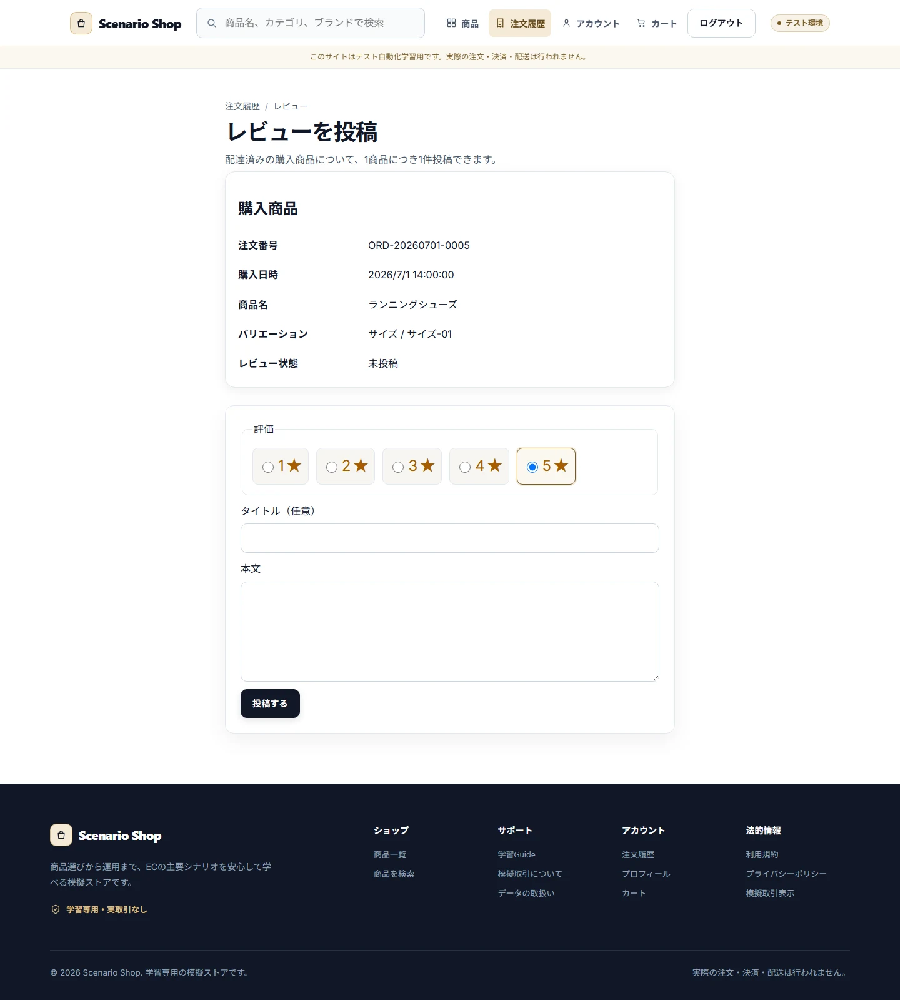
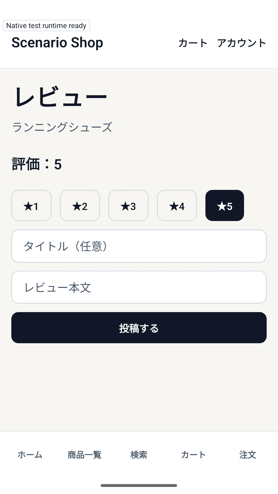
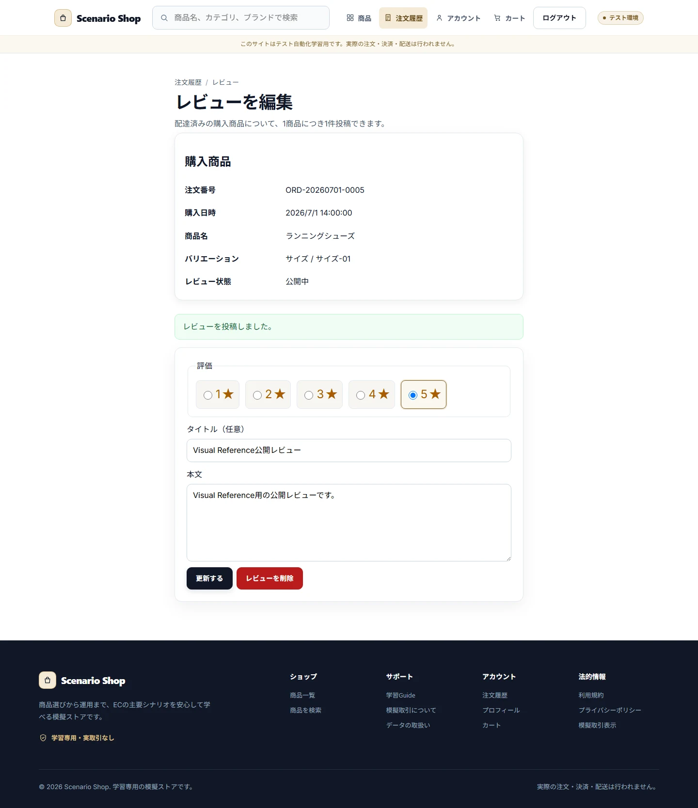
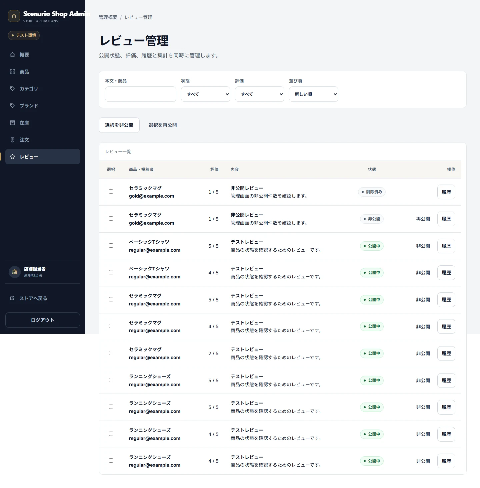
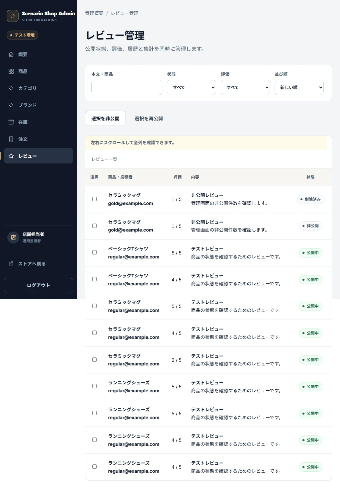

# Reviews

## Purpose / Scope

配達完了（Delivered）となった注文に対するカスタマーレビューの投稿資格（Eligibility）、投稿・編集・削除、公開／非公開状態、および商品サマリー（Product Summary）の仕様を定義します。

## Business Rules

### BR-REVIEW-001 — 配達完了（Delivered）注文の本人明細のみがレビュー対象となる

カスタマー本人の配達完了（delivered）となった注文明細（Order Item）に対して1件のみ作成でき、削除後も同一の注文明細へ再投稿することはできません。

### BR-REVIEW-002 — レビュー状態と商品サマリー（Product Summary）を一貫して更新する

公開中（published）のレビューのみを商品表示の集計対象とし、非公開（hidden）は再公開操作が行われるまで非表示、削除済み（deleted）は終端状態とします。レビューの編集によって状態が自動変更されることはありません。

## UI / Behavior Contract

カスタマーは、自身が投稿したレビューの評価（Rating）、タイトル（Title）、本文、ステータス（Status）、バージョン（Version）を編集できます。管理者（Admin）は公開／非公開を管理できます。なお、削除済みのレビューを編集または再投稿できるUIは表示しません。

### SCREEN-REVIEWS-EDITOR — Review Editor

Screen Catalog: [Screen Catalog](../screen-catalog.md)

#### Functions

- 配達完了（Delivered）かつ本人の注文明細（Order Item）に対してレビューを作成・編集する。
- published、hidden、deletedの状態を表示し、deletedのレビューを再投稿可能に見せない。

#### Important UI States

| State slug | Type | Audience / Role | Condition / Scenario | Expected UI | Visual requirement | Required platforms | Visual detail | Related Oracle |
|---|---|---|---|---|---|---|---|---|
| `default` | baseline | `customer` | `reviewable-orders` | 評価（Rating）、タイトル（Title）、本文、保存アクションを表示する。 | `required` | `web-desktop, android` | `-` | `BR-REVIEW-001`, `AC-REVIEW-001` |
| `published` | domain | `customer` | `reviewable-orders` | 既存レビューの編集状態を表示する。 | `required` | `web-desktop` | `-` | `BR-REVIEW-002`, `AC-REVIEW-002` |

#### Visual References

##### `default`

###### Web Desktop

###### Android — Canonical Visual Reference

##### `published`

###### Web Desktop

### SCREEN-ADMIN-REVIEWS — Admin Reviews

Screen Catalog: [Screen Catalog](../screen-catalog.md)

#### Functions

- オペレーターおよび管理者（Operator / Admin）がレビューの公開状態と一括操作結果を確認する。
- カスタマーレビューのスナップショットを保持したまま公開／非公開を操作する。

#### Important UI States

| State slug | Type | Audience / Role | Condition / Scenario | Expected UI | Visual requirement | Required platforms | Visual detail | Related Oracle |
|---|---|---|---|---|---|---|---|---|
| `default` | baseline | `operator, admin` | `default` | レビュー一覧と状態操作UIを表示する。 | `required` | `web-desktop, web-tablet` | `-` | `BR-REVIEW-002`, `AC-REVIEW-002` |

#### Visual References

##### `default`

###### Web Desktop

###### Web Tablet

## Acceptance Criteria

### Criteria

#### AC-REVIEW-001 — レビュー投稿資格（Review Eligibility）を制限する

Related BR: `BR-REVIEW-001`

未配達の注文、他人の注文、既存レビューが存在する明細、および削除済みの明細は投稿対象外となり、配達完了（delivered）となった本人明細のみが一度だけ投稿できます。

#### AC-REVIEW-002 — 公開集計と状態遷移を分ける

Related BR: `BR-REVIEW-002`

published／hidden／deletedの表示、編集、管理者（Admin）操作と、商品サマリー（Product Summary）における件数・平均評価・評価分布の集計結果が一致します。

## Executable Canonical Sources

- `src/application/use-cases/review-user-use-cases.ts`
- `src/application/use-cases/customer-review-state.ts`
- `src/domain/policies/state-transitions.ts`
- `app/reviews/`, `app/admin/reviews.tsx`
