# Storefront

## Purpose / Scope

ゲスト（Guest）および顧客（Customer）が公開商品を閲覧・探索し、検索、カテゴリー／ブランド、価格、セール、在庫、レビュー評価、バリエーションを確認するWeb／ネイティブ共通のストアフロント（Storefront）における基本挙動を定義します。なお、管理者による商品編集および購入手続きの確定は別機能（Feature）として扱います。

## Business Rules

### BR-STOREFRONT-001 — Viewer条件を満たす公開商品だけを表示する

商品の公開状態、会員ランク制限、閲覧者（Viewer）種別に応じた閲覧条件を適用し、権限のない商品を商品一覧、ホーム、詳細、ファセット（絞り込み条件）に含めないようにします。

### BR-STOREFRONT-002 — 検索とFacetは同じViewer条件で決定的に絞り込む

キーワード、カテゴリー、ブランド、価格、在庫状況、セール有無、最低評価を適用し、同一ファセット内はOR条件、異なるファセット間はAND条件として合計件数（total）およびページ情報（page）を算出します。

### BR-STOREFRONT-003 — Variationと価格を現在時刻・Viewerに合わせて表示する

セール期間、会員割引、在庫数、購入上限数を現在時刻および閲覧者情報に合わせて表示し、バリエーションが未選択の状態や在庫切れとなっているバリエーションをカートに追加する操作は許可しません。

## UI / Behavior Contract

ホーム画面では主要カテゴリー、新着商品、セール情報、会員ランク案内を表示します。検索サジェストは入力が2文字以上の場合に最大8件まで表示します。バリエーション選択UIは、12件以下の場合はボタン群、13件以上の場合はセレクトボックス（Select）形式とし、商品一覧で並び順が同順位となる場合はproductCodeを用いて表示順を決定的に固定（安定化）させます。

### SCREEN-STOREFRONT-HOME — Home

Screen Catalog: [Screen Catalog](../screen-catalog.md)

#### Functions

- 公開商品、主要カテゴリー、新着商品、セール、会員ランク案内への導線を表示する。
- 既存のロール規約（Role契約）に従い、ゲストと顧客（Customer）それぞれに利用可能な導線を表示する。

#### Important UI States

| State slug | Type | Audience / Role | Condition / Scenario | Expected UI | Visual requirement | Required platforms | Visual detail | Related Oracle |
|---|---|---|---|---|---|---|---|---|
| `default` | baseline | `guest, customer, operator, admin` | `default` | 公開商品と主要導線を表示する。 | `required` | `web-desktop, android` | `-` | `BR-STOREFRONT-001`, `AC-STOREFRONT-001` |
| `empty-catalog` | empty | `guest, customer` | `empty-catalog` | 公開商品が存在しない旨を単一のエンプティ状態（Empty State）として表示・説明する。 | `required` | `web-desktop` | `-` | `BR-STOREFRONT-001`, `AC-STOREFRONT-001` |

#### Visual References

##### `default`

###### Web Desktop

[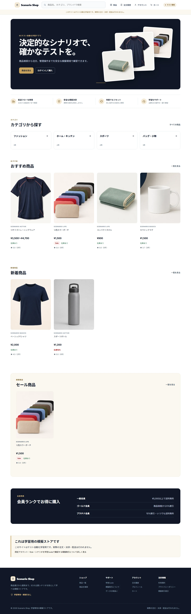](../assets/screens/SCREEN-STOREFRONT-HOME/default/web-desktop.webp)

###### Android — Canonical Visual Reference

[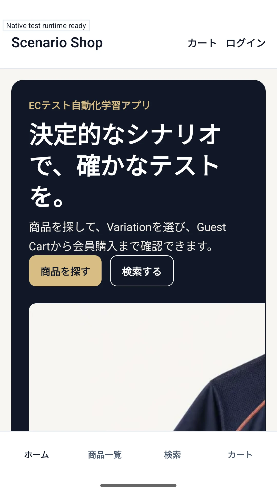](../assets/screens/SCREEN-STOREFRONT-HOME/default/android.webp)

##### `empty-catalog`

###### Web Desktop

[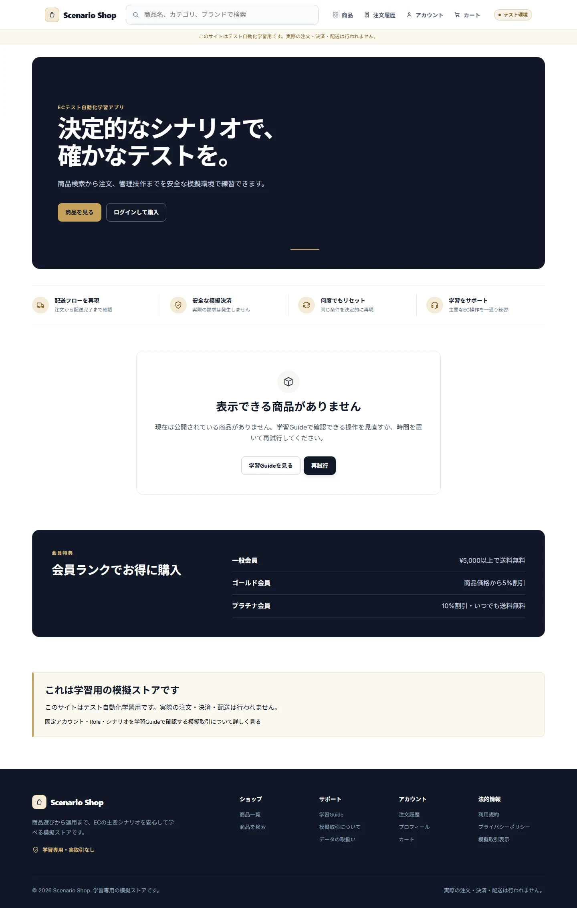](../assets/screens/SCREEN-STOREFRONT-HOME/empty-catalog/web-desktop.webp)

### SCREEN-STOREFRONT-PRODUCT-LIST — Product List

Screen Catalog: [Screen Catalog](../screen-catalog.md)

#### Functions

- 公開条件を満たす商品を一覧表示し、ページネーション、フィルター、ソート機能によって探索できるようにする。
- 各商品カードから商品詳細画面や購入への導線を提供する。

#### Important UI States

| State slug | Type | Audience / Role | Condition / Scenario | Expected UI | Visual requirement | Required platforms | Visual detail | Related Oracle |
|---|---|---|---|---|---|---|---|---|
| `default` | baseline | `guest, customer, operator, admin` | `default` | 商品一覧とファセット（絞り込み条件）を表示する。 | `required` | `web-desktop, android` | `-` | `BR-STOREFRONT-001`, `AC-STOREFRONT-002` |
| `empty` | empty | `guest, customer` | `empty-catalog` | 表示可能な商品がない理由と元の画面に戻る導線を表示する。 | `required` | `web-desktop` | `-` | `BR-STOREFRONT-001`, `AC-STOREFRONT-001` |
| `many-products` | domain | `guest, customer` | `many-products` | 多数の商品が存在する場合に、ページネーションによって閲覧・移動できる。 | `required` | `web-desktop` | `-` | `BR-STOREFRONT-002`, `AC-STOREFRONT-002` |

#### Visual References

##### `default`

###### Web Desktop

[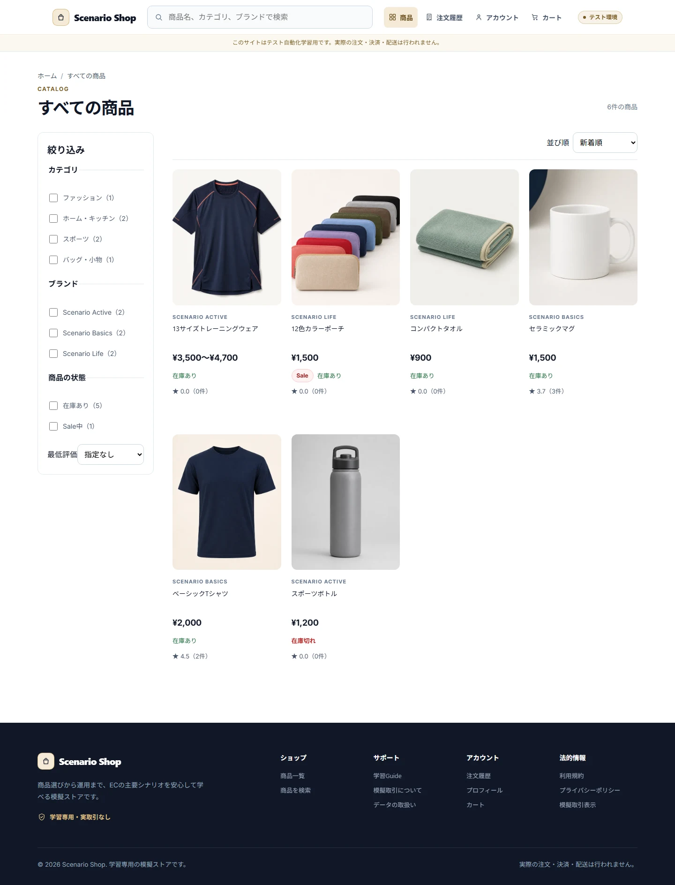](../assets/screens/SCREEN-STOREFRONT-PRODUCT-LIST/default/web-desktop.webp)

###### Android — Canonical Visual Reference

[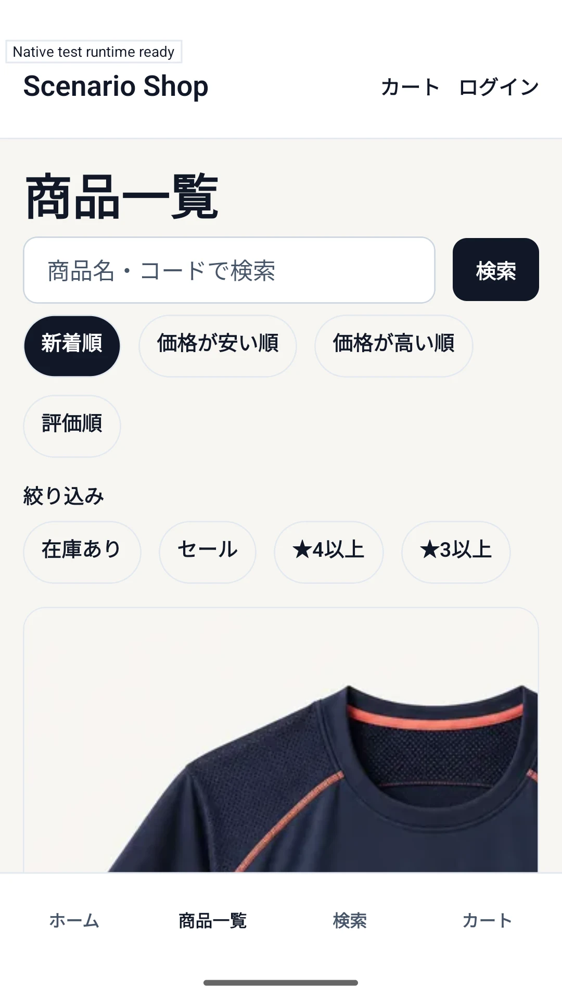](../assets/screens/SCREEN-STOREFRONT-PRODUCT-LIST/default/android.webp)

##### `empty`

###### Web Desktop

[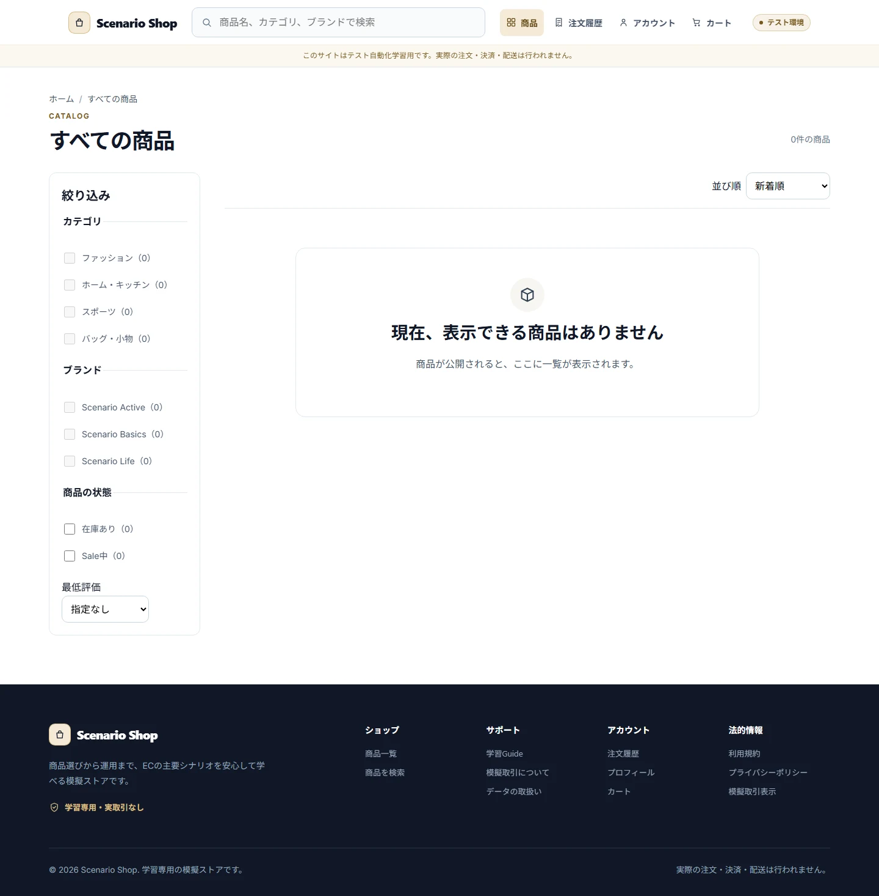](../assets/screens/SCREEN-STOREFRONT-PRODUCT-LIST/empty/web-desktop.webp)

##### `many-products`

###### Web Desktop

[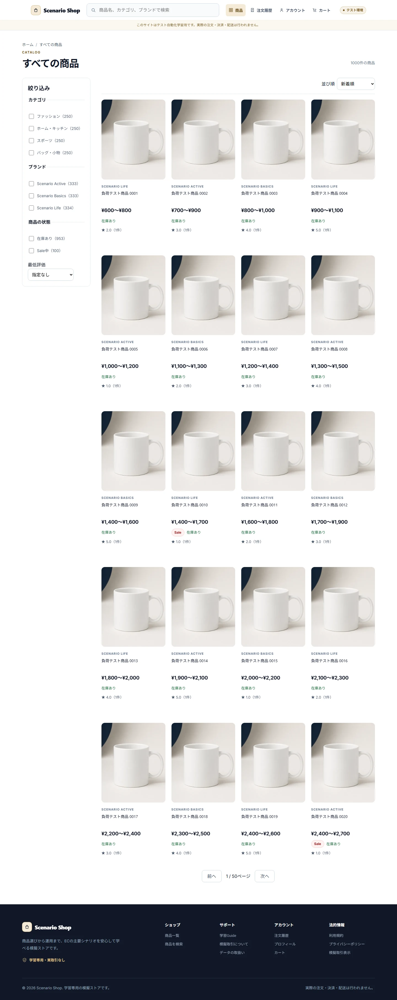](../assets/screens/SCREEN-STOREFRONT-PRODUCT-LIST/many-products/web-desktop.webp)

### SCREEN-STOREFRONT-PRODUCT-DETAIL — Product Detail

Screen Catalog: [Screen Catalog](../screen-catalog.md)

#### Functions

- 商品画像、価格、セール情報、レビューサマリー、バリエーション、在庫状況、購入上限数を表示する。
- 選択可能なバリエーションのみ、カートへの追加操作を可能にする。

#### Important UI States

| State slug | Type | Audience / Role | Condition / Scenario | Expected UI | Visual requirement | Required platforms | Visual detail | Related Oracle |
|---|---|---|---|---|---|---|---|---|
| `default` | baseline | `guest, customer, operator, admin` | `default` | 商品情報とバリエーション選択UIを表示する。 | `required` | `web-desktop, android` | `-` | `BR-STOREFRONT-003`, `AC-STOREFRONT-003` |
| `out-of-stock` | domain | `guest, customer` | `out-of-stock` | 在庫切れである旨と、カートに追加できない理由を表示する。 | `required` | `web-desktop` | `-` | `BR-STOREFRONT-003`, `AC-STOREFRONT-003` |
| `low-stock` | domain | `guest, customer` | `low-stock` | 残り在庫数と購入上限数を表示する。 | `required` | `web-desktop` | `-` | `BR-STOREFRONT-003`, `AC-STOREFRONT-003` |

#### Visual References

##### `default`

###### Web Desktop

[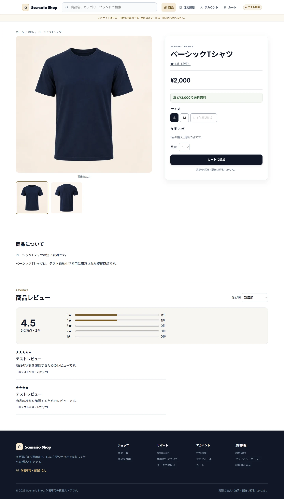](../assets/screens/SCREEN-STOREFRONT-PRODUCT-DETAIL/default/web-desktop.webp)

###### Android — Canonical Visual Reference

[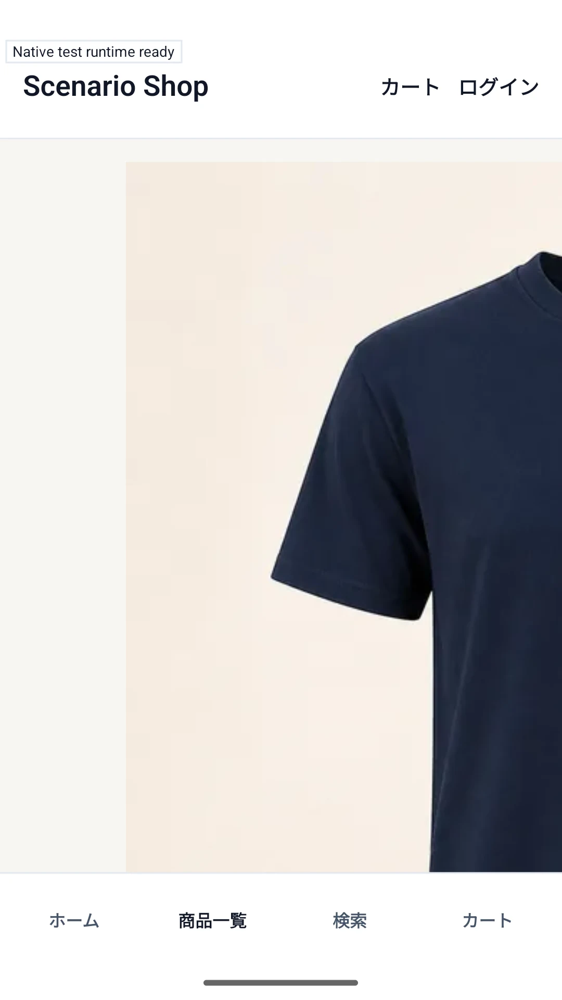](../assets/screens/SCREEN-STOREFRONT-PRODUCT-DETAIL/default/android.webp)

##### `out-of-stock`

###### Web Desktop

[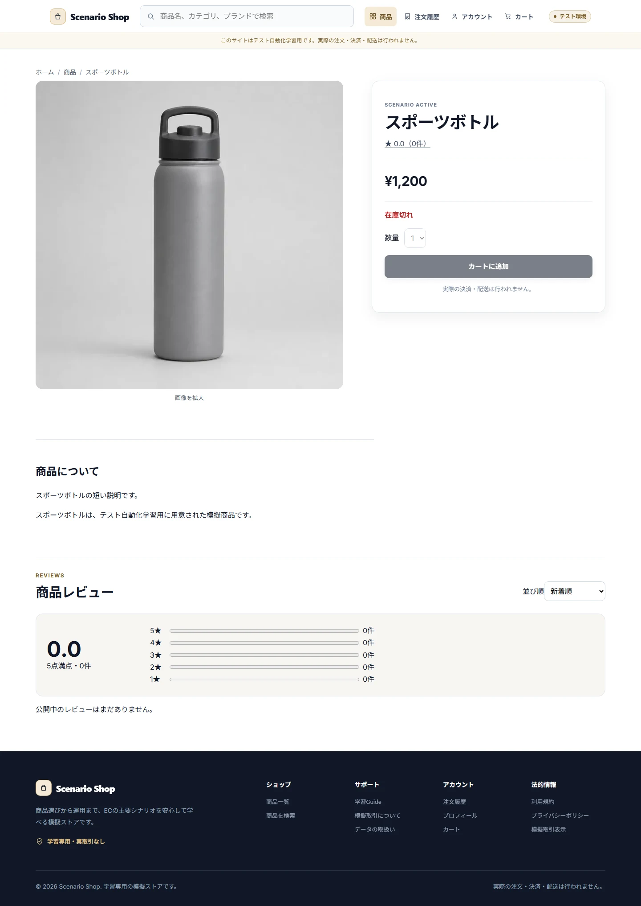](../assets/screens/SCREEN-STOREFRONT-PRODUCT-DETAIL/out-of-stock/web-desktop.webp)

##### `low-stock`

###### Web Desktop

### SCREEN-STOREFRONT-SEARCH — Search

Screen Catalog: [Screen Catalog](../screen-catalog.md)

#### Functions

- 商品名、商品コード、検索サジェスト、フィルターを用いて公開商品を検索する。
- 該当する検索結果がない場合、検索条件を見直すための導線を表示する。

#### Important UI States

| State slug | Type | Audience / Role | Condition / Scenario | Expected UI | Visual requirement | Required platforms | Visual detail | Related Oracle |
|---|---|---|---|---|---|---|---|---|
| `default` | baseline | `guest, customer, operator, admin` | `default` | 検索入力フォームと検索結果を表示する。 | `required` | `web-desktop, android` | `-` | `BR-STOREFRONT-002`, `AC-STOREFRONT-002` |
| `no-results` | empty | `guest, customer` | `search-empty` | 条件に一致する商品がない旨を表示する。 | `required` | `web-desktop` | `-` | `BR-STOREFRONT-002`, `AC-STOREFRONT-002` |

#### Visual References

##### `default`

###### Web Desktop

[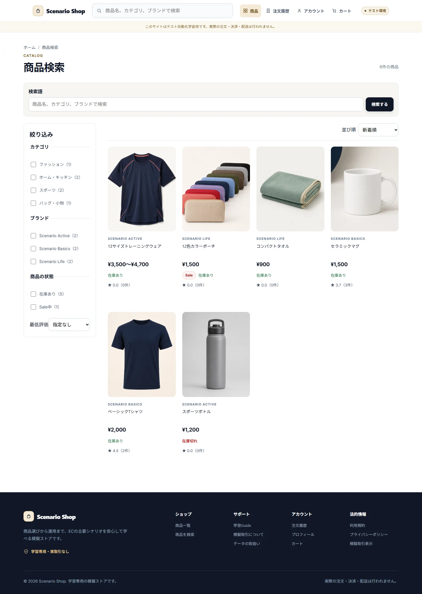](../assets/screens/SCREEN-STOREFRONT-SEARCH/default/web-desktop.webp)

###### Android — Canonical Visual Reference

[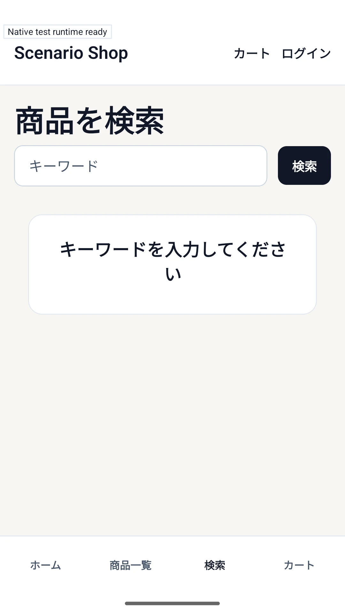](../assets/screens/SCREEN-STOREFRONT-SEARCH/default/android.webp)

##### `no-results`

###### Web Desktop

[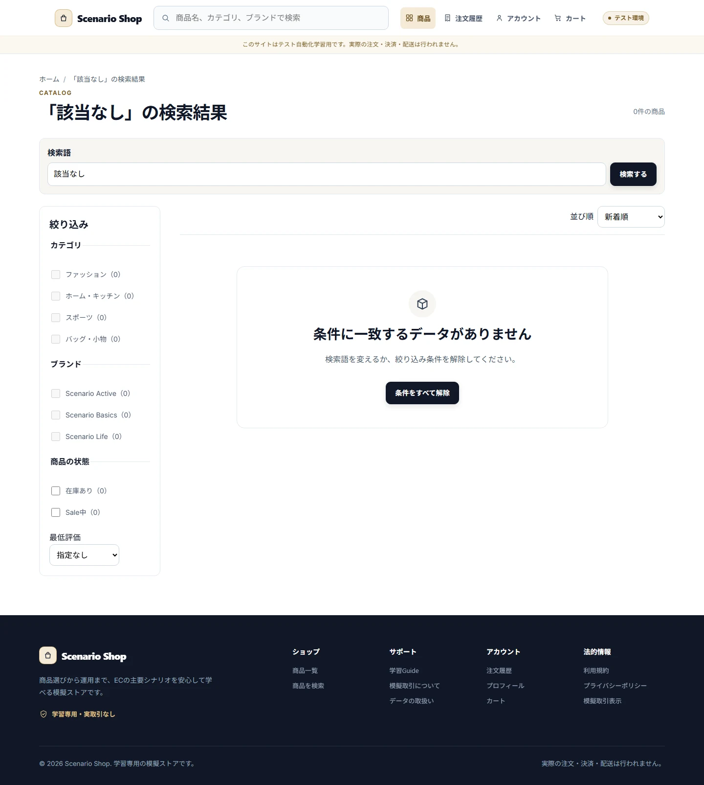](../assets/screens/SCREEN-STOREFRONT-SEARCH/no-results/web-desktop.webp)

### SCREEN-STOREFRONT-CATEGORY — Category

Screen Catalog: [Screen Catalog](../screen-catalog.md)

#### Functions

- 指定したカテゴリーに属する公開商品を一覧表示する。
- 閲覧者の条件（Viewer条件）に合致しない商品を表示結果に含めない。

#### Important UI States

| State slug | Type | Audience / Role | Condition / Scenario | Expected UI | Visual requirement | Required platforms | Visual detail | Related Oracle |
|---|---|---|---|---|---|---|---|---|
| `default` | baseline | `guest, customer, operator, admin` | `default` | カテゴリー名と対象商品の一覧を表示する。 | `required` | `web-desktop, android` | `-` | `BR-STOREFRONT-001`, `AC-STOREFRONT-001` |

#### Visual References

##### `default`

###### Web Desktop

[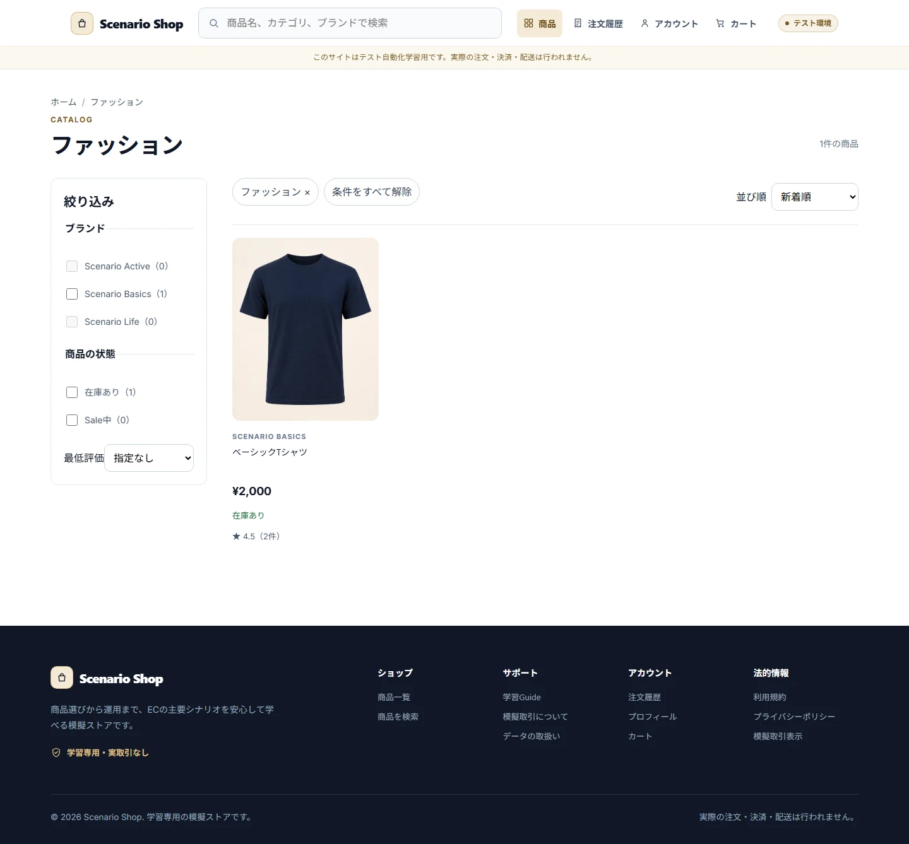](../assets/screens/SCREEN-STOREFRONT-CATEGORY/default/web-desktop.webp)

###### Android — Canonical Visual Reference

[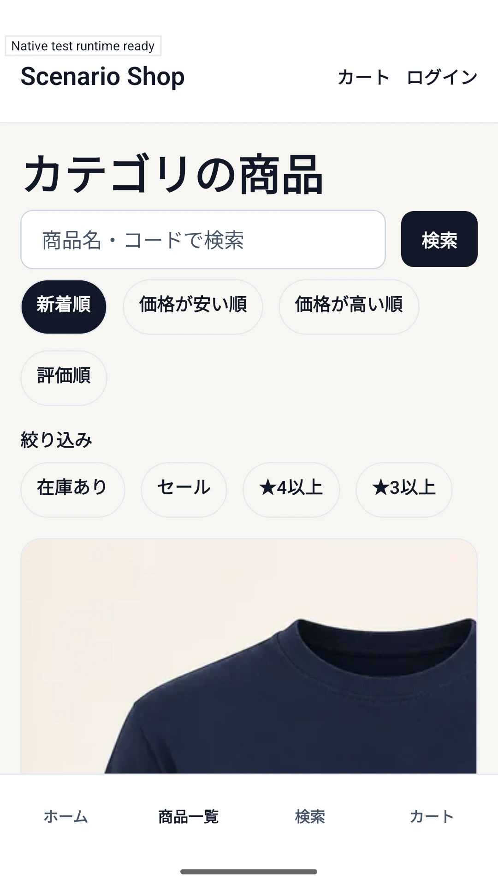](../assets/screens/SCREEN-STOREFRONT-CATEGORY/default/android.webp)

## Acceptance Criteria

### Criteria

#### AC-STOREFRONT-001 — 公開条件を満たさない商品を除外する

Related BR: `BR-STOREFRONT-001`

ゲスト（Guest）、顧客（Customer）、または会員ランク制限の異なる各閲覧者において、商品一覧・ホーム・商品詳細画面の表示結果が仕様（Normative条件）通りに一致すること。

#### AC-STOREFRONT-002 — FacetとPaginationが一貫する

Related BR: `BR-STOREFRONT-002`

閲覧者条件（Viewer条件）および選択されたフィルターを適用した際の、総件数（total）、ページ番号（page）、ファセット件数、および決定的なソート順（安定Sort）の整合性が保たれていること。

#### AC-STOREFRONT-003 — Variationと価格のBoundaryを表示する

Related BR: `BR-STOREFRONT-003`

セール期間外、在庫数0、バリエーション未選択、会員ランク別価格について、操作可否（活性／非活性）およびその理由の表示を含めて正しく確認できること。

## Executable Canonical Sources

- `src/application/use-cases/catalog-use-cases.ts`
- `src/domain/policies/permissions.ts`
- `src/domain/services/pricing.ts`
- `src/seeds/metadata.ts`
- `app/products/`, `app/search.tsx`, `app/categories/`