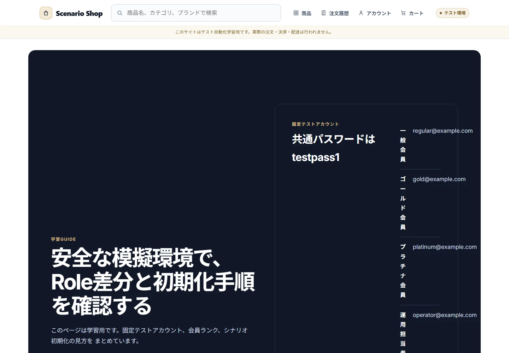
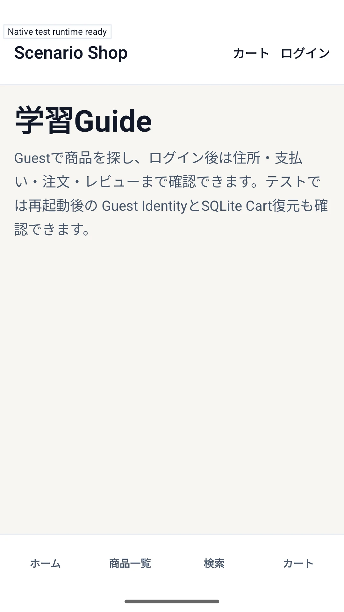
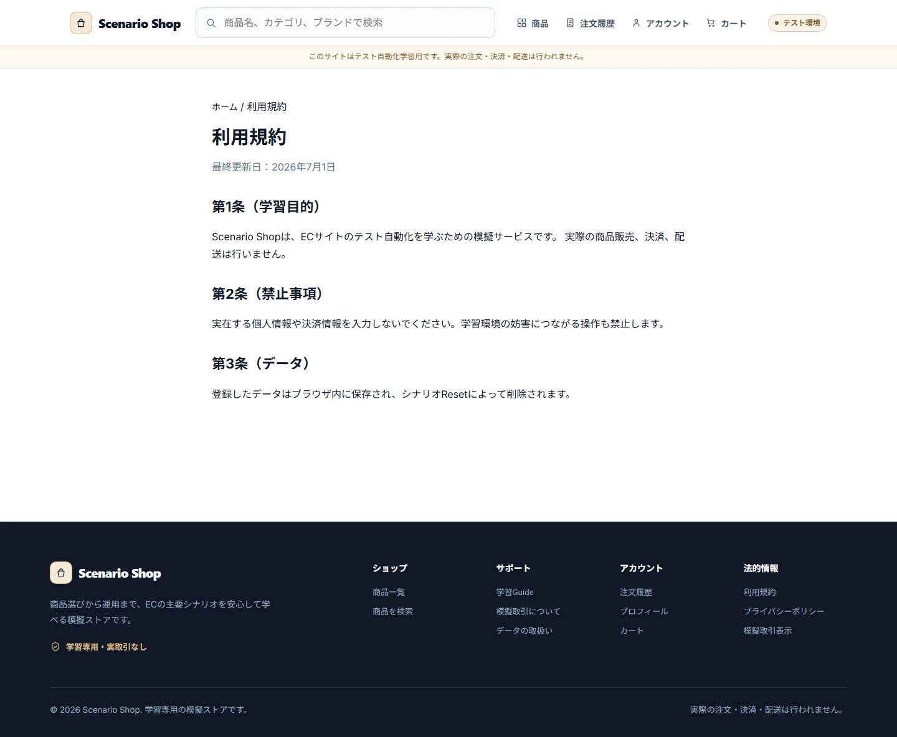
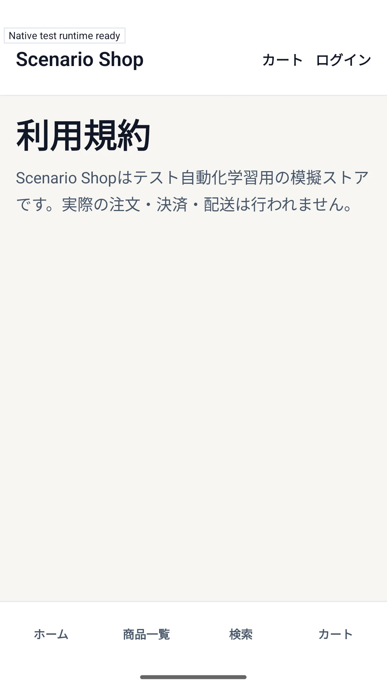
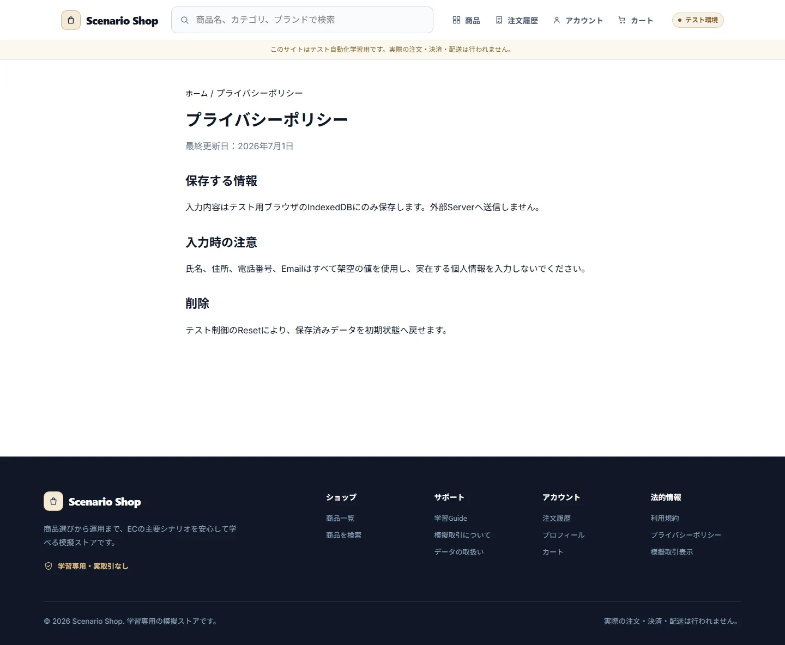
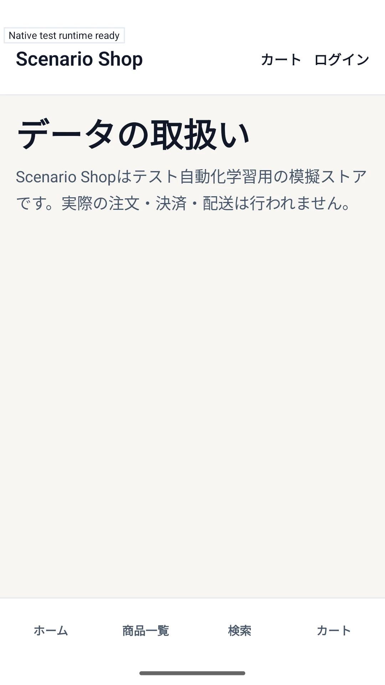
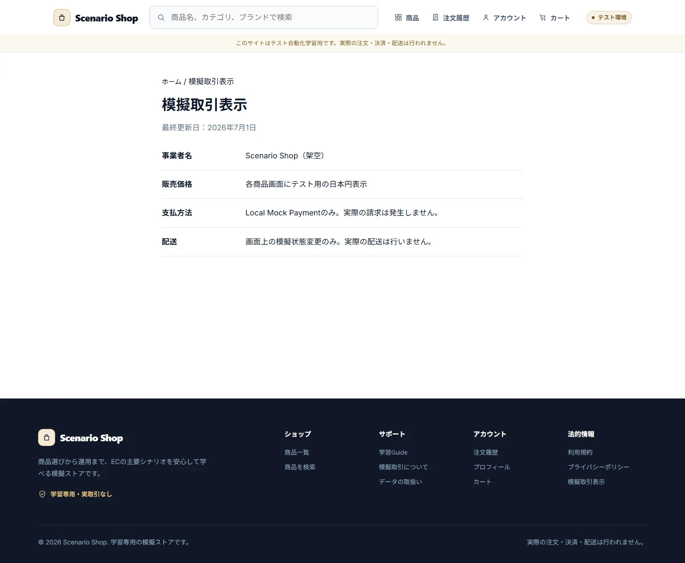
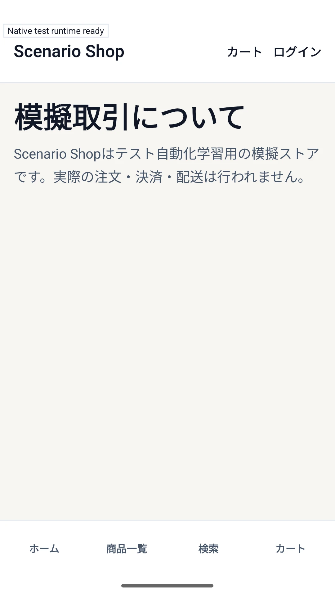

# Product Scope

## Current Product

Scenario Shopは、固定シードとローカルモックを活用し、ECストアフロントおよびSaaS型管理画面のQA（品質保証）を学習・検証するためのアプリケーションです。実際の商品の販売、決済、配送、および外部APIとの通信は行いません。

## Platforms

### Web

デスクトップWebおよびモバイルWebを正式な対象とします。ストアフロント、カスタマー購入導線、オペレーター／管理者用管理画面を提供します。管理操作はデスクトップ環境（画面幅1024px以上）を前提としており、表示領域（ビューポート）が狭い場合は専用の警告メッセージを表示します。

### Native

ネイティブアプリは、カスタマー向けのゲストストアフロント、カート、ログイン、アカウント、住所、チェックアウト、決済、注文、レビューを対象とします。ネイティブ環境での管理画面（Native Admin）およびゲストチェックアウトは対象外です。Androidはビルドおよびランタイム／Maestroによる自動テストを保証範囲とし、iOSは自動化・本番シミュレータビルド（Automation/Production Simulator Build）、ビルド時メタデータ、本番ガード、成果物検証（Artifact validation）を対象とするビルド限定（Build-only）契約とします。

## Included Behavior

- 商品の探索・検索、ファセット絞り込み（Facet）、価格、セール、在庫、バリエーション、レビュー要約（Review Summary）
- ゲスト／カスタマーカート、ログイン時のカート統合、チェックアウト、ローカルモック決済
- 注文スナップショット、決済結果、配送状況（Shipment）、カスタマーレビュー
- オペレーター／管理者による商品、カテゴリー、ブランド、在庫、注文、レビュー、ユーザーの管理
- シードリセット、固定クロック、決定論的な決済遅延（Payment Delay）、限定的なインスペクション
- レスポンシブ表示、キーボード操作、スクリーンリーダー対応、エラー／Empty／Loading／Conflict／Not Foundの各種状態表示

## Excluded Behavior

キャンセル・返品・返金（Cancel/Return/Refund）、決済状態不明・照合（Payment Unknown/Reconciliation）、ゲストチェックアウト、ネイティブ管理画面、インポート・エクスポート、マイグレーション復旧、クーポン、ポイント、お気に入り（Wishlist）、レコメンド、外部の決済・配送APIとの通信は、現行仕様（Current Specification）の期待される動作に含めません。

## Canonical Source Boundaries

本ドキュメントでは、システムの仕様上の意味と対象範囲を定義します。具体的なルーティングは `app/`、ロールやステータスの型定義は `src/domain/contracts/`、シードやシナリオは `src/seeds/metadata.ts` および `src/seeds/scenarios.ts`、デザイントークンは `src/presentation/design/tokens.ts`、ビルドおよびネイティブ設定は `app.config.ts` と `.github/workflows/` をそれぞれ参照してください。

## Screen Contracts

### SCREEN-SUPPORTING-GUIDE — Guide

Screen Catalog: [Screen Catalog](./screen-catalog.md)

#### Functions

- ゲスト、カスタマー、オペレーター、管理者が、Scenario Shopの利用方法、固定アカウント、ロール、会員ランク特典（Rank benefit）を確認できる。
- 仕様の読み方と、安全に初期状態へ戻すリセット機能への導線（入口）を表示する。

#### Important UI States

| State slug | Type | Audience / Role | Condition / Scenario | Expected UI | Visual requirement | Required platforms | Visual detail | Related Oracle |
|---|---|---|---|---|---|---|---|---|
| `default` | baseline | `guest, customer, operator, admin` | `default` | ガイド本文とロール別の導線を表示する。 | `required` | `web-desktop, android` | `-` | [Product Scope](./product-scope.md#current-product), [Roles and Permissions](./roles-and-permissions.md#roles) |

#### Visual References

##### `default`

###### Web Desktop

###### Android — Canonical Visual Reference

### SCREEN-SUPPORTING-TERMS — Terms

Screen Catalog: [Screen Catalog](./screen-catalog.md)

#### Functions

- 利用規約を閲覧できる。
- ストアフロントへ戻るナビゲーションを提供する。

#### Important UI States

| State slug | Type | Audience / Role | Condition / Scenario | Expected UI | Visual requirement | Required platforms | Visual detail | Related Oracle |
|---|---|---|---|---|---|---|---|---|
| `default` | baseline | `all` | `default` | 利用規約本文の入口とナビゲーションを表示する。 | `required` | `web-desktop, android` | `-` | [Product Scope](./product-scope.md#current-product), [UI and UX Contract](./ui-ux-contract.md#boundary-ux) |

#### Visual References

##### `default`

###### Web Desktop

###### Android — Canonical Visual Reference

### SCREEN-SUPPORTING-PRIVACY — Privacy

Screen Catalog: [Screen Catalog](./screen-catalog.md)

#### Functions

- プライバシーポリシーを閲覧できる。
- ストアフロントへ戻るナビゲーションを提供する。

#### Important UI States

| State slug | Type | Audience / Role | Condition / Scenario | Expected UI | Visual requirement | Required platforms | Visual detail | Related Oracle |
|---|---|---|---|---|---|---|---|---|
| `default` | baseline | `all` | `default` | プライバシーポリシー本文の入口とナビゲーションを表示する。 | `required` | `web-desktop, android` | `-` | [Product Scope](./product-scope.md#current-product), [UI and UX Contract](./ui-ux-contract.md#boundary-ux) |

#### Visual References

##### `default`

###### Web Desktop

###### Android — Canonical Visual Reference

### SCREEN-SUPPORTING-COMMERCE — Commerce

Screen Catalog: [Screen Catalog](./screen-catalog.md)

#### Functions

- 模擬取引の表示と、外部決済・配送を行わない対象範囲を閲覧できる。
- ストアフロントへ戻るナビゲーションを提供する。

#### Important UI States

| State slug | Type | Audience / Role | Condition / Scenario | Expected UI | Visual requirement | Required platforms | Visual detail | Related Oracle |
|---|---|---|---|---|---|---|---|---|
| `default` | baseline | `all` | `default` | 模擬取引の説明とナビゲーションを表示する。 | `required` | `web-desktop, android` | `-` | [Product Scope](./product-scope.md#current-product), [UI and UX Contract](./ui-ux-contract.md#boundary-ux) |

#### Visual References

##### `default`

###### Web Desktop

###### Android — Canonical Visual Reference

