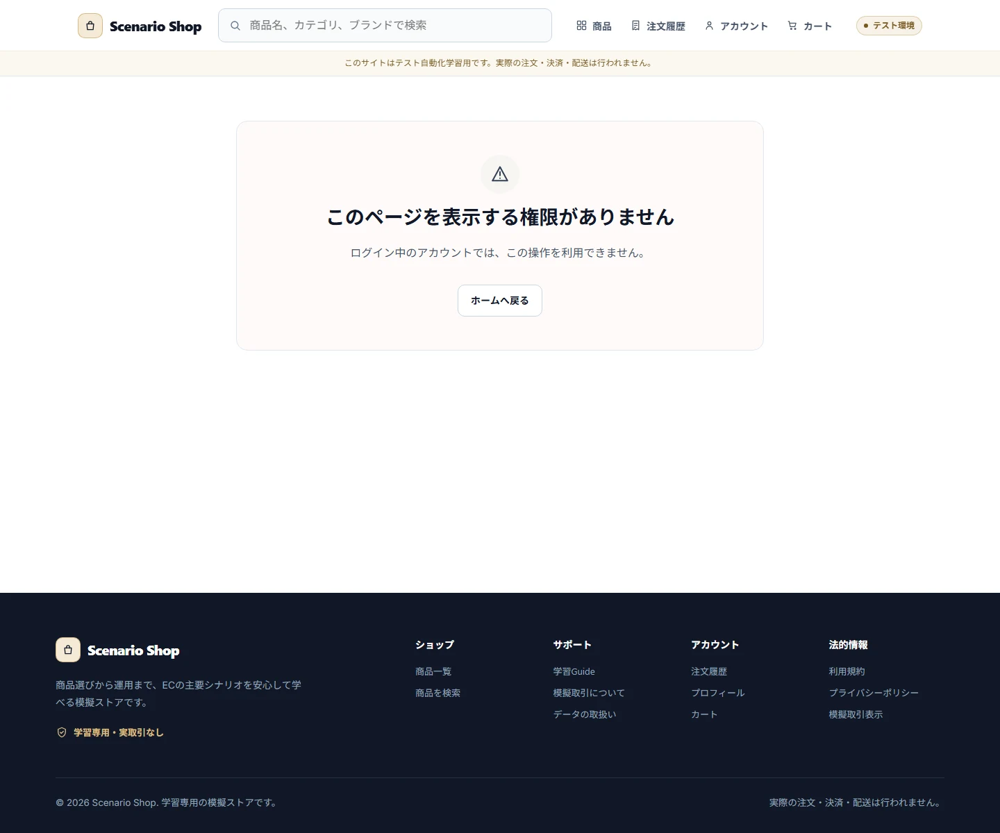
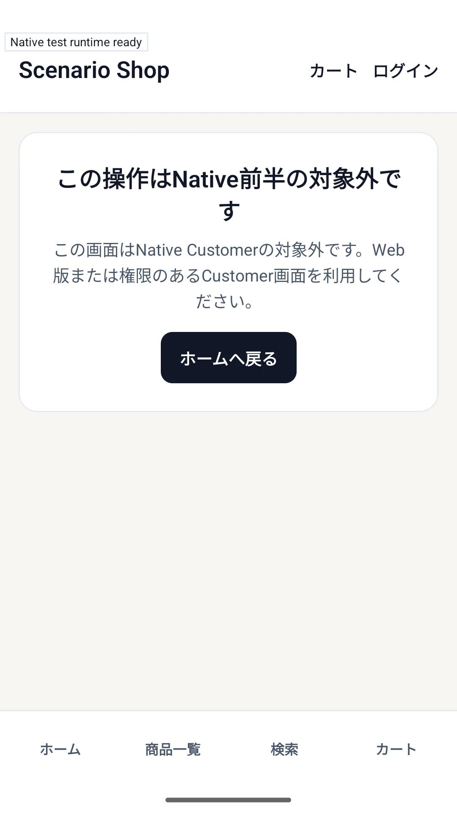

# ロールと権限

## ロール

| アカウント | ストアフロント | カート | チェックアウト | 顧客データ | ストア管理 | ユーザー管理 |
| ----- | ----- | ----- | ----- | ----- | ----- | ----- |
| ゲスト | 閲覧 | 〇 | × | × | × | × |
| 顧客（有効） | 閲覧 | 〇 | 〇 | 自身のみ | × | × |
| 顧客（停止／退会） | ログイン拒否 | セッションなし | × | × | × | × |
| オペレーター（有効） | ゲスト同等の閲覧 | × | × | × | 〇 | × |
| 管理者（有効） | ゲスト同等の閲覧 | × | × | × | 〇 | 〇 |

## 顧客ランク

権限水準は `regular`、`gold`、`platinum` の順に高くなります。ランク制限商品は、同等以上のランクを持つ顧客のみ閲覧できます。価格割引および配送料の適用条件は、現在のランクに基づいて商品単価ごとに計算します。具体的なランクの定義値は `src/domain/policies/permissions.ts` および価格計算ユースケースを正本とします。

## 認可制御

認可制御はUI上の表示制御にとどまらず、アプリケーションのユースケース層で確実に適用・強制します。顧客は自身のアカウント、配送先住所、注文履歴、レビューのみ操作できます。オペレーターおよび管理者はストア管理を行えますが、顧客向けの購入導線は利用できません。ユーザー管理を実行できるのは管理者のみです。

## アカウント状態

顧客のログインおよびチェックアウトが許可されるのは `active`（有効）状態のみです。`suspended`（停止）および `withdrawn`（退会）のアカウントはログインが拒否されます。管理画面などの操作で変更可能なアカウント状態の遷移は `active ↔ suspended` に限られ、`withdrawn` はシードデータとして固定された読み取り専用の状態です。

## 正本ソース

ロールやステータスの型定義は `src/domain/contracts/entities.ts`、認可ポリシーは `src/domain/policies/permissions.ts`、セッション管理およびルートガードは `src/application/` および `src/presentation/`、固定アカウントデータは `src/seeds/default-dataset.ts` を参照してください。

## 画面契約

### SCREEN-BOUNDARY-FORBIDDEN — アクセス拒否

画面カタログ: [画面カタログ](./screen-catalog.md)

#### 機能一覧

* ロールまたは権限の不足によりアクセスできないルートであることを説明する。

* 利用者が安全にストアフロントやアクセス可能な導線へ戻れるアクションを表示する。

#### 主要なUI状態

| 状態スラグ | 種別 | 対象者・ロール | 条件・シナリオ | 期待されるUI | 視覚要件 | 必須プラットフォーム | 視覚詳細 | 関連オラクル |
| ----- | ----- | ----- | ----- | ----- | ----- | ----- | ----- | ----- |
| `default` | baseline | `guest, customer, operator, admin` | `default` | 権限不足の説明と安全な戻り先を表示する。 | `required` | `web-desktop, android` | `-` | [ロールと権限](./roles-and-permissions.md#認可制御), [UI・UX契約](./ui-ux-contract.md#境界領域のユーザー体験) |

#### 画面リファレンス

##### `default`

###### Webデスクトップ

###### Android — 正本画面リファレンス

