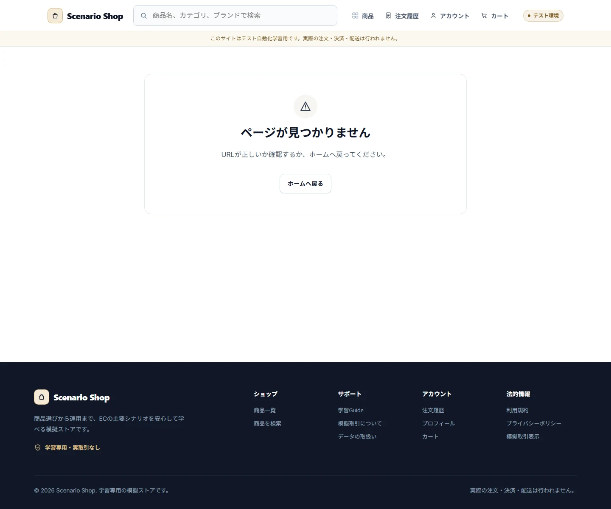
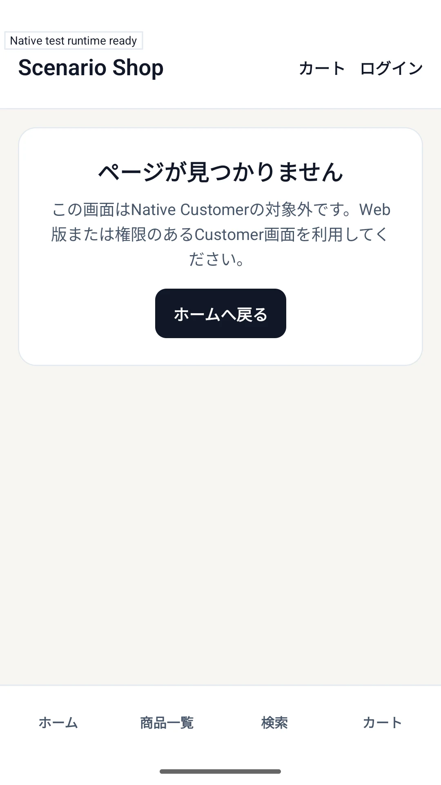

# UI and UX Contract

## レスポンシブ挙動（Responsive Behavior）

モバイルは767px以下、タブレットは768〜1023px、デスクトップは1024px以上を基本的なブレークポイント（境界値）とします。ストアフロント／カスタマー画面では、390×844を標準モバイル解像度とし、320×700を追加の検証境界として扱います。管理画面は1024px未満では管理操作を提供せず、警告または安全な画面への入口を表示します。

## ビジュアル言語（Visual Language）

画面はオフホワイト、ダークネイビー、限定ゴールドを基調とし、8pxグリッド、44px以上のタッチターゲット、ボーダー（枠線）を基調としたカードを使用します。カラー、タイポグラフィ、スペーシング、角丸（Radius）は `src/presentation/design/tokens.ts` と `src/presentation/styles/global.css` を正本とし、仕様書側ではその意味や利用目的のみを定義します。

## アクセシビリティ（Accessibility）

主要なフローはキーボード操作のみで完了できます。検索はコンボボックス、評価（レーティング）はラジオグループ、エラーサマリーは見出し（Heading）およびリンク、確認操作はダイアログ、フィルターは操作可能なシートとして実装します。エラーを色情報のみで伝えず、ラベル、ロール（Role）、テキストを併用します。ルート（画面）遷移後は、主要な見出しへフォーカスを移動させます。

## 境界領域のユーザー体験（Boundary UX）

ローディング、データなし（Empty）、エラー、コンフリクト（競合）、Not Found（未検出）の各状態を、同一の表示へとひとまとめに集約・混同させません。バリエーション未選択、在庫切れ、価格変更、ログイン拒否、チェックアウトのバージョン不一致、決済失敗、権限拒否の各状態では、利用者が次に実行可能なアクションを明示します。内部のEnum（列挙型）、リポジトリのバージョン、アクターID、ゲートウェイキーなどの内部情報を、カスタマーUIへ露出させません。

## 正本ソース（Canonical Sources）

具体的なラベル、テストID、ルート、トークン、コンポーネント構造については、`src/presentation/`、`app/`、`src/presentation/design/tokens.ts`、`docs/05_ui/` を参照してください。既存のテストコードはリグレッション（回帰）確認の記録であり、正式な仕様の判断基準ではありません。

## Screen Contracts

### SCREEN-BOUNDARY-NOT-FOUND — Not Found

Screen Catalog: [Screen Catalog](./screen-catalog.md)

#### Functions

- 存在しないルートであることを明示し、利用者がストアフロントへ戻るためのアクションを表示する。
- フレームワーク内部のエントリではなく、ユーザーが直接観測できる境界サーフェス（Boundary surface）として扱う。

#### Important UI States

| State slug | Type | Audience / Role | Condition / Scenario | Expected UI | Visual requirement | Required platforms | Visual detail | Related Oracle |
|---|---|---|---|---|---|---|---|---|
| `default` | baseline | `all` | `missing-route` | ページが見つからない旨（Page Not Found）と戻り先の導線を表示する。 | `required` | `web-desktop, android` | `-` | [UI and UX Contract](./ui-ux-contract.md#境界領域のユーザー体験boundary-ux), [State and Scenarios](./state-and-scenarios.md#error-and-boundary-states) |

#### Visual References

##### `default`

###### Web Desktop

###### Android — Canonical Visual Reference

